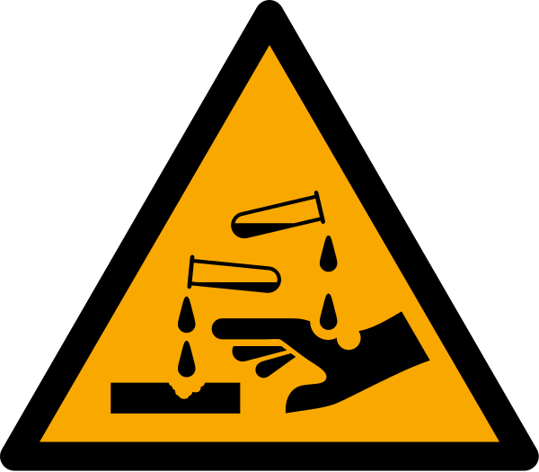
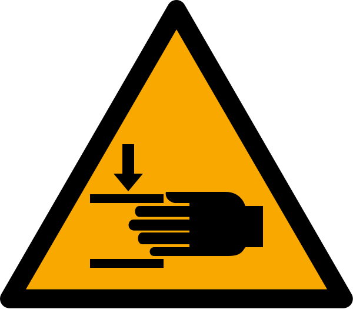
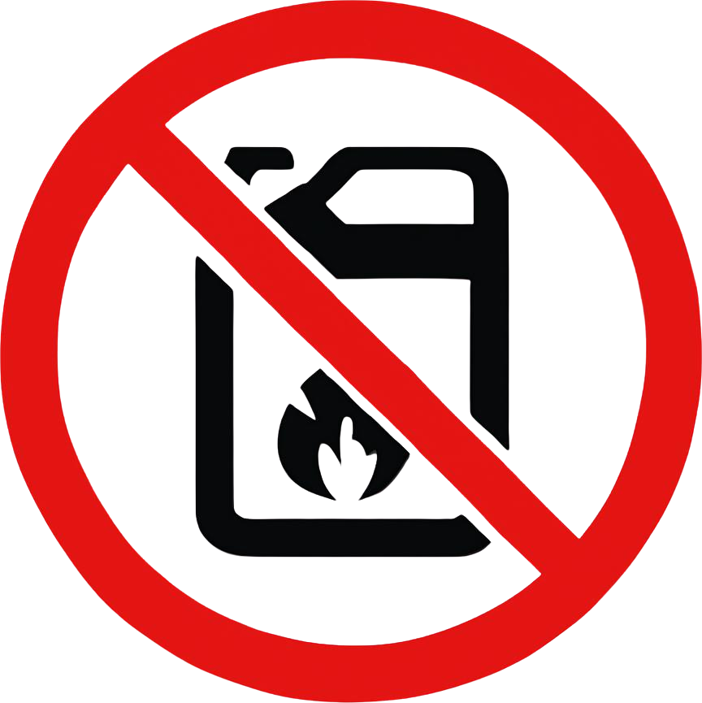
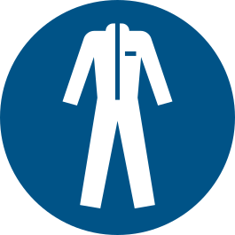

# 1.2 Semboller ve etiketleme kuralları

Bu kullanım kılavuzunda ve makine gövdesi üzerinde yer alan etiketler; operatör güvenliğini en üst düzeyde tutmak, olası riskleri belirtmek ve makinenin doğru kullanım koşullarını göstermek amacıyla uluslararası standartlara uygun olarak yerleştirilmiştir. 

Makineyi devreye almadan, bakım yapmadan veya galvanizli sepetler gibi ağır/sıcak parçalara müdahale etmeden önce aşağıdaki sembollerin anlamlarını ve zorunlu kıldığı eylemleri mutlaka inceleyin.

| Sembol (Etiket) | Kategori | Açıklama | Gerekli Eylem / Talimat |
| :---: | :---: | :---: | :--- |
|  | **Uyarı** | Genel Tehlike / Dikkat | Makine veya ekipman üzerinde potansiyel tehlike arz eden alanları belirtir. Çalışma alanında dikkatli hareket edin ve ilgili ek güvenlik talimatlarına uyun. |
|  | **Uyarı** | Sıcak Yüzey Temas Tehlikesi | Makine üzerinde veya çevresinde yüksek sıcaklığa ulaşan yüzeyler bulunmaktadır. Yanık riskine karşı bu noktalara sistem tamamen soğumadan çıplak elle temas etmeyin. |
|  | **Uyarı** | Aşındırıcı / Korozif Madde | Aşındırıcı kimyasalların bulunduğu veya kullanıldığı alanları belirtir. Kimyasallara doğrudan temas etmekten kaçının ve dökülme/sıçrama risklerine karşı önlem alın. |
|  | **Uyarı** | Ezilme / Sıkışma Tehlikesi | Hareketli mekanizmaların bulunduğu ve uzuvların sıkışma/ezilme riski taşıdığı alanları belirtir. Makine çalışırken koruyucu muhafazaları açmayın ve hareketli parçalardan uzak durun. |
|  | **Uyarı** | Kaygan Zemin Tehlikesi | Çalışma alanında sıvı dökülmesi veya sızıntı kaynaklı kaygan zemin riski bulunmaktadır. Düşme tehlikesine karşı dikkatli adımlarla ilerleyin. |
|  | **Yasak** | Parlayıcı Madde / Yanıcı Madde Yasaktır | Makine içerisinde veya çevresinde yanıcı, patlayıcı sıvıların ve açık alevin kullanımı kesinlikle yasaktır. Sadece üretici tarafından onaylanmış maddeleri kullanın. |
|  | **Zorunlu** | Kullanım Kılavuzuna Başvurun | Makineyi devreye almadan, işletime sokmadan veya herhangi bir bakım işlemi gerçekleştirmeden önce kullanım kılavuzunu bütünüyle okuyun ve talimatlara uyun. |
|  | **KKD** | İş Elbisesi Kullanımı Zorunlu | Operasyon ve bakım süreçlerinde potansiyel risklere karşı vücudu koruyacak uygun iş elbisesi veya koruyucu tulum giyilmesi zorunludur. |
|  | **KKD** | Çelik Burunlu Ayakkabı Zorunlu | Malzeme düşmesi, çarpma veya ezilme risklerine karşı çalışma alanında çelik burunlu koruyucu iş ayakkabısı kullanılması zorunludur. |
|  | **KKD** | Koruyucu Eldiven Kullanımı Zorunlu | Keskin kenarlı, sıcak veya kimyasal bulaşmış yüzeylere/parçalara müdahale ederken işin niteliğine uygun koruyucu eldiven kullanılması zorunludur. |
|  | **KKD** | Koruyucu Gözlük Kullanımı Zorunlu | Sıvı sıçraması, partikül fırlaması veya kimyasal buhar riskine karşı gözleri korumak amacıyla uygun koruyucu iş gözlüğü takılması zorunludur. |
|  | **KKD** | Solunum Maskesi Kullanımı Zorunlu | Havaya karışabilecek zararlı gaz, buhar veya partikül soluma riskine karşı, çalışma ortamına uygun filtreli solunum maskesi kullanılması zorunludur. |

> **Not:** Makine üzerindeki yıpranmış, sökülmüş veya okunmayan uyarı etiketlerini derhal yenileri ile değiştirin. Etiketsiz makine çalıştırmak iş güvenliği ihlalidir.
