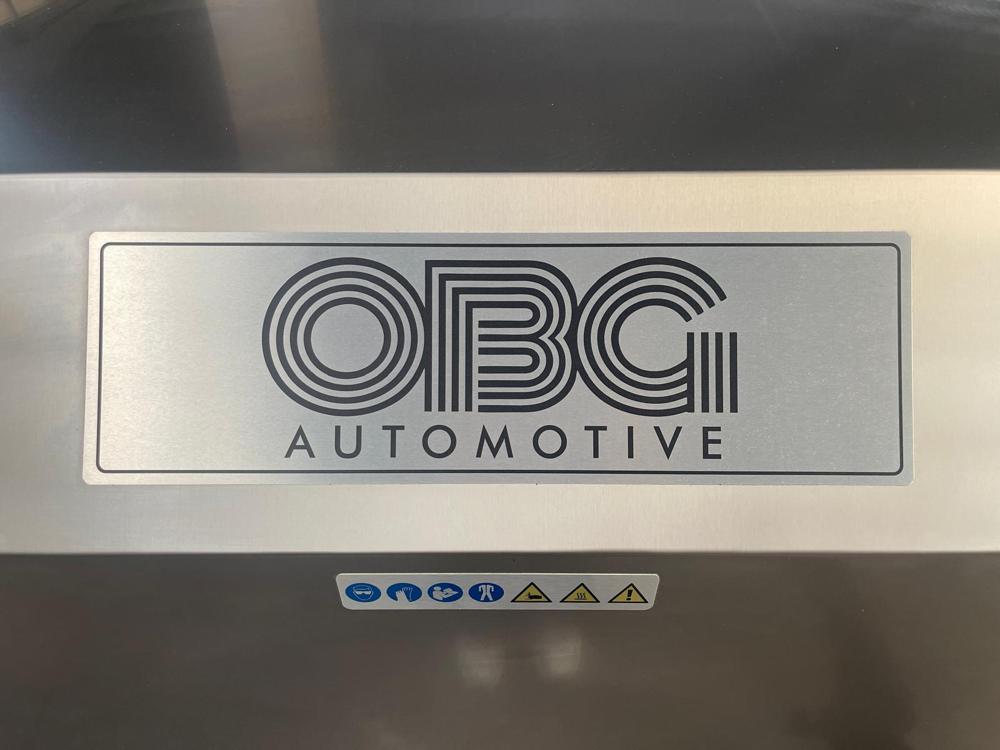

# 2.2 Residual risks and machine labels

An EN ISO 12100 risk assessment was applied at the design stage; the risks that could be reduced have been reduced by design (enclosed washing chamber, lid-closed switch, interlock lock, emergency stop, level switch, thermostat temperature limit, motor thermal protection). Nevertheless, **residual risks** remain that cannot be eliminated completely owing to the nature of the machine. Personnel must be aware of these risks, use the relevant PPE and comply with the matrix in **Chapter 2.6**.

The general meanings of the warning symbols are explained in **Chapter 1.2**; this section defines the machine-specific residual risks and the labels on the machine.

---

## 2.2.1 Residual risks

**Thermal risk — hot process water, steam and heating element**

The process water in the washing tank is heated by the electric heating element to a maximum of 70 °C (**See Chapter 3.4.8**). During washing, the inner surfaces of the chamber, the inner surface of the lid, the tank body and the pipework heat up, and they remain hot after the cycle has ended. When the lid is opened, the hot steam accumulated in the chamber rises towards the face; the washed parts and the basket come out hot. Contact with bare hands creates a risk of first- or second-degree burns. Keep your face away from the lid opening when opening the lid; unload the parts with heat-resistant gloves; wait for the process water to cool down before maintenance and cleaning.

**Mechanical risk — rotating basket, heavy parts and top lid**

The washing basket is driven by the basket gear motor throughout the cycle and while the TEST button is held down. A hand, arm or clothing can become trapped between the basket and the chamber wall (**See Chapter 3.4.5**). The interlock lock (option) locks the lid only for the duration of the washing cycle; on machines without an interlock, the lid can also be opened during the cycle. The lid is open while the basket is being rotated with the TEST button; intervening in the rotating basket causes serious injury. Load and unload parts only after the basket has come to a complete stop. There is a risk of crushing hands and feet when heavy parts are moved by hand or with the transport trolley (**See Chapter 7.4.1**).

The top lid is held in the open position by two gas springs. Gas springs lose gas pressure over time; with a gas spring that has lost its force, the lid can close on its own during loading or cleaning and cause injury to the hands, fingers and head. The gas springs are checked monthly, and the machine is not used until a gas spring that does not hold the lid in the open position has been replaced (**See Chapter 9.1.7**).

**Pressurised water spray**

The washing pump applies the process water to the parts under pressure through the nozzles on the spray arms. If the lid-closed switch or the interlock lock is disabled and the lid is opened during the cycle, water at up to 70 °C can spray onto the operator; there is a risk of scalding and eye injury. Never reach into the chamber while the pump is running.

**Chemical and liquid exposure**

The process water contains alkaline washing chemical, oil and dirt. There is a risk of splashing onto the skin or into the eyes when adding chemical, filling the tank, cleaning the pre-filter and the suction filter, replacing the bag filter, cleaning the oil skimmer and draining the tank. Water overflowing or dripping around the tank creates a slippery floor. Follow the precautions in the chemical manufacturer's safety data sheet (SDS); use the gloves and goggles specified in **Chapter 2.6**.

**Electrical risk**

The machine is supplied from a 380 V, 3-phase mains supply (**See Chapter 3.3.4**). The heating element is in contact with the water inside the tank; in the event of an insulation fault the residual current device interrupts the circuit, but intervening in the panel or the heating element connections on a wet floor can be fatal. The panel door is opened only by authorised electrical personnel; the **Chapter 2.4** LOTO procedure is mandatory before any intervention. The machine has no frequency inverter; after the main switch has been switched off, no work is carried out inside the panel until the absence of energy has been verified in accordance with **Chapter 2.4.2**. The insulation and protection integrity of the electrical equipment is verified by the annual electrical safety tests (**See Chapter 9.1.8**).

**Noise**

The noise level of the machine is specified as 50 dB(A) (**See Chapter 3.3.6**). This value is below the 80 dB(A) action level; hearing protection is not mandatory. The sound level may increase while the optional drying fan (blower type) is running; in that case the employer assesses the need for hearing protection in accordance with workplace noise legislation.

**Steam and environment**

The steam generated in the chamber during washing is released into the surroundings through the two steam vent outlets on the side surfaces of the chamber; on machines with a steam extraction fan, the fan forces the steam into the extraction duct. Steam also escapes from the chamber when the lid is opened. In an inadequately ventilated space, visibility is reduced, the floor becomes slippery and condensation can form inside the panel. The installation area must be ventilated in accordance with **Chapter 3.3.6**; the vent outlets must not be obstructed.

---

## 2.2.2 Warning labels on the machine

The pictograms on the machine body and the electrical panel comply with ISO 7010; the meaning of the symbols is given in **Chapter 1.2**. Removing, painting over or rendering labels illegible is prohibited. Replace worn labels immediately (**See Chapter 1.3**); do not operate a machine without its labels. The written labels on the machine (panel, interlock lock) are in English.

*Figure 2.1 — Top lid: OBG Automotive brand plate and the pictogram strip below it (mandatory PPE symbols and hazard warnings)*

| Label / symbol | Location | Required action |
| :--- | :--- | :--- |
| Type plate (OBG Automotive, LYM 1150 NS, serial no. 0226087) and CE marking | Right-hand side surface, rear lower corner | State the information on the plate in service and spare part requests (**See Chapter 1.3, 3.3**) |
| Pictogram strip — mandatory: protective goggles, protective gloves, read the manual, protective clothing; warning: hand entrapment, hot surface, general hazard | Front of the top lid, below the brand plate | Use the PPE in **Chapter 2.6**; open the lid only after the cycle has ended and the basket has stopped |
| **HIGH VOLTAGE** (yellow triangle) | Electrical panel door (right-hand side) | Authorised electrical personnel only; apply LOTO (**See Chapter 2.4**) |
| **EMERGENCY STOP** | Front of the electrical panel, at the top | **See Chapter 2.5** |
| Control element labels (WASHING, TIMER, BASKET ROTATION, RESET, HEATER, THERMOSTAT, OIL SEPERATOR, fault lamps, POWER) | Front of the electrical panel | **See Chapter 3.4** |
| Interlock lock instruction label ("FOR INTERLOCK TO ACTIVATE … TAKE IT TO THE 'LOCK' POSITION") | Left-hand side surface, interlock lock box (option) | Set the lock to the LOCK position after installation (**See Chapter 5.4.1**) |
| Manufacturer details (CNK Elektronik Makine San. A.Ş., address, telephone) and CE marking | Front of the electrical panel, at the bottom | **See Chapter 1.3** |
| Protective earthing label (TOPRAKLAMA = earthing, yellow) | Inside of the electrical panel door (**See Figure 5.3**) | Do not disconnect the earthing connection (**See Chapter 5.3.1**) |
