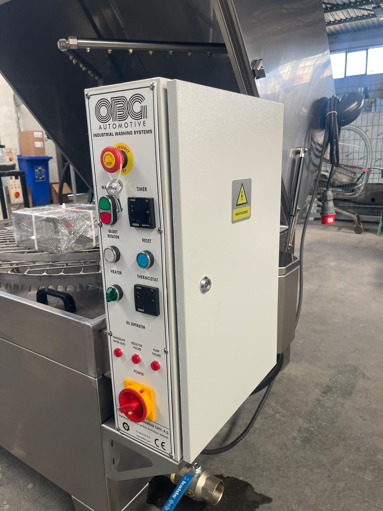

# 2.3 General operational safety rules

The following rules apply at all stages of use of the machine. In the event of a violation, stop the machine; do not put it back into operation until the safety conditions have been met.

1. Do not operate the machine without having read the manual and received training (**See Chapter 1.1.3**).
2. Do not disable or bridge the safety equipment (emergency stop, lid-closed switch, interlock lock, level switch, thermostat temperature limit, thermal overload relays).
3. Open the lid only after the washing cycle has ended and the basket has come to a complete stop; keep your face away from the opening when opening the lid (**See Chapter 7.4.3**).
4. Do not reach into the chamber with a hand, arm or tool while the basket is rotating (during the cycle or while the TEST button is held down) (**See Chapter 3.4.5**).
5. Do not give a START command while the RESET lamp is off (safety circuit open); rectify the cause first (**See Chapter 2.5, 11.1**).
6. Do not switch on the heater switch or start a cycle when there is insufficient water in the tank; if the red low water level lamp (INADEQUATE WATER LEVEL) is lit, fill the tank (**See Chapter 7.2**).
7. Do not load the basket above its maximum loading capacity; position the parts so that they do not protrude beyond the basket or strike the spray arms (**See Chapter 7.4.1**).
8. Put only approved, water-based alkaline washing chemical into the tank; do not use acid-based, solvent-containing or flammable liquids (**See Chapter 3.2.2, 10.1.5**).
9. Keep the electrical panel door closed during operation; only authorised electrical personnel work inside the panel, under LOTO (**See Chapter 2.4**).
10. Do not spray water around the machine or onto the panel; do not direct water at the electrical panel, the digital displays, the lid switch or the interlock lock box area (**See Chapter 10.1.6**).
11. Clean up water collecting around the tank and slippery floors immediately; wear non-slip safety footwear (**See Chapter 2.6**).
12. Do not work with gas springs that do not hold the lid in the open position; if you have to work under the lid while holding it open, secure the lid with a support (**See Chapter 9.1.7**).
13. In an emergency, press the emergency stop (EMERGENCY STOP) button on the panel (**See Chapter 2.5**).

---

# 2.4 Hazardous energy control — LOTO (lockout and tagout)

**WARNING — Unexpected start-up and energy-related injury:** During maintenance or cleaning carried out without LOTO, the machine can start up accidentally; crushing by the rotating basket, electric shock from the heating element and the panel, and scalding by hot process water can occur. Isolate, lock out and tag out all energy sources.

This procedure is applied before mechanical maintenance, electrical intervention, filter and tank cleaning, nozzle and heating element checks, pump and gear motor intervention and all similar work. Other chapters only give the reference **See Chapter 2.4**; the steps are not repeated.

As this machine has no HMI, the absence of energy is verified **physically**: the RESET lamp and the fault lamps are off, and no motor runs when the START and TEST buttons are pressed.

## 2.4.1 Scope and energy sources

| Energy type | Source | Isolation point |
| :--- | :--- | :--- |
| Electrical | 380 V, 3-phase mains supply (**See Chapter 3.3.4**) | **Main switch (POWER)** on the front of the electrical panel — the **0 (OFF)** position can be locked with a padlock (**See Chapter 3.4.1**) |
| Thermal | Washing tank heating element; process water at up to 70 °C, hot chamber and tank surfaces | Heater switch to **0**, then main switch OFF; cooling time before intervention |
| Mechanical | Basket gear motor and rotating basket; washing pump; optional fan, oil skimmer and drain pump motors | Electrical isolation; wait for the basket and the fans to come to a complete stop |
| Water / process liquid | Process water in the tank (contains chemical) | Tank draining — drain valve at the lower right front or drain pump (**See Chapter 10.1.4**); there is no fixed water inlet, the tank is filled manually (**See Chapter 3.3.5**) |
| Potential (gravity) | Top lid with gas springs | Leave the lid in the fully open position; if you are not sure of the gas spring force, secure the lid with a support (**See Chapter 9.1.7**) |
| Pneumatic | None — the machine does not use compressed air | Not applicable |
| Hydraulic | None | Not applicable |
| Stored electrical | No stored energy source other than the 24 V DC power supply inside the panel; no inverter | Verification after main switch OFF (steps below) |

## 2.4.2 LOTO application procedure

**Preparation**

1. Determine the scope and duration of the maintenance or intervention.
2. Inform the personnel affected; announce that work is being carried out on the machine.

**Stopping the machine**

3. End the washing cycle in progress with the red **STOP** button; wait for the basket to come to a complete stop (**See Chapter 7.3**).
4. Set the heater switch (HEATER) and, where fitted, the oil skimmer switch (OIL SEPERATOR) to position **0**.
5. If there is a hazardous situation, press the emergency stop button (**See Chapter 2.5**).

**Energy isolation**

6. Turn the **main switch (POWER)** on the front of the electrical panel to position 0 (OFF).
7. Fit your personal **padlock** to the switch.
8. Hang a **LOTO tag** on the padlock; the tag must show your name, the date and the words "Do not operate — maintenance".
9. If work is to be carried out inside the tank or the chamber, wait for the process water to cool to a safe temperature; if necessary, drain the tank through the drain valve (**See Chapter 10.1.4**).
10. Open the lid latch, bring the lid to the fully open position and check that the gas springs hold the lid; if work is to be carried out under the lid, secure the lid with a support.

**Verification**

11. Verify that the RESET lamp and the fault lamps on the panel are completely **off**.
12. Press the **START** button; verify that the washing pump does not run.
13. Press the **TEST** button; verify that the basket does not rotate. If any motor runs, assume that the supply has not been disconnected; do not enter the panel, call authorised electrical personnel.
14. Check that there is no movement or noise in the basket, pump and, where fitted, optional motor areas.
15. Do not remove any guard and do not start the intervention until verification has been completed.

**After the intervention**

16. Refit all removed guards, covers and connections; remove tools and materials from the chamber and the tank.
17. Close the lid and close the latch; check that the lid-closed switch is aligned with the lid.
18. The LOTO padlock and tag are removed **only by the authorised person who fitted the padlock**.
19. Set the main switch to position 1 (ON); press the **RESET** button until its lamp lights (**See Chapter 2.5**).
20. If work has been carried out on the safety circuit (emergency stop, lid switch, interlock, level switch), repeat the safety function tests (**See Chapter 5.4.2**); then carry out the start-up procedure (**See Chapter 7.2**).

**DANGER — Multiple personnel:** If more than one person is working on the same machine, each person fits their own padlock to the main switch; no padlock is removed until the last person has finished.

The lid-closed switch and the interlock lock are not bypassed; the switch may not be bridged or removed. The lid is opened for maintenance only after LOTO has been applied. The main switch is the red-and-yellow rotary switch at the bottom of the panel front (**POWER**; **See Figure 3.7**).

---

# 2.5 Emergency stop (E-Stop) and reset

The machine has **1** emergency stop button: at the top of the front of the electrical panel, labelled **EMERGENCY STOP**, red mushroom-head, latching type (**See Chapter 3.4.2**). The panel is on the right-hand side of the washing chamber, in a position accessible from the operator area.

When the emergency stop button is pressed, all functions of the machine (basket gear motor, washing pump, heater and, where fitted, optional motors) stop with a category 1 stop; the button latches in the pressed position and the blue **RESET** lamp goes out. No function can be restarted without reset acknowledgement. The emergency stop is used only in the event of imminent danger; in normal operation, use the red STOP button to end the cycle. Frequent use of the emergency stop causes premature wear of the safety circuit components.

*Figure 2.2 — Front of the electrical panel: EMERGENCY STOP button (top) and blue RESET button; HIGH VOLTAGE label on the panel door*

**Situations in which the emergency stop is to be used**

- Risk of entrapment, falling or impact that threatens life; danger of contact with the rotating basket
- Opening of the lid during the washing cycle, or hot water spraying out of the chamber
- Sudden noise of mechanical failure, severe vibration from the pump or the gear motor, major leak in the tank or the pipework
- Electric arc, smoke, burning smell or abnormal heating from the heating element

A low water level or the tripping of a thermal overload relay already stops the machine; these are not reasons for an emergency stop. In these cases, follow the diagnostic steps in **Chapter 11**.

**Reset procedure**

1. Eliminate the physical threat; make the source of the entrapment, leak or fault safe.
2. **Release** the pressed emergency stop mushroom head (EMERGENCY STOP) by turning it in the direction of the arrow.
3. Verify that the lid is closed and aligned with the lid-closed switch, and that there is sufficient water in the tank.
4. Press and hold the blue **RESET** button on the panel **until the lamp lights**. Releasing the emergency stop alone is not sufficient; the operator acknowledges with the reset that the machine has been brought to the safe state.
5. If the RESET lamp does not light, check the low water level lamp and follow the diagnostic sequence in **Chapter 11.1**; do not give a START command until the lamp lights.
6. Do not restart the cycle until the hazard has been completely eliminated; the start-up sequence is as described in **Chapter 7.2**.

The reset procedure restores the safety function; giving a start command before the fault has been rectified leads to a further stop or to damage. The emergency stop function test is repeated during installation, after every repair on the safety circuit and **once a year** together with the annual electrical safety tests (**See Chapter 5.4.2, 6.2, 9.1.8**).

---

# 2.6 Personal protective equipment (PPE)

The employer is obliged to provide task-based PPE and to supervise its use. The following matrix defines the minimum requirements; if local legislation or the chemical manufacturer's safety data sheet (SDS) imposes stricter requirements, those apply. The meaning of the symbols is given in **Chapter 1.2**; the pictogram strip on the machine lid makes the use of protective goggles, gloves and clothing mandatory (**See Chapter 2.2.2**).

| Task | Work clothing | Steel-toe-capped footwear | Gloves | Protective goggles | Respiratory protection |
| :--- | :---: | :---: | :---: | :---: | :---: |
| Panel operation (start / stop / reset / settings) | ✓ | ✓ | — | — | — |
| Loading and unloading parts (with the lid open, into the basket or onto the transport trolley) | ✓ | ✓ | ✓ (heat-resistant — parts and basket are hot) | ✓ (steam and splash risk) | — |
| Manual tank filling, adding water and chemical | ✓ | ✓ (non-slip) | ✓ (chemical-resistant) | ✓ | — |
| Cleaning the pre-filter, suction filter and bag filter; cleaning the oil skimmer | ✓ | ✓ (non-slip) | ✓ (liquid-proof, chemical-resistant) | ✓ | Filtered mask if required |
| Tank draining, disinfection and use of cleaning chemical | ✓ (liquid-proof apron) | ✓ (non-slip) | ✓ (chemical-resistant, long-cuff) | ✓ (fully enclosed) | Filtered mask if required |
| Mechanical maintenance (pump, gear motor, nozzles, gas springs) | ✓ | ✓ | ✓ (cut-resistant) | ✓ | — |
| Electrical panel intervention and electrical safety tests (with LOTO) | ✓ (cotton, flame-resistant) | ✓ (insulating sole) | Insulating (during measurements) | ✓ | — |
| Working near the hot tank and heating element | ✓ | ✓ | ✓ (heat-resistant) | ✓ | — |

**CAUTION — Slippery floor:** In the event of a leak or overflow around the tank, non-slip footwear and careful movement are mandatory (**See Chapter 10**).

**CAUTION — Hot parts and steam:** At the end of the cycle the basket, the parts and the inner surface of the lid are hot; steam rises when the lid is opened. Wear heat-resistant gloves and protective goggles when unloading; keep your face away from the lid opening.

Short-term visitors must be briefed by the employer and equipped with the minimum PPE (safety footwear, goggles) before entering the operator area.
