# 3.1 Makine tanımı ve çalışma prensibi

LYM 1150, endüstriyel parça yüzeylerinde bulunan yağ, gres, talaş, karbon kalıntısı ve benzeri işletme kirlerinin giderilmesi amacıyla tasarlanmış, üstten yüklemeli ve döner sepetli bir parça yıkama makinesidir. Makine; talaşlı imalat, döküm, presleme ve bakım-onarım süreçlerinden gelen parçaların kaplama, boyama, kaynak veya montaj gibi bir sonraki işleme hazırlanmasında kullanılır. Bu kılavuzun konusu olan makine, OBG Automotive için üretilen **LYM 1150 NS** (seri no **0226087**, üretim yılı 2026) makinesidir; makine gövdesi ve kumanda panosu OBG Automotive markasını taşır, üreticisi CNK Elektronik Makine Sanayi AŞ'dir (**Bkz. Bölüm 1.3**).

Temizleme işlemi; ısıtılmış proses suyunun, kendi ekseni etrafında dönen sepet içindeki parçalara püskürtme kolları üzerindeki nozullar aracılığıyla basınçlı olarak uygulanmasıyla gerçekleştirilir. Isının çözücü etkisi, proses kimyasalının kir bağlarını zayıflatıcı etkisi ve püskürtülen suyun mekanik çarpma etkisi birlikte çalışarak kirlerin parça yüzeyinden ayrılmasını sağlar. Sepetin dönmesi, parçanın tüm yüzeylerinin püskürtme alanından sırayla geçmesini ve yıkama sonucunun parça konumundan bağımsız olarak tutarlı olmasını sağlar.

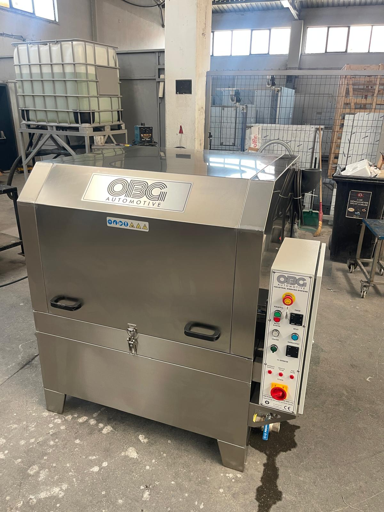

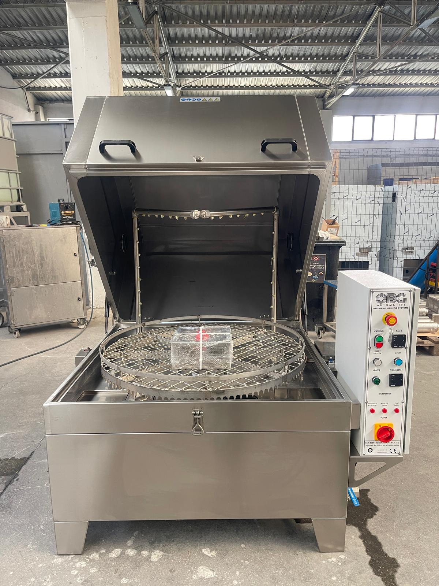

*Şekil 3.1 — LYM 1150 NS genel görünüş: kapak kapalı (solda) ve kapak açık (sağda)*

Makinenin ön yüzünde üst kapak, iki kapak tutamağı ve kapak mandalı; sağ tarafında elektrik ve kumanda panosu bulunur. Makine dört sabit ayak üzerinde durur. Kapak üzerindeki marka plakasının altında, zorunlu KKD ve tehlike piktogramlarını gösteren etiket şeridi yer alır (**Bkz. Bölüm 2.2.2**).

## 3.1.1 Ana bileşenler

Makine aşağıdaki ana bileşenlerden oluşur. Bileşenlerin teknik değerleri **Bölüm 3.3**'te, kumanda elemanları **Bölüm 3.4**'te verilmiştir.

| Bileşen | Konum ve işlev |
| :--- | :--- |
| **Yıkama hücresi** | Döner sepetin, püskürtme kollarının ve nozulların bulunduğu, üst kapakla kapatılan paslanmaz çelik kabin. Yıkama işlemi bu kapalı hacim içinde gerçekleştirilir. |
| **Üst kapak** | Yıkama hücresine parça yüklenmesini ve boşaltılmasını sağlar. Arkadaki iki menteşe üzerinde açılır; iki gazlı amortisör kapağın açılması için gereken kuvveti azaltır ve kapağı açık konumda tutar. Ön ortadaki mandal kapağı kapalı konumda tutar; iki tutamak kapağın açılıp kapatılmasında kullanılır. |
| **Döner yıkama sepeti** | Yıkanacak parçaları taşıyan paslanmaz çelik tel örgü disk. Çevresindeki dişli çember üzerinden sepet redüktörü tarafından döndürülür ve tank üzerindeki plastik taşıyıcı makaralar üzerinde döner. |
| **Sepet redüktörü** | Sepeti sabit devirde döndüren elektrik motorlu dişli kutusu; yıkama hücresinin sağ yan yüzeyindeki paslanmaz muhafaza içinde yer alır. Aşırı yük durumunda termik röle ile korunur. |
| **Yıkama pompası** | Tanktaki proses suyunu emerek püskürtme kollarına basınçlı olarak ileten paslanmaz gövdeli santrifüj pompa. Makine şasesinin arka bölmesinde yer alır. |
| **Püskürtme kolları ve nozullar** | Kapak iç yüzeyine bağlı U biçimli paslanmaz boru çerçeve: üst yatay kol ve iki yan dikey kol üzerindeki toplam 45 nozul, basınçlı proses suyunu parça yüzeyine yönlendirir. |
| **Yıkama tankı ve ısıtıcı** | Proses suyunun depolandığı, yıkama hücresinin altındaki tank. Tank içindeki elektrikli rezistans suyu termostatta ayarlanan sıcaklığa getirir. |
| **Filtreler** | Hücre tabanının sol ön köşesindeki ön filtre ve tank içindeki delikli silindirik emiş filtresi, kaba partiküllerin pompaya ve nozullara ulaşmasını önler. |
| **Seviye bekçisi** | Tanktaki su seviyesini izler; seviye güvenli sınırın altına düştüğünde ısıtıcıyı ve pompayı devre dışı bırakır. |
| **Kapak kapalı switchi** | Yıkama hücresinin sağ üst kenarında, elektrik panosunun yanında. Üst kapağın kapalı olduğunu algılar; kapak kapalı değilse yıkama çevrimi başlatılamaz. |
| **Interlock kilit (opsiyon)** | Yıkama hücresinin sol yan yüzeyinde, kapak kenarının altında. Yıkama çevrimi süresince kapağı kilitler (**Bkz. Bölüm 5.4.1**). |
| **Buhar tahliye çıkışları** | Yıkama hücresinin sol ve sağ yan yüzeylerinin üst kısmında birer adet 3" PVC dirsek. Hücrede oluşan buharın dışarı verilmesini sağlar; buhar tahliye fanı opsiyonunda tahliye bu çıkışlardan fan ile yapılır. |
| **Tahliye vanası** | Makinenin sağ ön alt kısmında, elektrik panosunun altındaki 2" küresel vana. Tankın boşaltılmasında kullanılır (**Bkz. Bölüm 10.1.4**). |
| **Elektrik ve kumanda panosu** | Yıkama hücresinin sağ tarafına monte edilmiş kapaklı pano. Ön yüzünde ana şalter, acil stop, kumanda butonları, zamanlayıcı, termostat ve arıza lambaları bulunur; içinde koruma elemanları ve röleler yer alır. Makine, PLC veya HMI içermeyen röle tabanlı bir kumanda sistemiyle çalışır. |

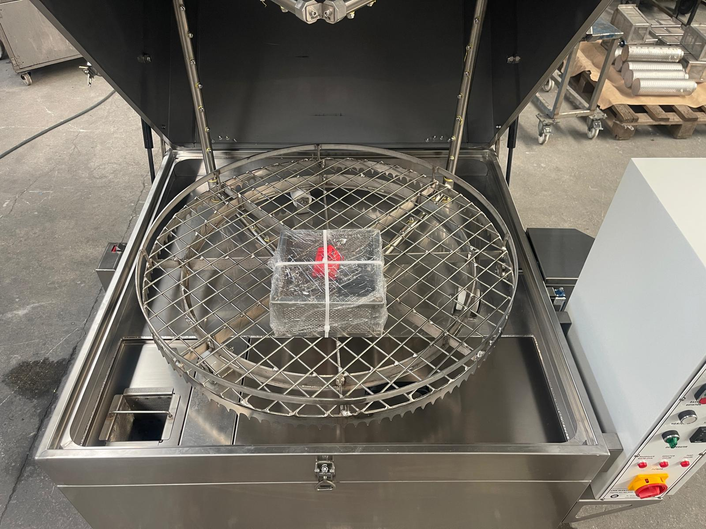

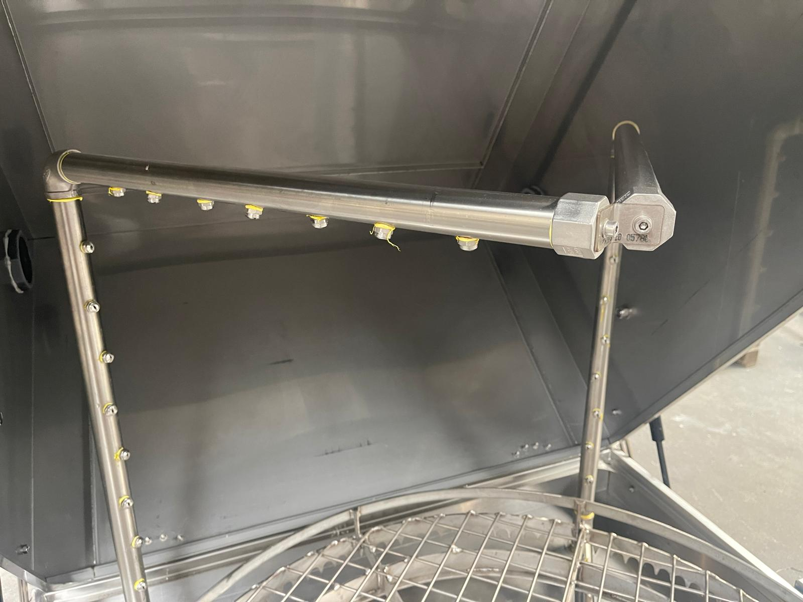

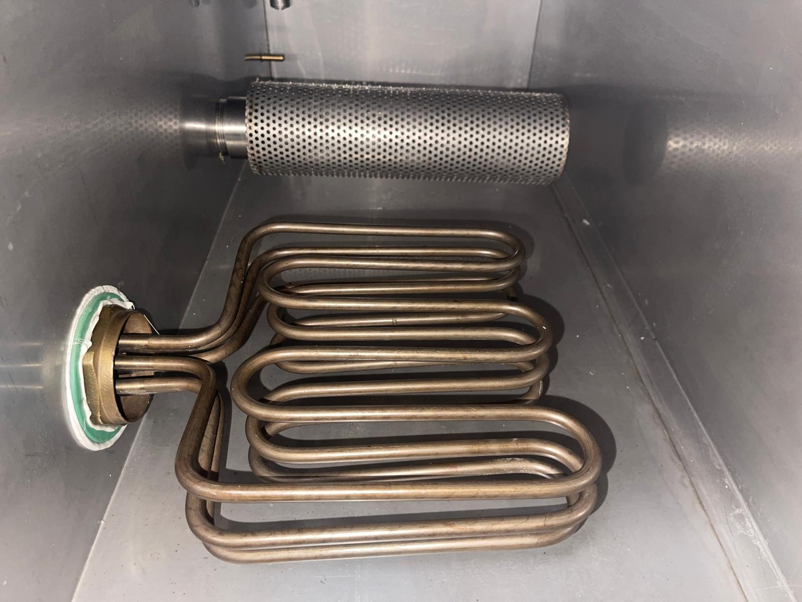

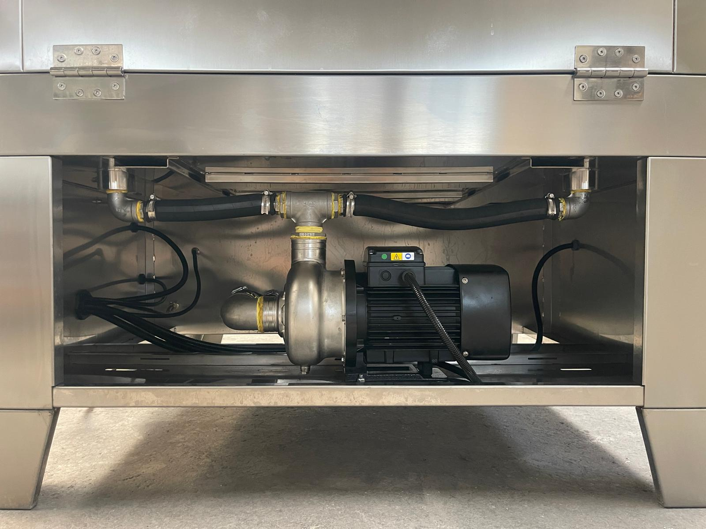

*Şekil 3.2 — Ana bileşenler: yıkama hücresi ve döner sepet (sol üst), püskürtme kolu ve nozullar (sağ üst), tank içindeki emiş filtresi ve rezistans (sol alt), arka bölmedeki yıkama pompası ve bağlantı boruları (sağ alt)*

Döner sepet, çevresindeki dişli çember ile tahrik edilir ve tank üzerine yerleştirilmiş plastik taşıyıcı makaralar üzerinde döner. Kapak, ön ortadaki mandal ile kapalı konumda tutulur; yıkama çevrimi başlatılmadan önce mandal kapatılmalıdır.

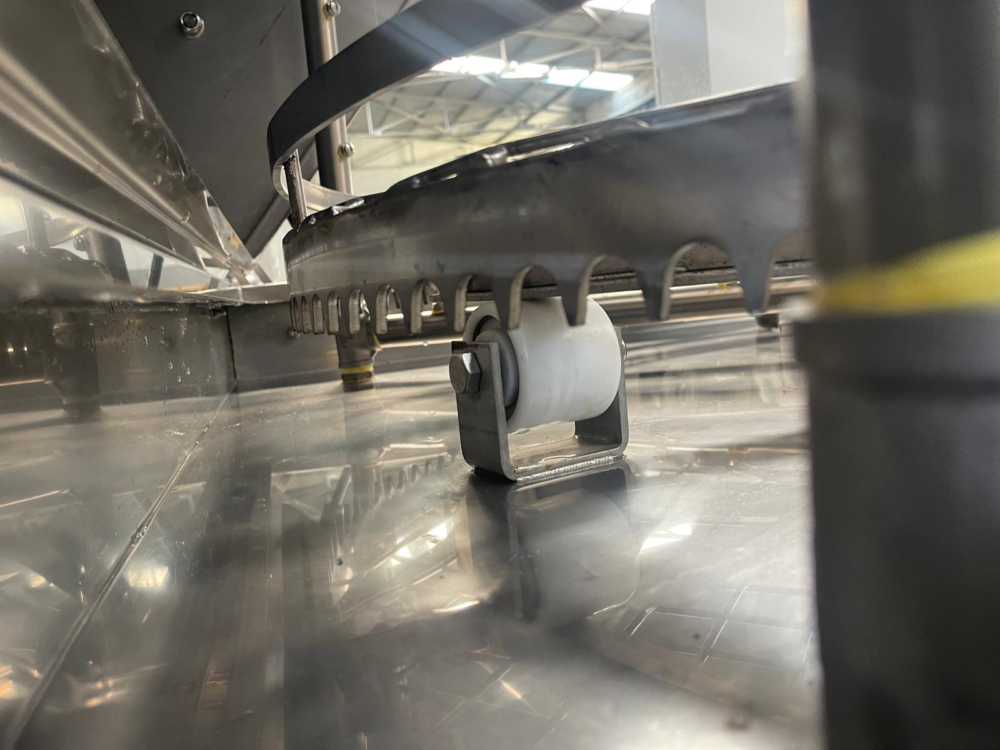

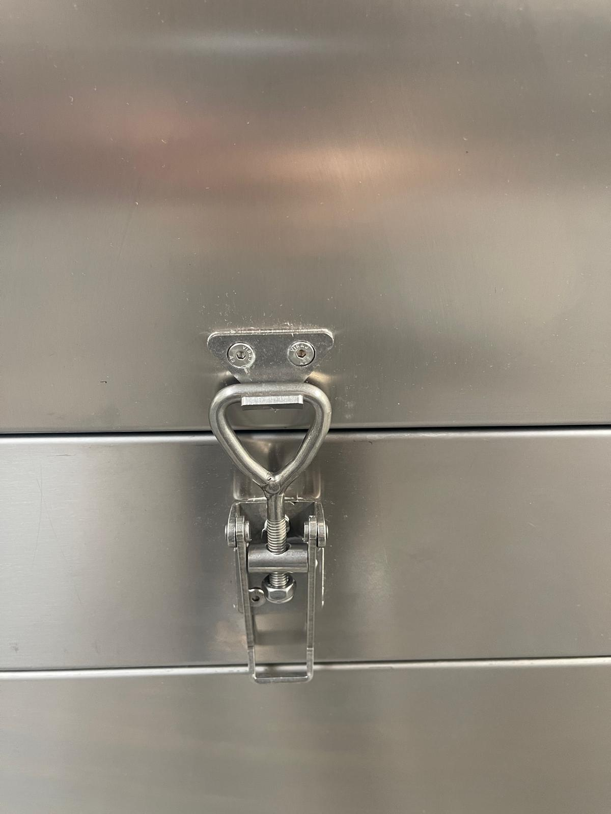

*Şekil 3.3 — Sepet taşıyıcı makarası ve dişli çember (solda), kapak mandalı (sağda)*

Gazlı amortisörler kapağın her iki yanındadır. Interlock kilit kutusu sol yan yüzeyde; kapak kapalı switchi, sepet redüktörü muhafazası, elektrik panosu, tahliye vanası, besleme kablosu ve tip etiketi sağ yan yüzeydedir. Buhar tahliye çıkışları her iki yan yüzeyin üst kısmında bulunur. Yıkama pompası ve bağlantı borularının bulunduğu şase bölmesine makinenin arkasından erişilir.

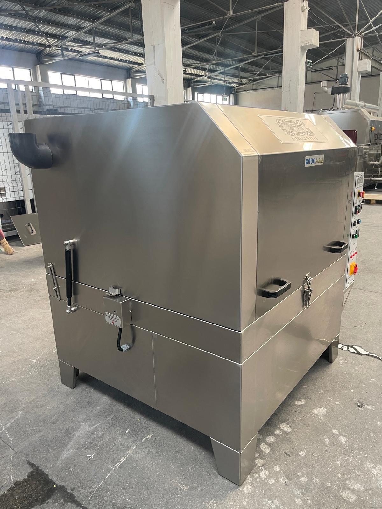

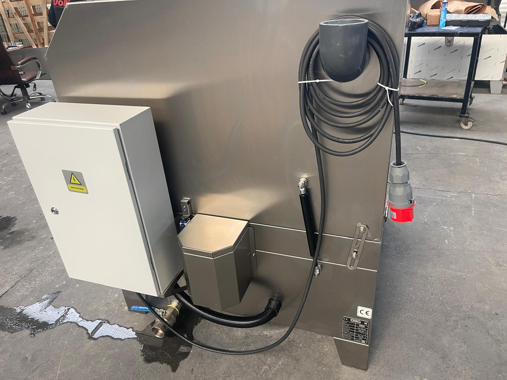

*Şekil 3.4 — Sol yan görünüş: gazlı amortisör, interlock kilit kutusu ve buhar tahliye çıkışı (solda); sağ yan görünüş: elektrik panosu, sepet redüktörü muhafazası, tahliye vanası, buhar tahliye çıkışına sarılı besleme kablosu ve tip etiketi (sağda)*

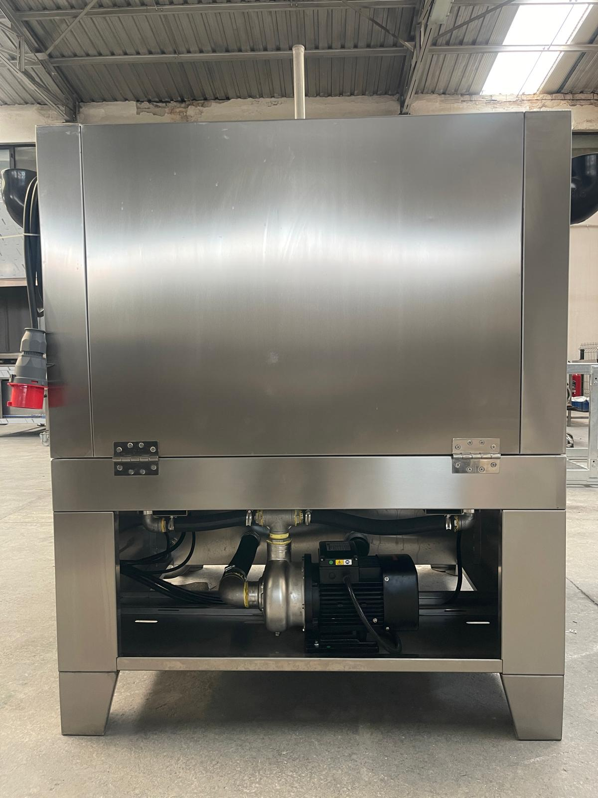

*Şekil 3.5 — Arka görünüş: kapak menteşeleri ve şase arkasındaki pompa bölmesi*

## 3.1.2 Çalışma prensibi ve proses akışı

Makine tek bir çalışma moduna sahiptir: zamanlayıcı kontrollü yıkama çevrimi. Standart konfigürasyonda proses yalnızca yıkama adımından oluşur; kurutma fanı opsiyonu bulunan makinelerde yıkamanın ardından kurutma adımı uygulanabilir. Çevrim süresi, zamanlayıcı üzerinden 0–100 dakika aralığında ayarlanır.

Bir yıkama çevrimi genel olarak aşağıdaki sırayla gerçekleşir. İşletme talimatları ve ayrıntılı adımlar **Bölüm 7**'de verilmiştir.

1. Tanktaki proses suyu, termostatta ayarlanan sıcaklığa kadar ısıtılır. Isıtma süresi, başlangıç su sıcaklığına bağlı olarak yaklaşık 1 saattir. Su sıcaklığı en fazla 70 °C'ye ayarlanabilir.
2. Yıkanacak parçalar sepete yerleştirilir, üst kapak kapatılır ve kapak mandalı kapatılır.
3. Zamanlayıcıda yıkama süresi ayarlanır ve yıkama çevrimi başlatılır; interlock kilit opsiyonu bulunan makinelerde kapak çevrim süresince kilitlenir.
4. Çevrim süresince sepet döner; yıkama pompası proses suyunu nozullar üzerinden parçalara püskürtür. Püskürtülen su yıkama hücresinden tanka geri döner ve filtrelerden geçerek yeniden pompaya emilir.
5. Ayarlanan süre dolduğunda pompa ve sepet redüktörü otomatik olarak durur; interlock kilit bulunan makinelerde kilit açılır.
6. Sepet tamamen durduktan sonra kapak açılır ve parçalar boşaltılır.

Proses suyu kapalı devrede dolaştığından, parçalardan ayrılan kir ve yağ tankta birikir. Proses suyunun temizliği ve filtrelerin düzenli bakımı yıkama kalitesini doğrudan etkiler (**Bkz. Bölüm 10**).

## 3.1.3 Model ve varyant

LYM 1150, LYM serisinin LYM 1 gövde ailesinde yer alan modeldir. Tip etiketindeki model adı **LYM 1150 NS**'dir (**Bkz. Bölüm 3.3**).

| Özellik | Değer |
| :--- | :--- |
| **Model** | LYM 1150 NS |
| **Stok kodu** | 02 01 21 |
| **Gövde ailesi** | LYM 1 |
| **Yıkama pompası** | 1 × 2,2 kW |
| **Isıtıcı** | 1 × 8,25 kW |
| **Nozul adedi** | 45 |

Nozullar, standart konfigürasyonda püskürtmeyi doğrudan parça yüzeyine dik olarak yönlendiren 0° paslanmaz nozullardır. Bu yapı, yağ, talaş ve yapışkan kirlerin yüksek çarpma etkisiyle sökülmesine uygundur. Geniş yüzeyli veya karmaşık geometrili parçalar için alternatif olarak yassı püskürtme nozulları tedarik edilebilir; bu nozullar suyu daha geniş bir alana dağıtarak yüzeyin homojen biçimde taranmasını sağlar.

## 3.1.4 Opsiyonel donanımlar

Aşağıdaki donanımlar sipariş aşamasında talep edilmesi hâlinde makineye eklenir. Makinenizde bulunan opsiyonlar sipariş ve teslim dokümanlarında belirtilmiştir (**Bkz. Bölüm 13.1**); opsiyon parçaları **Bölüm 13.3**'te "Opsiyon" olarak işaretlenmiştir. Opsiyonların kurulu güce etkisi **Bölüm 3.3.4**'te verilmiştir. Her opsiyonun kullanımı ve bakımı, aşağıdaki tabloda belirtilen bölümlerde açıklanmıştır.

| Opsiyon | İşlev | Kullanım ve bakım |
| :--- | :--- | :--- |
| **Yağ sıyırıcı** | Tank yüzeyinde biriken yüzer yağı döner disk ile mekanik olarak tanktan uzaklaştırır; proses suyunun kullanım ömrünü uzatır. | **Bölüm 3.4.9, 7.6.2, 10.1.3** |
| **Hassas filtre** | Pompa çıkış hattına yerleştirilen 200 mikron torba filtre ile ince partikülleri tutar. | **Bölüm 9.1.6, 10.1.3** |
| **Interlock kilit** | Üst kapağı yıkama çevrimi süresince kilitleyerek çalışma sırasında açılmasını engeller. | **Bölüm 5.4.1, 5.4.2** |
| **Buhar tahliye fanı** | Yıkama hücresinde oluşan buharı ve sıcak havayı hücre dışına tahliye eder; kapak açıldığında operatöre yönelen buhar miktarını azaltır. | **Bölüm 3.3.6, 7.4.3** |
| **Buhar tahliye fanı (yoğuşturmalı tip)** | Tahliye edilen buharı yoğuşturarak ortam havasına nem ve yağ buharı yayılmasını azaltır. | **Bölüm 3.3.6, 7.4.3** |
| **Kurutma fanı (fan tipi)** | Yıkama sonrasında parçalar üzerindeki suyun hava akışı ile uzaklaştırılmasını sağlar. | **Bölüm 7.4.3** |
| **Kurutma fanı (blower tipi)** | Yüksek basınçlı hava akışı ile kör delik ve girintilerde kalan suyun daha etkin biçimde uzaklaştırılmasını sağlar. | **Bölüm 7.4.3** |
| **Drenaj pompası** | Tankın boşaltılmasında proses suyunu tahliye hattına pompalar. | **Bölüm 5.3.3, 10.1.4** |
| **Taşıma arabası** | Sepetin makine dışında yüklenmesini ve yüklü sepetin makineye sürülmesini sağlayan tekerlekli araba. | **Bölüm 5.1.2, 7.4.1** |

Opsiyonel motorlar (yağ sıyırıcı, fanlar, drenaj pompası) pano içindeki ayrı termik rölelerle korunur; bu motorlar için pano ön yüzünde arıza lambası bulunmaz (**Bkz. Bölüm 11.2**, Arıza 4).
