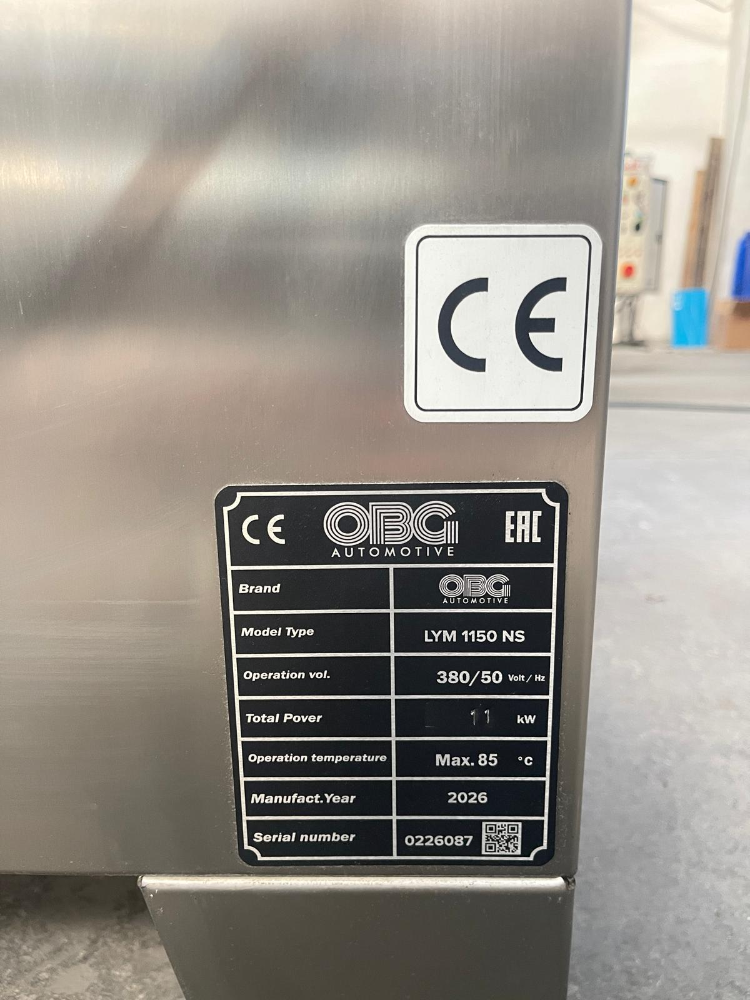

# 3.3 Teknik özellikler

Bu alt bölümde LYM 1150 NS (seri no 0226087) makinesinin standart konfigürasyonuna ait fiziksel, proses, elektrik, tesisat ve ortam değerleri verilmiştir. Bu tablolar kılavuzun teknik değerler için tek referans kaynağıdır; diğer bölümlerde bu değerlere atıf yapılır.

Müşteri talebi doğrultusunda değişiklik yapılmış makinelerde geçerli değerler, makineyle birlikte teslim edilen imalat sonu (as-built) dokümanlarında belirtilir. Tablolardaki değerler ile makine üzerindeki tip etiketi arasında fark bulunması durumunda **tip etiketindeki değerler** esas alınır.

Tip etiketi, makinenin sağ yan yüzeyinin arka alt köşesinde, CE işaretinin yanında bulunur. Etiket üzerinde marka (OBG Automotive), model tipi (LYM 1150 NS), besleme gerilimi ve frekansı (380 V / 50 Hz), toplam güç (11 kW), azami çalışma sıcaklığı, üretim yılı (2026) ve seri numarası (0226087) yer alır; etikette CE ve EAC işaretleri bulunur. Üreticiyle yapılacak tüm yazışmalarda ve yedek parça siparişlerinde model ve seri numarasını belirtin.

Tip etiketinde belirtilen azami çalışma sıcaklığı (85 °C) makinenin tasarım sınırıdır. İşletmede proses suyu sıcaklığı termostat ile en fazla **70 °C**'ye ayarlanır; bu sınır aşılmaz (**Bkz. Bölüm 3.4.8**).

*Şekil 3.6 — Tip etiketi: OBG Automotive, LYM 1150 NS, seri no 0226087*

## 3.3.1 Boyutlar ve ağırlık

| Parametre | Birim | Değer |
| :--- | :---: | :---: |
| **Dış genişlik (W)** | mm | 1200 |
| **Dış uzunluk (L)** | mm | 1200 |
| **Dış yükseklik (H), kapak kapalı** | mm | 1400 |
| **Dış yükseklik, kapak tam açık** | mm | [EKSİK] |
| **Boş ağırlık (kuru)** | kg | [EKSİK] |
| **Çalışma ağırlığı (tank dolu)** | kg | [EKSİK] |
| **Şase tipi** | – | 4 adet sabit ayak |

Dış ölçülere elektrik panosu, yan yüzeylerdeki buhar tahliye çıkışları ve interlock kilit kutusu dahil değildir. Elektrik panosunun ölçüleri **Bölüm 3.4**'te verilmiştir.

## 3.3.2 Sepet ve yükleme kapasitesi

| Parametre | Birim | Değer |
| :--- | :---: | :---: |
| **Sepet çapı** | mm | 1000 |
| **Azami yükleme yüksekliği** | mm | 550 |
| **Azami yükleme kapasitesi** | kg | 400 |
| **Yükleme tipi** | – | Üstten |
| **Sepet malzemesi** | – | Paslanmaz çelik |
| **Kapak amortisörü** | N | 2 × 350 |

Azami yükleme kapasitesi, sepete yüklenen parçaların ve varsa parça taşıyıcı aparatların toplam ağırlığını ifade eder. Parçalar sepet içinde ağırlık merkezi sepet eksenine yakın olacak şekilde dengeli yerleştirilmelidir; tek tarafa yığılmış yük, sepet redüktörünü dengesiz yüke maruz bırakır.

## 3.3.3 Yıkama prosesi, pompa ve tahrik

**Proses değerleri**

| Parametre | Birim | Değer |
| :--- | :---: | :---: |
| **Yıkama tankı hacmi** | L | 150 |
| **Isıtıcı gücü** | kW | 8,25 |
| **Proses suyu sıcaklığı, azami** | °C | 70 |
| **Isıtma süresi (yaklaşık)** | saat | 1 |
| **Yıkama süresi ayar aralığı** | dk | 0–100 |
| **Proses adımları** | – | Yıkama; kurutma (opsiyon) |
| **Nozul adedi** | adet | 45 |
| **Azami sürekli çalışma** | – | 7/24 |

Saatlik kapasite; parça tipine, parça boyutuna, kirlilik derecesine ve gereken yıkama süresine bağlı olduğundan sabit bir değer olarak verilmez. Kapasite planlaması **Bölüm 8**'e göre yapılır.

**Yıkama pompası**

| Parametre | Birim | Değer |
| :--- | :---: | :---: |
| **Pompa adedi** | adet | 1 |
| **Marka / model** | – | ATLANTIS KAF 300T/304 |
| **Sipariş kodu** | – | 10 02818 |
| **Güç** | kW (HP) | 2,2 (3) |
| **Gerilim / frekans** | V / Hz | 380 / 50 |
| **Nominal devir** | d/dk | 2900 |
| **Nominal akım** | A | 4,2 |
| **Debi** | L/dk | 350 |
| **Termik röle** | – | [EKSİK] |

Nominal akım değeri 380 V, 3 faz ve cos φ = 0,8 esas alınarak hesaplanmıştır; kesin değer pompa motoru etiketinden doğrulanmalıdır.

**Motor listesi**

| Motor | Değer |
| :--- | :--- |
| **Yıkama pompası** | 1 × 2,2 kW, 2900 d/dk |
| **Sepet redüktörü** | 0,18 kW, 1500 d/dk — YILMAZ redüktör (motor 10 00588, redüktör 10 01004) |
| **Sepet redüktörü termik rölesi** | [EKSİK] |

Tüm motorlar şebekeye doğrudan (DOL) bağlıdır; makinede frekans inverteri bulunmaz. Redüktör ve motor yedek parça kodları **Bölüm 13.3**'te verilmiştir.

## 3.3.4 Elektrik besleme

| Parametre | Birim | Değer |
| :--- | :---: | :---: |
| **Besleme gerilimi** | V | 380 |
| **Frekans** | Hz | 50 |
| **Besleme konfigürasyonu** | – | 3P + N + PE |
| **Toplam kurulu güç (ısıtma dahil)** | kW | 11 |
| **Azami akım çekişi** | A | 25 |
| **Güç faktörü (cos φ)** | – | 0,8 |
| **Kısa devre dayanımı (Icc)** | kA | 0,5 |
| **Ana şalter** | – | Opaş 3 × 25 A pako şalter (YKL301025) — pano ön yüzünde **POWER** |
| **Önerilen besleme koruması** | A | 25 |
| **Bağlantı elemanı** | – | Bemis 5 × 32 A endüstriyel fiş (10 00307) ve duvar prizi (10 00308) |
| **UPS / jeneratör gereksinimi** | – | Yok |

Kurulu güç değeri standart, opsiyonsuz konfigürasyon içindir ve tip etiketindeki değerle aynıdır (11 kW). Makinede opsiyonel donanım bulunuyorsa, aşağıdaki güç değerleri toplam kurulu güce eklenmeli ve besleme hattı ile koruma elemanları buna göre boyutlandırılmalıdır.

| Opsiyon | Ek güç (kW) |
| :--- | :---: |
| **Yağ sıyırıcı** | 0,09 |
| **Buhar tahliye fanı** | 0,37 |
| **Kurutma fanı (fan tipi)** | 6,37 |
| **Kurutma fanı (blower tipi)** | 10,37 |
| **Buhar tahliye fanı (yoğuşturmalı tip)** | [EKSİK] |
| **Drenaj pompası** | [EKSİK] |

Besleme hattının tesis tarafındaki bağlantısı ve faz sırası kontrolü **Bölüm 5**'e göre yapılır. Elektrik donanımının yıllık güvenlik testleri **Bölüm 9.1.8**'de tanımlanmıştır.

## 3.3.5 Su bağlantısı ve atık su

| Parametre | Birim | Değer |
| :--- | :---: | :---: |
| **Sabit su girişi** | – | Yok — tank elle doldurulur |
| **Besleme suyu sıcaklığı** | °C | 10–70 |
| **Su kalitesi** | – | Şebeke suyu |
| **Ek su filtresi gereksinimi** | – | Yok |
| **Atık su (drenaj) bağlantısı** | inç | 2" küresel vana, sağ ön alt |
| **Basınçlı hava gereksinimi** | – | Yok |

Sabit su girişi bulunmadığından tank, kapak açıkken şebeke suyu ile elle doldurulur (**Bkz. Bölüm 5.3.2**).

Drenaj hattından tahliye edilen proses suyu yağ ve kimyasal içerir. Atık su, doğrudan kanalizasyona verilmeden yerel çevre mevzuatına uygun olarak toplanmalı ve bertaraf edilmelidir (**Bkz. Bölüm 10**).

## 3.3.6 Ortam koşulları ve emisyon

| Parametre | Birim | Değer |
| :--- | :---: | :---: |
| **Çalışma ortamı** | – | Kapalı mekân |
| **Çalışma ortamı sıcaklığı** | °C | +10 / +30 |
| **Depolama ortamı sıcaklığı** | °C | +10 / +30 |
| **Bağıl nem** | % | 30–50 |
| **Elektrik donanımı koruma sınıfı** | – | IP54 |
| **A-ağırlıklı ses basıncı seviyesi** | dB(A) | 50 |

Ortam sıcaklığının +10 °C'nin altına düştüğü koşullarda tank, pompa ve borulardaki suyun donma riski bulunur; makine bu koşullarda çalıştırılmamalı ve uzun süreli duruşlarda tank boşaltılmalıdır (**Bkz. Bölüm 4.2**).

Yıkama sırasında, özellikle kapak açıldığında, yıkama hücresinden su buharı çıkar. Hücredeki buhar, hücrenin sol ve sağ yan yüzeylerinin üst kısmındaki iki adet 3" PVC buhar tahliye çıkışından dışarı verilir; bu çıkışlar kapatılmamalı veya tıkanmamalıdır. Buhar tahliye fanı opsiyonu bulunan makinelerde buhar, fan ile tesis havalandırmasına veya dış ortama bağlanan tahliye kanalına basılır. Makinenin kurulduğu alan, buharın birikmesini önleyecek şekilde havalandırılmalıdır.
