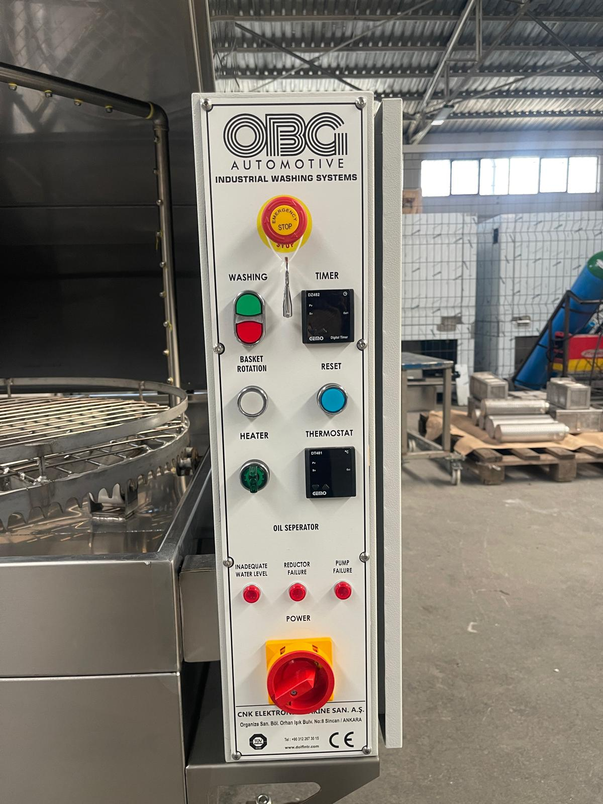

# 3.4 Makine kontrolleri

Makine, PLC veya operatör paneli (HMI) içermeyen, röle tabanlı bir kumanda sistemi ile çalışır. Makinenin tüm kumanda, ayar ve sinyal elemanları, yıkama hücresinin sağ tarafında bulunan elektrik panosunun ön yüzünde yer alır. Yıkama süresi dijital zamanlayıcı ile, proses suyu sıcaklığı ise dijital termostat ile ayarlanır; arıza durumları panodaki kırmızı sinyal lambaları ile bildirilir.

Makine tek çalışma moduna sahiptir. Manuel, bakım veya adım modu bulunmaz; sepetin yıkama çevrimi dışında döndürülmesi yalnızca TEST butonu (pano etiketi: BASKET ROTATION) ile mümkündür (**Bkz. Bölüm 3.4.5**).

| Parametre | Değer |
| :--- | :--- |
| **Pano konumu** | Yıkama hücresinin sağ tarafı |
| **Pano ölçüleri (G × Y × D)** | 410 × 650 × 160 mm |
| **Pano koruma sınıfı** | IP54 |
| **Pano etiket dili** | İngilizce |

Pano üzerindeki tüm etiketler **İngilizcedir**. Bu kılavuzda kumanda elemanları Türkçe adlarıyla anılır; her elemanın pano üzerindeki İngilizce etiketi aşağıdaki tabloda verilmiştir.

Pano ön yüzünde kumanda elemanları yukarıdan aşağıya şu sırayla yer alır: acil stop (EMERGENCY STOP); yıkama start / stop butonu (WASHING) ve zamanlayıcı (TIMER); test butonu (BASKET ROTATION) ve reset butonu (RESET); ısıtıcı şalteri (HEATER) ve termostat (THERMOSTAT); yağ sıyırıcı şalteri (OIL SEPERATOR; opsiyon); arıza lambaları (INADEQUATE WATER LEVEL, REDUCTOR FAILURE, PUMP FAILURE); en altta ana şalter (POWER).

*Şekil 3.7 — Kumanda panosu ön yüzü*

Aşağıdaki tabloda kumanda elemanları, bu alt bölümdeki açıklama numaralarına göre listelenmiştir.

| No | Eleman | Pano etiketi | Tip | İşlev özeti |
| :---: | :--- | :--- | :--- | :--- |
| 1 | Ana şalter | POWER | Kilitlenebilir kırmızı-sarı döner şalter | Makinenin tüm elektrik beslemesini açar / keser |
| 2 | Acil stop | EMERGENCY STOP | Kilitlemeli mantar buton | Tehlike anında makineyi durdurur |
| 3 | Yıkama start / stop | WASHING | Yeşil / kırmızı çift buton | Yıkama çevrimini başlatır / sonlandırır |
| 4 | Zamanlayıcı | TIMER | GEMO DZ482 dijital zaman rölesi | Yıkama süresini belirler |
| 5 | Test | BASKET ROTATION | Beyaz buton | Sepeti çevrim dışında döndürür |
| 6 | Reset | RESET | Mavi ışıklı buton | Emniyet devresini onaylar |
| 7 | Isıtıcı | HEATER | Yeşil pako şalter | Tank ısıtmasını devreye alır |
| 8 | Termostat | THERMOSTAT | GEMO DT481 dijital termostat | Proses suyu sıcaklığını ayarlar ve gösterir |
| 9 | Yağ sıyırıcı şalteri (opsiyon) | OIL SEPERATOR | Siyah pako şalter | Yağ sıyırıcıyı çalıştırır |
| 10 | Arıza lambaları | INADEQUATE WATER LEVEL / REDUCTOR FAILURE / PUMP FAILURE | Kırmızı sinyal lambaları | Arıza durumlarını bildirir |

## 3.4.1 Ana şalter

Ana şalter (POWER), makinenin tesis şebekesinden gelen tüm elektrik beslemesini açar ve keser. Şalter **0 (OFF)** konumundayken pano içindeki kumanda ve güç devrelerinin tamamı enerjisizdir; şalter **1 (ON)** konumuna getirildiğinde makine çalışmaya hazır hâle gelir.

Ana şalter, bakım ve temizlik çalışmalarında asma kilit ile **0** konumunda kilitlenebilecek şekilde tasarlanmıştır. Enerji izolasyonu her zaman ana şalter üzerinden yapılır (**Bkz. Bölüm 2.4**).

## 3.4.2 Acil stop

Makinede elektrik panosu üzerinde 1 adet acil stop butonu (EMERGENCY STOP) bulunur. Butona basıldığında makinenin tüm hareketli ve enerji tüketen fonksiyonları (sepet redüktörü, yıkama pompası, ısıtıcı ve varsa opsiyonel motorlar) durdurulur ve buton basılı konumda kilitlenir. Durdurma, kategori 1 durdurma olarak gerçekleşir.

Acil stop butonunun kilidi açıldığında makine kendiliğinden yeniden çalışmaz. Makinenin tekrar çalışmaya hazır hâle gelmesi için RESET butonu ile emniyet devresinin onaylanması gerekir (**Bkz. Bölüm 3.4.6**). Acil durdurma ve yeniden başlatma prosedürü **Bölüm 2.5**'te tanımlanmıştır.

**DİKKAT — Yanlış kullanım:** Acil stop butonu, makineyi normal işletmede durdurmak için kullanılmamalıdır. Sık kullanım, emniyet devresi elemanlarının erken yıpranmasına neden olur. Devam eden bir yıkama çevrimini sonlandırmak için kırmızı STOP butonunu kullanın (**Bkz. Bölüm 3.4.3**).

## 3.4.3 Yıkama start / stop

Yıkama çevrimini başlatmak ve durdurmak için kullanılan, pano üzerinde WASHING etiketli çift butondur.

- **START (yeşil):** Zamanlayıcıda ayarlanan süre boyunca yıkama çevrimini başlatır. Çevrimin başlayabilmesi için üst kapağın kapalı, emniyet devresinin onaylanmış ve tanktaki su seviyesinin yeterli olması gerekir.
- **STOP (kırmızı):** Devam eden yıkama çevrimini, ayarlanan süre dolmadan sonlandırır; yıkama pompasını ve sepet redüktörünü durdurur.

Çevrim sonunda veya STOP komutundan sonra kapak, sepet tamamen durduktan sonra açılmalıdır.

## 3.4.4 Zamanlayıcı (GEMO DZ482)

Zamanlayıcı (TIMER), yıkama çevriminin süresini belirleyen dijital zaman rölesidir. Yıkama süresi, parçanın kirlilik derecesine ve yapısına göre 0–100 dakika aralığında ayarlanır. START butonuna basıldığında ekrandaki süre geriye doğru saymaya başlar; süre sıfıra ulaştığında yıkama pompası ve sepet redüktörü otomatik olarak durur.

Uygun yıkama süresi işletme tarafından parça tipine göre belirlenir. Süre ayarı **Bölüm 6**'da, parça tipine göre süre seçimi **Bölüm 8**'de açıklanmıştır.

## 3.4.5 Test butonu

TEST butonu (pano etiketi: BASKET ROTATION, beyaz), yıkama çevrimi çalışmıyorken sepetin redüktör ile döndürülmesini sağlar. Sepet yalnızca buton basılı tutulduğu sürece döner; buton bırakıldığında durur. Bu fonksiyon, parça yükleme ve boşaltma sırasında sepetin uygun konuma getirilmesi ile yıkama öncesinde sepet dönüşünün kontrol edilmesi amacıyla kullanılır.

**UYARI — Dönen sepet:** Sepet dönerken el, kol veya giysi sepet ile hücre duvarı arasına sıkışabilir. TEST butonunu kullanırken ellerinizi sepetten uzak tutun; sepete yalnızca sepet tamamen durduktan sonra müdahale edin.

## 3.4.6 Reset butonu

RESET butonu, emniyet devresinin operatör tarafından bilinçli olarak onaylanmasını sağlayan mavi ışıklı butondur. Acil stop butonuna basıldığında veya tanktaki su seviyesi güvenli sınırın altına düştüğünde emniyet devresi açılır ve makine durur. Arıza nedeni giderilip acil stop butonunun kilidi açılsa bile makine kendiliğinden yeniden çalışmaz.

Emniyet devresini onaylamak için RESET butonuna, buton lambası yanana kadar basılı tutun. Buton lambasının yanması, emniyet devresinin kapandığını ve makinenin çalışmaya hazır olduğunu gösterir. Bu düzenleme, enerji veya emniyet koşulu yeniden sağlandığında makinenin beklenmedik şekilde çalışmasını önler.

## 3.4.7 Isıtıcı şalteri

Isıtıcı şalteri (HEATER), yıkama tankındaki proses suyunun ısıtılmasını devreye alan yeşil pako şalterdir. Şalter **1** konumundayken ısıtıcı, termostatta ayarlanan hedef sıcaklığa ulaşılana kadar çalışır; hedef sıcaklığa ulaşıldığında termostat ısıtıcıyı devre dışı bırakır ve sıcaklık düştüğünde yeniden devreye alır. Şalter **0** konumundayken ısıtma yapılmaz.

Isıtıcı, tanktaki su seviyesi yeterli olmadığında seviye bekçisi tarafından otomatik olarak devre dışı bırakılır. Bu koruma, ısıtıcının susuz çalışarak hasar görmesini önler.

## 3.4.8 Termostat (GEMO DT481)

Termostat (THERMOSTAT), proses suyunun sıcaklığını ölçen, gösteren ve ısıtıcıyı kumanda eden dijital ünitedir. Ekranda anlık su sıcaklığı (**PV**, ölçülen değer) ve hedef sıcaklık (**SV**, ayar değeri) görüntülenir. Sıcaklık ölçümü tank içindeki termokupl ile yapılır.

Hedef sıcaklık en fazla **70 °C** olarak ayarlanabilir. Bu sınır, operatörü haşlanma ve buhar yanığı riskine karşı korumak ve pompa, conta ve tank bileşenlerini tasarım sınırları içinde tutmak amacıyla üretici tarafından belirlenmiştir.

**UYARI — Sıcak su ve buhar:** 70 °C sınırının üzerindeki proses suyu ciddi haşlanma ve buhar yanıklarına neden olabilir, ayrıca pompa ve contalarda kalıcı hasar oluşturur. Termostat sıcaklık sınırını değiştirmeyin veya devre dışı bırakmayın. Ekranda 70 °C'nin üzerinde bir değer görülürse makineyi STOP butonu ile durdurun, ısıtıcı şalterini **0** konumuna getirin ve yetkili servise başvurun (**Bkz. Bölüm 1.3**).

Sıcaklık sınırının kullanıcı tarafından değiştirilmesi, makineyi garanti kapsamı dışında bırakır (**Bkz. Bölüm 3.2.5**).

## 3.4.9 Yağ sıyırıcı şalteri (opsiyon)

Yağ sıyırıcı opsiyonu bulunan makinelerde, pano üzerindeki OIL SEPERATOR konumundaki pako şalter yağ sıyırıcıyı çalıştırır; opsiyon bulunmayan makinelerde bu konum boştur. Yağ sıyırıcı, tank yüzeyinde biriken yüzer yağı döner disk ile mekanik olarak tanktan uzaklaştırır ve proses suyunun kullanım ömrünü uzatır.

Yağ, yıkama sırasında proses suyuna karıştığı için yüzeyde toplanamaz. Bu nedenle yağ sıyırıcı, yıkama çevrimi çalışmıyorken ve proses suyu durgunken (örneğin ısıtma süresinde veya vardiya sonunda) çalıştırılır. Sıyrılan yağ, işletmenin belirlediği yağlı atık kabında toplanır ve yağlı atık olarak bertaraf edilir (**Bkz. Bölüm 10.1.7**). Yağ sıyırıcı diskinin ve yağ akış yolunun haftalık temizliği **Bölüm 10.1.3**'te tanımlanmıştır.

## 3.4.10 Arıza lambaları

Elektrik panosu üzerindeki üç kırmızı sinyal lambası, aşağıdaki arıza durumlarını operatöre bildirir. Makinede alarm kodu gösteren bir ekran bulunmaz; arıza bildirimi yalnızca bu lambalar ile yapılır.

| Lamba | Pano etiketi | Anlamı | Makine davranışı | Teşhis |
| :--- | :--- | :--- | :--- | :---: |
| **Düşük su seviyesi** | INADEQUATE WATER LEVEL | Tanktaki su seviyesi güvenli çalışma sınırının altına düşmüştür. | Isıtıcı ve yıkama pompası devre dışı kalır; emniyet devresi açılır. Su ilave edildikten sonra RESET gerekir. | **Bölüm 11**, Arıza 3 |
| **Redüktör arızası** | REDUCTOR FAILURE | Sepet redüktörü termik rölesi aşırı akım nedeniyle atmıştır. | Sepet dönmez; yıkama çevrimi başlamayabilir. | **Bölüm 11**, Arıza 1 |
| **Pompa arızası** | PUMP FAILURE | Yıkama pompası termik rölesi aşırı akım nedeniyle atmıştır. | Yıkama pompası çalışmaz. | **Bölüm 11**, Arıza 2 |

Kurutma fanı, drenaj pompası, yağ sıyırıcı ve buhar tahliye fanı gibi opsiyonel donanımlar için ayrı arıza lambası bulunmaz. Bu donanımların termik koruması pano içinde kontrol edilir (**Bkz. Bölüm 11**).
