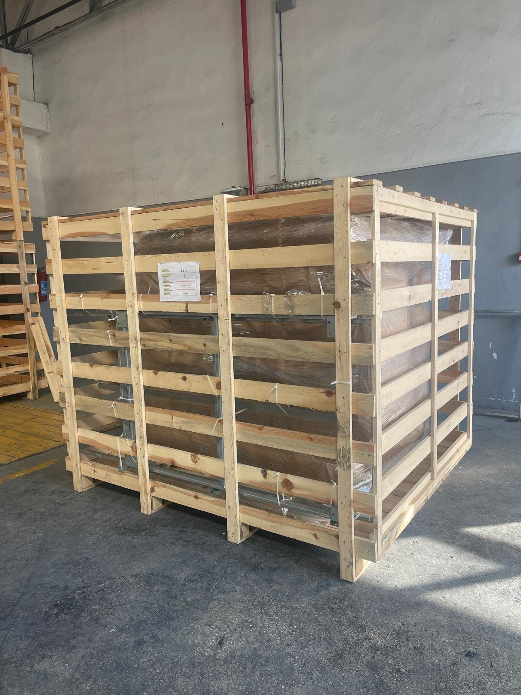
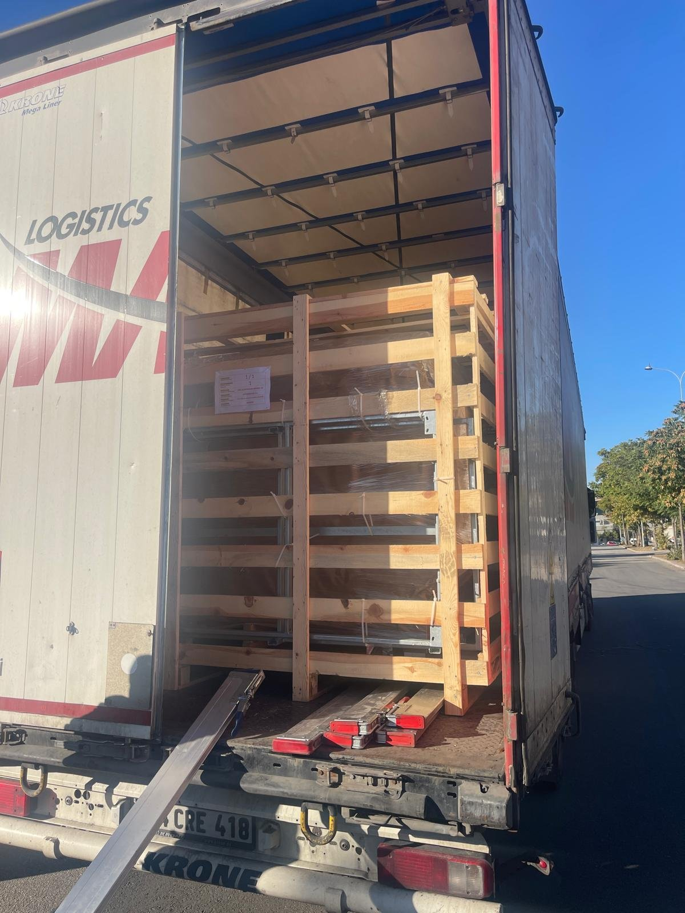

# 4.1 Packaging, lifting and handling

This section describes the shipping packaging of the machine, the checks to be carried out on receipt, and the safe lifting of the machine with a forklift and its transport to the installation site.

## 4.1.1 Packaging and shipping

Depending on the destination, the machine is shipped in one of the following packaging types:

| Shipment | Packaging type | Protection |
| :--- | :--- | :--- |
| **Domestic** | Domestic packaging | Impact- and moisture-protected packaging |
| **Export** | Wooden crate | Machine wrapped in stretch film, inside a wooden crate |

During transport of the machine, the ambient temperature must be between **+10 °C and +50 °C**. The machine has no transport lock or securing element fitted for transport that would need to be removed before installation. However, the machine must be secured to the vehicle bed with suitable lashing equipment to prevent sliding and tipping in the transport vehicle.

*Figure 4.1 — Wooden crate for export shipment (left) and loading of the crate onto the transport vehicle (right); representative image*

The machine is shipped with the tank empty, the supply cable coiled around the steam vent outlet on the right-hand side face and the interlock lock (option) in the **UNLOCK** position. On machines ordered with a transport trolley, the trolley is shipped unassembled together with the machine; assembly of the trolley is described in **Chapter 5.1.2**.

## 4.1.2 Inspection on receipt

When taking delivery of the machine, carry out the following checks while the carrier's representative is still on site:

1. Check the outer surface of the packaging for signs of impact, crushing, tearing or wetting.
2. Verify that the label on the packaging matches the ordered model and serial number (LYM 1150 NS, serial no. 0226087).
3. After opening the packaging, visually inspect the machine body, the lid, the electrical panel and the supply cable for damage.
4. Check against the delivery note that the documents and accessories shipped with the machine (transport trolley, spare parts, documents) are complete.
5. Have any damage or shortage found recorded in writing on the delivery note and document it with photographs.
6. Report any damage or shortage immediately and in writing to the carrier and the authorised service (**See Chapter 1.3**).

Do not operate a machine with transport damage until it has been assessed by the manufacturer.

## 4.1.3 Lifting and handling with a forklift

The machine has no dedicated fork pockets for forklift forks. The machine is lifted by driving the forks directly under the base frame profiles.

**Preparation before handling**

1. Set the main switch to the **0** position and unplug the supply plug from the socket.
2. Drain the water in the washing tank completely (**See Chapter 10**). A machine with water in its tank is not only heavier but can also lose its balance during handling due to the sloshing of the water.
3. Remove the parts in the basket and any loose accessories; on machines with a transport trolley, separate the trolley from the machine.
4. Close the top lid and close its latch.
5. Gather up the supply cable and the drain hoses; prevent them from trailing on the floor and catching on the forks.

**Lifting**

6. Drive the forklift forks under the base frame profiles so that they are centred on the machine's centre of gravity. Verify that the forks are long enough to protrude beyond the far side of the machine.
7. Check that the forks are in contact only with the base frame profiles. Do not apply load to the side cladding panels, the drain valve, the pump in the rear compartment or the electrical panel.
8. Lift the machine approximately 10 cm off the floor and check its balance. If the machine tilts to one side, lower the load and reposition the forks.

**Handling and setting down**

9. Transport the machine at low speed, keeping it close to the floor (at a height of no more than 20 cm). Avoid sudden braking and sharp turns.
10. Assign a banksman to guide the forklift on routes where visibility is restricted.
11. Lower the machine slowly onto an installation site that meets the requirements defined in **Chapter 3.5**.
12. Check that all four feet are resting fully on the floor.

**CAUTION — Body and panel damage:** Pulling, pushing and lifting the machine by the lid handles, the lid, the electrical panel, the steam vent outlets or the pipework causes permanent deformation of the body and damage to the electrical connections. Lift and transport the machine only from the base frame.
