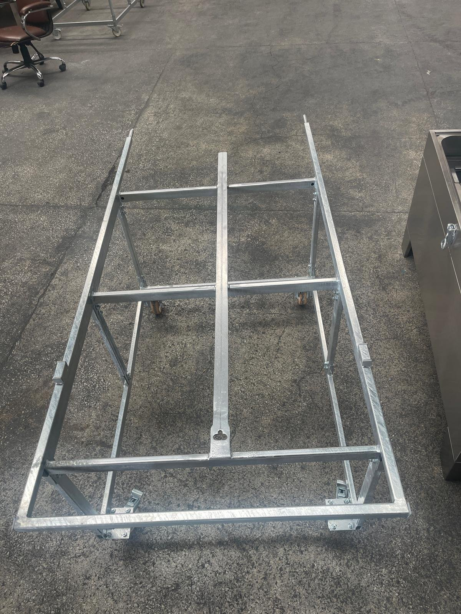

# 5.1 Machine and transport trolley assembly

The machine is shipped as a single unit with all components fitted and factory-tested. No mechanical assembly work is required for the machine itself at the installation site. On machines ordered with the transport trolley option, only the transport trolley is assembled.

## 5.1.1 Unpacking

1. Open the packaging after moving the machine with a forklift to a point close to the installation site (**See Chapter 4.1**).
2. Remove the crate or packaging material without letting sharp tools come into contact with the machine surfaces.
3. Remove the stretch film and protective materials wrapped around the machine.
4. Open the lid latch and open the lid; remove the accessory and spare part packages shipped on the basket or inside the washing chamber. Check that the lid is held in the open position by the gas springs.
5. Unwind the supply cable from where it is coiled around the steam vent outlet on the right-hand side face; cut the cable ties and check the cable for damage.
6. On machines with the interlock lock option, note that the lock is in the shipping position (**UNLOCK**); the lock is activated after the electrical connections have been completed (**See Chapter 5.4.1**).
7. Separate and dispose of the packaging waste in accordance with local waste regulations.

## 5.1.2 Assembly of the transport trolley (option)

The transport trolley is a wheeled device that allows the parts to be loaded into the basket outside the machine and the loaded basket to be rolled into the machine on rails. When ordered together with the machine, the transport trolley is shipped unassembled and must be assembled during installation.

*Figure 5.1 — Assembled transport trolley (representative image)*

1. Remove the transport trolley parts from the packaging and check against the delivery list that they are complete.
2. Assemble the trolley according to the assembly drawing supplied. If no assembly drawing is available, contact the authorised service (**See Chapter 1.3**).
3. Tighten the fasteners; check that the wheels turn freely and that the brakes of the braked wheels hold.
4. Bring the trolley up to the front of the machine; check that the trolley rails are aligned with the level of the basket rails in the machine and that the trolley and the machine fit fully together.
5. Roll the empty basket from the trolley into the machine and from the machine onto the trolley to verify that the movement takes place without snagging.

Transport trolley assembly drawing and torque values: [EKSİK]
