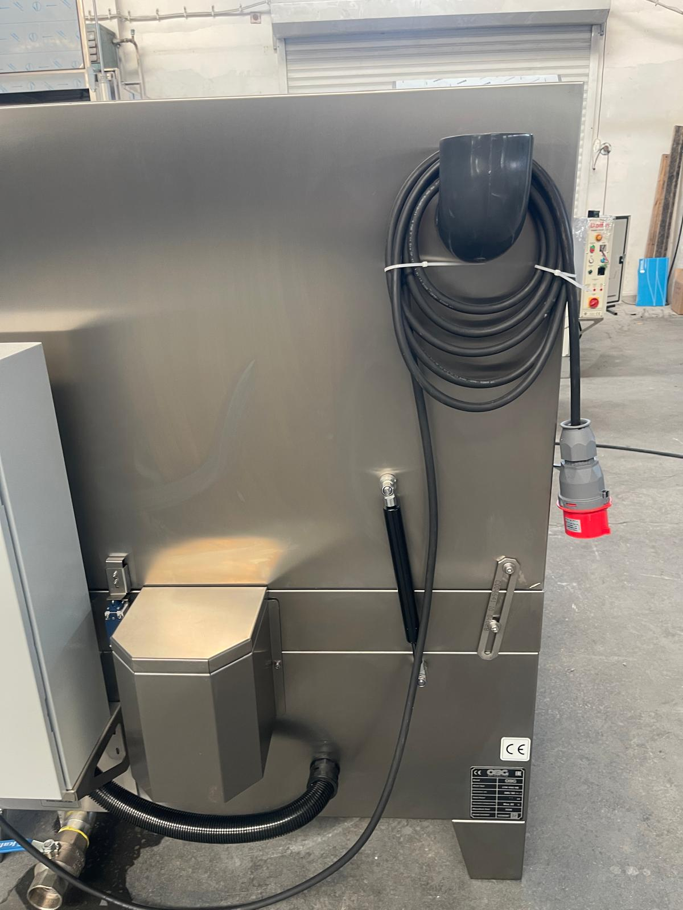
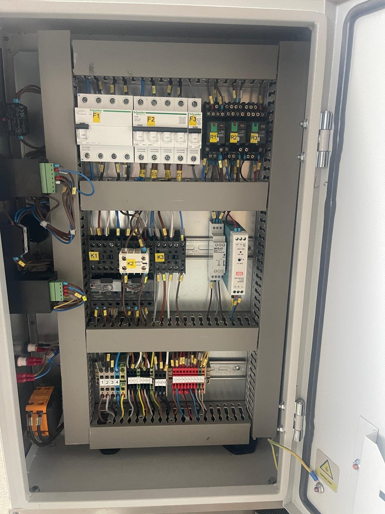

# 5.3 Electrical, water and drain connections

This section describes the connection of the machine to the plant electrical supply, the first filling of the tank and the waste water drain connection. The machine does not require compressed air, a hydraulic supply or a fixed water inlet. The connection values are given in **Chapter 3.3.4** and **Chapter 3.3.5**.

## 5.3.1 Electrical connection

The machine is supplied with 3 phases + neutral + protective earth (3P + N + PE) and is connected by means of the 5-pole 32 A industrial plug and wall socket (Bemis) shipped with the machine. The supply cable exits at the right rear corner of the machine; for shipment it is coiled around the steam vent outlet on the right-hand side face.

*Figure 5.2 — Right-hand side face: supply cable coiled around the steam vent outlet and 5-pole (3P + N + PE) industrial plug; type plate below*

**Plant-side preparation**

1. Protect the line that will supply the machine on the plant side with a fuse or circuit breaker according to the supply protection value given in **Chapter 3.3.4** (25 A; on machines with optional equipment, taking the additional power into account).
2. Have the supply cable cross-section determined by authorised electrical personnel according to the line length and the electrical regulations in force.
3. Mount the wall socket shipped with the machine at a point that the machine supply cable can reach without being under tension, and connect it to the plant line.
4. Verify with a measuring instrument that the protective earth conductor (PE) is connected to the socket and has continuity with the plant earthing system.

**Connecting the machine**

5. Check that the main switch (POWER) of the machine is in the **0** position.
6. Unwind the supply cable from the steam vent outlet; route the cable so that there is no risk of crushing, cutting or contact with hot surfaces.
7. Insert the supply plug into the socket.

**CAUTION — Incorrect phase sequence:** If the phase sequence is incorrect, the phase sequence relay inside the panel does not allow the machine to operate. The phase sequence check is described in **Chapter 5.5**. Do not operate the machine by bridging the phase sequence relay; the motors would rotate in the reverse direction and could cause damage to the pump and the gear motor.

*Figure 5.3 — Electrical panel, interior view (representative image): top row, residual current device (F1) and circuit breakers (F2, F3) with relays (R1–R3); middle row, contactors (K1–K3), thermal overload relays, phase sequence relay and 24 V DC power supply; bottom row, terminal block*

## 5.3.2 Water connection and first filling

The machine has no fixed water inlet; the tank is filled by hand (with a hose) with mains water while the lid is open. No water line connection is required on the plant side.

**First filling**

1. Check that the drain valve is closed (**See Chapter 5.3.3**).
2. Open the lid and fill the tank with mains water to above the level at which the level switch clears the low-level signal. Feed the water into the washing chamber with the lid open; the water flows into the tank through the openings in the chamber floor.
3. Add the washing chemical to the tank at the dosage specified by the chemical manufacturer (**See Chapter 3.2.2**).

Maximum filling level of the tank and level mark: [EKSİK]

## 5.3.3 Waste water drain connection

The tank water is drained through the 2" ball-type drain valve located at the lower right front of the machine, below the electrical panel (**See Figure 10.3**).

1. Connect a hose or pipe to the outlet of the drain valve to carry the waste water to the plant waste water collection point.
2. Lay the drain line with a continuous fall so that the water can flow by gravity.
3. Verify that the waste water collection point allows the disposal of process water containing oil and chemicals in accordance with local environmental legislation.

In the standard configuration, the tank is drained by gravity through the drain valve. On machines with the drain pump option, the tank water is pumped into the drain line by the drain pump; in this case the drain line is connected to the pump outlet and the line does not need to be laid with a fall.
