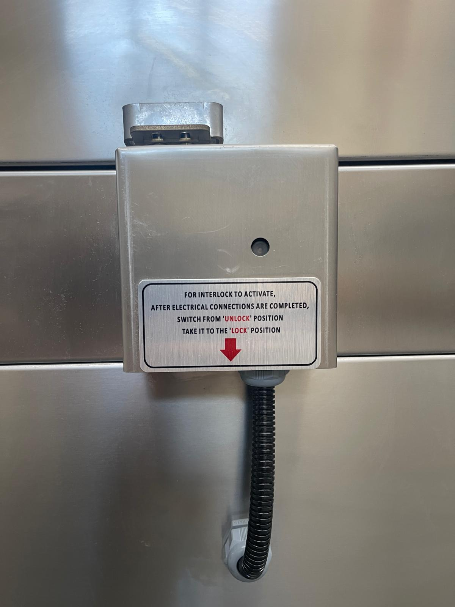

# 5.4 Testing the safety functions

Before the machine is started for the first time, all safety functions must be tested for correct operation. These tests ensure that any damage to cables, switches and connections that may have occurred during transport or installation is detected before the machine is used in production. The same tests are repeated after every repair carried out on the safety circuit and once a year together with the annual electrical safety tests (**See Chapter 9.1.8**).

Carry out the tests with an adequate water level in the tank and with the basket empty. If any of the tests fails, do not use the machine; rectify the fault in accordance with **Chapter 11** or contact the authorised service.

## 5.4.1 Activating the interlock lock (option)

On machines with the interlock lock option, the lock is shipped in the **UNLOCK** position so that the lid can be opened during transport and installation; the label on the lock box also states this ("FOR INTERLOCK TO ACTIVATE, AFTER ELECTRICAL CONNECTIONS ARE COMPLETED, SWITCH FROM 'UNLOCK' POSITION TAKE IT TO THE 'LOCK' POSITION"). Activate the lock after the electrical connections have been completed:

1. Locate the interlock lock box on the **left-hand side face** of the washing chamber, immediately below the lid edge (**See Figure 3.4**).
2. As stated on the label on the box, turn the lock selector from the **UNLOCK** position to the **LOCK** position.

*Figure 5.4 — Interlock lock box on the left-hand side face; lock striker attached to the lid above, LOCK / UNLOCK instruction label on the box*

If the lock is left in the **UNLOCK** position, the interlock function remains disabled and the lid can be opened during the cycle.

## 5.4.2 Test procedure

| No | Test | Procedure | Expected result |
| :---: | :--- | :--- | :--- |
| 1 | **Emergency stop** | Press the emergency stop button while the basket is rotating via the TEST button. | The basket gear motor stops; all functions are disabled. |
| 2 | **Reset after emergency stop** | Unlatch the emergency stop button; press the START button without pressing the RESET button. | The machine does not start. After the RESET button has been pressed until its lamp lights, the machine becomes ready to operate. |
| 3 | **Lid-closed switch** | Press the START button with the lid open. | The washing cycle does not start. |
| 4 | **Interlock lock (option)** | Try to open the lid while the washing cycle is running. | The lid remains locked and cannot be opened. |
| 5 | **Low water level** | Under the supervision of authorised personnel, lower the tank level below the low-level limit. | The low water level lamp (INADEQUATE WATER LEVEL) lights; the heater and the pump are disabled. |
| 6 | **Lid gas springs** | Open the lid fully and release it. | The lid stays in the open position by itself; the closing movement is controlled (**See Chapter 9.1.7**). |

Record the results of all tests in the installation record together with the date and the name of the person carrying out the tests.

**WARNING — Disabled safety function:** Operating the machine after a failed safety test can result in hot water being sprayed while the lid is open or in contact with the rotating basket. Do not release the machine for use until all tests have been passed.
