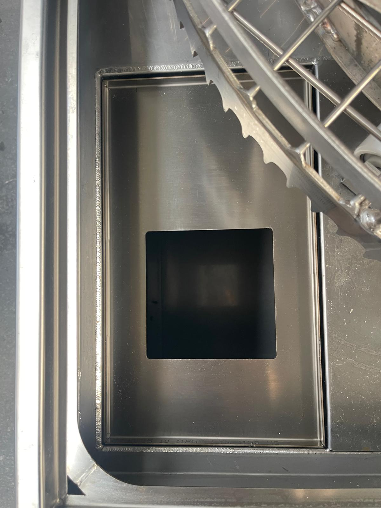
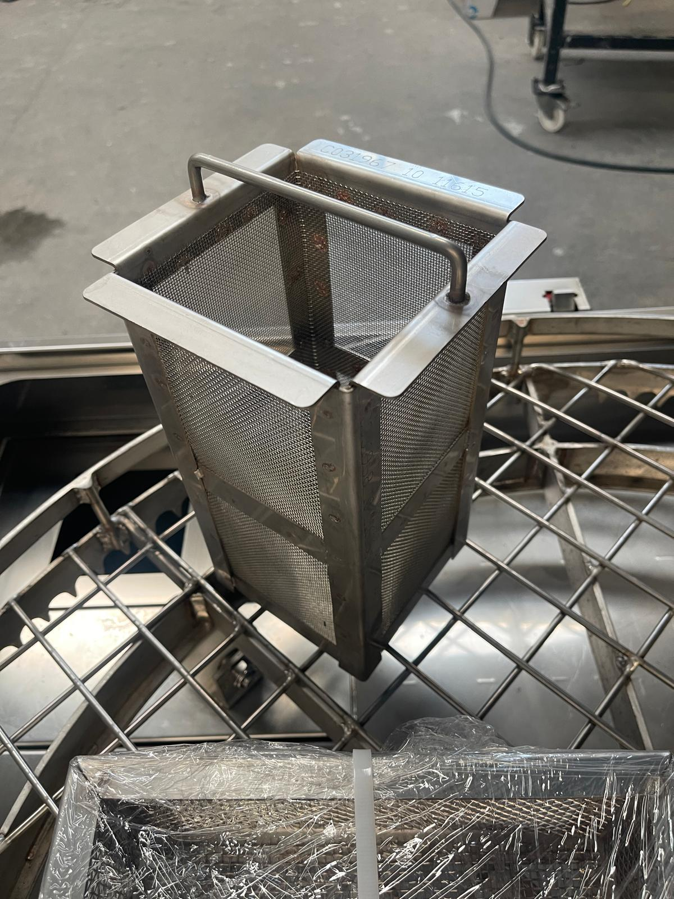
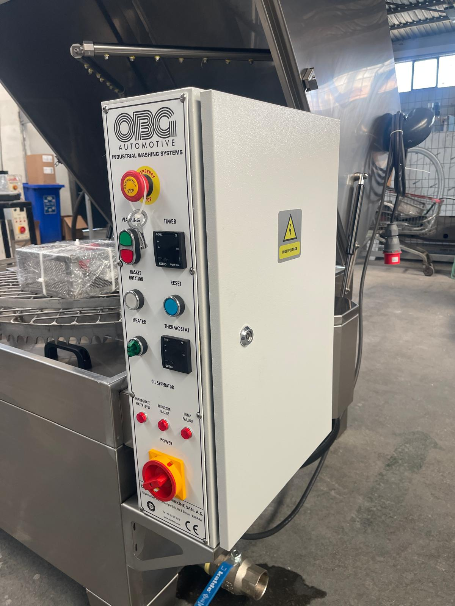

# 10.1 Cleaning and disinfection

## 10.1.1 Safety before cleaning

Carry out the following steps before every cleaning operation:

1. Stop the machine with the red STOP button and wait until the basket has come to a complete standstill.
2. Set the heater switch, the oil skimmer switch (if fitted) and the main switch to position **0**.
3. Apply LOTO (**See Chapter 2.4**).
4. Wait until the process water and the chamber surfaces have cooled to a safe temperature.
5. Open the lid and check that the gas springs hold the lid in the open position; if work is to be carried out under the lid, secure the lid with a support (**See Chapter 9.1.7**).

Do not bypass the lid-closed switch or the interlock lock during cleaning.

**WARNING — Hot surface and steam:** After operation, the process water, the tank, the chamber surfaces and the filters are hot; contact causes burns. Wait until the process water has cooled to a safe temperature before opening the lid, and wear heat-resistant protective gloves.

**WARNING — Chemical:** The process water contains washing chemical; contact with the skin and eyes can cause irritation. Wear protective gloves and safety goggles when cleaning the filters and the tank. Use only the cleaning agents specified in **Chapter 10.1.5**.

## 10.1.2 Daily cleaning — pre-filter

The pre-filter retains the coarse dirt and the swarf shed by the parts that is carried in the water returning from the washing chamber to the tank. The pre-filter is placed in the square filter housing in the front left corner of the washing chamber floor and is lifted out from above by its handle with the lid open.

*Figure 10.1 — Pre-filter housing in the chamber floor (left) and pre-filter basket removed from the housing (right)*

| Parameter | Value |
| :--- | :--- |
| **Interval** | Daily |
| **Spare part** | 07 10214 Pre-filter NS assembly |

1. Stop the machine and apply LOTO (**See Chapter 10.1.1**).
2. Release the lid latch and open the lid.
3. Grip the pre-filter by its handle and lift it upwards out of its housing.
4. Empty the coarse dirt and swarf from the filter into a waste container.
5. Clean the filter with mains water and an approved cleaning agent. Use high-pressure water or a brush if necessary.
6. Check the filter for deformation, tears or perforation. Replace a damaged filter with the spare part.
7. Remove any dirt remaining in the filter housing.
8. Place the filter in its housing in the correct orientation so that it is fully seated.
9. Close the lid and remove the LOTO.

Expected result: The pre-filter is clean and fully seated in its housing; no abnormal noise occurs at the pump suction when the machine is started.

**CAUTION — Operation without filter:** If the machine is operated without the pre-filter fitted, swarf and coarse dirt reach the tank and the pump suction directly; the pump impeller and mechanical seal are damaged and the nozzles become clogged. Do not operate the machine when the pre-filter is not in its housing.

## 10.1.3 Weekly cleaning — suction filter, bag filter and tank surface

The suction filter is the perforated cylindrical filter at the end of the pump suction pipe inside the tank and protects the pump from the particles in the tank. The filter is located in the section of the tank below the pre-filter housing, next to the heating element. Machines with the fine filter option additionally have a 200 micron bag filter in the pump outlet line; on machines with the oil skimmer option, the oil on the tank surface is removed by the skimmer disc.

*Figure 10.2 — Suction filter inside the tank (top) and heating element (bottom)*

| Parameter | Value |
| :--- | :--- |
| **Interval** | Weekly |
| **Suction filter spare part** | 07 00670 Suction filter assembly |
| **Bag filter spare part (fine filter option)** | 10 05378 Bag filter 200 micron |

1. Stop the machine and apply LOTO (**See Chapter 10.1.1**).
2. Carry out the daily pre-filter cleaning (**See Chapter 10.1.2**).
3. If access to the suction filter is required, drain the tank water (**See Chapter 10.1.4**).
4. Remove the suction filter.
5. Clean the suction filter; replace the filter if the holes are clogged or the filter body is damaged.
6. On machines with the fine filter, open the bag filter housing in the pump outlet line; remove the bag filter, clean it or replace it with a new bag; check the housing seal and close the housing.
7. Check the filter seals and the leak-tightness of their connections.
8. Remove the oil layer remaining on the tank surface. On machines with the oil skimmer, wipe the skimmer disc, the disc scraper and the oil flow path with a cloth; remove hardened oil and dirt deposits from the disc.
9. Refit the filters.
10. Refill the tank if necessary and remove the LOTO.

Expected result: The filters are clean or new; the pump flow rate is normal; there are no leaks at the connections; the oil skimmer disc is clean.

Details of suction filter removal and refitting: [EKSİK]

## 10.1.4 Tank draining, cleaning and disinfection

This operation is carried out when the process water has to be replaced (**See Chapter 7.6.2**), before a prolonged shutdown and when odour or dirt accumulation develops in the tank. Tank disinfection is carried out with soapy water.

*Figure 10.3 — Drain valve at the lower front right (below the electrical panel, ball valve with blue handle)*

1. Stop the machine and apply LOTO (**See Chapter 10.1.1**).
2. Check that the outlet of the drain valve is connected to the waste water collection point (**See Chapter 5.3.3**).
3. Open the drain valve and drain the process water from the tank completely. On machines with a drain pump, empty the tank with the drain pump; stop the pump as soon as it starts to run dry.
4. Remove and clean the pre-filter and the suction filter (**See Chapter 10.1.2** and **10.1.3**).
5. Collect the sludge and swarf accumulated on the tank floor.
6. Wash the inside surfaces of the tank with soapy water; use a soft brush or cloth suitable for stainless steel surfaces.
7. Drain the soapy water into the drain line.
8. Rinse the tank with clean water and drain the rinsing water.
9. Clean and rinse the inside surfaces of the washing chamber and the basket in the same way.
10. Close the drain valve.
11. Leave the inside of the tank to dry or dry it with a dry cloth.
12. Refit the filters.
13. Refill the tank in accordance with **Chapter 5.3.2** and remove the LOTO.

**CAUTION — Acidic disinfectant:** Acid-based disinfectants and cleaning agents cause corrosion on stainless steel surfaces, seals and the pump. Use only soapy water for tank disinfection.

## 10.1.5 Cleaning agents

| Application | Recommended product |
| :--- | :--- |
| **General cleaning** | VEIDEC 89 SUPER FOAM 750 |
| **Stubborn, persistent stains** (small amount, rubbing with a moistened sponge) | VEIDEC BIO CLEANING 3 |
| **Stainless steel surface polishing** | VEIDEC 34 INOX |
| **Tank disinfection** | Soapy water |
| **Water for machine cleaning** | Mains water |

If an equivalent product is used, the product must not be acid-based and must not damage the stainless steel, tank and seal materials. Neutral or mildly alkaline detergents compatible with stainless steel may be used. Use the cleaning agents in accordance with their manufacturer's instructions for dosage, contact time and rinsing.

Acid-based cleaning agents and cleaning agents that damage stainless steel must not be used.

## 10.1.6 Cleaning of the external surfaces and the electrical panel

1. Wipe the external stainless steel surfaces of the machine with a cloth, moistened with the general cleaning agent if necessary.
2. Dry the surfaces with a dry cloth.
3. Wipe the front of the electrical panel and the thermostat and timer displays only with a dry or slightly damp cloth.
4. Wipe the piston rods of the lid gas springs with a dry cloth; do not apply cleaning agent or oil to the piston rods.

**CAUTION — Water on electrical components:** Do not spray water or cleaning agent onto the electrical panel, the thermostat and timer, the lid-closed switch, the interlock lock housing or the optional fan motors. Water entering the panel causes short circuits, tripping of the residual current device and component failure.

Remove the LOTO after drying is complete. Put the machine into operation in accordance with **Chapter 7.2**.

## 10.1.7 Waste water and chemical disposal

The process water drained from the tank, the soapy washing water, the oil removed by the oil skimmer and the waste collected from the filters contain oil, dirt and chemicals. This waste:

- Must not be discharged directly into the sewer, the rainwater drain or the ground.
- Must be collected in accordance with the waste water and chemical waste legislation of the country in which the machine is used.
- Must be treated under the environmental permits of the facility or handed over to a licensed waste disposal company.

## 10.1.8 Cleaning record form

| No | Operation | Interval | Date | Carried out by |
| :---: | :--- | :--- | :--- | :--- |
| 1 | Pre-filter cleaning | Daily | | |
| 2 | Suction filter cleaning or replacement | Weekly | | |
| 3 | Bag filter cleaning or replacement (fine filter option) | Weekly | | |
| 4 | Removal of the oil layer from the tank surface; oil skimmer cleaning (option) | Weekly | | |
| 5 | Tank draining and disinfection (soapy water) | As required | | |
| 6 | Drying of the external surfaces | After every cleaning | | |
