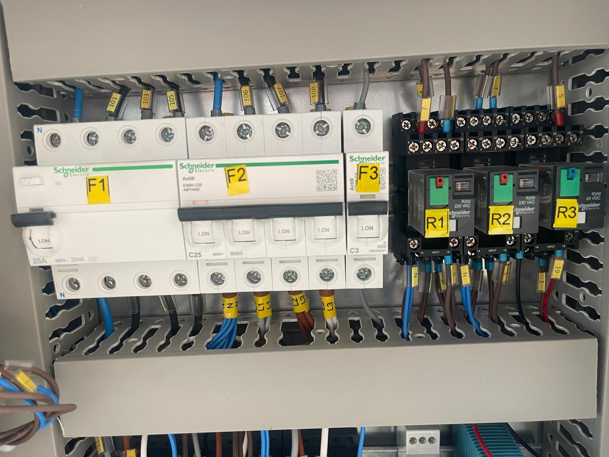

# 11.1 General diagnostic sequence

## 11.1.1 Fault indication

The machine indicates faults in two ways:

| Indication type | Scope | Diagnosis |
| :--- | :--- | :--- |
| **Fault lamp (panel front)** | Low water level (INADEQUATE WATER LEVEL), gear motor fault (REDUCTOR FAILURE), pump fault (PUMP FAILURE) | **Chapter 11.2**, Faults 1–3 |
| **Fault without lamp (thermal overload relay inside the panel)** | Drying fan, drain pump, oil skimmer, steam extraction fan and other optional motors | **Chapter 11.2**, Fault 4 |

Thermal overload relay trips on optional equipment without a fault lamp are noticed only by the equipment concerned not operating. In this case, the corresponding thermal overload relay inside the panel must be checked. Tripping of the residual current device or the phase sequence relay is noticed by the machine not operating at all (**Chapter 11.2**, Fault 5; **Chapter 11.3**).

*Figure 11.1 — Protective devices inside the panel (representative image): residual current device (F1), circuit breakers (F2, F3) and relays (R1–R3)*

## 11.1.2 Diagnostic sequence

In the event of a fault, follow the sequence below:

1. Check that the emergency stop button is released and that RESET has been pressed (**See Chapter 2.5**).
2. Read the fault lamps on the panel and find the fault corresponding to the lit lamp in **Chapter 11.2**.
3. If a thermal overload relay has tripped, first rectify the cause of the fault; then reset the thermal overload relay and try the machine again.
4. If an item of optional equipment without a fault lamp is not operating, have the thermal overload relay inside the panel checked (Fault 4).
5. If no lamp is lit and the machine is not operating, have the phase sequence relay and the residual current device checked (**See Chapter 11.3**).
6. If the residual current device has tripped, find the faulty circuit by switching on the functions one at a time (Fault 5).

Do not reset the thermal overload relay or the residual current device repeatedly without rectifying the cause of the fault. Every reset carried out without rectifying the cause increases the risk of permanent damage to the motor, the heating element or the cables.

## 11.1.3 Criteria for calling the service

Stop using the machine and contact the authorised service in the following cases (**See Chapter 1.3**):

- If the same fault recurs after the thermal overload relay has been reset,
- If the gear motor or the pump draws excessive current even when running without load,
- If the residual current device trips repeatedly, regardless of the circuit,
- If replacement of the lid switch or repair of the wiring is required and no authorised maintenance personnel are available at the operating company,
- If internal damage to the motor or mechanical damage to the pump is suspected.

When contacting the service, state the machine model (LYM 1150 NS), the serial number (0226087), the fault lamp that is lit, when and during which operation the fault occurred, and the diagnostic steps carried out.
