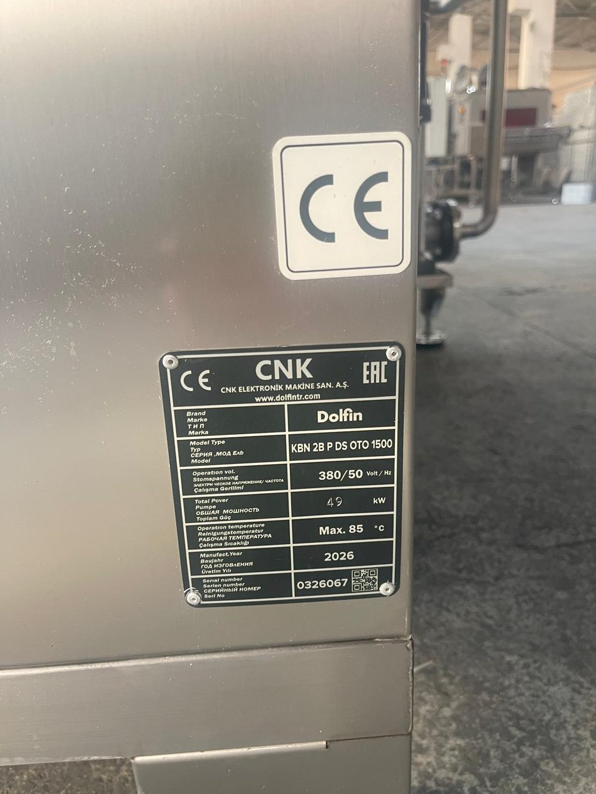
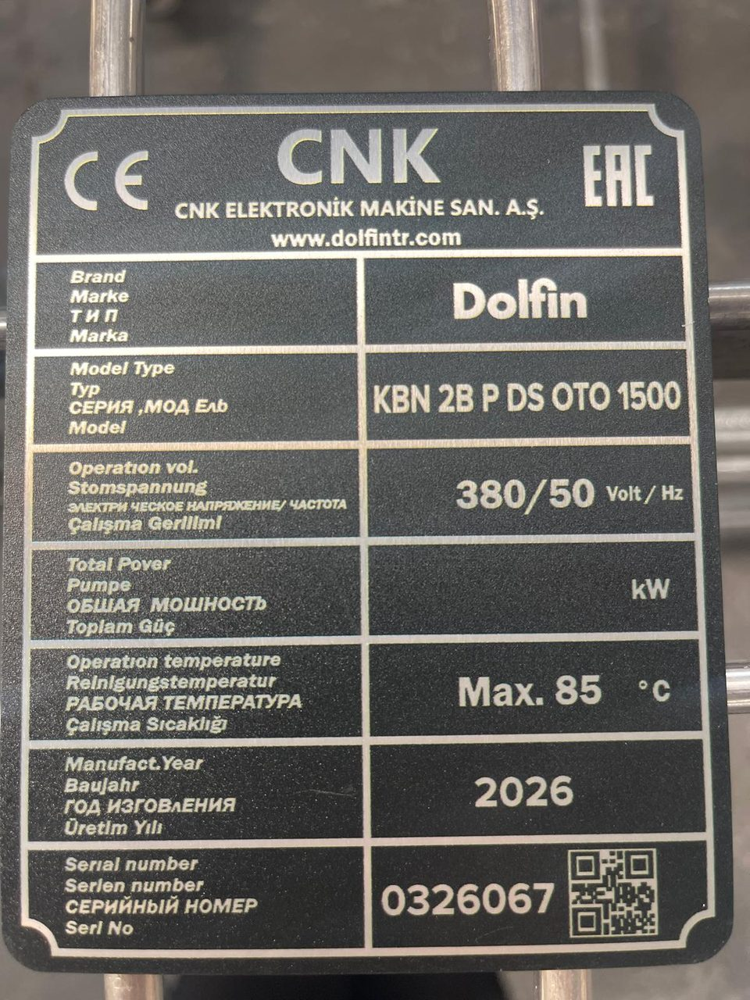

# 1.1 Kılavuz hakkında

## 1.1.1 Kılavuzun amacı ve kapsamı

Bu kullanım kılavuzu, aşağıda tanımlanan parça yıkama makinesinin güvenli taşınması, kurulması, devreye alınması, çalıştırılması, ayarlanması, temizlenmesi, bakımı, arıza giderilmesi ve hizmet dışı bırakılması için gereken bilgileri içerir. Kılavuz, makinenin tip plakasındaki seri numarasıyla tanımlanan tek bir makine için hazırlanmıştır; aynı model ailesindeki başka bir makinede kullanılmadan önce üreticiye danışılmalıdır.

Tablo: Kılavuzun geçerli olduğu makine

| Bilgi | Değer |
|---|---|
| Makine | {{PROJE:Makine ticari adı}} |
| Model | {{PROJE:Makine model kodu}} |
| Marka | {{PROJE:Marka}} |
| Seri numarası | {{PROJE:Makine seri numarası}} |
| Üretim yılı | {{PROJE:Üretim yılı}} |
| Üretici | {{URETICI:Üretici firma adı}} |
| Müşteri | {{MUSTERI:Müşteri}} |
| Kılavuz dili | {{PROJE:Kılavuz dili}} |

Kılavuz, makineyle birlikte teslim edilen şu donanımları da kapsar: {{MAKINE_TANIMI:Opsiyon / varyant listesi (bu projeye özel)}}.

Makinede kullanılan satın alınmış bileşenlerin (operatör paneli, PLC, frekans invertörü, pompalar, sensörler, pnömatik elemanlar) kendi üretici kılavuzları bu kılavuzun ekidir. Bu kılavuz, bileşen kılavuzlarındaki bilgilerden yalnızca makinenin kullanımı için gereken kısmı içerir; bileşenin ayrıntılı ayarı, onarımı veya yazılımı için ilgili üretici kılavuzuna başvurulmalıdır (**Bkz. Bölüm 13.1**).

## 1.1.2 Hedef kitle ve personel nitelikleri

Kılavuz, makineyle çalışan tüm kişiler için yazılmıştır. Her görev, yalnızca o görev için aşağıdaki nitelikleri taşıyan ve işletme tarafından yetkilendirilmiş kişilerce yapılır. Yetkisiz kişilerin makineyi çalıştırması, ayar değiştirmesi veya bakım yapması yasaktır.

Tablo: Personel grupları ve nitelikleri

| Personel | Bu kılavuzdaki görevleri | Gereken nitelik |
|---|---|---|
| Operatör | Parça yükleme ve boşaltma, reçete seçimi, çevrimi başlatma ve durdurma, alarm onaylama, günlük kontroller ve günlük temizlik | Bu kılavuzun Bölüm 2, 3, 7 ve 10'u üzerinden işletmece eğitilmiş ve yetkilendirilmiş kişi |
| Mekanik bakım personeli | Periyodik bakım, filtre ve tank temizliği, teker, conta ve pnömatik eleman değişimi, mekanik ayarlar | Makine bakımında deneyimli, LOTO uygulamasını bilen, bu kılavuzla eğitilmiş teknisyen |
| Elektrik bakım personeli | Elektrik panosundaki tüm işler, koruma elemanlarının resetlenmesi, ölçümler, izolasyon testi | Ulusal mevzuata göre yetkili, alçak gerilim tesisatında çalışma yetkisi olan elektrikçi |
| Yetkili kullanıcı | Kurulum Sayfası'ndaki ayarlar (geçiş süresi, saat ve tarih), alarm geçmişinin incelenmesi | Kurulum Sayfası şifresi işletme tarafından verilmiş vardiya amiri veya bakım sorumlusu |
| Kurulum ve servis personeli | Montaj, devreye alma, PLC ve operatör paneli programı, sürücü parametreleri | Üretici servis personeli veya üreticinin yazılı onayıyla görevlendirilmiş uzman |

## 1.1.3 Kılavuzun kullanımı

Kılavuz, EN ISO 20607 yapısına göre 14 bölümden oluşur. Bir işe başlamadan önce o işin anlatıldığı bölümün tamamını okuyun; prosedürlerdeki adımları yazıldığı sırayla uygulayın. Bir adımda o adıma özgü tehlike varsa adımın hemen önünde uyarı kutusu bulunur.

Tablo: Bölümler ve içerikleri

| Bölüm | İçerik |
|---|---|
| 1 Giriş | Kılavuzun kapsamı, semboller, servis bilgileri |
| 2 Güvenlik | Tehlikeler, güvenlik donanımları, KKD, LOTO, acil durumlar |
| 3 Genel bakış | Makinenin tanımı, amaçlanan kullanım, teknik özellikler, kumanda elemanları, yerleşim |
| 4 Taşıma | Taşıma, elleçleme ve depolama |
| 5 Montaj | Montaj, konumlandırma, tesisat bağlantıları, güvenlik ve devreye alma testleri |
| 6 Ayarlar | Mekanik, güvenlik, elektrik, pnömatik ve reçete ayarları |
| 7 Çalıştırma | Çalışma modları, çalıştırma, durdurma, otomatik çevrim, günlük akış |
| 8 Kapasite | Çevrim süresi, kapasite hesabı, ürüne özel ayarlar |
| 9 Bakım | Bakım planı, kritik malzeme listesi, bakım prosedürleri |
| 10 Temizlik | Günlük ve periyodik temizlik |
| 11 Arıza giderme | Arıza bulma yöntemi, alarm kodları, belirtiye göre arızalar |
| 12 Demontaj | Devre dışı bırakma, demontaj ve hurdaya ayırma |
| 13 Dokümanlar | Teslim edilen dokümanlar, elektrik şeması ve I/O listesi, yedek parça listesi |
| 14 Ekler | Kontrol ve kayıt formları, sözlük |

Şekil ve tablolar bölüm numarasıyla numaralandırılmıştır (ör. Şekil 3-1, Tablo 7-2). Metin içindeki **Bkz. Bölüm X.Y** ifadeleri, konunun ayrıntılı anlatıldığı yeri gösterir. Teknik değerler yalnızca tek bir yerde verilir; diğer bölümler o yere referans verir.

## 1.1.4 Kılavuzun saklanması

Kılavuz makinenin bir parçasıdır. Aşağıdaki kurallara uyun:

- Kılavuzu makinenin yanında, operatörün ve bakım personelinin her an ulaşabileceği kuru bir yerde saklayın.
- Kılavuzun eksiksiz ve okunaklı kalmasını sağlayın; sayfa çıkarmayın.
- Kılavuz kaybolur veya hasar görürse makinenin seri numarasını belirterek üreticiden yenisini isteyin (**Bkz. Bölüm 1.3**).
- Makine satılır veya başka bir işletmeye devredilirse kılavuzu ve ekindeki tüm dokümanları makineyle birlikte teslim edin.
- Üreticiden gelen kılavuz güncellemelerini ve servis notlarını kılavuza ekleyin.

## 1.1.5 Tip plakası ve makine kimliği

Tip plakası makine gövdesi üzerindedir; CE işareti tip plakasının üstünde ayrı bir etiket olarak bulunur. Tip plakası makinenin yasal kimliğidir: plakayı sökmeyin, boyamayın, üzerini kapatmayın. Plaka okunmaz hale gelirse üreticiden yenisini isteyin.

Tablo: Tip plakası bilgileri

| Plakadaki alan | Değer |
|---|---|
| Üretici | {{URETICI:Üretici firma adı}} — {{URETICI:Web sitesi}} |
| Marka | {{PROJE:Marka}} |
| Model | {{PROJE:Makine model kodu}} |
| Çalışma gerilimi / frekans | {{ELEKTRIK:Besleme gerilimi (V)}} V / {{ELEKTRIK:Besleme frekansı (Hz)}} Hz |
| Toplam güç | {{ELEKTRIK:Toplam kurulu güç (kW)}} kW |
| Çalışma sıcaklığı | En fazla {{KAPASITE_PROSES:Azami çalışma sıcaklığı (°C)}} °C |
| Üretim yılı | {{PROJE:Üretim yılı}} |
| Seri numarası | {{PROJE:Makine seri numarası}} |
| Uygunluk işaretleri | {{PROJE:Uygunluk işaretleri}} |

Üreticiyle yapılan her yazışmada ve yedek parça siparişinde model ve seri numarasını belirtin.

## 1.1.6 Uygunluk ve standartlar

Makine {{PROJE:Uygunluk işaretleri}} işaretlidir. Makinenin uygunluk beyanının referansı: {{DOKUMANLAR:AB / AT uygunluk beyanı}}. Bu kılavuz EN ISO 20607 (Makinelerde güvenlik — Kullanım kılavuzu — Genel hazırlama ilkeleri) ve EN ISO 12100 (Makinelerde güvenlik — Tasarım için genel prensipler — Risk değerlendirmesi ve risk azaltımı) esas alınarak hazırlanmıştır.

Makinede üreticinin yazılı onayı olmadan yapılan her değişiklik, uygunluk beyanını geçersiz kılar ve değişikliği yapanı makine üreticisi konumuna getirir (**Bkz. Bölüm 2.1.5**).

## 1.1.7 Sorumluluğun sınırları

Üretici, aşağıdaki durumlardan kaynaklanan yaralanma ve hasarlardan sorumlu değildir:

- Bu kılavuzdaki talimatlara uyulmaması.
- Makinenin amaçlanan kullanımı dışında kullanılması (**Bkz. Bölüm 3.2**).
- Güvenlik donanımlarının devre dışı bırakılması, köprülenmesi veya sökülmesi.
- Makinede, PLC programında veya operatör paneli projesinde üreticinin onayı olmadan değişiklik yapılması.
- Orijinal olmayan veya üreticinin onaylamadığı yedek parça kullanılması.
- Yetkisiz veya eğitimsiz personelin makineyle çalışması.
- Bölüm 9'daki bakımların yapılmaması veya kayıt altına alınmaması.

Garanti koşulları satış sözleşmesinde tanımlanır.

## 1.1.8 Telif hakkı

Bu kılavuzun telif hakkı {{URETICI:Üretici firma adı}} şirketine aittir. Kılavuz yalnızca makineyi kullanan işletmenin iç kullanımı içindir; üreticinin yazılı izni olmadan tamamen veya kısmen çoğaltılamaz, üçüncü kişilere verilemez.
