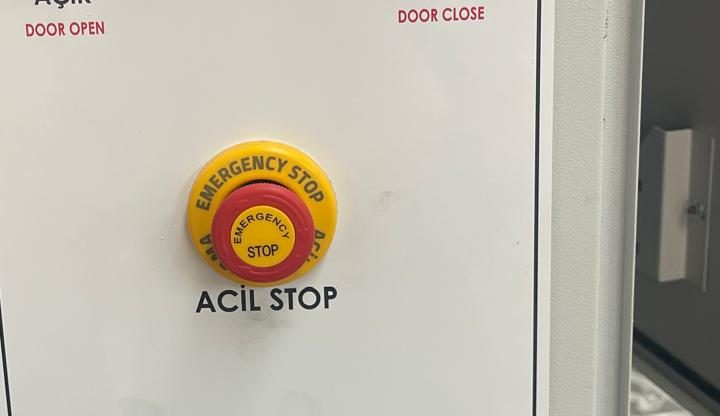
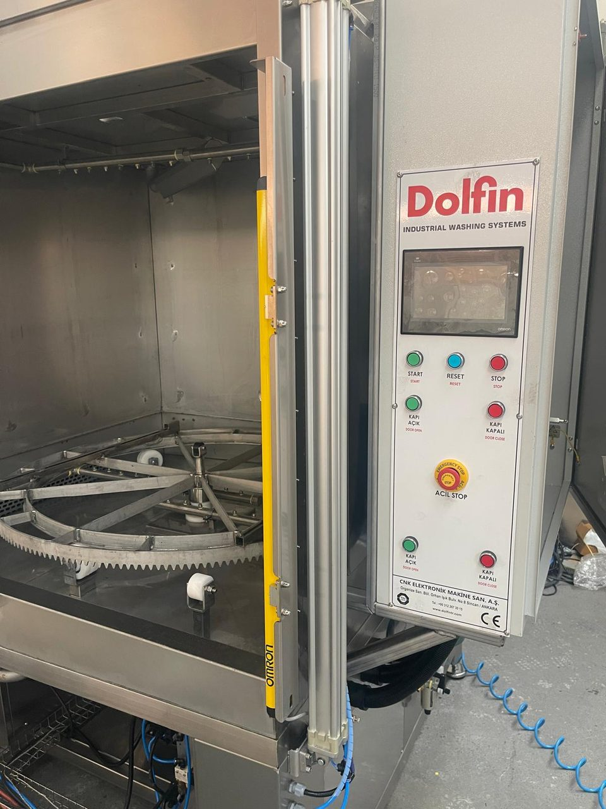
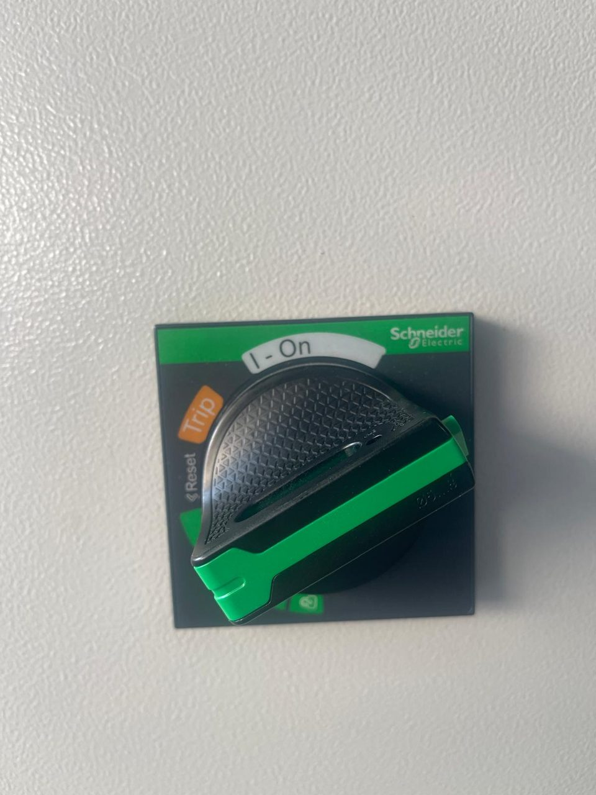
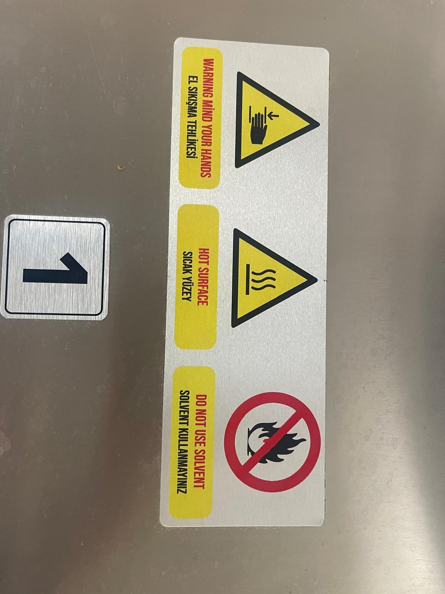
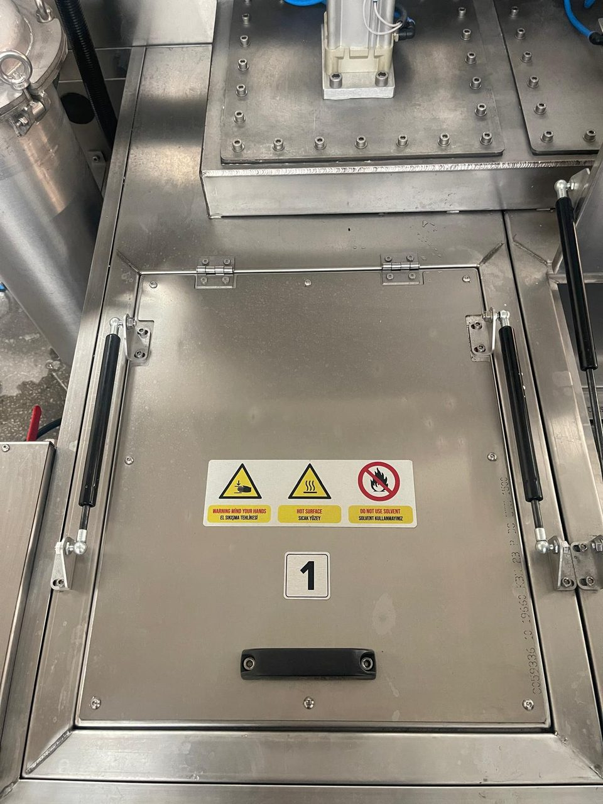
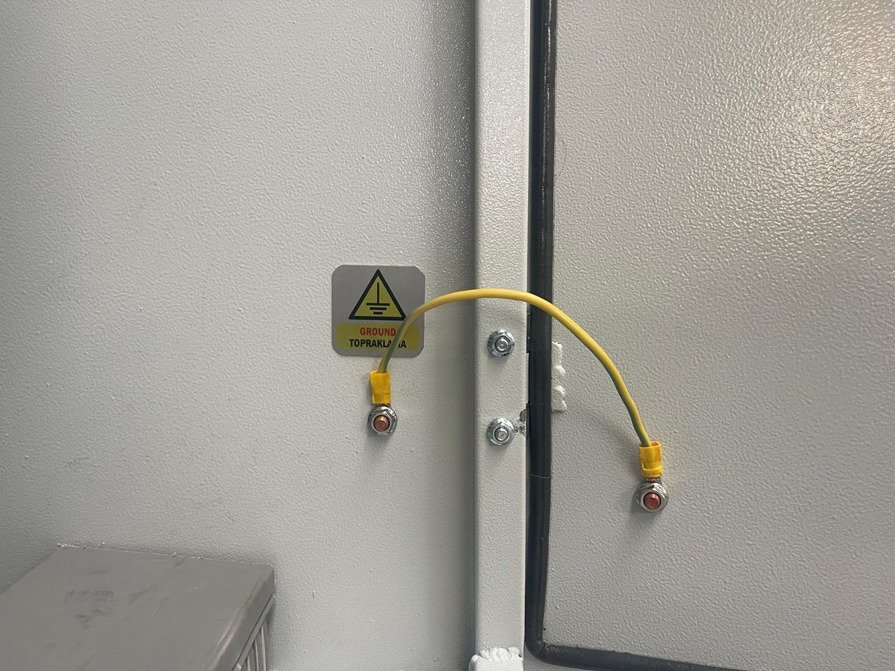

# 2.2 Güvenlik bilgileri

## 2.2.1 Güvenlik donanımları

Makinedeki güvenlik donanımları aşağıdaki tabloda verilmiştir. Bu donanımların çalışması devreye almada (**Bkz. Bölüm 5.4**) ve periyodik olarak (**Bkz. Bölüm 9.1.3**) test edilir. Arızalı bir güvenlik donanımıyla makine çalıştırılmaz.

Tablo: Güvenlik donanımları

| Donanım | Konum | İşlevi |
|---|---|---|
| Acil durdurma butonu (ACİL STOP) | Kumanda paneli | Basıldığında makineyi anında durdurur ve çalışan çevrimi iptal eder. Butona basınca kilitlenir, çevrilerek bırakılır. |
| Güvenlik rölesi ({{KONTROLLER:Güvenlik rölesi tipi}}) | Elektrik panosu | Acil durdurma devresini izler; buton bırakıldıktan sonra **RESET** butonuyla yeniden devreye alınır. PLC'ye acil durdurma bilgisini verir (I0.0). |
| **RESET** butonu | Kumanda paneli | Acil durdurma butonu bırakıldıktan sonra güvenlik rölesini yeniden devreye alır. |
| Kabin kapısı | Kabinin önü | Çevrim sırasında kabin içindeki dönen sepete, püskürtülen sıcak sıvıya ve sıcak havaya erişimi engeller. Yalıtımlıdır. |
| Kapı kapalı sviçi ({{SENSORLER:S07#2}}) | Kabin kapısı | Kapı tam kapanmadan çevrimin başlamasını engeller (Error-422). |
| Işık perdesi | Kapı açıklığının iki yanı | Kapı açıklığında el veya cisim algılar; kapının kapanma hareketine karşı ezilme korumasıdır (el koruma sensörü, I1.11). |
| Pilotlu çek valfler | Kapı silindirlerinin hava hatları | Basınçlı hava kesildiğinde silindirlerdeki havayı hapsederek kapının kendi ağırlığıyla düşmesini önler. |
| Ana şalter | Elektrik panosu kapağı | Makinenin tüm elektrik beslemesini keser; kapalı konumda asma kilitle kilitlenir (**Bkz. Bölüm 2.4**). |
| Kaçak akım röleleri F1–F4 | Elektrik panosu | Motor (F1) ve ısıtıcı (F2–F4) devrelerinde kaçak akımda beslemeyi keser; F2–F4 atınca panelde Error-170, 171, 172 çıkar. |
| Faz koruma rölesi ({{ELEKTRIK:Faz koruma rölesi tipi}}) | Elektrik panosu | Faz eksikliği veya yanlış faz sırasında uyarır (Error-410). |
| Motor koruma şalterleri Q1–Q6 | Elektrik panosu | Motorları aşırı akıma karşı korur; atınca ilgili Error mesajı çıkar. |
| Seviye sensörleri | Her tankta | Sıvı pompa seviyesinin altına düşünce o tankın pompasını ve ısıtıcısını durdurur (kuru çalışma ve kuru ısıtma koruması). |
| Hava basınç şalteri | Basınçlı hava girişi | Giriş basıncı düştüğünde uyarır (Error-235). |
| Kilitli pano kapakları | Elektrik panosu, pnömatik valf kutusu | Gerilim altındaki parçalara ve valflere yetkisiz erişimi engeller. |
| Tank kapağı amortisörleri | Tank kapakları | Açık tank kapağını tutar, kapağın düşmesini önler. |
| Kule lambası | Elektrik panosu üstü | Makinenin durumunu uzaktan gösterir: kırmızı alarm, yeşil çevrim, sarı bekleme (**Bkz. Bölüm 3.4.2**). |

## 2.2.2 Tehlikeli bölgeler

Tablo: Tehlikeli bölgeler

| Bölge | Tehlike | Ne zaman | Önlem |
|---|---|---|---|
| Kapı açıklığı | Dikey hareket eden kabin kapısının ezmesi, sıkıştırması | Kapı açılırken ve kapanırken | Kapı hareket ederken açıklığa uzanmayın; ışık perdesini çalışır durumda tutun |
| Kabin içi ve dönen sepet | Dönen sepete ve pinyon–kremayer kavramasına el veya giysi sıkışması; sıcak sıvı ve sıcak hava | Çevrim sırasında, STOP sonrası konumlamada, **Sepet Test** sırasında | Kapı kapalıyken çalışın; **Sepet Test** sırasında kabine uzanmayın; kabine girmeden LOTO uygulayın |
| Tank ünitesi | Sıcak sıvı, buhar, yıkama kimyasalı; tank kapağının düşmesi | Isıtma açıkken, çevrimde, drenajda, tank bakımında | Tank kapağını yalnızca gerektiğinde açın; KKD kullanın; amortisörü zayıflamış kapağı açık bırakmayın |
| Çatı | Sıcak ısıtıcı kutusu ve hava kanalı; dönen fan pervaneleri; yüksekte çalışma | Kurutma sırasında ve sonrasında | Çatıya yalnızca LOTO uygulanmış ve soğumuş makinede, işletmenin yüksekte çalışma talimatına göre çıkın |
| Kabin altı | Sıcak pompa gövdeleri ve borular; pnömatik valfler | Çevrim sırasında ve sonrasında | Kabin altına çevrim sırasında uzanmayın |
| Torba filtreler ve pompa hatları | Basınç altındaki sıcak sıvının fışkırması | Pompa çalışırken ve hemen sonra | Filtre kapağını yalnızca pompa durmuş ve hat boşaltılmışken açın (**Bkz. Bölüm 9.1.8**) |
| Tahliye odası | Pnömatik silindir hareketiyle el sıkışması | Vanalar konum değiştirirken | Hava basıncı varken tahliye odası kapağını açmayın |
| Elektrik panosu | Elektrik çarpması ({{ELEKTRIK:Besleme gerilimi (V)}} V) | Pano kapağı açıkken | Panoyu yalnızca yetkili elektrikçi açar |
| Makine çevresindeki zemin | Kayma, düşme | Drenaj, temizlik, sızıntı | Zemini kuru tutun; sızıntıyı hemen giderin |

## 2.2.3 Artık riskler

Aşağıdaki tehlikeler tasarım ve koruyucu donanımlarla tamamen giderilemez; uyarılara ve kurallara uyarak önlenir.

**UYARI — Ezilme:** Kabin kapısı pnömatik silindirlerle dikey hareket eder. Kapı hareket ederken kapı açıklığındaki el, kol veya baş ezilebilir. Kapıyı kumanda ederken açıklığı gözünüzle kontrol edin; ışık perdesini temiz ve çalışır durumda tutun.

**UYARI — Düşen kapı:** Kapı açık konumdayken basınçlı hava yalnızca pilotlu çek valflerle tutulur. Valflerde kaçak varsa kapı zamanla aşağı kayabilir. Açık kapının altında uzun süre çalışmayın; kabin içinde bakım yapmadan önce kapıyı mekanik olarak destekleyin (**Bkz. Bölüm 2.4.3**).

**UYARI — Sıkışma:** Dönen sepet ile kabin arasında ve pinyon–kremayer kavramasında el veya giysi sıkışabilir. Sepet dönerken kabine uzanmayın. **Sepet Test** sepeti kapı açıkken de döndürebilir.

**UYARI — Sıcak sıvı ve buhar:** Tank sıvısı {{RECETE_PARAMETRELERI:P01 Yıkama sıcaklık set değeri#3}} °C aralığında ısıtılır; tip plakasındaki azami çalışma sıcaklığı {{KAPASITE_PROSES:Azami çalışma sıcaklığı (°C)}} °C'dir. Kapı açıldığında buhar çıkar; sıcak sıvı ciltte yanığa yol açar. Çevrim bitmeden kapıyı açmayın; tank, drenaj ve filtre işlerinde KKD kullanın.

**UYARI — Sıcak yüzey:** Kurutma havası {{RECETE_PARAMETRELERI:P05 Kurutma sıcaklık set değeri#3}} °C aralığında ısıtılır. Çevrim sonunda parçalar, sepet, kabin iç yüzeyleri, ısıtıcı kutusu, pompalar ve borular sıcaktır. Isıya dayanıklı eldiven kullanın; bakımdan önce soğumasını bekleyin.

**TEHLİKE — Elektrik çarpması:** Elektrik panosunda ve ısıtıcı bağlantı kutularında {{ELEKTRIK:Besleme gerilimi (V)}} V gerilim vardır. Ana şalter kapalıyken bile ana şalterin besleme tarafı gerilim altındadır. Panoda yalnızca yetkili elektrikçi, LOTO uygulayarak çalışır.

**UYARI — Kimyasal madde:** Yıkama kimyasalları cildi ve gözü tahriş edebilir veya aşındırabilir. Kimyasal hazırlama, tank doldurma, drenaj ve filtre temizliğinde kimyasala dayanıklı eldiven ve göz koruyucu kullanın; GBF'deki talimatlara uyun.

**UYARI — Yangın:** Tanklara solvent, benzin, tiner veya başka yanıcı sıvı koymayın. Isıtıcılar ve sıcak kurutma havası yanıcı buharları tutuşturabilir.

**DİKKAT — Kayma:** Drenaj, temizlik ve sızıntılarda zemin ıslanır ve yağlanır. Kaymaz ayakkabı giyin; zemini hemen kurulayın.

**DİKKAT — Pnömatik enerji:** Hava beslemesi kesildikten sonra silindirlerde ve hatlarda basınç kalabilir. Pnömatik bağlantıyı sökmeden önce elemanın basıncının boşaldığından emin olun (**Bkz. Bölüm 2.4**).

**DİKKAT — Gürültü:** Makinenin gürültü emisyon değeri: {{ORTAM_KOSULLARI:Gürültü seviyesi (dB(A))}}. İşletme, çalışma alanında ölçüm yaparak kulak koruyucu gereksinimini belirler.

**DİKKAT — Ağır yük:** Ağır parçaların elle yüklenmesi bel ve sırt yaralanmasına yol açabilir. Parçaları yükleme arabası veya kaldırma ekipmanıyla taşıyın.

## 2.2.4 Kişisel koruyucu donanım

Aşağıdaki tabloda her görev için kullanılacak en az KKD verilmiştir. Kullanılan kimyasalın GBF'si daha fazlasını gerektiriyorsa GBF'ye uyun.

:M008: :M009: :M004: :M010: :M013: :M014:

**Görevlere göre kişisel koruyucu donanım**

{{TABLO:KKD}}

KKD'yi her kullanımdan önce kontrol edin; yırtık eldiveni, çatlak gözlüğü ve aşınmış ayakkabıyı değiştirin.

## 2.2.5 Makine üzerindeki güvenlik etiketleri

Makine üzerindeki etiketler tehlikeli noktaları gösterir. Etiketleri sökmeyin, boyamayın, üzerini kapatmayın; okunmaz hale gelen etiketi aynısıyla değiştirin.

Tablo: Makine üzerindeki etiketler

| Etiket | Konum | Anlamı |
|---|---|---|
| :W024: "Warning mind your hands / El sıkışma tehlikesi" | Tank kapakları | Kapak kapanırken el sıkışabilir |
| :W017: "Hot surface / Sıcak yüzey" | Tank kapakları | Kapak ve tank sıcaktır |
| :P001: "Do not use solvent / Solvent kullanmayınız" | Tank kapakları | Tanklarda solvent ve yanıcı sıvı kullanmak yasaktır |
| Tank numarası "1", "2" | Tank kapakları | Yıkama tankı {{TANKLAR:Yıkama tankı kapak numarası}}, durulama tankı {{TANKLAR:Durulama tankı kapak numarası}} |
| :W012: Elektrik tehlikesi | Elektrik panosu kapağı | Pano içinde tehlikeli gerilim vardır |
| "Panoların kapaklarını kilitli tutunuz" | Elektrik panosu kapağı | Pano kapağı her zaman kilitli tutulur |
| "Keep locked / Kilitli tut" | Pnömatik valf kutusu | Valf kutusu kapağı kilitli tutulur |
| "Ground / Topraklama" | Elektrik panosu kapağı | Kapak topraklama bağlantısı; sökülmez |
| "Air inlet / Hava girişi" | Basınçlı hava girişi | Basınçlı hava bağlantı noktası |
| "TAŞMA HATTI" | Tank ünitesi ön yüzü | Taşma hattı çıkışı |
| "DRENAJ" | Tank ünitesi alt kenarı | Tank drenaj vanası |
| CE işareti ve tip plakası | Makine gövdesi | Makine kimliği (**Bkz. Bölüm 1.1.5**) |

## 2.2.6 Sıcaklıklar ve sıcak yüzeyler

Tablo: Makinedeki sıcaklıklar

| Yer | Sıcaklık | Not |
|---|---|---|
| Yıkama ve durulama tankı sıvısı | Ayar aralığı {{RECETE_PARAMETRELERI:P01 Yıkama sıcaklık set değeri#3}} °C | Hazırlık açık kaldıkça çevrim dışında da sıcak tutulur |
| Kurutma havası | Ayar aralığı {{RECETE_PARAMETRELERI:P05 Kurutma sıcaklık set değeri#3}} °C | Kurutma fazında |
| Azami çalışma sıcaklığı (tip plakası) | {{KAPASITE_PROSES:Azami çalışma sıcaklığı (°C)}} °C | Makinenin tasarım sınırı |
| Isıtıcı kutusu ve hava kanalı (çatı) | Kurutma sıcaklığının üzerinde | Kurutma sırasında ve sonrasında dokunmayın |
| Pompalar, borular, filtre gövdeleri | Tank sıvısı sıcaklığında | Çevrim sırasında ve sonrasında |
| Parçalar, sepet, kabin iç yüzeyi | Kurutma sıcaklığına yakın | Çevrim sonunda |

Elle temas gerektiren bakım ve temizlik işlerine sıvı ve yüzeyler 40 °C'nin altına indikten sonra başlayın.

## 2.2.7 Kimyasal güvenlik

Yıkama sıvısı su ve endüstriyel yıkama kimyasalından hazırlanır. Kimyasalla ilgili şu kurallara uyun:

- Yalnızca su bazlı ve kimyasal tedarikçisinin parça yıkama makineleri için önerdiği kimyasalları kullanın.
- Kimyasalın makine malzemeleriyle uyumunu tedarikçiye onaylatın: {{AMACLANAN_KULLANIM:Malzeme uyumu}}.
- Kimyasalı tedarikçinin önerdiği derişimde hazırlayın; derişimi düzenli ölçün.
- Farklı kimyasalları karıştırmayın; kimyasal değişiminde tankları boşaltıp temizleyin.
- Kimyasalı tanka dökerken önce suyu koyun, kimyasalı sonra ekleyin.
- Kimyasalı orijinal, etiketli kabında ve GBF'deki koşullarda saklayın.
- Kullanılmış yıkama sıvısını, ayrılmış yağı ve tank çamurunu kanalizasyona dökmeyin (**Bkz. Bölüm 10.1.7**).

İlk yardım için **Bkz. Bölüm 2.5.7**.
