# 3.4 Kumanda elemanları ve göstergeler

## 3.4.1 Kumanda paneli

Kumanda paneli, kabin kapısının sağındaki elektrik panosunun öne bakan yüzündedir. Panelde operatör paneli (dokunmatik ekran), çevrim butonları, kapı butonları ve acil durdurma butonu bulunur.

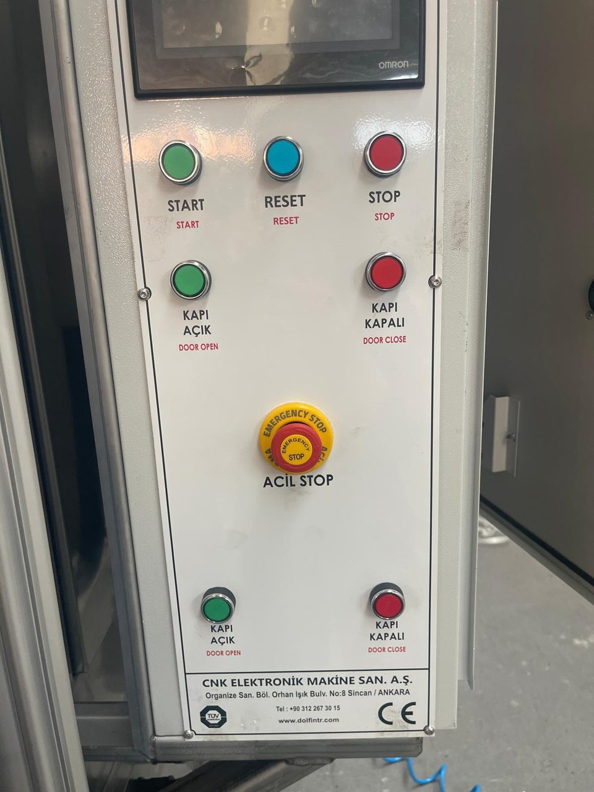

Tablo: Kumanda paneli elemanları

| No | Eleman | Tür | İşlevi |
|---|---|---|---|
| 1 | Operatör paneli | 7 inç dokunmatik ekran ({{KONTROLLER:HMI marka / model}}) | Reçete seçimi ve düzenleme, faz seçimi, **Hazırlık**, **Sepet Test**, manuel kumanda, alarm ve durum izleme (**Bkz. Bölüm 3.4.3**) |
| 2 | **START** | Yeşil buton | Çevrimi başlatır. Çevrim yalnızca bu butonla başlar; operatör panelinde başlatma butonu yoktur. |
| 3 | **RESET** | Mavi buton | Acil durdurma butonu bırakıldıktan sonra güvenlik rölesini yeniden devreye alır. |
| 4 | **STOP** | Kırmızı buton | Çalışan çevrimi kontrollü durdurur: çalışan adım güvenli şekilde bitirilir, sepet başlangıç konumuna getirilir (**Bkz. Bölüm 7.3.2**). |
| 5 | **KAPI AÇIK** | Yeşil buton (iki adet: üst ve alt) | Kabin kapısını açar (kaldırır). |
| 6 | **KAPI KAPALI** | Kırmızı buton (iki adet: üst ve alt) | Kabin kapısını kapatır (indirir). |
| 7 | Acil durdurma butonu (ACİL STOP) | Kırmızı mantar başlı, kilitlenen buton | Makineyi anında durdurur ve çevrimi iptal eder (**Bkz. Bölüm 2.5.1**). |
| 8 | Üretici etiketi | Etiket | Üretici adı, adresi, telefonu ve web adresi |

Kapı butonları her biri iki adet olmak üzere panelin üst ve alt bölümündedir. Kapıyı kumanda ederken aynı adlı iki butona birlikte basın ve kapı son konumuna gelene kadar basılı tutun (**Bkz. Bölüm 7.2.5 ve 7.2.6**).

## 3.4.2 Kule lambası

Kule lambası elektrik panosunun üstündedir ve makinenin durumunu uzaktan gösterir.

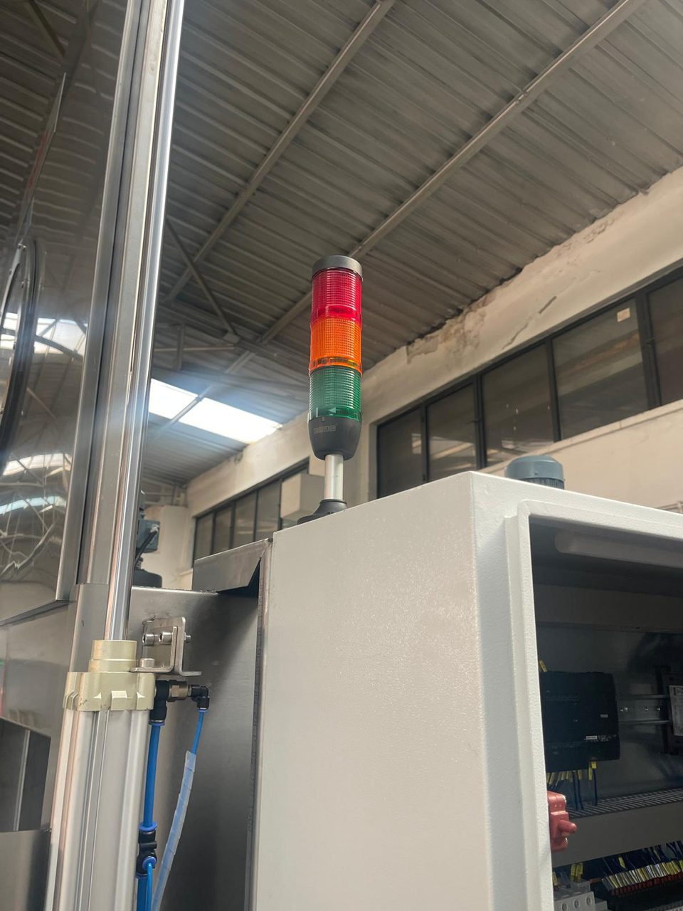

Tablo: Kule lambasının anlamları

| Renk | Anlamı | Yapılacak |
|---|---|---|
| Kırmızı | En az bir alarm aktif. Alarm varken yeşil ve sarı lamba yanmaz; kırmızı lamba aktif alarm kalmayana kadar yanar. | Alarm Sayfası'ndaki mesajı okuyun; nedeni giderin (**Bkz. Bölüm 11.1**). |
| Yeşil | Çevrim çalışıyor, alarm yok. | Kapıyı açmayın; kabine müdahale etmeyin. |
| Sarı | Makine çevrimde değil (bekliyor), alarm yok. Çevrim bitince lamba yeşilden sarıya döner. | Kapı açılabilir; yükleme ve boşaltma yapılabilir. |
| Hiçbiri | Makinede enerji yok veya kumanda devresi enerjisiz. | Ana şalteri ve kumanda devresi sigortalarını kontrol ettirin. |

## 3.4.3 Operatör paneli — genel kullanım

Operatör paneli 7 inç dokunmatik ekrandır. Ekrandaki butonlara ve değer kutularına parmakla dokunun; sivri veya sert cisim kullanmayın. Değer kutusuna dokunulduğunda bir tuş takımı açılır; yeni değeri girip onaylayın. Panel dilleri: {{KONTROLLER:Operatör paneli dilleri}}.

Panelde altı ekran vardır. Sol sütundaki sayfa menüsü tüm sayfalarda aynı yerdedir; açık olan sayfanın butonu kırmızı görünür. Sol üstteki Dolfin logosu her sayfada açılış ekranına döner.

Tablo: Operatör paneli ekranları

| Ekran | Nasıl açılır | İçerik | Yetki |
|---|---|---|---|
| Açılış Ekranı | Enerji verildiğinde veya logoya dokunarak | Dil seçimi, Çalışma Sayfası'na geçiş | Serbest |
| Çalışma Sayfası | Menü veya açılış ekranına dokunarak | Reçete seçimi, faz seçimi, sıcaklıklar, kalan süreler, durum penceresi, **Hazırlık**, **Sepet Test**, **LAMBA** | Serbest |
| Ayar Sayfası | Menü | Reçete değerleri, egzoz, drenaj ve yağ sıyırıcı ayarları, tank drenajı | Serbest |
| Manuel Sayfası | Menü | Giriş sinyallerinin durumu (GİRİŞ GÖZLEM), manuel kumanda | Serbest |
| Alarm Sayfası | Menü | Aktif alarmlar | Serbest |
| Kurulum Sayfası | Menü | Alarm geçmişi, saat ve tarih, geçiş süresi, toplam çalışma zamanı | Yetkili kullanıcı şifresi |

## 3.4.4 Açılış Ekranı

Panele enerji verildiğinde, panelin kendi açılış logosundan sonra açılış ekranı gelir.

Tablo: Açılış Ekranı elemanları

| No | Eleman | İşlevi |
|---|---|---|
| 1 | İngiliz bayrağı | Panel dilini İngilizce yapar; sayfa yazıları ve alarm mesajları İngilizce görünür. |
| 2 | Türk bayrağı | Panel dilini Türkçe yapar. |
| 3 | Ekranın geneli | Bayraklar dışındaki herhangi bir yere dokunulduğunda Çalışma Sayfası açılır. |

## 3.4.5 Çalışma Sayfası

Ana operatör ekranıdır. Reçete seçimi, üç fazın Aktif/Pasif seçimi, set ve anlık sıcaklıklar, kalan süreler, makinenin durumu ve aktif alarmlar buradan izlenir; **Hazırlık**, **Sepet Test** ve kabin lambası buradan kumanda edilir. Çevrim bu sayfadan değil, kumanda panelindeki **START** butonuyla başlatılır.

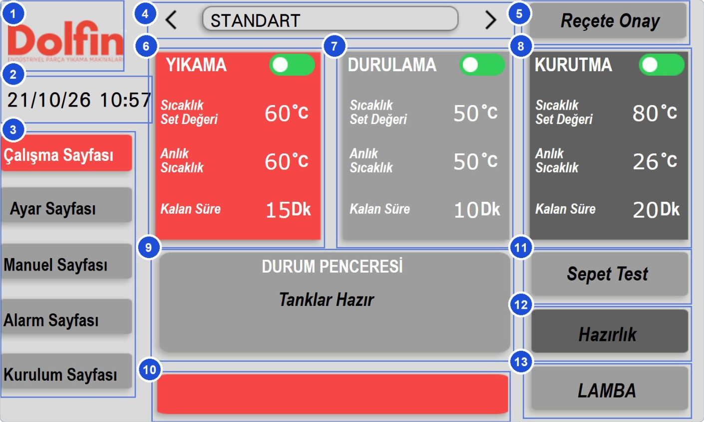

Tablo: Çalışma Sayfası elemanları

| No | Eleman | Tür | İşlevi ve kullanımı |
|---|---|---|---|
| 1 | Dolfin logosu | Buton | Dokunulduğunda açılış (dil seçimi) ekranı açılır. |
| 2 | Tarih / saat | Gösterge | Panelin tarih (gün/ay/yıl) ve saatini gösterir; alarm kayıtlarında bu saat kullanılır. Kurulum Sayfası'ndan ayarlanır. |
| 3 | Sayfa menüsü | Menü | Sayfalar arasında geçiş yapar; açık sayfanın butonu kırmızıdır. Kurulum Sayfası yetkili kullanıcı girişi ister. |
| 4 | Reçete seçimi | Seçim | **<** ve **>** oklarıyla reçeteler arasında geçilir; ortadaki kutuda seçili reçetenin adı yazar. Seçim tek başına makinedeki değerleri değiştirmez. |
| 5 | **Reçete Onay** | Buton | Seçili reçetenin sıcaklık ve süre değerlerini makineye gönderir; değerler hemen geçerli olur. Makine çevrimde değilken kullanın. |
| 6 | YIKAMA paneli | Panel | Yıkama fazının seçimi ve bilgileri: başlık faz çalışırken yanıp söner; Aktif/Pasif anahtarı (yeşil Aktif, gri Pasif; yalnızca çevrim dışında görünür); **Sıcaklık Set Değeri** (makinede geçerli değer); **Anlık Sıcaklık**; **Kalan Süre** (Dk; yalnızca yıkama pompası çalışırken azalır). |
| 7 | DURULAMA paneli | Panel | Durulama fazının seçimi ve bilgileri; kullanımı YIKAMA paneliyle aynıdır. Kalan süre yalnızca durulama pompası çalışırken azalır. |
| 8 | KURUTMA paneli | Panel | Kurutma fazının seçimi ve bilgileri: **Sıcaklık Set Değeri** kurutma havasının sıcaklığıdır; **Kalan Süre** faz başladığı andan itibaren azalır. |
| 9 | DURUM PENCERESİ | Gösterge | Çevrim dışında tankların hazırlık durumunu, çevrim sırasında çalışan adımı yazar (**Bkz. Bölüm 7.4.3**). STOP'a basıldığında altında **Sistem Duruyor** yazar. |
| 10 | Alarm bandı | Gösterge | Aktif alarm mesajları kırmızı bant üzerinde kayan yazı olarak geçer; alarm yokken bant boştur. |
| 11 | **Sepet Test** | Basılı tutulan buton | Makine çevrimde değilken, basılı tutulduğu sürece sepeti yavaş hızda döndürür; sepet başlangıç konumuna gelince kendiliğinden durur. |
| 12 | **Hazırlık** | Aç/Kapa buton | Yıkama ve durulama tanklarının ısıtmasını açar/kapatır; açıkken yeşildir. Isıtma yalnızca bu buton açıkken yapılır; çevrim sırasında da açık kalmalıdır. |
| 13 | **LAMBA** | Aç/Kapa buton | Kabin lambasını yakar/söndürür; lamba 60 saniye sonra kendiliğinden söner. |

## 3.4.6 Ayar Sayfası

Reçete değerlerinin (sıcaklık ve süreler) düzenlendiği, egzoz, drenaj ve yağ sıyırıcı ayarlarının yapıldığı ve tankların boşaltıldığı sayfadır. Reçete değerleri **Reçete Onay**'a basılınca makineye gider; egzoz, drenaj ve yağ sıyırıcı ayarları girildiği anda geçerli olur.

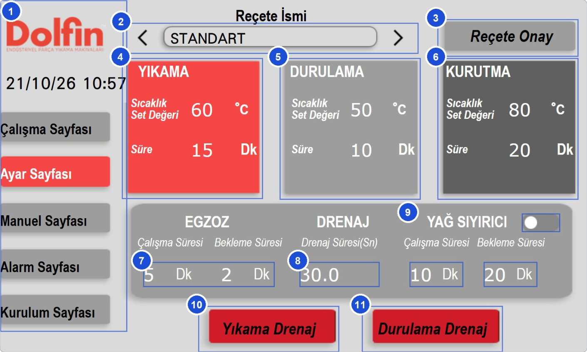

Tablo: Ayar Sayfası elemanları

| No | Eleman | Tür | İşlevi ve kullanımı |
|---|---|---|---|
| 1 | Logo, tarih/saat ve sayfa menüsü | Menü | Sayfalar arası geçiş; Çalışma Sayfası'ndaki gibi. |
| 2 | Reçete İsmi / reçete seçimi | Seçim | Düzenlenecek reçeteyi seçer. İsim kutusuna dokunarak reçetenin adı değiştirilir ({{RECETE_PARAMETRELERI:P07 Reçete ismi#3}} karakter). |
| 3 | **Reçete Onay** | Buton | Seçili reçeteyi makineye gönderir. Bu sayfada değiştirilen değerler reçeteye hemen kaydedilir, ancak bu butona basılana kadar makinede geçerli olmaz. |
| 4 | YIKAMA | Değer girişi | Yıkama tankı sıcaklığı ({{RECETE_PARAMETRELERI:P01 Yıkama sıcaklık set değeri#3}} °C) ve yıkama süresi ({{RECETE_PARAMETRELERI:P02 Yıkama süresi#3}} Dk). |
| 5 | DURULAMA | Değer girişi | Durulama tankı sıcaklığı ({{RECETE_PARAMETRELERI:P03 Durulama sıcaklık set değeri#3}} °C) ve durulama süresi ({{RECETE_PARAMETRELERI:P04 Durulama süresi#3}} Dk). |
| 6 | KURUTMA | Değer girişi | Kurutma havası sıcaklığı ({{RECETE_PARAMETRELERI:P05 Kurutma sıcaklık set değeri#3}} °C) ve kurutma süresi ({{RECETE_PARAMETRELERI:P06 Kurutma süresi#3}} Dk). |
| 7 | EGZOZ | Değer girişi | Egzoz fanının kurutmadaki **Çalışma Süresi** ve **Bekleme Süresi** ({{RECETE_PARAMETRELERI:P10 Egzoz çalışma süresi#3}} Dk). Reçeteden bağımsızdır. |
| 8 | DRENAJ — Drenaj Süresi (Sn) | Değer girişi | Tank sıvısı alt seviyenin altına indikten sonra drenaj pompasının çalışmaya devam edeceği süre ({{RECETE_PARAMETRELERI:P12 Drenaj süresi#3}} Sn). |
| 9 | YAĞ SIYIRICI | Seçim anahtarı ve değer girişi | Yağ sıyırıcıyı açar/kapatır; **Çalışma Süresi** ve **Bekleme Süresi** ({{RECETE_PARAMETRELERI:P14 Yağ sıyırıcı çalışma süresi#3}} Dk). Acil durdurma ve enerji kesintisinden sonra kapalı gelir. |
| 10 | **Yıkama Drenaj** | Aç/Kapa buton | Makine çevrimde değilken yıkama tankını boşaltmak için drenaj pompasını çalıştırır. |
| 11 | **Durulama Drenaj** | Aç/Kapa buton | Durulama tankı için aynı işlev; aynı drenaj pompasını kullanır. |

## 3.4.7 Manuel Sayfası

Üst bölümde (GİRİŞ GÖZLEM) makinedeki buton, sensör ve koruma cihazlarından gelen sinyallerin anlık durumu, alt bölümde (MANUEL KONTROL) bazı ünitelerin elle kumandası bulunur. Arıza ararken ve bakımda kullanılır.

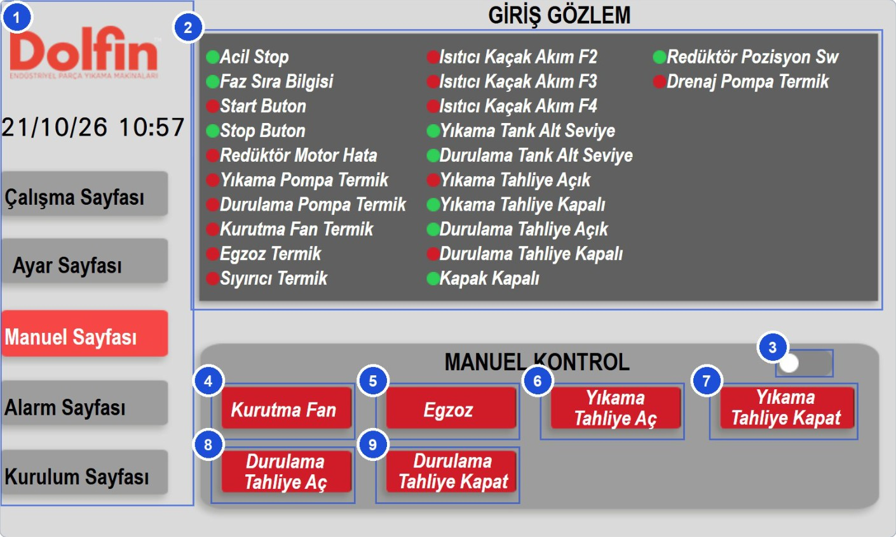

Tablo: Manuel Sayfası elemanları

| No | Eleman | Tür | İşlevi ve kullanımı |
|---|---|---|---|
| 1 | Logo, tarih/saat ve sayfa menüsü | Menü | Sayfalar arası geçiş. |
| 2 | GİRİŞ GÖZLEM | Lamba listesi | Her satırdaki lamba ilgili sinyalin anlık durumunu gösterir: yeşil = sinyal var, kırmızı = sinyal yok (**Bkz. Bölüm 11.1.3**). |
| 3 | MANUEL KONTROL anahtarı | Seçim anahtarı | Manuel butonları devreye alır (yeşil). Makine çevrimdeyken açılamaz; çevrim başlayınca kendiliğinden kapanır. |
| 4 | **Kurutma Fan** | Aç/Kapa buton | Kurutma fanını elle çalıştırır/durdurur. Kurutma ısıtıcısı elle çalıştırılamaz. |
| 5 | **Egzoz** | Aç/Kapa buton | Egzoz fanını elle çalıştırır/durdurur. |
| 6 | **Yıkama Tahliye Aç** | Aç/Kapa buton | Yıkama tahliye vanasını açar; vana açık konuma gelince komut kendiliğinden kesilir. |
| 7 | **Yıkama Tahliye Kapat** | Aç/Kapa buton | Yıkama tahliye vanasını kapatır. |
| 8 | **Durulama Tahliye Aç** | Aç/Kapa buton | Durulama tahliye vanasını açar. |
| 9 | **Durulama Tahliye Kapat** | Aç/Kapa buton | Durulama tahliye vanasını kapatır. |

Pompalar, ısıtıcılar ve sepet motoru elle çalıştırılamaz; sepet için **Sepet Test**, tank boşaltma için **Drenaj** kullanılır.

## 3.4.8 Alarm Sayfası

O an aktif olan alarmların listesidir. Kule lambası kırmızı yandığında veya Çalışma Sayfası'ndaki kırmızı bantta mesaj geçtiğinde bu sayfaya bakın.

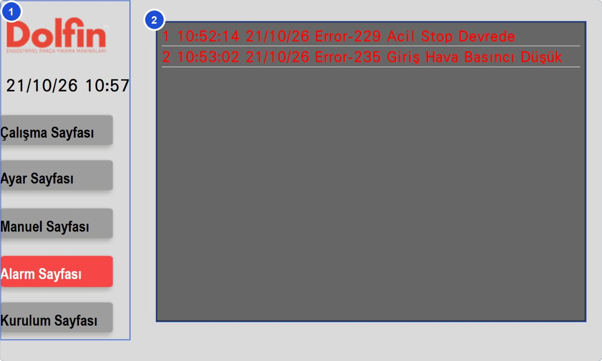

Tablo: Alarm Sayfası elemanları

| No | Eleman | Tür | İşlevi ve kullanımı |
|---|---|---|---|
| 1 | Logo, tarih/saat ve sayfa menüsü | Menü | Sayfalar arası geçiş. |
| 2 | Aktif alarm listesi | Liste | Her satırda sıra numarası, alarmın oluştuğu saat ve tarih ve mesaj yazar. Satıra dokunmak alarmı onaylar (satır yeşile döner); onay alarmın nedenini gidermez. Nedeni giderilen alarm listeden kalkar. |

## 3.4.9 Kurulum Sayfası

Yetkili personel içindir: alarm geçmişi, panel saat/tarih ayarı, fazlar arasındaki geçiş süresi ve toplam çalışma zamanı göstergesi bu sayfadadır. Menüde **Kurulum Sayfası**'na basıldığında yetkili kullanıcı giriş penceresi açılır; şifre girildikten sonra sayfa açılır.

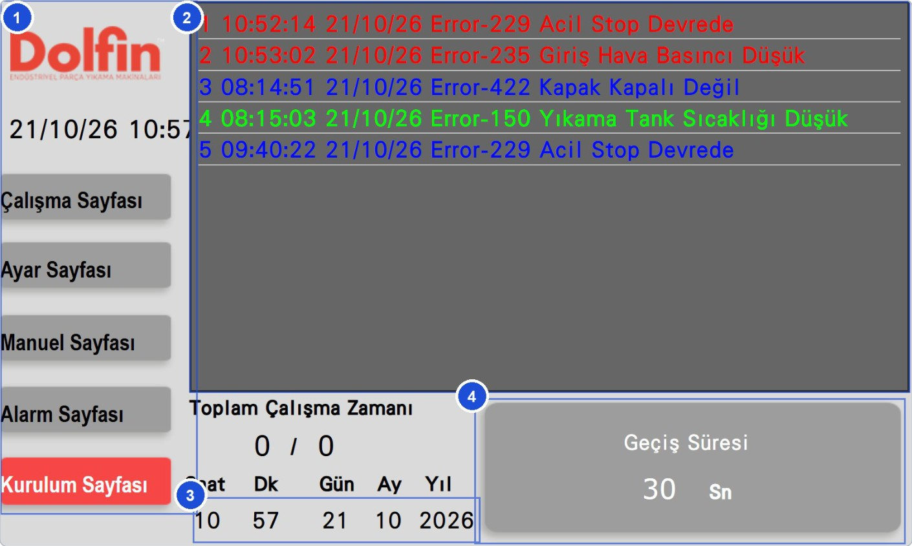

Tablo: Kurulum Sayfası elemanları

| No | Eleman | Tür | İşlevi ve kullanımı |
|---|---|---|---|
| 1 | Logo, tarih/saat ve sayfa menüsü | Menü | Sayfalar arası geçiş. |
| 2 | Alarm geçmişi | Liste | Oluşan tüm alarmların kaydı: sıra numarası, saat ve tarih, onay zamanı ve mesaj. Kırmızı: hâlâ aktif; yeşil: onaylanmış; mavi: nedeni giderilmiş. |
| 3 | Saat / tarih ayarı | Değer girişi | Saat (24 saat), Dk, Gün, Ay, Yıl. Alarm kayıtlarındaki zamanlar bu saate göre yazılır. |
| 4 | **Geçiş Süresi** | Değer girişi | Yıkama ile durulama ve durulama ile kurutma arasındaki süzülme süresi ({{RECETE_PARAMETRELERI:P09 Geçiş süresi#3}} Sn). Reçeteye bağlı değildir. |

Sayfanın sol alt bölümündeki **Toplam Çalışma Zamanı** göstergesi makinenin çalışma süresini gösterir. Bu değeri bakım kayıtlarına yazın (**Bkz. Bölüm 9.1.23**).

## 3.4.10 Elektrik panosu

Elektrik panosu kabin kapısının sağındadır; kapağı sağ yana açılır. Pano kapağında ana şalter kolu ve uyarı etiketleri bulunur. Panoyu yalnızca yetkili elektrikçi açar.

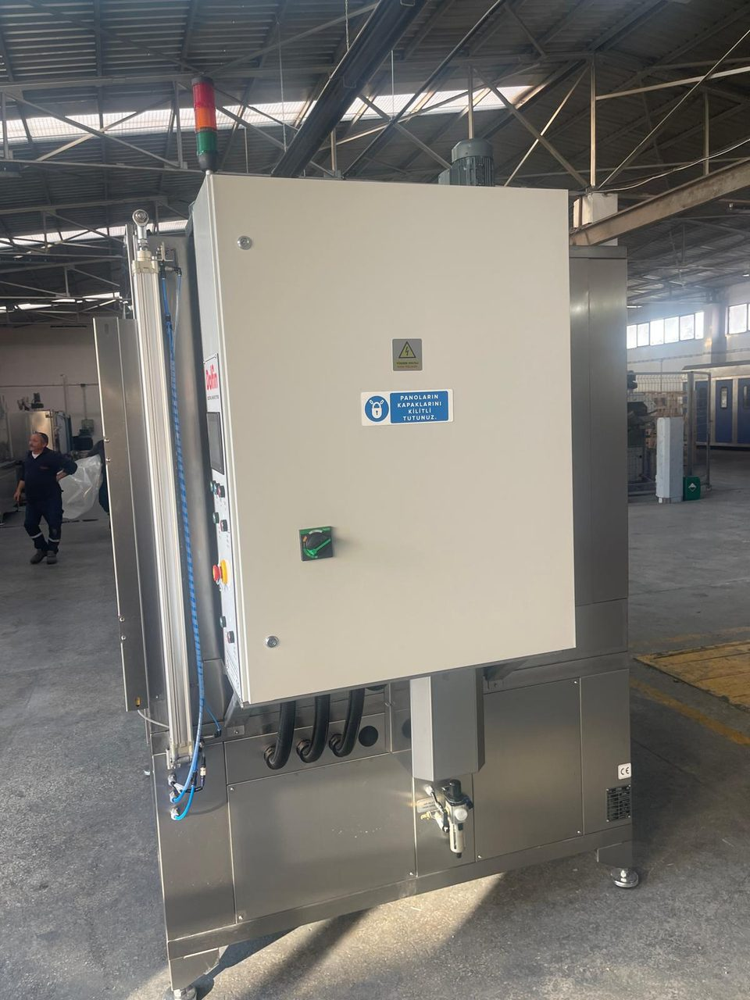

Pano kapağı açıldığında ekipmanın yerleşimi aşağıdaki gibidir.

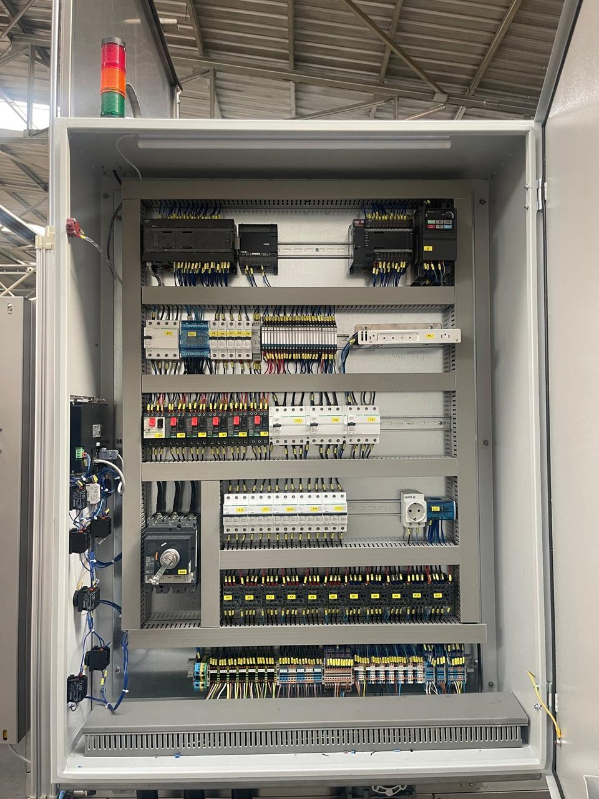

Tablo: Elektrik panosu — işaretlerin açıklaması

| No | Ekipman | Görevi |
|---|---|---|
| 1 | PLC ({{KONTROLLER:PLC marka / model}}) | Makine kumandası |
| 2 | Termokupl giriş ünitesi (CP1W-TS003) | Tank ve kurutma sıcaklıklarının ölçümü |
| 3 | PLC ek ünitesi | Ek giriş ve çıkışlar |
| 4 | Sepet motoru sürücüsü (frekans invertörü) | Sepet motorunun hız kontrolü; arızada kendi ekranında hata kodu gösterir |
| 5 | F1 kaçak akım rölesi | Motor devreleri kaçak akım koruması |
| 6 | Dağıtım barası ve sigortalar F5–F9 | Sepet sürücüsü, güç kaynağı, kontaktör bobinleri ve yardımcı devreler |
| 7 | Ara röleler R1–R20 | PLC çıkışlarını yük devrelerine aktarır |
| 8 | 24 V DC güç kaynağı | Kumanda devresi beslemesi |
| 9 | Motor koruma şalterleri Q1–Q6 | Pompa, fan, yağ sıyırıcı ve drenaj pompası motorlarının korunması |
| 10 | Kaçak akım röleleri F2–F4 | Isıtıcı devreleri kaçak akım koruması |
| 11 | Ana şalter | Makinenin ana beslemesi; kolu pano kapağındadır |
| 12 | Sigortalar F10–F14 | Isıtıcı devrelerinin korunması |
| 13 | Kontaktörler K1–K9 | Pompa, fan ve ısıtıcıların anahtarlanması |
| 14 | Klemensler | Saha bağlantıları |
| 15 | Kule lambası | Durum gösterimi |

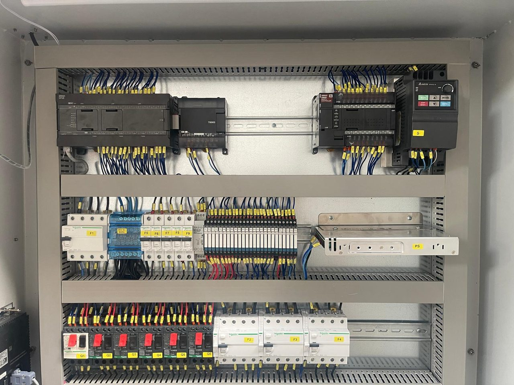

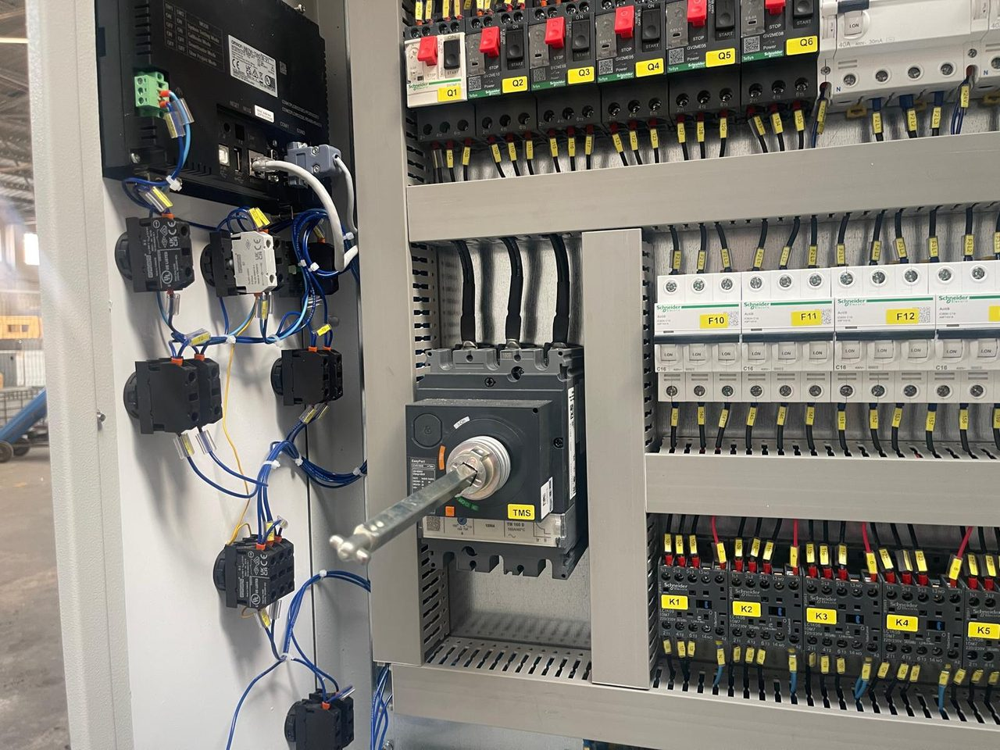

**Elektrik panosu ekipmanları**

{{TABLO:PANO_EKIPMANLARI}}

Pano ekipmanının şema üzerindeki yerleri ve PLC giriş/çıkış listesi **Bkz. Bölüm 13.2**.
