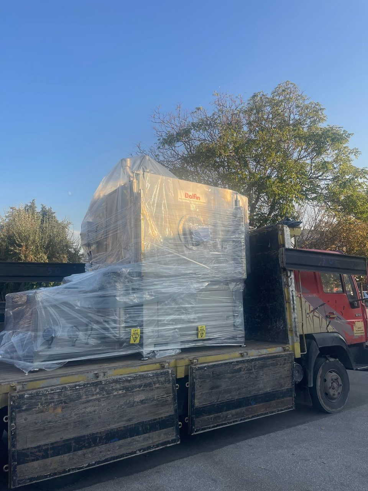
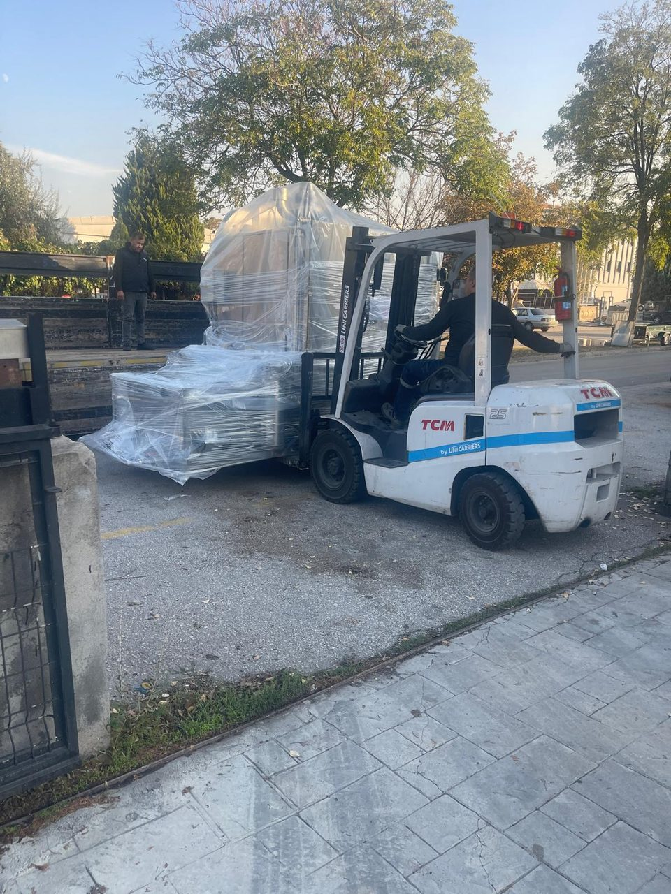

# 4.1 Taşıma

## 4.1.1 Taşıma birimleri

Makine, tank ünitesi kabin ünitesinden ayrılarak iki ana birim halinde taşınır. Yükleme arabası ve gevşek parçalar ayrıca paketlenir.

Tablo: Taşıma birimleri

| Birim | İçerik | Ağırlık | Kaldırma |
|---|---|---|---|
| Kabin ünitesi | Kabin, kabin kapısı, dönen sepet, püskürtme boruları, proses pompası (kabin altı), elektrik panosu ve kumanda paneli, çatı ekipmanları | {{TASIMA:Taşıma ağırlığı — kabin ünitesi (kg)}} kg | Alttan forkliftle |
| Tank ünitesi | Yıkama ve durulama tankları, ısıtıcılar, tahliye odası, yağ sıyırıcı, drenaj pompası ve kolektör, torba filtreler, dikey proses pompası | {{TASIMA:Taşıma ağırlığı — tank ünitesi (kg)}} kg | Alttan forkliftle |
| Aksesuarlar | Yükleme arabası, üst sepet, gevşek parçalar | — | Elle veya forkliftle |

Ambalaj: {{TASIMA:Ambalaj tipi (kasa / shrink / konteyner)}}.

## 4.1.2 Taşıma öncesi hazırlık

Makine, kurulum yerinden başka bir yere taşınacaksa aşağıdaki hazırlığı yapın. İlk sevkiyatta hazırlık üretici tarafından yapılmıştır.

**ÖNEMLİ:** Tanklarda, pompalarda, filtrelerde ve borularda kalan sıvı taşıma sırasında dökülür, donma tehlikesinde pompa ve boruları çatlatır. Tüm sıvıları boşaltın.

**Sıvıların boşaltılması**

1. Tankları drenaj pompasıyla boşaltın (**Bkz. Bölüm 7.6.3**).
2. Tank drenaj vanalarını ve kolektör boşaltma vanasını açarak kalan sıvıyı alın.
3. Torba filtre gövdelerini alttaki boşaltma vanalarından boşaltın.
4. Tankları, ön filtre sepetlerini ve kabin tabanını temizleyin ve kurulayın.
5. Yağ sıyırıcının yağ toplama kabını boşaltın.

**Enerjinin ayrılması**

6. Kabin kapısını tam kapalı konuma getirin.
7. LOTO uygulayın (**Bkz. Bölüm 2.4**).
8. İşletmenin elektrik besleme kablosunu yetkili elektrikçiye söktürün.
9. Basınçlı hava, drenaj, taşma ve egzoz bağlantılarını sökün.

**Birimlerin ayrılması**

10. Kabin ünitesi ile tank ünitesi arasındaki boru bağlantılarını sökün; açık boru ağızlarını tapa veya bantla kapatın.
11. İki ünite arasındaki kablo ve pnömatik hortum bağlantılarını ayırın; uçları işaretleyin ve korumaya alın.
12. Ünitelerin ayaklarını, birbirlerinden ayrılabilecek kadar serbest bırakın.

**Gevşek parçaların sabitlenmesi**

13. Üst sepeti ve ön filtre sepetlerini çıkarıp ayrı paketleyin.
14. Tank kapaklarını kapalı konumda bantla veya kayışla sabitleyin.
15. Yükleme arabasını ayrı taşıyın.
16. Birimleri streç filmle sarın; elektrik panosunu, operatör panelini ve ışık perdelerini darbeye karşı koruyun.

## 4.1.3 Forkliftle kaldırma

**UYARI — Devrilen yük:** Birimlerin ağırlık merkezi yüksektir; yanlış kaldırılan birim devrilerek ağır yaralanmaya yol açar. Kaldırma sırasında birimin yanında ve altında kimse bulunmasın.

:W014:

1. Forkliftin kaldırma kapasitesinin birim ağırlığından büyük olduğunu kontrol edin (**Bkz. Bölüm 4.1.1**).
2. Çatalları birimin taşıyıcı şasesinin altına, birimin tüm derinliği boyunca uzanacak şekilde sokun.
3. Çatalların borulara, pompalara, drenaj kolektörüne, kablo kanallarına ve ayak ayar civatalarına değmediğini kontrol edin.
4. Birimi en fazla 100 mm kaldırın ve dengesini kontrol edin.
5. Birim dengesizse indirin ve çatal konumunu düzeltin.
6. Birimi alçakta tutarak, ani fren ve dönüş yapmadan taşıyın.
7. Birimi düz zemine yavaşça indirin.

Birimleri elektrik panosundan, kapıdan, kapı silindirlerinden, ışık perdelerinden, çatı ekipmanlarından, borulardan veya tank kapaklarından tutarak kaldırmayın, itmeyin.

## 4.1.4 Kamyonla taşıma

1. Birimleri açık kasa kamyonun kasasına, kasa tabanına kaymaz malzeme sererek yerleştirin.
2. Birimleri gövde şasesinden spanzetlerle kasaya bağlayın; spanzetleri borulara, panoya, fanlara ve kapıya geçirmeyin.
3. Spanzetlerin geçtiği sac köşelerine koruyucu yerleştirin.
4. Birimleri yağmur ve tozdan korumak için streç film ve branda ile örtün.
5. Yolculuk sırasında ilk 50 km'den sonra spanzetlerin gerginliğini kontrol edin.

## 4.1.5 Teslim alma kontrolü

1. Birimleri kamyondan indirmeden önce ambalajı ve görünen yüzeyleri hasara karşı inceleyin.
2. Teslim edilen birimleri ve aksesuarları sevk belgesiyle karşılaştırın.
3. Hasar veya eksiklik varsa fotoğraflayın, taşıyıcının teslim belgesine yazın ve en geç 24 saat içinde üreticiye bildirin.
4. Hasarlı makineyi üreticinin onayı olmadan kurmayın ve enerji vermeyin.
