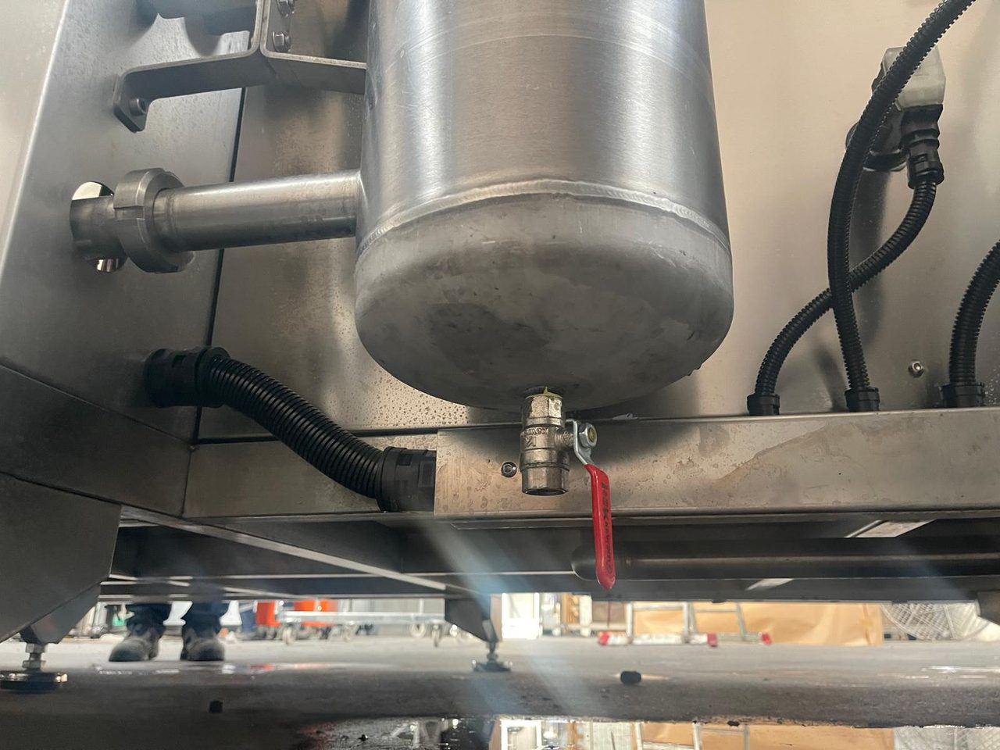
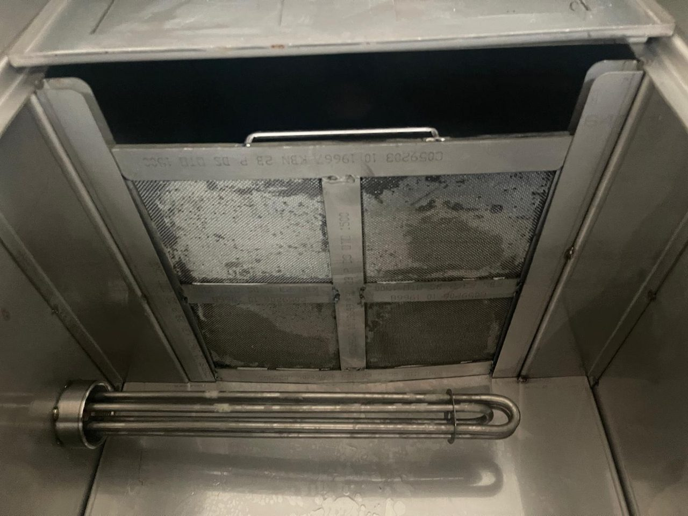
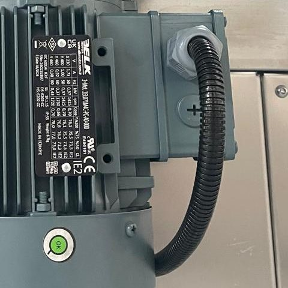

# 9.1 Bakım talimatları

## 9.1.1 Bakım güvenliği

**UYARI — Beklenmedik çalışma:** Bakım sırasında makinenin çalıştırılması sepetin dönmesine, kapının hareket etmesine, pompaların sıcak sıvı basmasına ve ısıtıcıların enerjilenmesine yol açar. Operatör panelinden yapılan kontroller dışındaki tüm bakım işlerinden önce LOTO uygulayın (**Bkz. Bölüm 2.4**).

Her bakım işinde şu kurallara uyun:

1. İşe başlamadan önce makinenin operatörünü bilgilendirin.
2. LOTO gerektiren işlerde LOTO uygulayın (**Bkz. Bölüm 2.4.2**).
3. Sıvıların ve yüzeylerin 40 °C'nin altına inmesini bekleyin.
4. Kabin içinde çalışılacaksa açık kapıyı mekanik olarak destekleyin.
5. Göreve göre KKD kullanın (**Bkz. Bölüm 2.2.4**).
6. Tank sıvısı ve çamuru ile temasta kimyasala dayanıklı eldiven ve göz koruyucu kullanın.
7. İş bitince takımları ve sökülen parçaları toplayın, koruyucuları takın.
8. Güvenlik donanımına dokunulduysa ilgili güvenlik testini yapın (**Bkz. Bölüm 5.4**).
9. Yapılan işi bakım kaydına yazın (**Bkz. Bölüm 9.1.23**).

## 9.1.2 Bakım personeli, aletler ve malzemeler

Bakım planındaki her iş "Yapan" sütununda belirtilen personel tarafından yapılır: **Operatör** (eğitimli operatör), **Bakım** (mekanik bakım personeli), **Elektrikçi** (yetkili elektrikçi), **Üretici** (üretici servisi) (**Bkz. Bölüm 1.1.2**).

Tablo: Bakım için gereken aletler

| Alet | Kullanım |
|---|---|
| Açık ağız / yıldız anahtar takımı 8–30 mm | M5–M20 paslanmaz civata ve somunlar (ayak ayarı M20: 30 mm; teker mili M16: 24 mm, M12: 19 mm) |
| Alyan anahtar takımı 3–10 mm | İmbus civatalar (M4–M12) |
| Tork anahtarı | Klemens ve bağlantı sıkma |
| Boru anahtarı | 2" ısıtıcı ve vana bağlantıları |
| Plastik spatula, naylon fırça, yumuşak bez | Tank, ısıtıcı ve sensör temizliği (metal kazıyıcı kullanmayın) |
| Islak–kuru elektrik süpürgesi veya çamur pompası | Tank tabanındaki çamurun alınması |
| Su terazisi | Terazileme kontrolü |
| Kumpas | Teker ve pinyon aşınma ölçümü |
| Referans termometre | Sıcaklık ölçümünün kontrolü |
| Multimetre ve pens ampermetre | Gerilim ve motor akımı ölçümü (elektrikçi) |
| İzolasyon test cihazı, 500 V DC | Isıtıcı ve motor izolasyon ölçümü (elektrikçi) |
| Kaçak spreyi | Pnömatik kaçak kontrolü |
| LOTO kilidi, etiketi ve çoklu kilitleme makası | Enerji ayırma |

## 9.1.3 Periyodik bakım planı

Periyotlar tek vardiya çalışma için verilmiştir; çok vardiyalı çalışmada veya yoğun kirli parça yıkanmasında periyotları kısaltın. Kurulum Sayfası'ndaki **Toplam Çalışma Zamanı** değerini bakım kaydına yazarak periyotları izleyin. Kontrol ve kayıt formları **Bkz. Bölüm 14.1**.

Tablo: Periyodik bakım planı

| No | Periyot | Bileşen | İşlem | Yapan | Bölüm |
|---|---|---|---|---|---|
| B01 | Günlük | Ön filtre sepetleri (8 adet) | Çıkarın, talaşı boşaltın, yıkayın, yerine takın | Operatör | 9.1.6 |
| B02 | Günlük | Tank sıvı seviyeleri | Kontrol edin; eksikse tamamlayın | Operatör | 7.6.4 |
| B03 | Günlük | Filtre regülatör | Yoğuşma suyunu boşaltın; çalışma basıncını kontrol edin | Operatör | 6.4.4 |
| B04 | Günlük | Kabin içi ve sepet | Düşen parçaları ve talaşı alın | Operatör | 10.1.3 |
| B05 | Günlük | Yağ sıyırıcı yağ toplama kabı | Kontrol edin; dörtte üç doluysa boşaltın | Operatör | 7.6.5 |
| B06 | Günlük | Tanklar, pompalar, filtreler, bağlantılar | Sızıntı kontrolü | Operatör | 9.1.17 |
| B07 | Günlük | Işık perdesi camları | Temizleyin | Operatör | 10.1.5 |
| B08 | Günlük | Kule lambası ve alarmlar | Alarm olmadığını kontrol edin | Operatör | 11.1 |
| B09 | Haftalık | Acil durdurma | Fonksiyon testi | Operatör | 5.4.1 |
| B10 | Haftalık | Işık perdesi | Fonksiyon testi | Operatör | 5.4.3 |
| B11 | Haftalık | Kapı kapalı sviçi | Fonksiyon testi | Operatör | 5.4.4 |
| B12 | Haftalık | Torba filtreler | Torbayı kontrol edin; kirliyse yıkayın veya değiştirin | Bakım | 9.1.8 |
| B13 | Haftalık | Tank yüzeyi ve yağ sıyırıcı diski | Yağ tabakasını ve diski kontrol edin; diski temizleyin | Bakım | 9.1.10 |
| B14 | Haftalık | Püskürtme memeleri | Tıkalı meme kontrolü | Bakım | 9.1.11 |
| B15 | Haftalık | Sepet, tekerler, pinyon | Ses, aşınma ve talaş birikmesi görsel kontrolü | Bakım | 9.1.12 |
| B16 | Haftalık | Yıkama kimyasalı | Derişim ölçümü | Operatör | 7.6.9 |
| B17 | Haftalık | Yükleme arabası | Tekerlek ve kilit kontrolü | Operatör | 7.6.10 |
| B18 | Aylık | Tank sıvıları ve tanklar | Sıvıyı değiştirin; tankı, ayırıcıları ve ısıtıcıları temizleyin | Bakım | 9.1.9 |
| B19 | Aylık | Emiş filtreleri | Tank temizliğinde temizleyin | Bakım | 9.1.7 |
| B20 | Aylık | Seviye sensörleri | Çatalları temizleyin; lamba kontrolü | Bakım | 9.1.19 |
| B21 | Aylık | Tahliye vanaları | Manuel test; tanklar arası sıvı geçişi kontrolü | Bakım | 9.1.16 |
| B22 | Aylık | Kabin kapısı | Kızak, fitil, mafsallar, hız ve vuruntu kontrolü | Bakım | 9.1.15 |
| B23 | Aylık | Pnömatik sistem | Kaçak, hortum ve susturucu kontrolü | Bakım | 9.1.21 |
| B24 | Aylık | Pompalar | Salmastra sızıntısı, ses, titreşim, sıcaklık | Bakım | 9.1.17 |
| B25 | Aylık | Kurutma ve egzoz fanları | Pervane, emiş ağzı ve baca kontrolü | Bakım | 9.1.20 |
| B26 | Aylık | Kaçak akım röleleri F1–F4 | Test butonuyla test | Elektrikçi | 5.4.6 |
| B27 | Aylık | Tank kapağı amortisörleri | Açık kapağın kendiliğinden kapanmadığını kontrol edin | Operatör | 9.1.9 |
| B28 | 3 aylık | Yataklama tekerleri ve sepet göbeği | Aşınma, çatlak, rulman boşluğu | Bakım | 9.1.12 |
| B29 | 3 aylık | Pinyon, kremayer, redüktör ve motor | Diş aşınması, yağ kaçağı, ses, sıcaklık | Bakım | 9.1.14 |
| B30 | 3 aylık | Sepet konum sensörü | Temizlik ve mesafe kontrolü | Bakım | 6.1.2 |
| B31 | 3 aylık | Tank ısıtıcıları | Kireç ve tortu kontrolü (tank boşken) | Bakım | 9.1.18 |
| B32 | 3 aylık | Elektrik panosu | Klemens sıkılığı, kontaktör kontakları, ısınma izleri, toz | Elektrikçi | 9.1.22 |
| B33 | 3 aylık | Motor koruma şalterleri | Ayar değerlerinin kontrolü | Elektrikçi | 6.3.1 |
| B34 | 6 aylık | Isıtıcılar ve motorlar | İzolasyon direnci ölçümü | Elektrikçi | 9.1.18 |
| B35 | 6 aylık | Topraklama | Koruma iletkeni sürekliliği | Elektrikçi | 9.1.22 |
| B36 | 6 aylık | Filtre regülatör | Filtre elemanını değiştirin | Bakım | 9.1.21 |
| B37 | 6 aylık | Kapı silindirleri ve pilotlu çek valfler | Kapının konumunu koruma testi | Bakım | 5.4.5 |
| B38 | 6 aylık | Hava basınç şalteri | Fonksiyon testi | Bakım | 5.4.8 |
| B39 | Yıllık | Tüm güvenlik fonksiyonları | Bölüm 5.4'teki testlerin tamamı | Bakım ve elektrikçi | 5.4 |
| B40 | Yıllık | Termokupllar | Referans termometreyle karşılaştırma | Bakım | 9.1.19 |
| B41 | Yıllık | Tahliye vanası piston lastikleri ve contaları | Kontrol; gerekirse değişim | Bakım | 9.1.16 |
| B42 | Yıllık | Proses pompaları | Mekanik salmastra ve rulman kontrolü | Bakım | 9.1.17 |
| B43 | Yıllık | Kapı fitili ve kızakları | Değişim ihtiyacı kontrolü | Bakım | 9.1.15 |
| B44 | Yıllık | PLC ve operatör paneli | Reçete kaydının güncelliği; saat kontrolü | Yetkili kullanıcı | 5.6.3 |
| B45 | Yıllık | Makinenin tamamı | Üretici servis bakımı | Üretici | 1.3 |

## 9.1.4 Yağlama planı

{{BAKIM_YAGLAMA:Yağlama noktası listesi (konum / yağ tipi / periyot)}}. Makinenin hareketli parçalarının çoğu yıkama sıvısıyla temas ettiğinden yağlanmaz; yağ, yıkama sıvısını kirletir ve parçalara geçer.

Tablo: Yağlama planı

| Nokta | Yağlayıcı | Periyot | Not |
|---|---|---|---|
| Sepet yataklama tekerlerinin rulmanları (6006 ZZ) ve sepet göbeği rulmanları (6206 ZZ) | Yok — ömür boyu yağlı, kapalı rulman | — | Keçeler rulmanı yıkama sıvısından korur; keçe hasarında rulman ve keçe değişir |
| Sepet redüktörü | Redüktör üreticisinin fabrika dolumu | {{BAKIM_YAGLAMA:Redüktör yağ değişim}} | Yağ kaçağını 3 ayda bir kontrol edin |
| Pinyon ve kremayer | Yok | — | Paslanmaz çelik, yıkama alanında; yağlamayın |
| Kapı kızakları (PE-UHMW) | Yok | — | Kendinden kayganlığı olan malzeme |
| Kapı ve tahliye vanası silindirleri | Yok — fabrikada yağlanmış | — | Filtre regülatörde yağlayıcı yoktur; hatta yağlayıcı eklemeyin |
| Motor ve pompa rulmanları | Yok — kapalı rulman | — | Anormal ses ve ısınmada rulman değişir |
| Pompa mili sızdırmazlığı | Yok — mekanik salmastra | — | Kuru çalıştırmayın |

## 9.1.5 Kritik malzeme listesi ve sarf malzemeleri

Yedek parçalar üç kategoride sınıflandırılmıştır:

- **Kritik:** Arızası makineyi durduran veya bir güvenlik fonksiyonunu etkileyen, temin süresi plansız duruşa yol açabilecek parçalar. İşletmede stokta tutulur.
- **Tüketim:** Düzenli aralıklarla veya her sökümde değişen aşınma ve sarf parçaları. İşletmede stokta tutulur.
- **Önerilen:** Arızası makineyi sınırlı etkileyen veya kısa sürede temin edilebilen parçalar. Kullanım yoğunluğuna göre stoklanır.

Bu bölümde yalnızca kritik ve tüketim parçaları verilmiştir; tam yedek parça listesi **Bkz. Bölüm 13.3**. Önerilen stok miktarları başlangıç önerisidir; işletme, kullanım ve temin sürelerine göre günceller.

**Kritik malzeme listesi**

{{TABLO:PARCA_LISTESI|07 00267, 07 04397, 10 03969, ZEL071MAC-PC-A0-000, [EKSİK]-01, 10 03401, 10 04813, 10 04515, 10 02932, 10 03262, 10 05243, 10 07492, 07 16791, 10 02976, 07 15142, 10 17992, LC1K1610M7, LC1K0910M7, G9SB-2002-A, VFD004EL21W-1, LRS-350-24}}

**Tüketim malzemeleri**

{{TABLO:PARCA_LISTESI|07 01218, 10 01020, 10 01026, 10 00526, 10 00527, 10 00649, 10 00656, 10 04499, 10 13568, 10 15429, 07 14060, [EKSİK]-03, 10 00470, 10 01780, 10 02944, 10 00427, 10 01905, [EKSİK]-04, 07 00604, [EKSİK]-09, [EKSİK]-10, [EKSİK]-11}}

Kritik bileşenlerin arızası çoğu zaman önceden belirti verir. Aşağıdaki tablo, bu belirtilerin hangi bakım işinde izlendiğini gösterir.

Tablo: Kritik bileşenlerin izlenmesi

| Bileşen | Arızanın makineye etkisi | Erken uyarı belirtisi | İzleme |
|---|---|---|---|
| Yataklama tekerleri ve sepet göbeği | Sepet sarsıntılı döner, kremayer–pinyon kavraması bozulur, sepet durur | Takırtı, sepetin dalgalı dönmesi, tekerde düzleşme veya çatlak, POM tozu | B15, B28 |
| Tahrik pinyonu, redüktör, sepet motoru | Sepet dönmez; çevrim bitmez | Diş sesi, redüktörde yağ izi, motorda ısınma, Error-126 | B15, B29 |
| Sepet konum sensörü | Çevrim sonunda sepet durmaz; çevrim bitmez | **Redüktör Pozisyon Sw** lambasının her turda yanmaması | B30 |
| Kapı silindirleri, kapı valfi, pilotlu çek valfler | Kapı açılmaz, kapanmaz veya açıkken aşağı kayar | Yavaş veya sarsıntılı kapı hareketi, hava kaçağı sesi | B22, B37 |
| Kapı kapalı sviçi | Çevrim başlamaz (Error-422) | Kapı kapalıyken **Kapak Kapalı** lambasının kararsız yanması | B11 |
| Tahliye vanası silindirleri, sensörleri, valfleri | Pompa çalışmaz; faz ilerlemez (Error-322, 323, 325, 326) | Vananın geç konum alması, tanklar arası seviye kayması | B21, B41 |
| Seviye sensörleri | Pompa ve ısıtıcı çalışmaz veya kuru çalışma koruması kaybolur | Sıvı varken alt seviye lambasının kırmızı kalması | B20 |
| Termokupllar | Tank yanlış sıcaklığa ısınır | Panel sıcaklığı ile ölçülen sıcaklık arasında fark | B40 |
| Tank ısıtıcıları | Tank ısınmaz; kaçak akım rölesi atar | Isınma süresinin uzaması, izolasyon direncinin düşmesi | B31, B34 |
| Isıtıcı ve pompa kontaktörleri | Isıtıcı veya pompa çalışmaz ya da kapanmaz | Kontaktörde vızıltı, kontaklarda yanma izi | B32 |
| Güvenlik rölesi, güç kaynağı, sepet sürücüsü | Makine çalışmaz veya sepet dönmez | Acil durdurma sonrası resetlenememe, 24 V'ta düşme, sürücü hata kodu | B09, B32 |

## 9.1.6 Ön filtre sepetlerinin temizliği

Ön filtre sepetleri (her tankta 4 adet) kabinden dönen sıvıdaki talaşı ve kiri tutar. Dolu sepet sıvının tanka dönüşünü yavaşlatır ve kabinde sıvı birikmesine yol açar.

**UYARI — Sıcak sıvı:** Sepetleri **Hazırlık** kapalıyken ve sıvı 40 °C'nin altındayken çıkarın; kimyasala dayanıklı eldiven ve göz koruyucu kullanın.

1. Makinenin çevrimde olmadığını kontrol edin ve **Hazırlık**'ı kapatın.
2. Temizlenecek tankın kapağını açın; amortisörlerin kapağı tuttuğunu kontrol edin.
3. Ön filtre sepetini tutamağından tutarak yuvasından yukarı çekin.
4. Sepetin içindeki talaşı ve kiri bir kaba boşaltın.
5. Sepetin elek yüzeylerini naylon fırça ve suyla yıkayın.
6. Eleği yırtık, delik ve deformasyona karşı kontrol edin; hasarlı sepeti değiştirin.
7. Sepeti yuvasına tam oturacak şekilde geri takın.
8. Tanktaki diğer sepetler için 3–7. adımları tekrarlayın.
9. Tank kapağını kapatın.
10. Toplanan talaşı ve kiri atık talimatına göre ayırın (**Bkz. Bölüm 10.1.7**).

## 9.1.7 Emiş filtrelerinin temizliği

Emiş filtreleri (her tankta 1 adet) pompanın emiş ağzındadır ve tank tabanına yakındır. Filtreye tank boşaltıldığında erişilir; bu nedenle emiş filtresi tank temizliğiyle birlikte temizlenir (**Bkz. Bölüm 9.1.9**). Pompa sesinde değişme veya püskürtme basıncında düşme olursa filtre daha erken kontrol edilir.

1. Tankı boşaltın ve LOTO uygulayın (**Bkz. Bölüm 9.1.9**, 1–6. adımlar).
2. Emiş filtresini emiş ağzındaki manşondan çevirerek sökün.
3. Filtrenin deliklerini naylon fırça ve suyla temizleyin.
4. Filtre gövdesini ezilme ve yırtılmaya karşı kontrol edin; hasarlıysa değiştirin.
5. Filtreyi manşona elle sıkıca takın.

## 9.1.8 Torba filtrelerin bakımı

Torba filtreler proses pompalarının basma hatlarındadır ve sıvıdaki ince parçacıkları tutar. Kirlenen torba püskürtme basıncını düşürür.

**UYARI — Basınçlı sıcak sıvı:** Filtre gövdesi pompa çalışırken basınç altındadır. Kapağı yalnızca pompa durmuş, LOTO uygulanmış ve gövde boşaltılmışken açın.

**Hazırlık**

1. Makinenin çevrimde olmadığını kontrol edin.
2. LOTO uygulayın (**Bkz. Bölüm 2.4**).
3. Filtre gövdesinin altındaki boşaltma vanasının çıkışına bir kova yerleştirin.
4. Boşaltma vanasını açın ve gövdedeki sıvıyı boşaltın.

**Torbanın değiştirilmesi**

5. Kapağın mapalı somunlarını çapraz sırayla gevşetin ve mapaları dışarı çevirin.
6. Kapağı kaldırın.
7. Torbayı tutamağından tutarak gövdeden çıkarın.
8. Torbayı kontrol edin: torba yalnızca kirliyse suyla yıkayın; yırtık veya kalıcı tıkanmış torbayı değiştirin.
9. Gövdenin içini ve torba sepetini temizleyin.
10. Kapak contasını kontrol edin; hasarlıysa değiştirin.
11. Torbayı torba sepetine, ağız halkası yuvasına oturacak şekilde yerleştirin.
12. Kapağı yerleştirin; mapalı somunları çapraz sırayla eşit sıkın.

**Bitirme**

13. Boşaltma vanasını kapatın.
14. LOTO'yu kaldırın.
15. İlk çevrimde kapakta ve vanada sızıntı olmadığını kontrol edin.

Torba ölçüsü ve gözenek değeri: {{TANKLAR:Torba filtre torbası (ölçü / gözenek)}}.

## 9.1.9 Tank sıvısının değiştirilmesi ve tank temizliği

Yıkama sıvısı zamanla yağ, kir ve talaşla kirlenir; kirlenmiş sıvı temizlik kalitesini düşürür, köpürmeye ve koku oluşmasına yol açar. Sıvı değişim aralığını, sıvının kirliliğine ve kimyasal tedarikçisinin önerisine göre belirleyin; bakım planındaki aylık periyot en uzun aralıktır.

**UYARI — Kimyasal madde ve sıcak sıvı:** Tank çamuru ve sıvısı kimyasal içerir. Kimyasala dayanıklı eldiven, göz koruyucu ve su geçirmez önlük kullanın; sıvının soğumasını bekleyin.

**Boşaltma**

1. Makinenin çevrimde olmadığını kontrol edin.
2. **Hazırlık**'ı kapatın ve sıvının 40 °C'nin altına inmesini bekleyin.
3. Tankı drenaj pompasıyla boşaltın (**Bkz. Bölüm 7.6.3**).
4. LOTO uygulayın (**Bkz. Bölüm 2.4**).
5. Tank kapağını açın.
6. Ön filtre sepetlerini çıkarın ve temizleyin (**Bkz. Bölüm 9.1.6**).

**Temizlik**

7. Tank içindeki tutamaklı ayırıcı ve filtre panellerini yuvalarından çıkarın.
8. Tank tabanındaki çamuru plastik spatulayla toplayın ve ıslak–kuru süpürgeyle veya çamur pompasıyla alın.
9. Isıtıcı yüzeylerindeki tortuyu naylon fırçayla temizleyin; ısıtıcılara metal aletle vurmayın veya kazımayın.
10. Seviye sensörünün çatallarını temizleyin (**Bkz. Bölüm 9.1.19**).
11. Emiş filtresini temizleyin (**Bkz. Bölüm 9.1.7**).
12. Tank duvarlarını ve tabanını suyla yıkayın; yıkama suyunu drenaj vanasından alın.
13. Ayırıcı ve filtre panellerini yuvalarına takın.

**Kontrol ve doldurma**

14. Tank kapağının amortisörlerinin kapağı açık konumda tuttuğunu kontrol edin; tutmuyorsa amortisörleri değiştirin.
15. Ön filtre sepetlerini yerine takın.
16. Drenaj vanasını kapatın.
17. LOTO'yu kaldırın.
18. Tankı doldurun ve kimyasal ekleyin (**Bkz. Bölüm 7.6.4**).
19. **Hazırlık**'ı açın.
20. Sıvı değişimini bakım kaydına yazın.

## 9.1.10 Yağ sıyırıcının bakımı

1. Ayar Sayfası'nda **YAĞ SIYIRICI** anahtarını Pasif yapın.
2. LOTO uygulayın.
3. Yağ sıyırıcının üst kapağını açın.
4. Diskin yüzeyindeki yağ ve kir birikintisini yumuşak bezle silin.
5. Sıyırıcı sacların diske temas ettiğini ve diskin yüzeyini çizmediğini kontrol edin.
6. Yağ toplama oluğunu ve yağ çıkışını temizleyin; yağ çıkışının tıkalı olmadığını kontrol edin.
7. Diskte eğilme veya derin çizik varsa üreticiye bildirin.
8. Kapağı kapatın, LOTO'yu kaldırın ve **YAĞ SIYIRICI** anahtarını Aktif yapın.
9. Sıyırıcının çalışma süresi içinde döndüğünü kontrol edin.

## 9.1.11 Püskürtme borularının ve memelerin temizliği

Tıkalı memeler parçaların bazı yüzeylerinin yıkanmamasına yol açar. Memeleri haftalık olarak bir çevrim sırasında gözetleme penceresinden kontrol edin; püskürtmesi zayıf veya hiç olmayan memeleri temizleyin.

1. LOTO uygulayın ve kabin kapısını açık konumda destekleyin.
2. Tıkalı memenin boru üzerindeki konumunu ve yönünü kalemle işaretleyin.
3. Memeyi borudan sökün.
4. Memenin deliğini yumuşak bir telle veya naylon fırçayla temizleyin ve suyla yıkayın; deliği büyütecek sert alet kullanmayın.
5. Boru ağzındaki kiri temizleyin.
6. Memeyi işaretlediğiniz yönde geri takın.
7. Bir deneme çevriminde püskürtmeyi kontrol edin.

Memeler sık tıkanıyorsa torba filtreleri ve ön filtre sepetlerini kontrol edin.

## 9.1.12 Dönen sepet, yataklama tekerleri ve göbeğin kontrolü

**Haftalık görsel kontrol**

1. Bir çevrim sırasında sepetin dönüşünü dinleyin; takırtı, gıcırtı veya düzensiz dönüş olmamalıdır.
2. Çevrim sonunda kabin tabanında POM (delrin) tozu veya kırıntısı olup olmadığını kontrol edin.

**3 aylık kontrol**

3. LOTO uygulayın ve kapıyı açık konumda destekleyin.
4. Üst sepeti çıkarın.
5. Her yataklama tekerinin yüzeyini düzleşme, çatlak, kırık ve aşınma basamağına karşı kontrol edin.
6. Tekeri elle çevirin; tekerin sıkışmadan döndüğünü ve rulmanda boşluk veya sürtünme olmadığını kontrol edin.
7. Tekeri eksenine dik yönde zorlayarak boşluk olup olmadığını kontrol edin.
8. Sepeti elle bir tam tur çevirin; sepetin göbekte salgı yapmadan döndüğünü ve tüm tekerlerin halkaya temas ettiğini kontrol edin.
9. Sepet göbeğinde radyal boşluk varsa göbek yatağını kontrol ettirin.
10. Alt sepetin çerçevesini, kaynak yerlerini ve kremayer halkasını çatlak ve deformasyona karşı kontrol edin.
11. Kusurlu tekeri değiştirin (**Bkz. Bölüm 9.1.13**).
12. Üst sepeti takın ve LOTO'yu kaldırın.

## 9.1.13 Yataklama tekeri değişimi

Tip 4 yataklama tekeri (Ø100) sepeti alttan taşır ve teker taşıyıcısındaki U sacına anahtar başlı M16 civata ve fiberli somunla bağlıdır. Tip 1 tekerler (Ø65) M12 civata ve fiberli somunla bağlıdır.

**UYARI — Ezilme:** Sepet kaldırılırken ağırdır. Sepeti yalnızca sağlam bir kaldırma levyesi veya krikoyla kaldırın ve kaldırılmış sepetin altına takoz koymadan elinizi teker bölgesine sokmayın.

**Sökme**

1. LOTO uygulayın ve kapıyı açık konumda destekleyin.
2. Üst sepeti çıkarın.
3. Değiştirilecek tekerin üzerindeki sepet halkasını, tekerden 5–10 mm ayrılacak kadar kaldırın ve altına takoz koyun.
4. Teker milini tutan fiberli somunu 24 mm anahtarla sökün (Tip 1 için 19 mm).
5. Teker civatasını çıkarın.
6. Teker komplesini U sacından çıkarın.

**Takma**

7. Yeni teker komplesini U sacına yerleştirin.
8. Civatayı takın ve yeni bir fiberli somunla sıkın; fiberli somunu yeniden kullanmayın.
9. Tekerin elle serbest döndüğünü kontrol edin.
10. Takozu alın ve sepeti tekere indirin.
11. Sepeti elle bir tam tur çevirin; tekerin halkaya temas ettiğini kontrol edin.
12. Üst sepeti takın, LOTO'yu kaldırın ve **Sepet Test** ile dönüşü kontrol edin.

Teker komplesi atölyede onarılabilir: rulmanlar (6006 ZZ), keçeler (42×30×7), O-ring, segman ve gerekiyorsa teker gövdesi (sipariş kodu 07 01218) değiştirilerek komple yeniden kullanılır.

## 9.1.14 Pinyon, kremayer ve sepet tahrikinin kontrolü

1. Bir çevrim sırasında redüktör ve motoru dinleyin; düzensiz ses ve titreşim olmamalıdır.
2. Çevrimden sonra motor ve redüktör gövdesinin sıcaklığını elle yaklaşarak kontrol edin; dokunulamayacak kadar sıcaksa sebebini araştırın.
3. LOTO uygulayın.
4. Redüktörde ve mil çıkışında yağ kaçağı olup olmadığını kontrol edin.
5. Kabin içinde pinyon dişlerini ve kremayer dişlerini aşınma, kırık ve çapak açısından kontrol edin.
6. Pinyon milinin destek yatağında (POM) boşluk olup olmadığını mili elle zorlayarak kontrol edin.
7. Pinyon ile kremayerin kavramasını kontrol edin (**Bkz. Bölüm 6.1.3**).
8. Motor kablosunun ve klemens kutusunun sağlam olduğunu kontrol edin.
9. Pinyon, mil veya redüktörde hasar varsa değiştirilmesini üreticiye veya eğitimli bakım personeline yaptırın.

## 9.1.15 Kabin kapısının bakımı

1. Kapıyı birkaç kez açıp kapatın; hareketin iki yandan eşit, yumuşak ve vuruntusuz olduğunu kontrol edin.
2. LOTO uygulayın.
3. Kapı kızaklarını (PE-UHMW) aşınma, çatlak ve yerinden çıkmaya karşı kontrol edin.
4. Kapı kenar fitilini yırtılma, sertleşme ve yerinden çıkmaya karşı kontrol edin.
5. Kapı silindirlerinin mil uçlarındaki küresel mafsallarda boşluk olup olmadığını kontrol edin.
6. Silindir millerinin yüzeyini çizik ve korozyona karşı kontrol edin; mili yumuşak bezle silin.
7. Silindir bağlantılarında ve pilotlu çek valflerde hava kaçağı olup olmadığını kaçak spreyiyle kontrol edin.
8. Gözetleme penceresinin camını ve contasını kontrol edin.
9. Işık perdesinin bağlantılarını ve kablolarını kontrol edin.
10. Kusurlu parçaları değiştirin; değişimden sonra Bölüm 5.4.3, 5.4.4 ve 5.4.5'teki testleri yapın.

## 9.1.16 Tahliye odası ve tahliye vanalarının bakımı

Tahliye vanalarından biri tam kapanmazsa kabinden dönen sıvı yanlış tanka geçer: bir tankın seviyesi yükselirken diğerininki düşer ve yıkama sıvısı durulama tankını kirletir.

**Aylık kontrol**

1. Manuel Sayfası'nda **MANUEL KONTROL** anahtarını açın.
2. Her vanayı açıp kapatın; **Açık** ve **Kapalı** lambalarının vana hareketinden sonra 10 saniye içinde yeşil olduğunu kontrol edin.
3. Tank seviyelerini birkaç gün boyunca izleyin; bir tankın seviyesi sürekli yükseliyor, diğerininki düşüyorsa vana sızdırıyordur.

**Piston lastiği ve conta değişimi**

4. Her iki tankı da çevrim dışında bırakın ve **Hazırlık**'ı kapatın.
5. LOTO uygulayın; basınçlı havayı ayırın ve silindirlerin basınçsız olduğunu kontrol edin.
6. Değiştirilecek vananın silindirinin hava hortumlarını ve sensör kablolarını işaretleyip sökün.
7. Tahliye odası kapağının civatalarını çapraz sırayla sökün.
8. Kapağı silindir ve vana pistonuyla birlikte yukarı kaldırın.
9. Piston lastiğini tutan pirinç piston somununu sökün.
10. Eski piston lastiğini çıkarın ve yuvasını temizleyin.
11. Yeni piston lastiğini takın ve piston somununu sıkın.
12. Kapak contasını yenisiyle değiştirin.
13. Kapağı yerine oturtun ve civataları çapraz sırayla eşit sıkın.
14. Hava hortumlarını ve sensör kablolarını takın.
15. LOTO'yu kaldırın ve vanayı Manuel Sayfası'ndan test edin.

## 9.1.17 Pompaların bakımı

**Günlük ve aylık kontrol**

1. Pompaların altında ve bağlantılarında sızıntı olup olmadığını kontrol edin; mil bölgesinden damlama mekanik salmastranın aşındığını gösterir.
2. Pompa çalışırken olağan dışı ses (çakıl sesi, uğultu) ve titreşim olup olmadığını dinleyin; çakıl sesi pompanın hava veya buhar emdiğini gösterir.
3. Motor fan kapağının ve soğutma kanatlarının temiz olduğunu kontrol edin.

**Sızıntı veya ses durumunda**

4. Tank seviyesini, emiş filtresini ve tank çıkış vanasının tam açık olduğunu kontrol edin.
5. Köpük oluşmasını kontrol edin (**Bkz. Bölüm 8.2.2**).
6. Sızıntı mekanik salmastradan geliyorsa salmastra değişimini eğitimli bakım personeline veya üreticiye yaptırın.

**Yıllık kontrol**

7. Elektrikçi pompa motorlarının akımını ölçer ve etiket akımıyla karşılaştırır.
8. Bakım personeli pompa milini (LOTO altında) elle çevirerek rulmanlarda sürtünme olup olmadığını kontrol eder.

**ÖNEMLİ:** Pompaları sıvısız çalıştırmayın. Seviye sensörleri pompayı korur; sensörleri köprülemeyin.

## 9.1.18 Isıtıcıların bakımı

**Kireç ve tortu kontrolü (3 aylık, tank boşken)**

1. Tank temizliği sırasında ısıtıcı elemanlarının yüzeyini kontrol edin.
2. Yüzeydeki tortuyu naylon fırçayla temizleyin.
3. Kalın kireç tabakası varsa kimyasal tedarikçisinin önerdiği kireç çözücüyü kullanın; kireç tabakası ısıtıcının ısınmasını ve ömrünü kısaltır.

**İzolasyon direnci ölçümü (6 aylık)**

Bu ölçümü yetkili elektrikçi yapar.

4. LOTO uygulayın.
5. Ölçülecek ısıtıcının bağlantı kapağını açın ve ısıtıcı kablolarını işaretleyip sökün.
6. İzolasyon test cihazıyla 500 V DC'de ısıtıcı uçları ile ısıtıcı gövdesi (topraklama) arasındaki direnci ölçün.
7. Ölçülen değeri bakım kaydına yazın ve önceki ölçümle karşılaştırın.
8. Değer 1 MΩ'un altındaysa (EN 60204-1 en düşük değeri) ısıtıcıyı değiştirin.
9. Kabloları işaretlerine göre bağlayın ve kapağı kablo rakoruyla sızdırmaz şekilde kapatın.

**Isıtıcı değişimi**

10. Tankı boşaltın ve LOTO uygulayın.
11. Isıtıcının bağlantı kapağını sökün ve kabloları işaretleyerek ayırın.
12. Isıtıcıyı boru anahtarıyla tanktan sökün.
13. Bağlantı yüzeyini temizleyin.
14. Yeni klingrit contayı takın.
15. Yeni ısıtıcıyı takın ve sıkın.
16. Kabloları bağlayın ve bağlantı kapağını takın.
17. Tankı doldurun ve bağlantıda sızıntı olmadığını kontrol edin.
18. **Hazırlık**'ı açın; tankın ısındığını ve ilgili kaçak akım rölesinin atmadığını kontrol edin.

## 9.1.19 Seviye sensörleri ve termokupllar

**Seviye sensörleri (aylık)**

Seviye sensörleri titreşimli çatal tipidir. Çatallar üzerinde biriken yağ, çamur veya kireç sensörün yanlış sinyal vermesine yol açar.

1. Tank sıvı seviyesi sensörün üzerindeyken Manuel Sayfası'nda ilgili alt seviye lambasının yeşil olduğunu kontrol edin.
2. Tank temizliği sırasında sensör çatallarını yumuşak fırça ve suyla temizleyin; çatalları bükmeyin ve çatallara vurmayın.
3. Tank doldurulduğunda lambanın yeşile döndüğünü kontrol edin.

**Termokupllar (yıllık)**

4. Tank set sıcaklığında ve **Hazırlık** açıkken, tank sıvısının sıcaklığını referans termometreyle termokupla yakın bir noktadan ölçün.
5. Ölçülen değeri operatör panelindeki **Anlık Sıcaklık** değeriyle karşılaştırın.
6. Fark 3 °C'den büyükse termokuplun bağlantısını ve kablosunu kontrol ettirin; gerekirse termokuplu değiştirin.
7. Kurutma sıcaklığını kurutma fazında kabin hava çıkışından ölçerek aynı şekilde karşılaştırın.

## 9.1.20 Kurutma ve egzoz sisteminin bakımı

**UYARI — Yüksekte çalışma ve sıcak yüzey:** Fanlar ve ısıtıcı kutusu çatıdadır. İşletmenin yüksekte çalışma talimatını uygulayın; ısıtıcı kutusunun soğumasını bekleyin (**Bkz. Bölüm 2.3.7**).

1. LOTO uygulayın.
2. Kurutma fanının ve egzoz fanının emiş ağızlarını kontrol edin; tıkayan cisimleri ve birikintiyi temizleyin.
3. Fan pervanelerinde birikinti varsa temizleyin; birikinti pervanede dengesizlik ve titreşim yaratır.
4. Fanı elle çevirerek sürtünme olmadığını kontrol edin.
5. Kurutma ısıtıcısı kutusunun ve hava kanalının bağlantılarını, yalıtımını ve sızdırmazlığını kontrol edin.
6. Egzoz bacasının ve kanalın içinde yoğuşma suyu birikintisi, yağ ve kir olup olmadığını kontrol edin; kanalın yoğuşma suyu tahliyesini temizleyin.
7. Fan motorlarının soğutma kanatlarını temizleyin.
8. LOTO'yu kaldırın; Manuel Sayfası'ndan fanları çalıştırarak titreşim ve ses kontrolü yapın.

## 9.1.21 Pnömatik sistemin bakımı

**Aylık kontrol**

1. Makine çalışır durumdayken pnömatik bağlantılarda kaçak olup olmadığını dinleyin ve kaçak spreyiyle kontrol edin.
2. Hortumları çatlak, ezilme ve sürtünmeye karşı kontrol edin; hasarlı hortumu değiştirin.
3. Valf egzozlarındaki susturucuları kontrol edin; tıkalı susturucu silindiri yavaşlatır, değiştirin.
4. Valf bobinlerinin soketlerinin yerine oturduğunu ve kablolarının sağlam olduğunu kontrol edin.

**Filtre elemanı değişimi (6 aylık)**

5. LOTO uygulayın; hava beslemesini ayırın ve manometrede 0 bar okuyun.
6. Filtre regülatörün kabını kilidini açarak sökün.
7. Filtre elemanını sökün ve yenisini takın.
8. Kabı temizleyin, contasını kontrol edin ve kabı yerine kilitleyin.
9. Hava beslemesini açın ve kaçak kontrolü yapın.

## 9.1.22 Elektrik panosu ve güvenlik fonksiyonlarının kontrolü

Bu kontrolleri yetkili elektrikçi yapar.

1. LOTO uygulayın ve pano kapağını açın.
2. Pano içinde nem, su izi, toz ve böcek olup olmadığını kontrol edin; tozu kuru bir fırça ve elektrik süpürgesiyle alın.
3. Güç klemenslerinin, kontaktör ve sigorta bağlantılarının sıkılığını kontrol edin.
4. Kontaktörlerde (özellikle ısıtıcı kontaktörleri K5–K9) aşırı ısınma, renk değişimi ve kontak yanması izi olup olmadığını kontrol edin; yanmış kontaktörü değiştirin.
5. Kablo rakorlarının ve pano kapak contasının sızdırmaz olduğunu kontrol edin.
6. Koruma iletkenlerinin bağlantısını ve sürekliliğini kontrol edin.
7. Pano kapağını kapatın, LOTO'yu kaldırın.
8. Makine çalışırken, mümkünse termal kamerayla güç bağlantılarında sıcak nokta olup olmadığını kontrol edin.
9. Güvenlik fonksiyonlarının yıllık testini yapın (**Bkz. Bölüm 5.4**).

## 9.1.23 Bakım kayıtları

Her bakım işi bakım kayıt formuna yazılır (**Bkz. Bölüm 14.1**). Kayıtta şunlar bulunur:

- Tarih ve Kurulum Sayfası'ndaki **Toplam Çalışma Zamanı** değeri.
- Bakım planı numarası (B01–B45) ve yapılan iş.
- Değiştirilen parçalar ve sipariş kodları.
- Ölçülen değerler (izolasyon direnci, motor akımı, sıcaklık farkı, hava basıncı).
- Tespit edilen kusurlar ve alınan önlemler.
- İşi yapan kişinin adı ve imzası.

Bakım kayıtları makinenin ömrü boyunca saklanır ve üretici servisine istendiğinde gösterilir.
