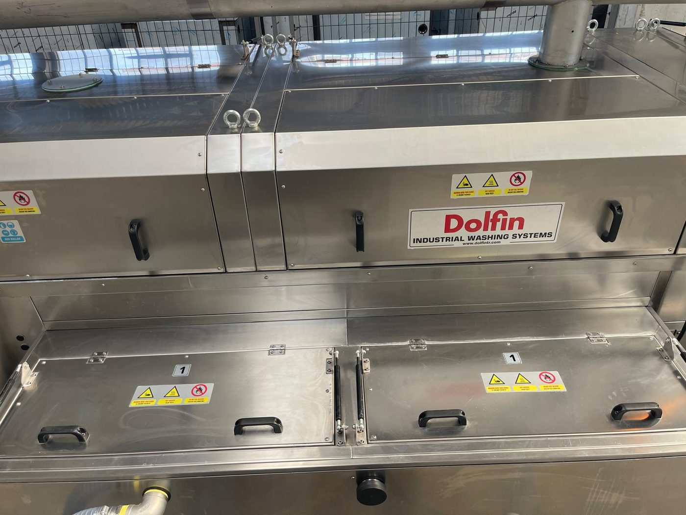
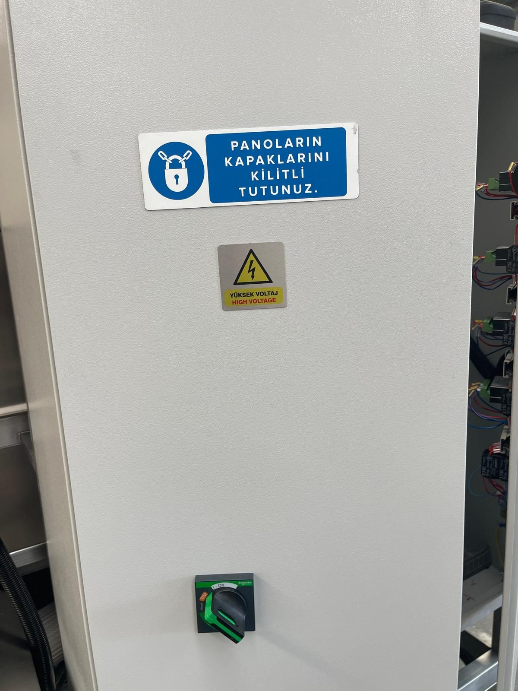

# 2.2 Kalıntı riskler ve makine etiketleri

Tasarım aşamasında EN ISO 12100 risk değerlendirmesi uygulanmış; mümkün olan riskler tasarımla (kapalı hücreler, kapak emniyet zinciri, acil stop, seviye interlock'u, koruma kafesleri) azaltılmıştır. Buna rağmen makinenin doğası gereği tamamen ortadan kaldırılamayan **kalıntı riskler** bulunur. Personel bu risklerin bilincinde olmalı; ilgili KKD'yi kullanmalı ve **Bölüm 2.6** matrisine uymalıdır.

Makine üzerindeki uyarı etiketleri **Bölüm 1.2**'de genel sembol kuralları ile açıklanmıştır; bu bölüm makineye özel kalıntı riskleri ve etiket konumlarını tanımlar.

---

## 2.2.1 Kalıntı riskler

**Termal risk — sıcak proses sıvısı, rezistanslar ve sıcak hava**

Yıkama tankı (TANK 1) ve durulama tankı (TANK 2) toplam yedi adet 8 kW rezistans ile ısıtılır; su sıcaklığı **+70 °C**'ye kadar çıkabilir (**Bkz. Bölüm 3.3.5**). Kurutma hücrelerinde 12 kW'lık iki ısıtıcı sıcak hava üretir. Tank kapakları, hücre kapakları, boru hatları, kurutma hücresi gövdesi ve çıkan parçalar proses sonrasında da sıcak kalır. Çıplak elle temas birinci veya ikinci derece yanık riski doğurur. Tank kapağını açarken sıcak buhar yüze doğru yükselir. Bakım veya temizlik öncesinde ısıtıcıları kapatın, su sıcaklığını GEMO DTH2 termostat göstergesinden kontrol edin ve yüzeyler soğuyana kadar bekleyin; ısıya dayanıklı eldiven kullanın.

**Mekanik risk — zincirli konveyör, tel bant ve döner mekanizmalar**

Konveyör, CONVEYOR anahtarı açıkken sürekli hareket eder; parça giriş (sol) ve çıkış (sağ) bölgesinde tel bant ile sabit yapı arasında parmak ve el sıkışması riski vardır. Konveyör redüktöründe tork sınırlayıcı bulunsa da bu sınırlayıcı insan uzvunu korumak için tasarlanmamıştır. Giriş ve çıkış bölgeleri koruma kafesi ile çevrilidir; kafes içine uzanmayın. Pompa, fan ve blower motorları döner elemanlardır; muhafazaları yalnızca LOTO uygulandıktan sonra sökün (**Bkz. Bölüm 2.4**). Parçaları yalnızca konveyör üzerine, hücre girişinin dışından yerleştirin ve çıkışta tel bant üzerinden alın.

**Kimyasal ve sıvı maruziyeti**

Yıkama ve durulama proseslerinde yağ, kir ve ısıtılmış proses sıvısı bulunur. Ön filtre temizliği, tank bakımı, hassas (torba) filtre değişimi ve sızıntı durumlarında cilde veya göze sıçrama riski vardır. Tank çevresinde taşan veya damlayan su kaygan zemin oluşturur. Makine üzerindeki "solvent kullanmayın" yasağı, yanıcı buhar ve paslanmaz yüzey hasarı riskine karşıdır. Bu işlerde KKD matrisine uyun (**Bkz. Bölüm 2.6**).

**Elektriksel risk**

Elektrik panosunda **380 V**, **50 Hz**, **3 faz**, toplam **110 kW / 220 A** besleme bulunur (**Bkz. Bölüm 3.3.3**). Rezistanslar tank gövdesine monte edilmiştir ve su ile temas hâlindedir; izolasyon hatasında kaçak akım röleleri (RCCB) devreyi keser, ancak ıslak zeminde pano veya rezistans bağlantı kutularına müdahale ölümcül olabilir. Pano kapağını yalnızca yetkili elektrik personeli açabilir; müdahale öncesi **Bölüm 2.4** LOTO prosedürü zorunludur. Ana şalter OFF konumundayken de ana şalterin giriş klemensleri ve tesis besleme kablosu gerilim altındadır. Ana şalter kapalı olsa bile konveyör inverterinin DC bara kondansatörlerinde kısa süreli tehlikeli gerilim kalabilir; inverter müdahalesinden önce inverter göstergesi tamamen sönene ve Delta inverter kılavuzunda belirtilen deşarj süresi dolana kadar bekleyin.

**Pnömatik risk**

Basınçlı hava beslemesi **6 bar**'dır (**Bkz. Bölüm 3.3.5**); hava, yağ ayırıcı ünitesinin diyaframlı pompasını besler. Hava hattının kopması veya rakorun ayrılması durumunda kırbaçlayan hortum ve basınçlı hava yaralanma riski oluşturur. Pnömatik müdahalelerde tesisat hattındaki kilitlenebilir hava vanasını kapatın ve kalıntı basıncı tahliye edin (**Bkz. Bölüm 2.4**).

**Gürültü**

Makine gürültü seviyesi **65 dB(A)** olarak tanımlanmıştır (**Bkz. Bölüm 3.3.6**). Dört blower ve iki kurutma fanı aynı anda çalışırken kurutma bölgesi yakınında ses seviyesi artar. İşveren, kurutma bölgesi yakınında uzun süre çalışan personel için işyeri gürültü mevzuatına göre ölçüm yaparak işitme koruyucu ihtiyacını belirler.

**Egzoz ve buhar**

Egzoz fanı (1,1 kW) yıkama ve kurutma bölgelerinden buhar ve nemli havayı bacaya tahliye eder. Egzoz bacası tesis havalandırmasına veya dış ortama bağlanmazsa buhar işletme içine yayılır; görüş azalır, zemin kayganlaşır ve pano içinde yoğuşma oluşur.

---

## 2.2.2 Makine üzerindeki uyarı etiketleri

Makine gövdesi ve elektrik panosundaki piktogramlar ISO 7010 ile uyumludur. Etiket sökme, boyama veya okunamaz hâle getirme yasaktır.

| Etiket / sembol | Konum | Gerekli eylem |
| :--- | :--- | :--- |
| Ellerinizi sıkıştırmayın + Sıcak yüzey + Solvent kullanmayın (üçlü etiket) | Tank 1 ve Tank 2 kapakları, yıkama/durulama/kurutma hücre kapakları | Kapağı yalnızca makine durmuş ve soğumuşken, tutamaklardan tutarak açın; solvent kullanmayın |
| Genel tehlike (sarı üçgen) | Bakım kapakları, yan kapaklar | **Bkz. Bölüm 2** |
| KKD KULLAN (mavi toplu etiket) | Makine gövdesi, tank önü | **Bkz. Bölüm 2.6** |
| YÜKSEK VOLTAJ / HIGH VOLTAGE | Elektrik panosu kapağı | Yalnızca yetkili elektrikçi; LOTO uygulayın (**Bkz. Bölüm 2.4**) |
| PANOLARIN KAPAKLARINI KİLİTLİ TUTUNUZ | Elektrik panosu kapağı | Pano kapağını çalışma sırasında kapalı ve kilitli tutun |
| AIR INLET / HAVA GİRİŞİ | Makine gövdesi — basınçlı hava regülatörü | Basınçlı hava hortumunu bu regülatöre bağlayın (**Bkz. Bölüm 3.3.5, 5.3.1**) |
| TAHLİYE | Tank altı boşaltma vanası | Tankı **Bölüm 10.1.5**'e göre boşaltın |
| Tank numarası **1** / **2** | Tank kapakları | Tank 1 = yıkama, Tank 2 = durulama |
| EMERGENCY STOP | Operatör paneli ve 6 saha acil stop butonu | **Bkz. Bölüm 2.5** |

Yıpranan etiketleri derhal yenileyin (**Bkz. Bölüm 1.2.6**). Etiketsiz makineyi çalıştırmayın.
