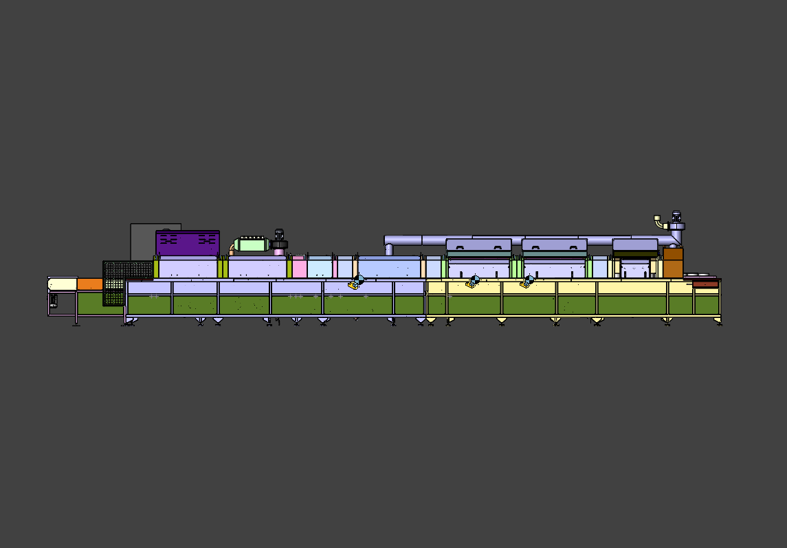
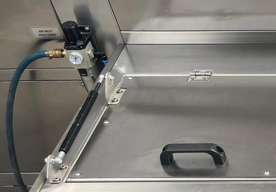

# 3.3 Teknik özellikler

Bu bölüm, **KNV 90 12000 2B** (seri no **0726051**) makinesine ait boyut, ağırlık, kapasite, elektrik, motor/ısıtıcı, medya bağlantıları ve ortam koşullarını toplar. Kurulum (Bölüm 5), ayar (Bölüm 6), operasyon (Bölüm 7) ve arıza (Bölüm 11) bölümlerinde aynı sayısal değerler tekrarlanmaz; ilgili bölümler buraya çapraz referans verir.

---

## 3.3.1 Fiziksel boyutlar ve ağırlık

| Parametre | Birim | Değer |
| :--- | :---: | ---: |
| Dış uzunluk (L) | mm | [EKSİK] |
| Dış genişlik (W) | mm | [EKSİK] |
| Dış yükseklik (H) — normal | mm | [EKSİK] |
| Boş ağırlık — kuru | kg | [EKSİK] |
| Çalışma ağırlığı — dolu | kg | [EKSİK] |
| Şase tipi | — | Ayarlanabilir ayak |

Makine, **ayarlanabilir ayaklar** üzerinde terazi ve seviye ayarı yapılabilir şekilde kurulur (**Bkz. Bölüm 5.2.3**). Tanklar dolu iken çalışma ağırlığı belirgin şekilde artar; taşıma ve depolama öncesi tanklar boşaltılmalıdır (**Bkz. Bölüm 4.1, 4.2**). Kurulum alanı ve etraf boşlukları **Bölüm 3.5.2**'de verilmiştir; makine layout çizimi ayrı evrak olarak teslim edilir (**Bkz. Bölüm 13.1**).

---

## 3.3.2 Kapasite ve proses parametreleri

| Parametre | Değer |
| :--- | :--- |
| Proses adım sayısı | 4 |
| Proses adı 1 | Yıkama (nozul püskürtme, hareket hâlinde parça) |
| Proses adı 2 | Durulama (nozul püskürtme) |
| Proses adı 3 | Su sıyırma (blower) |
| Proses adı 4 | Kurutma (kurutma fanları — sıcak hava) |
| Döngü süresi — nominal | Sabit değer yoktur — konveyör frekansına (20–60 Hz) ve hat uzunluğuna bağlıdır; işletmede ölçülür (**Bkz. Bölüm 8.1**) |
| Nominal kapasite | Müşteri firma belirler |
| Maksimum kapasite | Müşteri firma belirler |
| Minimum kapasite | Müşteri firma belirler |
| Ürün formatı / ambalaj tipi | Müşteri firma belirler |
| Ürün boyutu min / max | Müşteri firma belirler |
| Ürün ağırlığı min / max | Müşteri firma belirler |

Döngü süresi, bir parçanın konveyör üzerinde yıkama → durulama → su sıyırma → kurutma hattını katetme süresidir ve operatörün potansiyometre ile seçtiği konveyör hızına bağlıdır. Hız düşürüldükçe temas süresi ve temizlik etkinliği artar, saatlik parça adedi azalır. Döngü süresinin ölçüm yöntemi ve kapasite planlaması **Bölüm 8.1**'de açıklanmıştır.

---

## 3.3.3 Elektrik özellikleri

| Parametre | Değer |
| :--- | :--- |
| Besleme gerilimi | 380 V |
| Besleme frekansı | 50 Hz |
| Faz sayısı | 3 |
| Besleme konfigürasyonu | 3P+N+PE |
| Toplam kurulu güç (ısıtma dahil) | 110 kW |
| Maksimum akım çekişi | 220 A |
| Pano toplam akımı | 220 A |
| Kısa devre akımı / ICC gereksinimi | Bağlantı noktasında ≤ 36 kA (ana şalter kesme kapasitesi Icu = 36 kA, 380/415 V AC) |
| Ana şalter | Schneider **EasyPact CVS250F — LV521091** (TMŞ, 250 A); kapı kolu LV521101 |
| Kumanda devresi gerilimi | 220 V AC (kontaktör bobinleri) |
| Kontrol beslemesi | 24 V DC — LRS-350-24 (14,6 A) |
| Faz koruma | Faz sıra rölesi MKR-01 |
| Toplam sigorta / devre kesici | Motor ve ısıtıcı satırlarına göre (**Bkz. Bölüm 3.3.4**); pano TMŞ 250 A |
| UPS / jeneratör gereksinimi | Hayır |

Elektrik beslemesi kurulumda 380 V / 50 Hz, 3P+N+PE hat ile pano giriş terminallerine bağlanır (**Bkz. Bölüm 5.3.3**). Ana şalter Schneider EasyPact CVS250F'nin kesme kapasitesi Icu = 36 kA'dır (380/415 V AC); bağlantı noktasındaki beklenen kısa devre akımı 36 kA'yı aşmamalıdır. Faz sırası **MKR-01 faz sıra rölesi** tarafından izlenir; ters veya eksik fazda röle çıkış vermez ve fonksiyonlar devreye girmez (**Bkz. Bölüm 5.3.6, 11.3.1**). Enerji izolasyonu ve LOTO noktası pano kapağındaki ana şalter koludur (**Bkz. Bölüm 2.4**). Motor ve ısıtıcı grupları kaçak akım röleleri ile korunur: A9N19642 (motor grubu, kurutma 1/2) ve A9N19643 (TANK 1 ve TANK 2 rezistansları) (**Bkz. Bölüm 3.4.8**).

---

## 3.3.4 Motor, sürücü ve ısıtıcı listesi

**Motorlar ve koruma elemanları** (Schneider, aksi belirtilmedikçe)

| Kod | Motor | Güç | Akım | MKŞ / sürücü | Kontaktör |
| :--- | :--- | ---: | ---: | :--- | :--- |
| GE01 | Konveyör redüktör motoru | 0,25 kW | 0,50 A | Inverter Delta VFD004EL21W-1 (0,4 kW); sigorta A9F74106 1×6 | — |
| PE02 | Yıkama pompası motoru | 5,50 kW | 11,10 A | MKŞ GV2ME16 (9–14 A) + GVAE11 | LC1K1610M7 (16 A) |
| PE04 | Durulama pompası motoru | 3,00 kW | 6,10 A | MKŞ GV2ME14 (6–10 A) + GVAE11 | LC1K1610M7 (16 A) |
| FE01 | Egzoz fanı motoru | 1,10 kW | 2,30 A | MKŞ GV2ME07 (1,6–2,5 A) + GVAE11 | LC1K0610M7 (6 A) |
| GE06 | Yağ sıyırıcı redüktör motoru | 0,09 kW | 0,46 A | MKŞ GV2ME04 (0,4–0,63 A) + GVAE11 | LC1K0610M7 (6 A) |
| FE02 | 1. kurutma fanı motoru | 1,10 kW | 2,30 A | MKŞ GV2ME07 + GVAE11 | LC1K0610M7 |
| FE03 | 2. kurutma fanı motoru | 1,10 kW | 2,30 A | MKŞ GV2ME07 + GVAE11 | LC1K0610M7 |
| FE04 | 1. blower motoru | 4,00 kW | 8,00 A | MKŞ GV2ME14 (6–10 A) + GVAE11 | LC1K1610M7 (16 A) |
| FE05 | 2. blower motoru | 4,00 kW | 8,00 A | MKŞ GV2ME14 + GVAE11 | LC1K1610M7 |
| FE06 | 3. blower motoru | 4,00 kW | 8,00 A | MKŞ GV2ME14 + GVAE11 | LC1K1610M7 |
| FE07 | 4. blower motoru | 4,00 kW | 8,00 A | MKŞ GV2ME14 + GVAE11 | LC1K1610M7 |

Motor devri ve marka/model bilgileri her motorun gövdesindeki etiket üzerindedir. Pano içindeki MKŞ etiketleri: Q1 YIKAMA POM., Q2 DURULAMA POM., Q3 SIYIRICI, Q4 EGZOZ, Q5 KURUTMA FAN 1, Q6 KURUTMA FAN 2, Q7–Q10 BLOWER 1–4 (**Bkz. Bölüm 11.1.3**).

**Isıtıcılar (rezistanslar)**

| Kod | Isıtıcı | Güç | Akım | Kontaktör | Sigorta |
| :--- | :--- | ---: | ---: | :--- | :--- |
| R01–R05 | TANK 1 (yıkama) 1.–5. ısıtıcı | 5 × 8 kW | 16 A (her biri) | LC1K1610M7 | A9F74316 (16 A) |
| R06–R07 | TANK 2 (durulama) 1.–2. ısıtıcı | 2 × 8 kW | 16 A (her biri) | LC1K1610M7 | A9F74316 (16 A) |
| R21 | 1. kurutma fanı ısıtıcısı | 12 kW | 24 A | LC1D25M7 (25 A) | A9F74325 (25 A) |
| R22 | 2. kurutma fanı ısıtıcısı | 12 kW | 24 A | LC1D25M7 (25 A) | A9F74325 (25 A) |

Tank rezistansları **REZİSTANS KOMPLESİ 8000 W 50 cm düz dikişsiz** (07 15142) tipidir. Isıtıcı grupları kaçak akım röleleri ile korunur; izolasyon hatasında ilgili RCCB trip eder (**Bkz. Bölüm 11.3.3**). Sıcaklık kontrolü GEMO DTH2 termostatlar ve termokupllar (ETB30F06-5Ç / -4Ç) ile yapılır (**Bkz. Bölüm 3.4.4**).

---

## 3.3.5 Basınçlı hava ve su

| Parametre | Değer |
| :--- | :--- |
| Basınçlı hava girişi | 6 bar |
| Hava bağlantı noktası | Makine gövdesindeki **AIR INLET / HAVA GİRİŞİ** regülatörü (manometreli) — hortum ile bağlanır |
| Basınçlı hava tüketicisi | Yağ ayırıcı ünitesi diyaframlı pompası (solenoid valf kontrollü) — tek tüketici |
| Su girişi basıncı | 1 bar |
| Su sıcaklığı min / max | +10 °C – +70 °C |
| Su kalitesi | Şebeke suyu veya arıtılmış su |
| Tank dolumu | Elle — otomatik dolum vanası yoktur |
| Basınçlı hava bağlantısı | Hızlı bağlantı kaplini (jak) — hortum ile **AIR INLET / HAVA GİRİŞİ** regülatörüne |
| Su bağlantı çapı | 1" |
| Drain / atık su hattı çapı | 2" |
| Egzoz bacası çıkış çapı | Ø 125 mm |

Basınçlı hava, makine gövdesindeki regülatör üzerinden yağ ayırıcı ünitesinin diyaframlı pompasını besler; hidrolik veya vakum sistemi bulunmamaktadır. Makine üzerinde hava kesme vanası yoktur; tesisat hattına monte edilecek kilitlenebilir vana için **Bkz. Bölüm 2.4**. Hava bağlantı adımları **Bölüm 5.3.1**'de, regülatör ayarı **Bölüm 6.5.1**'de, egzoz bacası bağlantısı **Bölüm 5.3.4**'te verilmiştir. Su, tanklara elle doldurulur; tanklar, altlarındaki **TAHLİYE** vanaları ile boşaltılır (**Bkz. Bölüm 10.1.5**) ve atık su yerel mevzuata uygun bertaraf edilir (**Bkz. Bölüm 10.1.8**).

---

## 3.3.6 Ortam koşulları

| Parametre | Min | Max |
| :--- | :---: | :---: |
| Çalışma sıcaklığı | +10 °C | +30 °C |
| Depolama sıcaklığı | +10 °C | +30 °C |
| Göreceli nem | %30 | %50 |

| Parametre | Değer |
| :--- | :--- |
| Koruma sınıfı (IP) — makine | IP55 |
| Gürültü seviyesi | 65 dB(A) |
| Pano koruma sınıfı | **Bkz. Bölüm 3.4.1** |

Makine yalnızca **kapalı, korunaklı iç mekân** ortamında kullanılmak üzere tasarlanmıştır. Kurulum alanı minimum etraf boşlukları ve tavan yüksekliği **Bölüm 3.5.2**'de verilmiştir; amaçlanan kullanım sınırları **Bölüm 3.2**'de özetlenmiştir.

---

Kontrol elemanları: **Bkz. Bölüm 3.4**; yerleşim planı: **Bkz. Bölüm 3.5**.
