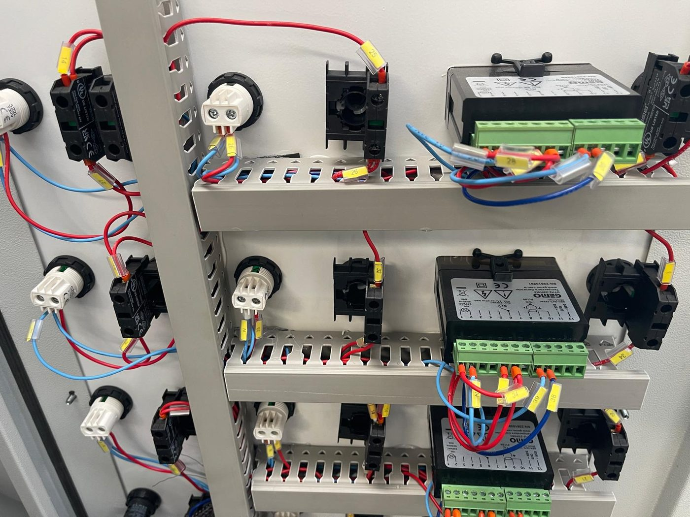
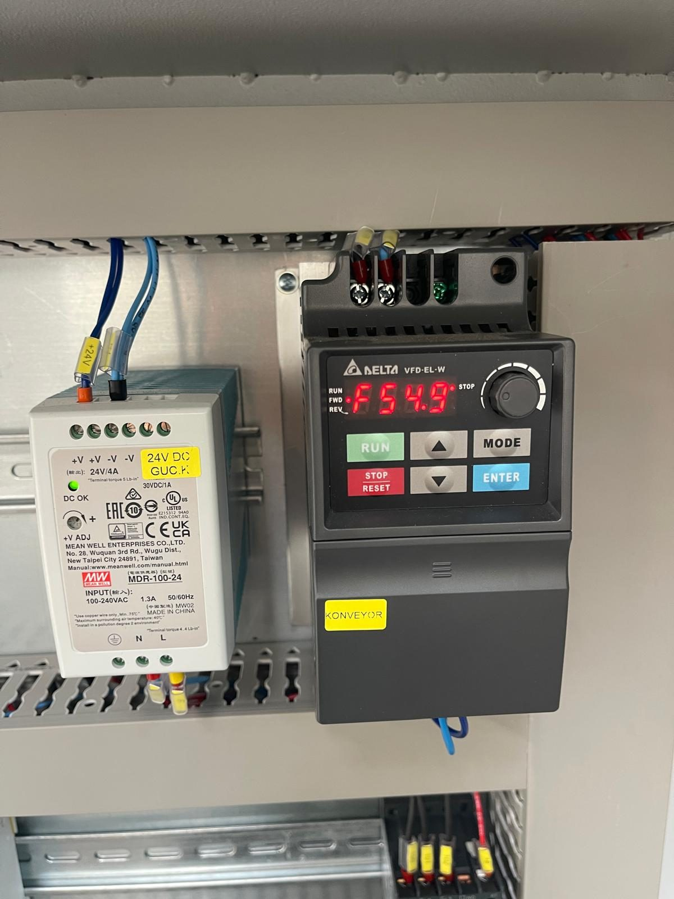

# 3.4 Maschinensteuerung

Die betriebliche Steuerung der Maschine erfolgt über das **Bedienfeld** an der Schaltschranktür. Diese Maschine hat **kein PLC und kein HMI**; die Steuerung wird mit Relais und Schützen realisiert, und für jede Prozessfunktion gibt es einen eigenen **EIN/AUS-Schalter** mit einer danebenliegenden **Betriebsleuchte (run)**. Die Heiztemperaturen werden mit vier digitalen Thermostaten **GEMO DTH2** eingestellt; die Fördergeschwindigkeit wird mit einem **Potentiometer** gewählt. Der Maschinenzustand wird über die roten Füllstand-Warnleuchten und die blaue RESET-Leuchte am Schaltschrank überwacht.

Diese Architektur gibt dem Bediener die Flexibilität, jede Funktion unabhängig ein- und auszuschalten; da jedoch keine automatische Sequenz vorhanden ist, muss der Bediener die Startreihenfolge und die Verriegelungsbedingungen kennen (**Siehe Kapitel 7.2**). Die Sicherheitsfunktionen sind in **Kapitel 2**, die Störungsdiagnose in **Kapitel 11** beschrieben.

---

## 3.4.1 Steuerschrank — allgemeiner Aufbau

| Parameter | Wert |
| :--- | :--- |
| Position des Hauptsteuerschranks | Bei Blick von vorn auf die Maschine **rechts** — an der vorderen Längsseite, nahe dem Ausgangsende; der Bediener bedient die Maschine von dieser Position aus (**Siehe Kapitel 3.5.1**) |
| Schaltschrankabmessungen (B × H × T) | 1000 × 1600 × 300 mm |
| Schutzart Schaltschrank (IP) | IP55 |
| Hauptschalter | Drehgriff außen an der Schaltschranktür — Leistungsschalter (TMŞ) Schneider CVS250F (LV521091), im Schaltschrank |
| HMI / PLC | Nicht vorhanden |
| Sprache des Bedienfelds | Englische Beschriftungen |
| Passwortebenen | Nicht vorhanden |
| Betriebsartenwahlschalter (Manuell / Automatik / Wartung) | Nicht vorhanden — der Bediener führt die Funktionen einzeln |
| Jog-/Tipptasten | Nicht vorhanden |
| Signalsäule | Nicht vorhanden — Status über die Leuchten am Schaltschrank |

Der Schaltschrank enthält die Leistungsverteilung, Motorschutzschalter, Schütze, Fehlerstrom-Schutzschalter, Heizungssicherungen, den Frequenzumrichter des Förderers, das Phasenfolgerelais, das 24-V-DC-Netzteil und zwei Sicherheitsrelais (**Siehe Kapitel 3.4.8**). An der Schaltschranktür befinden sich die Aufkleber "PANOLARIN KAPAKLARINI KİLİTLİ TUTUNUZ" (Schaltschranktüren verschlossen halten) und "YÜKSEK VOLTAJ" (Hochspannung); die Tür wird während des Betriebs verschlossen gehalten und nur von einer Elektrofachkraft unter LOTO geöffnet (**Siehe Kapitel 2.4**).

---

## 3.4.2 Anordnung des Bedienfelds

Das Bedienfeld befindet sich im oberen Bereich der Schaltschranktür auf einer Platte mit Dolfin-Logo. Das Bedienfeld besteht aus sechs Reihen: In den ersten vier Reihen befinden sich die Prozessschalter und die Heizungsthermostate, in der fünften Reihe der Förderer-Schalter, das Drehzahlpotentiometer und der Not-Halt-Taster, in der sechsten Reihe die Füllstandleuchten und der RESET-Taster. Die folgende Tabelle listet das Bedienfeld von oben nach unten und von links nach rechts auf.

| Reihe | Links | Mitte | Rechts |
| :---: | :--- | :--- | :--- |
| 1 | **TANK 1 HEATER** — Schalter + Thermostat GEMO DTH2 | **TANK 1 PUMP** — Schalter + Betriebsleuchte | **TANK 1 OIL SKIMMER** — Schalter + Betriebsleuchte |
| 2 | **TANK 2 HEATER** — Schalter + Thermostat GEMO DTH2 | **TANK 2 PUMP** — Schalter + Betriebsleuchte | **BLOWER 1** — Schalter + Betriebsleuchte |
| 3 | **DRYING 1 HEATER** — Schalter + Thermostat GEMO DTH2 | **DRYING 1 FAN** — Schalter + Betriebsleuchte | **BLOWER 2** — Schalter + Betriebsleuchte |
| 4 | **DRYING 2 HEATER** — Schalter + Thermostat GEMO DTH2 | **DRYING 2 FAN** — Schalter + Betriebsleuchte | **Unbeschrifteter Schalter** — Ölabscheidereinheit + Betriebsleuchte |
| 5 | **CONVEYOR** — Schalter + Betriebsleuchte | **Drehzahlpotentiometer** (Förderer) | **EMERGENCY STOP** — roter Pilztaster |
| 6 | **TANK 1 WASHING LEVEL** — rote Leuchte | **TANK 2 WASHING LEVEL** — rote Leuchte | **RESET** — blauer Taster / Leuchte |

---

## 3.4.3 Funktionsschalter und Betriebsleuchten

Jeder Schalter hat zwei Stellungen: **OFF** (AUS) und **ON** (EIN). Wird der Schalter in Stellung ON gebracht, zieht das zugehörige Schütz an und die danebenliegende weiße **Betriebsleuchte** leuchtet. Die Leuchte zeigt den Zustand des **Ausgangs**, nicht des Schalters: Leuchtet die Leuchte bei Schalterstellung ON nicht, hat eine Verriegelung (Füllstand, Sicherheitskreis) oder ein Schutzelement (Motorschutzschalter, Fehlerstrom-Schutzschalter) ausgelöst (**Siehe Kapitel 11.1**).

Neben den Heizungsschaltern (TANK 1/2 HEATER, DRYING 1/2 HEATER) befindet sich statt einer Betriebsleuchte der Thermostat **GEMO DTH2**; der Zustand des Heizungsausgangs wird an der Ausgangsanzeige im Thermostatdisplay abgelesen. Ist die Solltemperatur erreicht, schaltet der Thermostat die Heizung ab und die Ausgangsanzeige erlischt; dies ist normaler Betrieb. Sinkt die Temperatur unter den Sollwert, schaltet die Heizung selbsttätig wieder zu (**Siehe Kapitel 3.4.4**).

| Schalter | Deutsche Entsprechung | Geschaltete Einheit | Bedingung / Hinweis |
| :--- | :--- | :--- | :--- |
| TANK 1 HEATER | Heizung Waschtank | Heizstäbe R01–R05 (thermostatgeregelt) | Ausreichend Wasser in TANK 1 erforderlich; bei Erreichen der Solltemperatur schaltet der Thermostat ab |
| TANK 1 PUMP | Waschpumpe | PE02 (5,5 kW) | Ausreichend Wasser in TANK 1 erforderlich; Pumpenventile geöffnet |
| TANK 1 OIL SKIMMER | Ölskimmer | Getriebemotor GE06 | Bei Öl auf der Oberfläche des Waschtanks |
| TANK 2 HEATER | Heizung Spültank | Heizstäbe R06–R07 | Ausreichend Wasser in TANK 2 erforderlich |
| TANK 2 PUMP | Spülpumpe | PE04 (3 kW) | Ausreichend Wasser in TANK 2 erforderlich |
| BLOWER 1 | Blower-Gruppe 1 | Eine Gruppe der Blower-Motoren FE04–FE07 (Zuordnung im Schaltplan, **Siehe Kapitel 13.1**) | Wasserabblasen |
| BLOWER 2 | Blower-Gruppe 2 | Die andere Gruppe der Blower-Motoren FE04–FE07 (Zuordnung im Schaltplan, **Siehe Kapitel 13.1**) | Wasserabblasen |
| DRYING 1 HEATER | Heizung Trocknung 1 | R21 (12 kW, thermostatgeregelt) | Nur bei eingeschaltetem DRYING 1 FAN verwenden |
| DRYING 1 FAN | Ventilator Trocknung 1 | FE02 (1,1 kW) | — |
| DRYING 2 HEATER | Heizung Trocknung 2 | R22 (12 kW, thermostatgeregelt) | Nur bei eingeschaltetem DRYING 2 FAN verwenden |
| DRYING 2 FAN | Ventilator Trocknung 2 | FE03 (1,1 kW) | — |
| Unbeschrifteter Schalter | Ölabscheidereinheit | Magnetventil der Membranpumpe | Druckluft mit 6 bar muss angeschlossen sein |
| CONVEYOR | Förderer | GE01 — über Frequenzumrichter; Abluftventilator FE01 wird mit zugeschaltet | Geschwindigkeit über Potentiometer; Linie leer und RESET-Leuchte leuchtet |

Der Abluftventilator (FE01) hat am Bedienfeld keinen eigenen Schalter; er wird zusammen mit dem Schalter **CONVEYOR** zugeschaltet und läuft, solange der Förderergetriebemotor läuft. Wird der Schalter CONVEYOR auf OFF gestellt, stoppt auch der Abluftventilator.

Die Einschaltreihenfolge der Schalter ist in **Kapitel 7.2.2**, die Verriegelungen sind in **Kapitel 3.4.6** angegeben.

---

## 3.4.4 Thermostate — GEMO DTH2

Neben den vier Heizungsschaltern befindet sich jeweils ein digitaler Thermostat **GEMO DTH2**. Der Thermostat misst die Temperatur des betreffenden Tanks oder der Trocknungsluft mit einem Thermoelement (ETB30F06-5Ç / -4Ç) und trennt bei Erreichen des Sollwerts das Heizungsschütz; sinkt die Temperatur, schaltet er es wieder ein. So wird die Temperatur auf dem Sollwert gehalten, auch wenn der Heizungsschalter in Stellung ON bleibt.

| Thermostat | Geregelte Heizung | Sollwert |
| :--- | :--- | :--- |
| TANK 1 HEATER | R01–R05 (Waschtank) | Legt der Betreiber fest — höchstens +70 °C (**Siehe Kapitel 3.3.5**) |
| TANK 2 HEATER | R06–R07 (Spültank) | Legt der Betreiber fest — höchstens +70 °C |
| DRYING 1 HEATER | R21 (Trocknung 1) | Legt der Betreiber fest — unterhalb der zulässigen Temperatur des Werkstückmaterials |
| DRYING 2 HEATER | R22 (Trocknung 2) | Legt der Betreiber fest — unterhalb der zulässigen Temperatur des Werkstückmaterials |

Die Thermostate haben keinen werkseitigen Sollwert; die Sollwerte werden vom Betreiber gemäß den Prozessanforderungen festgelegt. Die Badwassertemperatur darf +70 °C nicht überschreiten. Die Temperatur der Trocknungsluft ist so zu wählen, dass die zulässige Temperatur des bearbeiteten Werkstückmaterials nicht überschritten wird.

Der Sollwert wird mit den Pfeiltasten Auf/Ab am Thermostat eingegeben; die Anzeige zeigt die aktuelle Temperatur. Das Einstellverfahren ist in **Kapitel 6.3.3** angegeben. Zeigt der Thermostat das Erreichen des Sollwerts an, während sich das Wasser weiter erwärmt, liegt ein Thermostat- oder Schützfehler vor (**Siehe Kapitel 11.1.2 — Störung 5**).

---

## 3.4.5 Signalleuchten und RESET

| Leuchte / Taster | Farbe | Bedeutung | Bedieneraktion |
| :--- | :---: | :--- | :--- |
| Betriebsleuchten (neben jedem Schalter) | Weiß | Zugehöriger Ausgang aktiv | Leuchtet sie bei Schalterstellung ON nicht: Verriegelung/Schutz prüfen (**Siehe Kapitel 11.1**) |
| TANK 1 WASHING LEVEL | Rot | Wasserstand im Waschtank unzureichend | TANK 1 von Hand befüllen; Heizung und Pumpe laufen nicht |
| TANK 2 WASHING LEVEL | Rot | Wasserstand im Spültank unzureichend | TANK 2 von Hand befüllen; Heizung und Pumpe laufen nicht |
| RESET | Blau | Leuchtet: Sicherheitskreis geschlossen, Maschine bereit. Aus: Not-Halt betätigt, Klappe offen oder Reset erwartet | Ursache beseitigen; RESET drücken, bis die Leuchte leuchtet (**Siehe Kapitel 2.5**) |

Die RESET-Leuchte ist die **allgemeine Bereitschaftsanzeige** dieser Maschine. Öffnet ein Not-Halt oder eine Wartungsklappe den Sicherheitskreis, erlischt die Leuchte und alle Ausgänge werden abgeschaltet; bis der sichere Zustand durch Reset bestätigt ist, läuft keine Funktion. Da keine Signalsäule vorhanden ist, überwacht der Bediener den Linienzustand anhand dieser Leuchten und der Betriebsleuchten.

---

## 3.4.6 Verriegelungen (Interlock)

Die Maschine wird ohne Automatisierungssoftware durch die folgenden hardwareseitigen Verriegelungen geschützt:

| Verriegelung | Bedingung | Folge |
| :--- | :--- | :--- |
| Tank-Füllstandverriegelung | Nicht ausreichend Wasser in TANK 1 oder TANK 2 (VEGASWING 51) | Heizungen und Pumpe des betreffenden Tanks lassen sich nicht einschalten; rote WASHING-LEVEL-Leuchte leuchtet |
| Klappen-Sicherheitskreis | Eine Wartungsklappe offen oder Schalter nicht fluchtend | Alle Bewegungs- und Prozessausgänge stoppen; RESET-Leuchte erlischt |
| Not-Halt-Kreis | Einer der 7 Not-Halt-Taster betätigt | Alle Bewegungs- und Prozessausgänge stoppen; RESET-Leuchte erlischt |
| Phasenüberwachung | Phasenfolge falsch oder Phase fehlt (MKR-01) | Schaltschrank gibt keinen Ausgang frei; Funktionen werden nicht eingeschaltet |
| Thermostat | Solltemperatur erreicht | Zugehöriges Heizungsschütz wird getrennt (Schalter bleibt ON) |
| Motorschutz (MKŞ) | Überstrom / Kurzschluss | Versorgung des betreffenden Motors wird getrennt; Betriebsleuchte erlischt |
| Fehlerstrom (RCCB) | Isolationsfehler einer Heizung | Versorgung der betreffenden Heizungsgruppe wird getrennt |

Die Füllstandverriegelung verhindert den Betrieb der Heizstäbe ohne Wasser und den Trockenlauf der Pumpe; der Füllstandsensor darf deshalb niemals überbrückt werden. Für eine Funktion, die trotz erfüllter Verriegelungsbedingungen nicht läuft, siehe die Störungstabelle in **Kapitel 11.1.2**.

---

## 3.4.7 Drehzahleinstellung des Förderers

| Parameter | Wert |
| :--- | :--- |
| Einstellelement | Potentiometer am Bedienfeld (neben dem Schalter CONVEYOR) |
| Antrieb | Delta VFD004EL21W-1 (0,4 kW) — im Schaltschrank |
| Einstellbereich | **20–60 Hz** Ausgangsfrequenz des Frequenzumrichters |
| Drehrichtungseinstellung | Werkseinstellung — Parameter des Frequenzumrichters; wird vom Bediener nicht verändert |

Wird das Potentiometer im Uhrzeigersinn gedreht, steigen die Ausgangsfrequenz des Frequenzumrichters und die Fördergeschwindigkeit. Wird **unter 20 Hz** abgesenkt, reicht das Motordrehmoment unter Last nicht aus und der Förderer kann stehen bleiben; verwenden Sie die Maschine deshalb nicht außerhalb dieses Bereichs. Die Geschwindigkeit bestimmt die Kontaktzeit des Werkstücks in der Kammer und damit das Reinigungs-/Trocknungsergebnis (**Siehe Kapitel 8.1**). Das Einstellverfahren für die Geschwindigkeit ist in **Kapitel 6.3.4** angegeben. Für die Alarmcodes des Frequenzumrichters siehe das Delta-Handbuch (**Siehe Kapitel 11.3.2**).

---

## 3.4.8 Hauptkomponenten im Schaltschrank

| Komponente | Marke / Modell | Funktion |
| :--- | :--- | :--- |
| Hauptschalter (Leistungsschalter, TMŞ) | Schneider EasyPact CVS250F — LV521091 (250 A); Türgriff LV521101 | Energietrennung und LOTO-Punkt (**Siehe Kapitel 2.4**) |
| Phasenfolge-/Phasenüberwachungsrelais | MKR-01 | Schutz gegen falsche Phasenfolge und Phasenausfall |
| Motorschutzschalter (MKŞ) | Schneider GV2ME04 / GV2ME07 / GV2ME14 / GV2ME16 + Hilfskontakt GVAE11 | Überstrom- und Kurzschlussschutz der Motoren — Q1…Q10 (**Siehe Kapitel 11.1.3**) |
| Schütze | Schneider LC1K0610M7, LC1K1610M7, LC1D25M7 (220-V-Spule) | Schalten von Motoren und Heizungen |
| Fehlerstrom-Schutzschalter (RCCB) | Schneider A9N19642 (4P — Motorgruppe, Trocknung 1/2), A9N19643 (4P — Tankheizstäbe) | Schutz bei Isolationsfehlern |
| Heizungssicherungen | A9F74316 (16 A — Tankheizstäbe), A9F74325 (25 A — Trocknungsheizungen) | Überstromschutz |
| Frequenzumrichter Förderer | Delta VFD004EL21W-1 (0,4 kW); Sicherung A9F74106 | Drehzahlregelung des Förderers |
| Steuernetzteil | LRS-350-24 (24 V DC, 14,6 A); Sicherung A9F74160 / A9F74110 | Versorgung des Steuerkreises |
| Sicherheitsrelais — Not-Halt-Kreis | Omron G9SB2002AACDC241 (Bestellnummer 10 00220) | Auswertung der 7 Not-Halt-Taster |
| Sicherheitsrelais — Wartungsklappenkreis | Omron G9SB2002AACDC241 (Bestellnummer 10 11531) | Auswertung der magnetischen Schalter der Wartungsklappen |
| Thermostate (4 Stück) | GEMO DTH2 | Temperaturregelung Tank 1, Tank 2, Trocknung 1, Trocknung 2 |
| Not-Halt-Taster (Schaltschrank) | P1EC400E40K + Kontaktblöcke | Not-Halt am Bedienfeld |
| Reset-Taster | BL901M + blaue Signalleuchte | Reset des Sicherheitskreises / Bereitschaftsanzeige |

Eingriffe im Schaltschrank erfolgen ausschließlich durch eine Elektrofachkraft unter LOTO (**Siehe Kapitel 2.4**). Die Ersatzteilnummern sind in **Kapitel 13.3** angegeben.

---

## 3.4.9 Betriebsarten und Start/Stopp

| Parameter | Wert |
| :--- | :--- |
| Allgemeiner START-/STOPP-Taster | Nicht vorhanden — jede Funktion wird mit ihrem eigenen Schalter ein-/ausgeschaltet |
| Automatikbetrieb | Nicht vorhanden — die gesamte Linie läuft nicht mit einem einzigen Befehl |
| Handbetrieb | Einzige Betriebsart der Maschine — der Bediener schaltet die Schalter unter Beachtung der Verriegelungen ein |
| Wartungs-/Einrichtbetrieb | Nicht vorhanden — bei Wartung wird der Hauptschalter ausgeschaltet und LOTO angewendet (**Siehe Kapitel 2.4**) |
| Schritt-/Einzelschrittbetrieb | Nicht vorhanden |
| Rezept-/Programmspeicherung | Nicht vorhanden — Sollwerte über die Thermostate |
| Trend-/Protokollaufzeichnung | Nicht vorhanden |
| Fernzugriff | Nein |

Die Start- und Abschaltreihenfolge ist in **Kapitel 7.2** und **7.3** definiert.

---

## 3.4.10 Not-Halt

Die Maschine verfügt über **7 Not-Halt-Taster**: einer am Bedienfeld; je einer an der vorderen und hinteren Längsseite am Förderereingang, am Fördererausgang und im mittleren Maschinenbereich (**Siehe Kapitel 3.5.5**). Beim Betätigen eines Not-Halt-Tasters stoppen alle Bewegungs- und Prozessausgänge; die RESET-Leuchte erlischt.

Das Reset-Verfahren, die Wiederanlaufbedingungen nach Not-Halt und die Pflichten des Bedieners sind in **Kapitel 2.5** angegeben; die Schritte werden in diesem Kapitel nicht wiederholt.

---

Werte der elektrischen Versorgung: **Siehe Kapitel 3.3.3**; Start-/Stopp-Verfahren: **Siehe Kapitel 7**; Störungsdiagnose: **Siehe Kapitel 11**.
