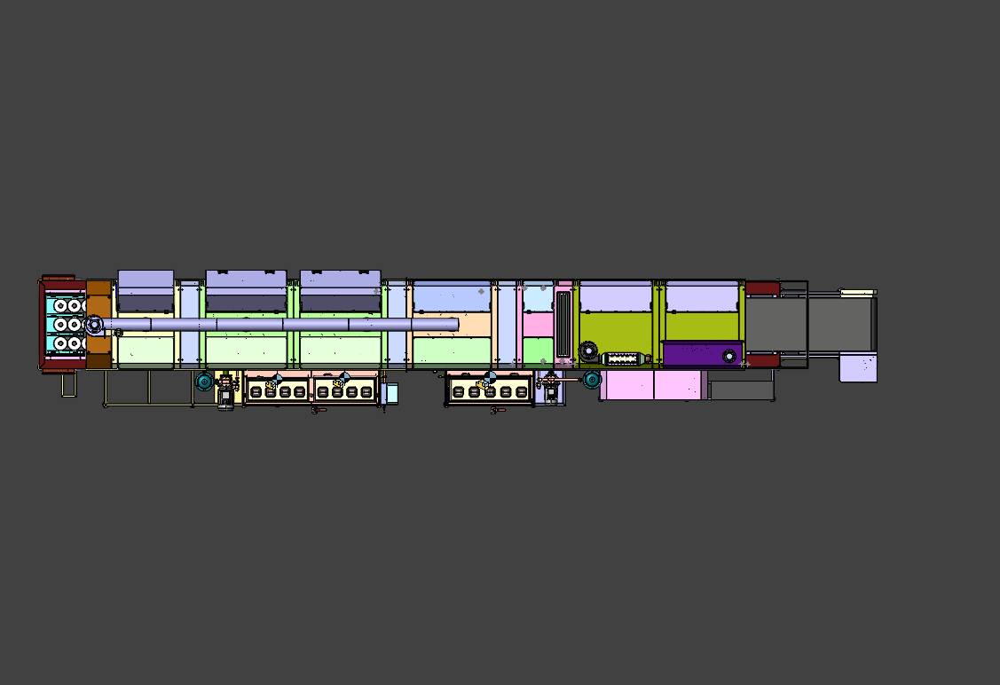
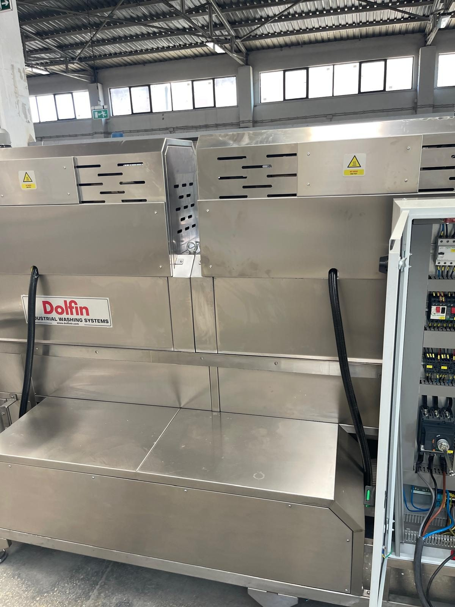
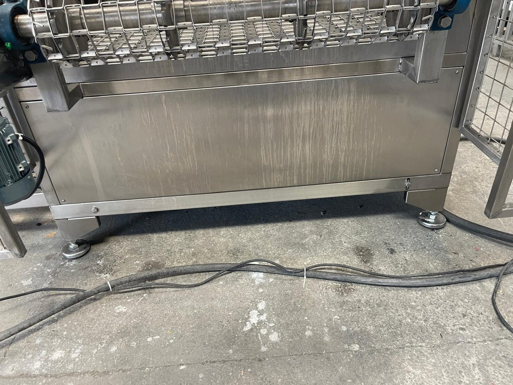

# 3.5 Makine yerleşim planı

Bu bölüm, makinenin tesis içindeki konumlandırılması, yön tanımları, minimum etraf boşlukları, bakım erişimi ve taşıma kısıtlarını tanımlar. Kurulum (Bölüm 5) ve nakliye (Bölüm 4) bölümleri alan gereksinimlerini buradan referans alır; aynı değerler tekrarlanmaz.

**Referans çizim:** Makine layout çizimi ayrı evrak olarak teslim edilir; dosya adı ve revizyonu için **Bkz. Bölüm 13.1**.

---

## 3.5.1 Yön tanımları ve operatör tarafı

Makine yönleri, konveyör akış yönü ve operatör erişim tarafı kurulum, operasyon ve bakım planlamasında ortak referans olarak kullanılır. Tüm kılavuz metinlerinde aşağıdaki tanımlar geçerlidir.

**Karşıdan bakış:** Makineye, tankların, pompaların ve elektrik panosunun bulunduğu **ön uzun kenardan** bakıştır. Kılavuzdaki "sol" ve "sağ" ifadeleri bu bakışa göredir: sol uç parça girişi, sağ uç parça çıkışıdır.

| Tanım | Yön / Konum |
| :--- | :--- |
| Ön (operatör tarafı) | Tankların, pompaların, elektrik panosunun ve operatör panelinin bulunduğu uzun kenar |
| Arka | Ön kenarın karşısındaki uzun kenar |
| Besleme tarafı (giriş) | Sol uç — parça girişi |
| Boşaltma tarafı (çıkış) | Sağ uç — parça çıkışı |
| Konveyör akış yönü | Sol → Sağ |
| Elektrik panosu ve operatör paneli | Karşıdan bakıldığında sağda — ön kenarda, çıkış ucuna yakın |
| Yağ ayırıcı ünitesi | Makine yanında ayrı kabin — hortum ve hava hattı ile bağlı |

Parçalar sol uçtan konveyöre elle yerleştirilir, yıkama → durulama → su sıyırma → kurutma bölgelerinden geçer ve sağ uçtan elle alınır. Operatörün yükleme ve boşaltma noktaları arasında engelsiz bir yürüyüş yolu bulunmalıdır; bu yol üzerinde ve ön kenardaki tank, filtre ve pano erişim alanında malzeme veya parça istiflenmemelidir.

Operatör; operatör paneline, ana şalter koluna ve elektrik panosuna **ön kenardan, çıkış ucuna yakın konumdan** erişir. Makinede tepe lambası yoktur; RESET ve seviye lambaları yalnızca panel önünden görülür. Bu nedenle operatör çalışma pozisyonu panelin görüş alanı içinde planlanmalıdır.

---

## 3.5.2 Minimum etraf boşlukları ve tavan yüksekliği

Kurulum alanı planlamasında aşağıdaki minimum boşluklar sağlanmalıdır. Boşluklar makinenin dış hatlarından ölçülür (dış ölçüler: **Bkz. Bölüm 3.3.1**).

| Bölge | Minimum boşluk | Gerekçe |
| :--- | :---: | :--- |
| Ön (operatör / pano / tank tarafı) | ≥ 1 200 mm | Pano kapağının tam açılması (pano genişliği 1 000 mm), tank kapakları ve filtre erişimi, operatör çalışma alanı |
| Arka | ≥ 1 000 mm | Bakım kapaklarının açılması ve arka taraf bakım erişimi |
| Yan — giriş (sol) | ≥ 1 500 mm | Parça yükleme alanı; konveyör ucu ve gres nipelleri erişimi |
| Yan — çıkış (sağ) | ≥ 1 500 mm | Parça boşaltma alanı; konveyör ucu ve gres nipelleri erişimi |
| Tavan yüksekliği | Makinenin en üst noktası (egzoz fanı / baca) + en az 500 mm | Egzoz fanı ve baca bakımı; baca tesis kanalına bağlanacaksa kanal güzergâhı ayrıca planlanır |

| Ek gereksinim | Değer |
| :--- | :--- |
| Montaj alanı minimum boyutu | (L + 3 000 mm) × (W + 2 200 mm) — L, W: **Bkz. Bölüm 3.3.1**; yağ ayırıcı ünitesi için makine yanında ek alan |
| Zemin düzgünlük toleransı | ≤ 2 mm/m; toplam kot farkı ayarlanabilir ayakların ayar aralığı içinde kalmalı |
| Zemin mukavemeti | Dolu çalışma ağırlığının (**Bkz. Bölüm 3.3.1**) en az 1,5 katını taşıyan endüstriyel beton zemin; ayak altlarındaki noktasal yükler dikkate alınır |
| Zemin yüzeyi | Sert, düz, suya dayanıklı; tank çevresinde drenaj önerilir |

Montaj alanı ölçüsündeki ekler, yukarıdaki etraf boşluklarının toplamıdır: uzunlukta giriş ve çıkış yanları (2 × 1 500 mm), genişlikte ön ve arka (1 200 mm + 1 000 mm). Seviye ayarı ayarlanabilir ayaklar ile yapılır (**Bkz. Bölüm 5.2.3**). Yağ ayırıcı ünitesi için makine yanında ek alan ve hortum/hava hattı güzergâhı planlanmalıdır.

---

## 3.5.3 Bakım erişim bölgeleri

| Bölge | Erişim |
| :--- | :--- |
| Tank 1 ve Tank 2 üst kapakları | Gaz amortisörlü kapaklar — ön filtre, iç filtre, rezistans ve seviye sensörü erişimi |
| Hücre bakım kapakları (7 adet) | Elle kaldırılarak açılır; manyetik emniyet switch'li — nozul, blower borusu ve tel bant erişimi |
| Pompa ve hassas filtre bölgesi | Ön kenar, tankların yanı — torba filtre gövdesi ve pompa |
| Elektrik panosu | Ön kenar, çıkış ucuna yakın — kapak tam açılma alanı (**Bkz. Bölüm 3.5.2**) |
| Konveyör redüktörü ve gres nipelleri | Redüktör çıkış ucunda; gres nipelleri giriş ve çıkış uçlarında — alet ile açılan koruma kafesi içi |
| Egzoz fanı ve baca | Makine üstü — tavan yüksekliği ve erişim platformu/merdiven gereksinimi |
| Yağ ayırıcı ünitesi | Ayrı kabin — diyaframlı pompa ve filtre alt kısımda |

Bakım kapakları **manyetik emniyet switch'leri** ile izlenir; kapak açıldığında makine durur. Bakım öncesi makine durdurulmalı, ana şalter kapatılmalı ve **LOTO prosedürü** uygulanmalıdır (**Bkz. Bölüm 2.4**). Switch'ler bypass edilmemelidir.

Günlük ön filtre temizliği tank üst kapaklarından, haftalık torba filtre temizliği pompa çıkışındaki filtre gövdesinden yapılır (**Bkz. Bölüm 10.1.3, 10.1.4**). Konveyör gres nipelleri koruma kafesi içindedir; kafes alet ile açılır ve bu noktalara yalnızca LOTO sonrası erişilir (**Bkz. Bölüm 2.4, 9.1.4**).

---

## 3.5.4 Taşıma, forklift ve ağırlık merkezi

| Parametre | Değer / Not |
| :--- | :--- |
| Sevkiyat parçaları | Makine gövdesi boyca tam ortadan ayrılmış **iki gövde parçası** + ayrı yağ ayırıcı ünitesi |
| Taşıma ağırlığı — en ağır gövde parçası | 3 000 kg |
| Boş ağırlık (toplam) | **Bkz. Bölüm 3.3.1** |
| Kaldırma yöntemi | Yalnız forklift; her gövde parçası ayrı kaldırılır — çatallar alt şasedeki profillerin altına, ağırlık merkezine göre ortalanarak sokulur; makinenin alt kısmında şase dışında bileşen bulunmaz. Vinç ve travers ile kaldırma öngörülmemiştir. |
| Ağırlık merkezi | Tanklar, pompalar ve elektrik panosu ön (operatör) uzun kenar boyunca yerleşiktir; ağırlık merkezi ön kenara doğru kayıktır. Gövde parçalarının ağırlıkları farklıdır. Tanklar boşaltılmadan taşınmaz. |

Her gövde parçasını yalnızca forklift ile ve ayrı ayrı kaldırın: çatalları alt şase profillerinin altına, parça boyunca ağırlık merkezine göre ortalayarak ve parçanın tüm genişliğini taşıyacak derinlikte sokun. Her parçada kaldırmadan önce 10–15 cm yükseklikte ayrı denge testi yapın (**Bkz. Bölüm 4.1.4**). Birleştirilmiş makine bütün hâlde kaldırılmaz; yer değişikliğinde gövde parçaları ayrılarak taşınır (**Bkz. Bölüm 12.1.3**). Tanklar dolu iken makine taşınmaz; sıvı çalkalanması ağırlık merkezini kaydırır ve devrilme riski oluşturur. Taşıma prosedürü **Bölüm 4.1**'de verilmiştir.

---

## 3.5.5 Güvenlik elemanlarının yerleşimi

Acil stop butonları ve emniyet switch'li bakım kapakları makine boyunca dağıtılmıştır; operatörün her çalışma pozisyonundan en az bir acil stopa erişimi vardır.

| No. | Acil stop konumu |
| :---: | :--- |
| 1 | Operatör paneli (EMERGENCY STOP) |
| 2 | Konveyör girişi (sol uç) — ön kenar |
| 3 | Konveyör girişi (sol uç) — arka kenar |
| 4 | Konveyör çıkışı (sağ uç) — ön kenar |
| 5 | Konveyör çıkışı (sağ uç) — arka kenar |
| 6 | Makine orta bölgesi — ön kenar |
| 7 | Makine orta bölgesi — arka kenar |

Acil stop'a basıldığında tüm fonksiyonlar durur. Reset prosedürü ve yeniden devreye alma koşulları **Bölüm 2.5**'te verilmiştir; bu bölümde adımlar tekrarlanmaz.

Bakım kapağı sayısı **7**'dir; her kapakta Omron F3STGRNLPU21M1J8 manyetik switch bulunur. Işık perdesi bulunmamaktadır; konveyör giriş ve çıkışı tel koruma kafesi ile çevrilidir (**Bkz. Bölüm 2.1.3**).

---

Teknik boyut ve ağırlık değerleri: **Bkz. Bölüm 3.3.1**; nakliye prosedürleri: **Bkz. Bölüm 4**.
