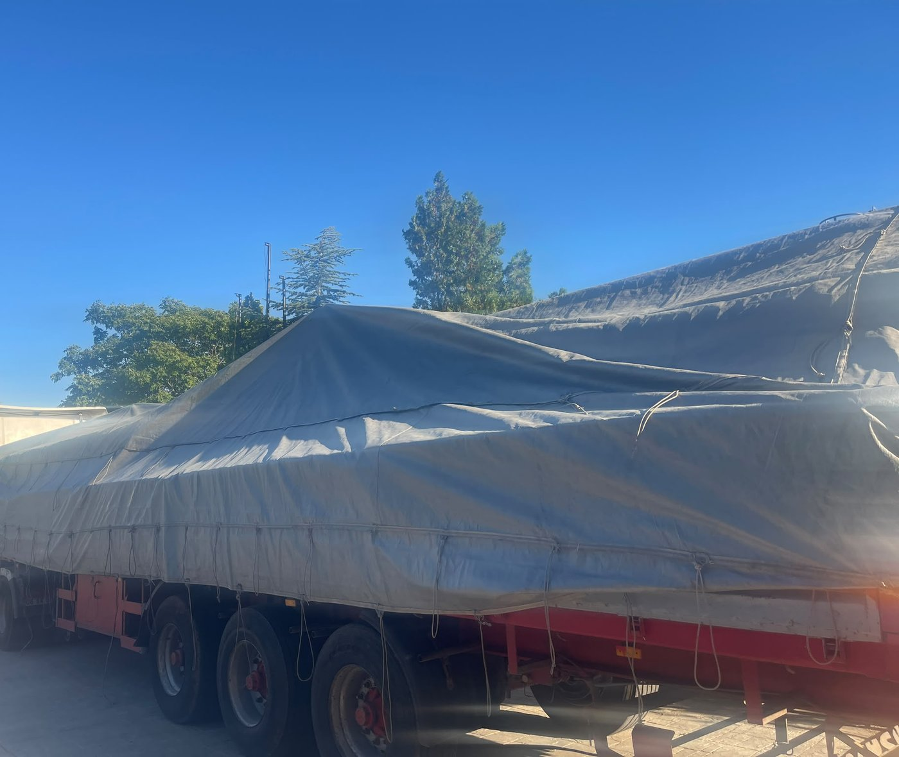

# 4.1 Transport und Versand

Die Maschine besteht aus einem **langen Hauptkörper**, der die Fördererlinie, die Tanks, die Trocknungseinheit und den Schaltschrank trägt, sowie der separat stehenden **Ölabscheidereinheit**. Da der Hauptkörper lang ist und die Gewichtsverteilung asymmetrisch ist (Tanks, Pumpen und Schaltschrank sind entlang der vorderen Längsseite angeordnet), dürfen Anheben und Transport nur durch einen zertifizierten Gabelstaplerfahrer und nur mit dem Gabelstapler an den Profilen des unteren Rahmens erfolgen (**Siehe Kapitel 3.5.4**). Der Hauptkörper wird mit Stretchfolie umwickelt und auf einem offenen Pritschenfahrzeug unter einer Plane versandt; die Ölabscheidereinheit wird separat transportiert.

Bei der Fahrzeugauswahl und der Planung des Transportwegs sind Außenabmessungen und Gewicht (**Siehe Kapitel 3.3.1**) sowie Transportgewicht, Anschlagpunkte und Schwerpunkt (**Siehe Kapitel 3.5.4**) zu berücksichtigen.

---

## 4.1.1 Anforderungen vor dem Transport

Vor Beginn des Transports müssen die folgenden Bedingungen erfüllt sein. Fehlt eine Bedingung, den Transport stoppen; nicht fortfahren, bevor sie erfüllt ist.

| Parameter | Wert / Anforderung |
| :--- | :--- |
| Transportmittel | Gabelstapler |
| Transportgewicht (schwerstes Teil) | **Siehe Kapitel 3.5.4** |
| Hebeverfahren und Gabelposition | **Siehe Kapitel 3.5.4** |
| Verpackungsart | Der Hauptkörper wird mit Stretchfolie umwickelt; auf dem offenen Pritschenfahrzeug mit einer Plane abgedeckt. Die Ölabscheidereinheit wird separat transportiert. |
| Sicherung / Verzurrung während des Transports | Die Maschine wird am Rahmen an mindestens 4 Punkten mit Spanngurten (Ratschengurten) auf der Ladefläche verzurrt; das Verrutschen der Füße wird mit Keilen verhindert. Die Gurte belasten weder Außenverkleidung, Schaltschranktür, Rohrleitungen noch Abluftkamin. |
| Feuchtigkeits-/Korrosionsschutz | Landtransport: Stretchfolie + Plane. Seetransport: zusätzlich VCI-Korrosionsschutzfolie und Silikagel-Trockenmittel in geschlossenem Container / geschlossener Kiste. Tanks, Pumpen und Filtergehäuse müssen leer und trocken sein. |
| Transporttemperatur | Es gilt der Lagertemperaturbereich (**Siehe Kapitel 3.3.6**) |
| Max. Transporthöhe (Land / See) | Straße: Gesamthöhe Fahrzeug + Ladung darf **4,00 m** nicht überschreiten (türkische Straßenverkehrsordnung, Karayolları Trafik Yönetmeliği); bei Überschreitung wird die Kamin-/Ventilatorgruppe demontiert transportiert. See: Planung nach der Innenhöhe von Container / Kiste. |

Der Gabelstaplerfahrer muss über ein gültiges Zertifikat verfügen. Die sichere Tragfähigkeit (SWL) des Gabelstaplers muss mindestens dem Transportgewicht des schwersten Teils (**Siehe Kapitel 3.5.4**) entsprechen und für den durch die Maschinenbreite gegebenen Lastschwerpunktabstand gelten. Torhöhe und Torbreite auf dem Transportweg müssen größer als die Außenabmessungen der Maschine (**Siehe Kapitel 3.3.1**) sein; Rampenneigung und Wenderadius müssen innerhalb der Betriebsgrenzen des beladenen Gabelstaplers liegen.

**VORSICHT — Falscher Anschlagpunkt:** Anheben an anderen Stellen als den Profilen des unteren Rahmens führt zu Rahmenverformung, Verlust der Tankdichtheit und Schäden am Schaltschrank. Heben Sie die Maschine nur wie in **Kapitel 3.5.4** festgelegt mit dem Gabelstapler an; verwenden Sie keinen Kran und keine Anschlagmittel.

---

## 4.1.2 Vorbereitung vor dem Transport

1. Transportroute und Zielpunkt vorab festlegen; Hindernisse, Neigung und Tragfähigkeit des Bodens prüfen.
2. Sicherstellen, dass die bauseitigen **Elektro-, Wasser- und Druckluftanschlüsse** der Maschine getrennt sind (bei installierter Maschine wird LOTO gemäß **Kapitel 2.4** angewendet).
3. Prüfen, dass der Hauptschalter in Stellung **OFF (O)** steht.
4. Die Prozessflüssigkeit im Wasch- und Spültank über die Ablassventile (**TAHLİYE**) entleeren; der Transport mit gefüllten Tanks verändert den Schwerpunkt und erzeugt Kippgefahr (**Siehe Kapitel 10.1.5**).
5. Prüfen, dass in Pumpengehäusen, Filtergehäusen und Rohrleitungen keine Flüssigkeit verbleibt.
6. Schlauch- und Druckluftanschlüsse der Ölabscheidereinheit vom Hauptkörper trennen; die Einheit separat transportieren.
7. Prüfen, dass Tankdeckel und Kammerklappen geschlossen sind und keine herabhängenden Kabel, Schläuche oder losen Teile verbleiben.
8. Die Gesamthöhe von Fahrzeug und Ladung mit dem Grenzwert in **Kapitel 4.1.1** vergleichen; bei Überschreitung den demontierten Transport der Kamin-/Ventilatorgruppe mit dem Herstellerservice planen (**Siehe Kapitel 1.3**).
9. Den Hauptkörper mit Stretchfolie umwickeln; beim Seetransport den zusätzlichen Korrosionsschutz gemäß **Kapitel 4.1.1** anwenden.
10. Gabelstaplerfahrer und Einweiser benennen.
11. Nach dem Verladen der Maschine auf das Fahrzeug (**Siehe Kapitel 4.1.4**) die Maschine am Rahmen an mindestens 4 Punkten mit Spanngurten verzurren; die Gurte nicht über Außenverkleidung, Schaltschranktür, Rohrleitungen oder Abluftkamin führen.
12. Das Verrutschen der Füße mit Keilen verhindern.
13. Die Maschine mit einer Plane abdecken und die Plane sichern.

---

## 4.1.3 Entfernen der Verpackung

Wenn die Maschine am Aufstellort angekommen ist, werden Plane und Stretchfolie kontrolliert entfernt, um Transportschäden zu vermeiden:

1. Vor dem Öffnen der Plane eine äußere Schadenskontrolle durchführen (Quetschungen, Feuchtigkeit, Kippspuren); bei Abweichungen fotografieren und der Betriebsleitung melden.
2. Spanngurte, Keile und Plane entfernen, ohne den Maschinenkörper, den Abluftkamin und die Schaltschranktür zu beschädigen.
3. Vor dem Anheben der Maschine mit dem Gabelstapler sicherstellen, dass die Füße und Anschlagpunkte frei von Verpackungselementen sind.
4. Nach dem Absetzen der Maschine am Aufstellort (**Siehe Kapitel 4.1.4**) die Stretchfolie entfernen; beim Aufschneiden der Folie das Messer nicht an Edelstahlflächen, Kabel oder Schläuche führen.
5. Verpackungsabfälle gemäß den betrieblichen Recyclingregeln trennen (**Siehe Kapitel 12.3**).

---

## 4.1.4 Transportverfahren mit dem Gabelstapler

**WARNUNG — Kippen und Quetschen:** Falsche Gabelposition, überhöhte Geschwindigkeit oder unausgewogene Beladung können beim Transport zum Umkippen der Maschine oder zum Quetschen von Personen führen. Setzen Sie die Gabeln ausschließlich unter den Profilen des unteren Rahmens an und zentrieren Sie sie auf den Schwerpunkt (**Siehe Kapitel 3.5.4**).

1. Die Gabeln des Gabelstaplers unter den Profilen des unteren Rahmens ausrichten; keine Last auf Außenverkleidung, Schaltschrank, Tankkörper, Rohrleitungen oder Abluftkamin bringen.
2. Die Gabeln entlang der Maschine auf den Schwerpunkt zentrieren und so tief einschieben, dass die gesamte Maschinenbreite getragen wird; reicht die Gabellänge nicht aus, Gabelverlängerungen verwenden.
3. Die Maschine **10–15 cm** vom Boden anheben und einen Gleichgewichtstest durchführen; bei Neigung, Ungleichgewicht vorn/hinten oder Gabelrutschen langsam absenken und die Position korrigieren.
4. Die Last während des gesamten Transports niedrig halten; keine abrupten Wendemanöver, Rückwärtsfahrten oder scharfen Bremsungen.
5. Bei eingeschränktem Sichtfeld des Gabelstaplers einen Einweiser einsetzen; keine Personen unter der angehobenen Last oder in der Bewegungsbahn der Last.
6. Die Maschine am Zielpunkt langsam absenken; prüfen, dass alle **Stellfüße** auf dem Boden aufsitzen.
7. Die Ölabscheidereinheit neben der Maschine an der vorgesehenen Stelle platzieren.
8. Nach dem Platzieren am Aufstellort mit dem Montageverfahren in **Kapitel 5** fortfahren.

**Erwartetes Ergebnis:** Die Maschine steht am Zielpunkt stabil und unbeschädigt; die Füße haben vollständigen Bodenkontakt.

**Abweichung:** Werden Kippen, Risse, Tankverformung oder Schäden am Schaltschrank festgestellt, die Maschine nicht in Betrieb nehmen; wenden Sie sich an den Herstellerservice (**Siehe Kapitel 1.3**).

---

## 4.1.5 Kontrolle nach dem Transport

1. Rahmen, Schaltschrank, Tanks, Kammerklappen, Abluftkamin und Rohrleitungen auf sichtbare mechanische Schäden prüfen.
2. Sicherstellen, dass die Füße keine Verformung aufweisen.
3. Prüfen, dass die Schaltschranktür geschlossen, verriegelt und trocken ist.
4. Prüfen, dass der Drahtgurt des Förderers und die Schutzgitter an ihrem Platz sind.
5. Wurde die Kamin-/Ventilatorgruppe demontiert transportiert, prüfen, dass die Teile vollständig und unbeschädigt sind.
6. Liegt kein Schaden vor, mit der Installation fortfahren (**Siehe Kapitel 5.1**); bei Schäden dokumentieren und den Service benachrichtigen.

Die Anforderungen an Boden und Freiraum am Aufstellort sind in **Kapitel 3.5.2** angegeben.
