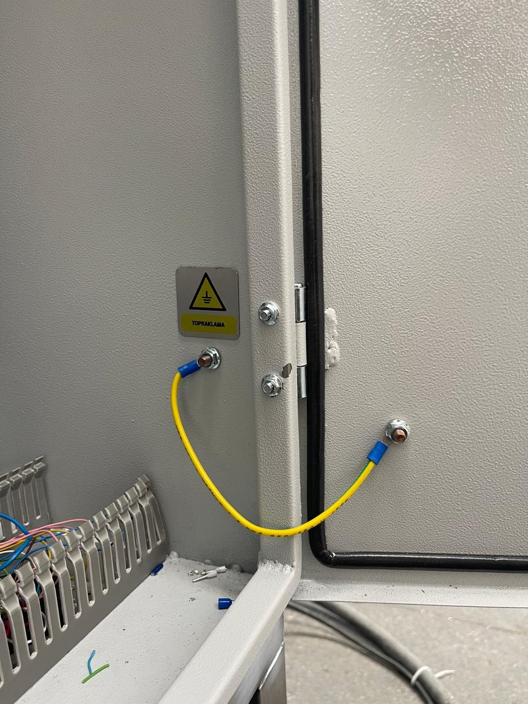
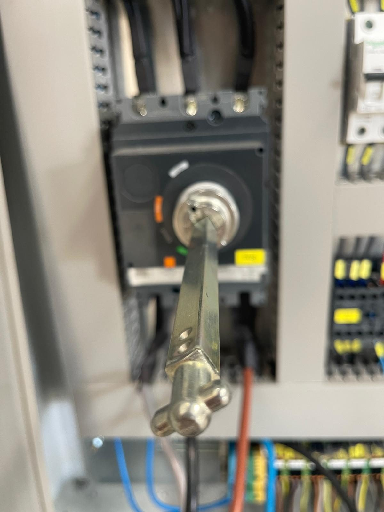

# 5.3 Systemanschlüsse und Inbetriebnahme

Die Medien-, Abluft-, Ölabscheider- und Elektroanschlüsse werden im Rahmen von **Kapitel 5.1 Schritte 4–9** ausgeführt. Die technischen Anschlusswerte sind in den Tabellen in **Kapitel 3.3.3** (Elektrik) und **Kapitel 3.3.5** (Druckluft/Wasser) angegeben; dieses Kapitel definiert das Installationsverfahren.

Ein Hydrauliksystem ist nicht vorhanden. Es gibt keinen Vakuumanschluss. Da diese Maschine über kein HMI verfügt, erfolgt die Anschlussprüfung über Manometer, Leuchten am Schaltschrank und physische Beobachtung.

---

## 5.3.1 Druckluftanschluss

| Parameter | Wert (Kapitel 3.3.5) |
| :--- | :--- |
| Druckluftversorgung | 6 bar |
| Anschlusspunkt | Druckregler **AIR INLET / HAVA GİRİŞİ** (mit Manometer) am Maschinenkörper |
| Anschlussdurchmesser | **Siehe Kapitel 3.3.5** |
| Verbraucher | Membranpumpe der Ölabscheidereinheit |

An der Maschine ist kein Druckluft-Absperrventil vorhanden; die Luft wird von der bauseitigen Leitung über einen Schlauch zum Druckregler geführt. Die Trennung der Druckluft erfolgt über das vom Betreiber in der bauseitigen Leitung montierte Ventil.

**Anschlussverfahren**

1. Sicherstellen, dass die bauseitige Druckluftleitung trockene und ölfreie Luft liefert.
2. In der bauseitigen Leitung vor dem Druckluftschlauch einen **abschließbaren Kugelhahn mit Entlüftung** montieren; dieses Ventil ist der LOTO-Trennpunkt für die Druckluft (**Siehe Kapitel 2.4**).
3. Bei geschlossenem Kugelhahn den Druckluftschlauch an den Eingang des Druckreglers **AIR INLET / HAVA GİRİŞİ** am Maschinenkörper anschließen.
4. Den Kugelhahn öffnen.
5. Den Druckregler auf **6 bar** einstellen; das Manometer als Referenz verwenden (**Siehe Kapitel 6.5**).
6. Verschraubungen und Schlauchanschlüsse auf Leckagen prüfen (Geräusch oder Seifenwasser).

**Erwartetes Ergebnis:** Manometer 6 bar; keine Leckage.

**Abweichung:** Wird der Druck von 6 bar nicht erreicht, die Kapazität des bauseitigen Kompressors, die vollständige Öffnung des Kugelhahns und die Reglereinstellung prüfen.

---

## 5.3.2 Wasseranschluss und Tankentleerung

| Parameter | Wert (Kapitel 3.3.5) |
| :--- | :--- |
| Wassereingangsdruck | 1 bar |
| Wassertemperatur | +10 °C – +70 °C |
| Wasserqualität | Leitungswasser oder aufbereitetes Wasser |
| Tankbefüllung | Von Hand — kein automatisches Füllventil |
| Entleerung | Ablassventile **TAHLİYE** unter den Tanks — Anschlussdurchmesser: **Siehe Kapitel 3.3.5** |

**Anschlussverfahren**

1. Die bauseitige Wasserleitung so vorbereiten, dass sie den Punkt erreicht, an dem die Tanks von Hand befüllt werden (Schlauch oder fester Füllstutzen); sicherstellen, dass der Wasserdruck **1 bar** beträgt.
2. Das bauseitige Wasserventil der Füllleitung geschlossen halten; dieses Ventil ist der Trennpunkt für Wasser (**Siehe Kapitel 2.4**).
3. Prüfen, dass die Ablassventile **TAHLİYE** unter Tank 1 und Tank 2 geschlossen sind.
4. Die Ablassventile (TAHLİYE) an die bauseitige Abwasserleitung anschließen; ölhaltiges Prozesswasser darf nicht in die Haushaltskanalisation eingeleitet werden (**Siehe Kapitel 10.1.8**).

**HINWEIS:** Die Erstbefüllung der Tanks erfolgt in **Kapitel 5.4.4**, damit die Prüfung der Füllstandverriegelung mit leerem Tank durchgeführt werden kann.

**Erwartetes Ergebnis:** Wasserleitung an der Befüllstelle bereit; Ablassventile (TAHLİYE) geschlossen und an die Abwasserleitung angeschlossen; keine Leckage an den Anschlüssen.

---

## 5.3.3 Elektroanschluss und Erdung

Die Werte der elektrischen Versorgung sind in der Tabelle in **Kapitel 3.3.3** angegeben. Installationsleitung: **380 V, 50 Hz, 3 Phasen, 3P+N+PE, 110 kW / 220 A**; Hauptschalter **Schneider CVS250F (250 A)**.

**GEFAHR — Stromschlag:** Arbeiten an spannungsführenden Leitungen sind verboten. Vor dem Anschluss muss der bauseitige Einspeiseschalter ausgeschaltet und verriegelt sein; der Hauptschalter der Maschine muss in Stellung **OFF** stehen. Der Anschluss wird ausschließlich von einer Elektrofachkraft ausgeführt.

**Anschlussverfahren**

1. Den Querschnitt des bauseitigen Zuleitungskabels anhand des Stroms von 220 A und der bauseitigen Kabellänge prüfen.
2. Sicherstellen, dass der zu erwartende Kurzschlussstrom am Anschlusspunkt das Schaltvermögen des Hauptschalters nicht überschreitet (**Siehe Kapitel 3.3.3**).
3. Die Schaltschranktür öffnen; das Zuleitungskabel durch die Eingangsverschraubung des Schaltschranks führen und in der Reihenfolge **L1-L2-L3-N** an die Eingangsklemmen des Hauptschalters (Leistungsschalter, TMŞ) anschließen.
4. Den **PE**-Leiter an die Erdungsschiene des Schaltschranks anschließen; prüfen, dass die gelb-grüne Erdungsbrücke zwischen Schaltschranktür und Gehäuse vorhanden ist.
5. Die Klemmanschlüsse mit dem vom Hersteller des Hauptschalters angegebenen Anzugsdrehmoment mit einem Drehmomentschlüssel anziehen; lose Anschlüsse verursachen Erwärmung und Brandgefahr.
6. Die Schaltschranktür schließen und verriegeln.
7. Den bauseitigen Einspeiseschalter einschalten; den Hauptschalter der Maschine noch nicht einschalten — mit der Phasenprüfung in **Kapitel 5.3.6** fortfahren.

---

## 5.3.4 Anschluss des Abluftkamins

Der Abluftventilator (FE01) ist auf dem Kamin oben auf der Maschine montiert und führt den Dampf aus den Kammern ab. Der Kamin muss an den bauseitigen Lüftungskanal oder direkt nach außen angeschlossen werden; andernfalls breitet sich der Dampf in der Betriebsstätte aus, die Sicht wird beeinträchtigt und im Schaltschrank bildet sich Kondensat.

1. Wurde die Kamin-/Ventilatorgruppe demontiert versandt, diese zuerst gemäß Anweisung des Herstellerservice an ihrem Platz oben auf der Maschine montieren (**Siehe Kapitel 5.1**).
2. Einen Kanal mit dem Durchmesser des Kaminaustritts (**Siehe Kapitel 3.3.5**) bis zur bauseitigen Lüftung oder nach außen verlegen.
3. Damit im Kanal kondensiertes Wasser nicht zur Maschine zurückfließt, den Kanal mit Gefälle verlegen und am tiefsten Punkt einen Kondensatablauf vorsehen.
4. Am Außenaustritt eine Haube gegen Regen und Rückströmung verwenden.
5. Die Kanalverbindungen dicht ausführen; bei laufendem Abluftventilator prüfen, dass an den Verbindungen kein Dampf austritt (**Siehe Kapitel 5.5.5**).

---

## 5.3.5 Anschluss der Ölabscheidereinheit

Die Ölabscheidereinheit ist ein separater Edelstahlschrank; die darunter angeordnete Membranpumpe wird mit Druckluft betrieben.

1. Die Einheit neben der Maschine an der im Aufstellungsplan (**Siehe Kapitel 13.1**) angegebenen Position aufstellen und ihre Füße nivellieren.
2. Die Saug- und Rücklaufschläuche für das ölhaltige Wasser zwischen Tank und Einheit anschließen; die Schlauchführung darf den Gehweg nicht kreuzen und darf nicht gequetscht werden.
3. Die Druckluftleitung der Einheit (Eingang des Magnetventils) an die Druckluftleitung der Maschine anschließen.
4. Sicherstellen, dass der elektrische Anschluss der Einheit (Magnetventil) vom Schaltschrank aus hergestellt ist; der Anschluss erfolgt gemäß Schaltplan (**Siehe Kapitel 13.1**).

Die Funktionsprüfung der Ölabscheidereinheit (mit dem unbeschrifteten Ölabscheiderschalter am Bedienfeld) erfolgt nach dem Einschalten des Hauptschalters und dem Befüllen der Tanks in **Kapitel 5.5.3**.

---

## 5.3.6 Inbetriebnahme und Phasenprüfung

Die Phasenfolge ist für die Drehrichtung von Pumpen, Ventilatoren und Blowern entscheidend; eine vertauschte Phasenfolge führt zu Rückwärtslauf der Motoren, sinkendem Pumpendruck und verringertem Trocknungsvolumenstrom. Das Phasenfolgerelais **MKR-01** gibt bei vertauschter oder fehlender Phase kein Ausgangssignal; in diesem Fall werden die Funktionen nicht zugeschaltet (**Siehe Kapitel 11.3.1**).

**GEFAHR — Stromschlag:** Auch wenn der Hauptschalter auf **OFF** steht, liegt an seinen Eingangsklemmen Spannung an; eine Berührung kann zum Tod führen. Vor dem Tauschen der Phasen den bauseitigen Einspeiseschalter ausschalten und abschließen.

**Inbetriebnahmeverfahren**

1. Sicherstellen, dass die Drehstromzuleitung an den Schaltschrank angeschlossen ist (**Siehe Kapitel 5.3.3**).
2. Prüfen, dass alle Wartungsklappen geschlossen und alle Not-Halt-Taster entriegelt sind.
3. Den Hauptschalterhebel in Stellung **ON (I)** bringen.
4. Den Ausgangszustand des Phasenfolgerelais MKR-01 an der Relaisanzeige prüfen.
5. Gibt das Relais kein Ausgangssignal, den Hauptschalter auf **OFF** stellen; den bauseitigen Einspeiseschalter ausschalten und abschließen.
6. In der Zuleitung **zwei Phasen** tauschen (nur Elektrofachkraft).
7. Bauseitigen Einspeiseschalter und Hauptschalter wieder einschalten; Schritt 4 wiederholen.
8. Den **RESET**-Taster drücken; sicherstellen, dass die blaue Leuchte aufleuchtet.
9. Einen Blower (z. B. **BLOWER 1**) kurz betreiben; die Drehrichtung mit dem Pfeil am Motor vergleichen.
10. Den Schalter auf **OFF** stellen.

**HINWEIS:** Aufgrund der Füllstandverriegelung laufen die Pumpen bei leerem Tank nicht. Die Drehrichtung der Pumpen wird nach dem Befüllen der Tanks in **Kapitel 5.5.2** geprüft.

**Checkliste elektrische Inbetriebnahmeprüfung**

| Prüfung | Erwartetes Ergebnis |
| :--- | :--- |
| Gibt das Phasenüberwachungsrelais ein Ausgangssignal? | Ja |
| Liegt an der Maschine Spannung an? (RESET-Leuchte leuchtet) | Ja |
| Erlischt bei Betätigung des Not-Halts die RESET-Leuchte und stoppt die Maschine? | Ja |
| Ist die Drehrichtung des Blowers korrekt? | Ja |

Die Not-Halt-Prüfschritte sind in **Kapitel 5.4.1**, das Reset-Verfahren in **Kapitel 2.5** angegeben.

---

## 5.3.7 Checkliste Abschluss der Anschlüsse

| # | Prüfung | Status |
| :---: | :--- | :---: |
| 1 | Druckluftanschluss hergestellt; Druckregler 6 bar | ☐ |
| 2 | Keine Leckage in der Druckluftleitung | ☐ |
| 3 | Wasserleitung an der Tankbefüllstelle bereit (1 bar); bauseitiges Wasserventil geschlossen | ☐ |
| 4 | Ablassventile (TAHLİYE) geschlossen und an die Abwasserleitung angeschlossen | ☐ |
| 5 | Abluftkamin an die Lüftung / nach außen angeschlossen | ☐ |
| 6 | Schlauch-, Druckluft- und Elektroanschlüsse der Ölabscheidereinheit hergestellt | ☐ |
| 7 | Drehstrom- und PE-Anschluss hergestellt (380 V, 50 Hz) | ☐ |
| 8 | Phasenfolge geprüft; MKR-01 gibt Ausgangssignal | ☐ |
| 9 | Hauptschalter eingeschaltet; RESET-Leuchte leuchtet | ☐ |

Nach Abschluss der Anschlüsse mit den Prüfungen in **Kapitel 5.4** und **5.5** fortfahren.
