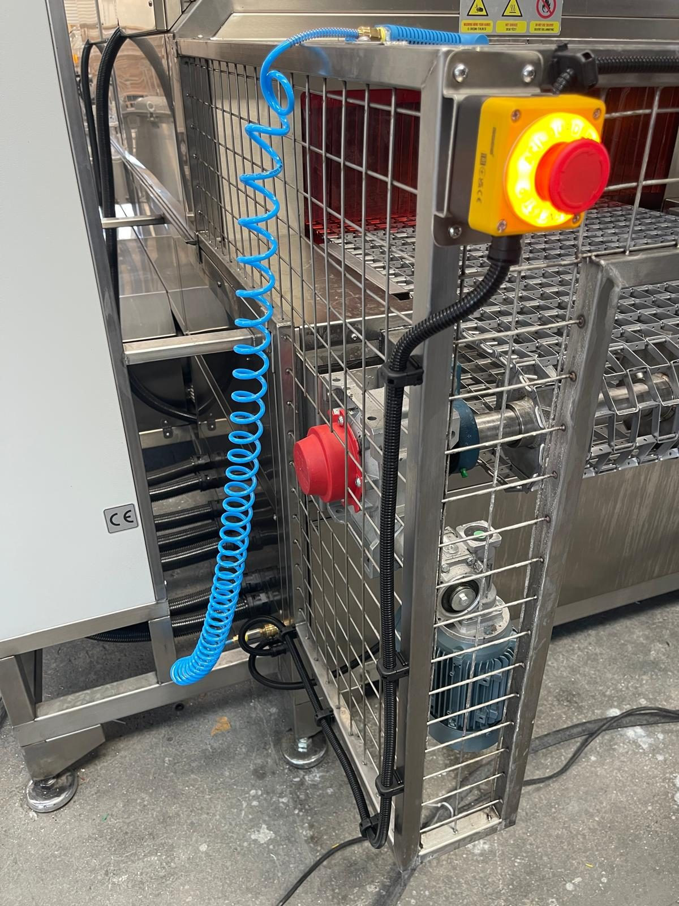
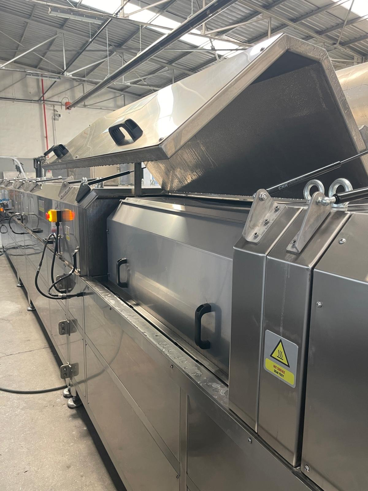

# 5.4 Güvenlik sistemleri testi

Kurulum sonrası güvenlik fonksiyonları, operasyona geçmeden önce doğrulanmalıdır. Makinede **7 acil stop butonu**, **7 bakım kapağında** seri bağlı Omron manyetik emniyet switch'i ve **iki ayrı** Omron G9SB emniyet rölesi (biri acil stop zinciri, biri bakım kapağı switch zinciri için) bulunur; **ışık perdesi yoktur**. Acil stop durdurma kategorisi **Bölüm 2.5**'te; güvenlik kategorisi ve performans seviyesi (EN ISO 13849-1) **Bölüm 2.1.3**'te verilmiştir.

Acil stop konumları, reset prosedürü ve acil stop sonrası davranış **Bölüm 2.5**'te verilmiştir; bu bölümde yalnızca **kurulum test adımları** tanımlanır. LOTO prosedürü bakım müdahalelerinde **Bölüm 2.4**'e göre uygulanır.

Bu makinede HMI bulunmadığından test sonucu **RESET lambasının sönmesi** ve çalışan fonksiyonun durması ile doğrulanır. Acil stop fonksiyon testi periyodu: **her ay bir kez** (**Bkz. Bölüm 6.2.3**); kapak switch kısa testi **haftalık** (**Bkz. Bölüm 9.1.3**).

---

## 5.4.1 Acil stop testi

Makinede **7 adet** acil stop butonu bulunur (**Bkz. Bölüm 2.5**):

| # | Konum |
| :---: | :--- |
| 1 | Operatör paneli (EMERGENCY STOP) |
| 2 | Konveyör girişi (sol uç) — ön kenar |
| 3 | Konveyör girişi (sol uç) — arka kenar |
| 4 | Konveyör çıkışı (sağ uç) — ön kenar |
| 5 | Konveyör çıkışı (sağ uç) — arka kenar |
| 6 | Makine orta bölgesi — ön kenar |
| 7 | Makine orta bölgesi — arka kenar |

**Test prosedürü**

Her acil stop butonu için ayrı ayrı:

1. Tehlike bölgesinin boş olduğunu doğrulayın; konveyör giriş/çıkışına kimse girmesin.
2. RESET lambası yanıkken en az bir fonksiyonu (ör. CONVEYOR veya DRYING 1 FAN) ON konumuna alın; run lambasının yandığını görün.
3. İlgili acil stop butonuna basın.
4. Çalışan fonksiyonun **durduğunu**, run lambasının ve **RESET lambasının söndüğünü** doğrulayın.
5. Fonksiyon anahtarı ON konumunda kalırken acil stop mantarını serbest bırakın.
6. Fonksiyonun **kendiliğinden yeniden başlamadığını** ve RESET lambasının sönük kaldığını doğrulayın.
7. Fonksiyon anahtarını OFF konumuna alın.
8. **RESET** butonuna lamba yanana kadar basın (**Bkz. Bölüm 2.5**).
9. Sonraki acil stop butonu için 2–8. adımları tekrarlayın.

| Kontrol | Beklenen sonuç |
| :--- | :--- |
| Acil stop'a basıldığında makine duruyor mu? | Evet — motor ve ısıtıcı kontaktörlerinin enerjisi gecikmesiz kesilir, RESET lambası söner (durdurma kategorisi: **Bkz. Bölüm 2.5**) |
| Acil stop serbest bırakılınca makine kendiliğinden başlıyor mu? | Hayır — yalnızca RESET ile hazır olur |

---

## 5.4.2 Bakım kapağı emniyet switch testi

| Parametre | Değer |
| :--- | :--- |
| Switch tipi | Omron F3STGRNLPU21M1J8 manyetik kapı switch'i |
| Kapak sayısı | 7 — seri zincir |
| Emniyet rölesi | Omron G9SB2002AACDC241 — kapak switch zincirine ayrılmış röle (acil stop rölesinden ayrı) |

Bu alt bölüm **fonksiyon testidir**; bakım erişimi değildir. Bakım/temizlik için kapak açmadan önce **Bölüm 2.4** LOTO zorunludur.

**Test prosedürü**

Her bakım kapağı için ayrı ayrı:

1. Tehlike bölgesinin boş olduğunu doğrulayın; kapağı açarken hareketli parçalara uzanmayın.
2. RESET lambası yanıkken bir fonksiyonu (ör. DRYING 1 FAN) ON konumuna alın.
3. Test edilecek bakım kapağını **yalnızca algılama için** kısmen kaldırın.
4. Fonksiyonun **durduğunu** ve RESET lambasının **söndüğünü** doğrulayın.
5. Fonksiyon anahtarını OFF konumuna alın.
6. Kapağı kapatın.
7. Switch–mıknatıs hizasını kontrol edin.
8. **RESET** butonuna basın; lambanın yandığını doğrulayın.
9. Sonraki bakım kapağı için 2–8. adımları tekrarlayın.

| Kontrol | Beklenen sonuç |
| :--- | :--- |
| Kapak açıldığında makine duruyor mu? | Evet — 7 kapağın her biri için |
| Kapak kapatılınca RESET ile hazır oluyor mu? | Evet |

Kapak switch'leri **bypass edilmez**; switch üzerine mıknatıs veya yabancı cisim konulmaz. Test başarısızsa operasyona geçmeyin.

---

## 5.4.3 Faz koruma ve elektrik güvenlik testi

| # | Kontrol | Beklenen sonuç |
| :---: | :--- | :--- |
| 1 | Faz koruma rölesi MKR-01 çıkış veriyor mu? | Evet |
| 2 | Makinede elektrik var mı? (RESET lambası yanıyor) | Evet |
| 3 | Acil stop'a basıldığında makine duruyor mu? | Evet |
| 4 | Blower dönüş yönü doğru mu? (**Bölüm 5.3.6**; pompalar: **Bölüm 5.5.2**) | Evet |
| 5 | Kaçak akım rölelerinin TEST butonu ile trip ettiği doğrulandı mı? (yalnız yetkili elektrikçi; test pano enerjili iken yapılır, trip sonrası röle kolu yeniden ON konumuna alınır) | Evet |

---

## 5.4.4 Tank seviye interlock testi

Seviye interlock'u, rezistansların susuz ve pompaların kuru çalışmasını önler. Test, tanklar ilk kez doldurulmadan önce yapılır; tankların ilk dolumu bu testin parçasıdır (**Bkz. Bölüm 5.3.2**).

1. Tank 1 boş iken, ana şalter ON ve RESET lambası yanıkken **TANK 1 WASHING LEVEL** kırmızı lambasının yandığını doğrulayın.
2. **TANK 1 HEATER** ve **TANK 1 PUMP** anahtarlarını ON konumuna alın.
3. Run lambalarının **yanmadığını** ve ısıtıcı/pompanın çalışmadığını doğrulayın.
4. Anahtarları OFF konumuna alın.
5. Tank 1'i **Bölüm 7.2.1**'e göre elle doldurun.
6. Dolum sırasında tank altı, boru bağlantıları ve pompa gövdesinde sızıntı kontrolü yapın.
7. Dolum tamamlandığında kırmızı **TANK 1 WASHING LEVEL** lambasının söndüğünü doğrulayın.
8. Tank 2 için 1–7. adımları tekrarlayın.

| Kontrol | Beklenen sonuç |
| :--- | :--- |
| Boş tankta ısıtıcı ve pompa çalışıyor mu? | Hayır — WASHING LEVEL lambası yanık |
| Tank dolunca WASHING LEVEL lambası sönüyor mu? | Evet |

**Anormal durum:** Tank dolu olmasına rağmen seviye lambası yanıyorsa seviye sensörünü kontrol edin (**Bkz. Bölüm 11.7.2**).

---

## 5.4.5 Makine hazır durumu testi

| Kontrol | Beklenen sonuç |
| :--- | :--- |
| Makine kullanıma hazır mı? | Evet — RESET lambası mavi yanıyor |
| WASHING LEVEL lambaları | Sönük (tanklar dolu) |
| Tüm fonksiyon anahtarları | OFF |

---

## 5.4.6 Güvenlik fonksiyon test kontrol listesi

| # | Test | Sonuç | Tarih | Test eden |
| :---: | :--- | :---: | :--- | :--- |
| 1 | Acil stop #1 — operatör paneli | ☐ OK / ☐ NOK | | |
| 2 | Acil stop #2 — giriş ucu, ön kenar | ☐ OK / ☐ NOK | | |
| 3 | Acil stop #3 — giriş ucu, arka kenar | ☐ OK / ☐ NOK | | |
| 4 | Acil stop #4 — çıkış ucu, ön kenar | ☐ OK / ☐ NOK | | |
| 5 | Acil stop #5 — çıkış ucu, arka kenar | ☐ OK / ☐ NOK | | |
| 6 | Acil stop #6 — orta bölge, ön kenar | ☐ OK / ☐ NOK | | |
| 7 | Acil stop #7 — orta bölge, arka kenar | ☐ OK / ☐ NOK | | |
| 8 | Reset prosedürü (Bölüm 2.5) | ☐ OK / ☐ NOK | | |
| 9 | Bakım kapağı switch'leri — 7 kapak | ☐ OK / ☐ NOK | | |
| 10 | Faz koruma rölesi | ☐ OK / ☐ NOK | | |
| 11 | Kaçak akım röleleri TEST | ☐ OK / ☐ NOK | | |
| 12 | Tank seviye interlock'u — Tank 1 / Tank 2 | ☐ OK / ☐ NOK | | |
| 13 | Makine kullanıma hazır (RESET lambası) | ☐ OK / ☐ NOK | | |

Tüm maddeler **OK** olmadan **Bölüm 5.5** testlerine ve operasyona geçilmemelidir.
