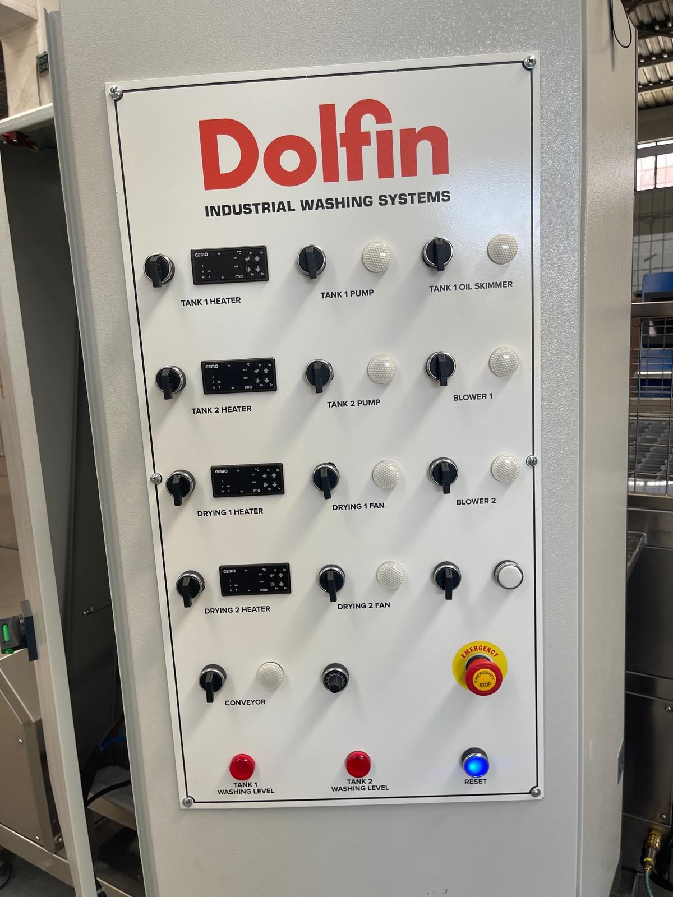

# 6.3 Elektrische Einstellungen

Die elektrischen Einstellungen bestehen aus zwei Ebenen: **für den Bediener zugängliche Bedienfeldeinstellungen** (Sollwerte der vier Thermostate GEMO DTH2 und Potentiometer für die Fördergeschwindigkeit) und **herstellergeschützte Einstellungen** (Parameter des Förderer-Frequenzumrichters, Motordrehrichtung, Sicherheitsrelaiskreis). Der Bediener greift nur in die erste Gruppe ein; wird die zweite Gruppe unbefugt geändert, können Förderrichtung, Geschwindigkeitsgrenzen und Sicherheitsfunktionen beeinträchtigt werden.

Der Aufbau des Bedienfelds ist in **Kapitel 3.4** beschrieben; dieses Kapitel gibt die Einstellverfahren an. Die Einstellung von Datum/Uhrzeit/Sprache ist bei dieser Maschine **nicht zutreffend** (kein HMI).

---

## 6.3.1 Motordrehrichtung / Phasenprüfung

| Parameter | Wert / Beschreibung |
| :--- | :--- |
| Motordrehrichtung / Phasenprüfung | Förderrichtung über Frequenzumrichter-Parameter — **Werkseinstellung**; der Bediener ändert sie nicht |
| Drehrichtung Pumpen / Ventilatoren / Blower | Abhängig von der Phasenfolge — bei der Installation mit MKR-01 geprüft |

Pumpen, Ventilatoren und Blower sind direkt anlaufende Motoren (Schütz), deren Drehrichtung von der Phasenfolge der Versorgung abhängt; die Phasenfolge wird bei der Installation mit dem Phasenfolgerelais geprüft (**Siehe Kapitel 5.3.6**). Der Förderer wird über einen Frequenzumrichter angetrieben und seine Richtung ist im Frequenzumrichter-Parameter fest hinterlegt. Eine Einstellung zur Änderung der Motordrehrichtung im Betrieb gibt es nicht; Rückwärtslauf ist ein Störungsanzeichen (**Siehe Kapitel 11.3.1**).

**VORSICHT — Unbefugte Parameteränderung:** Eine Änderung der Parameter des Delta VFD004EL21W-1 (Richtung, Min./Max.-Frequenz, Rampe) durch den Bediener kann zum Rückwärtslauf des Förderers oder zum Stillstand unter 20 Hz führen. Parameteränderungen ausschließlich vom autorisierten Herstellerservice vornehmen lassen.

---

## 6.3.2 Encoder / Rückführung

| Parameter | Wert / Beschreibung |
| :--- | :--- |
| Einstellung Encoder / Rückführung | **Keine** — Frequenzumrichterbetrieb im offenen Regelkreis |

An der Maschine sind kein Encoder, kein Servoantrieb und keine Positionsrückführung vorhanden; die Einstellung ist nicht zutreffend.

---

## 6.3.3 Thermostat-Sollwerte (GEMO DTH2)

| Parameter | Einstellort | Sollwert |
| :--- | :--- | :--- |
| Temperatur TANK 1 (Waschen) | Thermostat TANK 1 HEATER | Kein werkseitiger Sollwert — legt der Betreiber fest; Badwasser darf +70 °C nicht überschreiten (**Siehe Kapitel 3.3.5**) |
| Temperatur TANK 2 (Spülen) | Thermostat TANK 2 HEATER | Kein werkseitiger Sollwert — legt der Betreiber fest; Badwasser darf +70 °C nicht überschreiten |
| Lufttemperatur Trocknung 1 | Thermostat DRYING 1 HEATER | Kein werkseitiger Sollwert — legt der Betreiber so fest, dass die Temperaturbeständigkeit des Werkstückmaterials nicht überschritten wird |
| Lufttemperatur Trocknung 2 | Thermostat DRYING 2 HEATER | Kein werkseitiger Sollwert — legt der Betreiber so fest, dass die Temperaturbeständigkeit des Werkstückmaterials nicht überschritten wird |
| Skalierung Analogdruck | Keine | — |

Der Thermostat zeigt die mit dem Thermoelement gemessene Ist-Temperatur auf dem Display an und schaltet bei Erreichen des Sollwerts das zugehörige Heizungsschütz ab; sinkt die Temperatur, schaltet es wieder ein. Die Thermostate haben keinen werkseitigen Sollwert; der Betreiber legt die Sollwerte entsprechend den Prozessanforderungen (Verschmutzungsart, Werkstückmaterial, Reinigungschemie) fest. Das Badwasser darf **+70 °C nicht überschreiten** (**Siehe Kapitel 3.3.5**). Die Trocknungslufttemperatur wird so gewählt, dass die Temperaturbeständigkeit des bearbeiteten Werkstückmaterials nicht überschritten wird. Die festgelegten Werte werden produktbezogen aufgezeichnet (**Siehe Kapitel 8.2.3**).

**Einstellverfahren für den Thermostat-Sollwert**

1. Den betreffenden Heizungsschalter (z. B. TANK 1 HEATER) in Stellung **OFF** bringen.
2. Die Ist-Temperatur auf dem Thermostatdisplay ablesen.
3. Die Set-Taste des Thermostats drücken; der Sollwert blinkt auf dem Display.
4. Die Zieltemperatur mit den **Auf-/Ab-Pfeiltasten** eingeben.
5. Mit der Set-Taste bestätigen; das Display kehrt zur Ist-Temperatur zurück.
6. Die Einschaltbedingung der Heizung prüfen:
   a. TANK 1 / TANK 2 HEATER: Die rote WASHING-LEVEL-Leuchte des betreffenden Tanks muss aus sein.
   b. DRYING 1 / DRYING 2 HEATER: Der zugehörige Trocknungsventilator (DRYING 1 / DRYING 2 FAN) muss laufen.
7. Den Heizungsschalter auf **ON** stellen.
8. Beobachten, dass die Temperatur in Richtung Sollwert ansteigt und das Heizungsschütz beim Sollwert abschaltet (der Temperaturanstieg stoppt).
9. Die Sollwerte in die Checkliste in **Kapitel 6.3.5** und in das Wartungsformular eintragen.

**Erwartetes Ergebnis:** Die Ist-Temperatur stabilisiert sich im Bereich des Sollwerts; auch bei Heizungsschalter ON überschreitet die Temperatur den Sollwert nicht.

**Abweichung:** Erwärmt sich das Wasser trotz angezeigtem Sollwert weiter, kann der Thermostatausgang oder das Schütz verklebt sein (**Siehe Kapitel 11.1.2 — Störung 5**). Schaltet die Heizung überhaupt nicht ein, Füllstandverriegelung, Sicherung und Fehlerstrom-Schutzschalter prüfen (**Siehe Kapitel 11.3.3**).

Tastenanordnung und erweiterte Parameter des Thermostats sind in der Bedienungsanleitung GEMO DTH2 beschrieben; diese Anleitung ist auf Anfrage beim Hersteller erhältlich (**Siehe Kapitel 13.1.3**).

---

## 6.3.4 Fördergeschwindigkeit (Potentiometer)

| Parameter | Wert |
| :--- | :--- |
| Einstellelement | Potentiometer am Bedienfeld |
| Ausgang | Frequenz des Frequenzumrichters Delta VFD004EL21W-1 |
| Betriebsbereich | **20–60 Hz** |

**Verfahren zur Geschwindigkeitseinstellung**

1. Den Schalter CONVEYOR auf **ON** stellen (RESET-Leuchte leuchtet, Linie leer).
2. Das Potentiometer im Uhrzeigersinn drehen, um die Geschwindigkeit zu erhöhen, und gegen den Uhrzeigersinn, um sie zu verringern.
3. Den Förderer unter Last (mit Werkstücken beladen) beobachten; der Drahtgurt muss ohne Stocken laufen.
4. **Nicht unter 20 Hz absenken** — das Motordrehmoment reicht unter Last nicht aus und der Förderer kann stehen bleiben.
5. Die gewählte Geschwindigkeit in die Prozessaufzeichnung eintragen (**Siehe Kapitel 8.2**).

Die Geschwindigkeit bestimmt die Verweilzeit des Werkstücks in der Kammer: Niedrige Geschwindigkeit bedeutet längeres Waschen/Trocknen, hohe Geschwindigkeit mehr Werkstücke pro Stunde. Die Zykluszeit bei der gewählten Frequenz wird im Betrieb gemessen (**Siehe Kapitel 3.3.2**); Messverfahren: **Siehe Kapitel 8.1.1**. Bleibt der Förderer unter Last stehen, die Geschwindigkeit erhöhen oder die Last verringern; gibt der Frequenzumrichter einen Alarm aus: **Siehe Kapitel 11.3.2**.

---

## 6.3.5 Checkliste elektrische Einstellungen

| # | Prüfung | Wert / Status |
| :---: | :--- | :--- |
| 1 | Phasenfolge bei der Installation geprüft (Kapitel 5.3.6) | ☐ |
| 2 | Sollwert TANK 1 HEATER | ______ °C ☐ |
| 3 | Sollwert TANK 2 HEATER | ______ °C ☐ |
| 4 | Sollwert DRYING 1 HEATER | ______ °C ☐ |
| 5 | Sollwert DRYING 2 HEATER | ______ °C ☐ |
| 6 | Betriebsfrequenz des Förderers (20–60 Hz) | ______ Hz ☐ |
| 7 | Frequenzumrichter-Parameter in Werkseinstellung — nicht geändert | ☐ |

**Datum:** _______________ **Geprüft von:** _______________

---

Aufbau des Bedienfelds: **Siehe Kapitel 3.4**; Kapazitätsmanagement: **Siehe Kapitel 8.2**.
