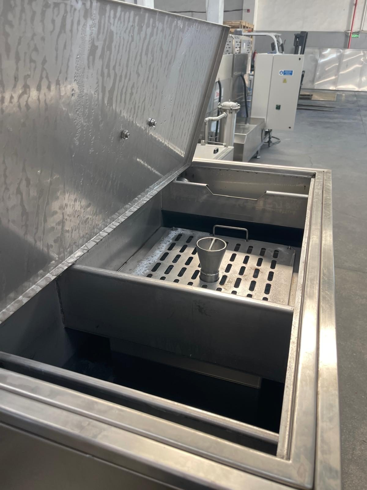
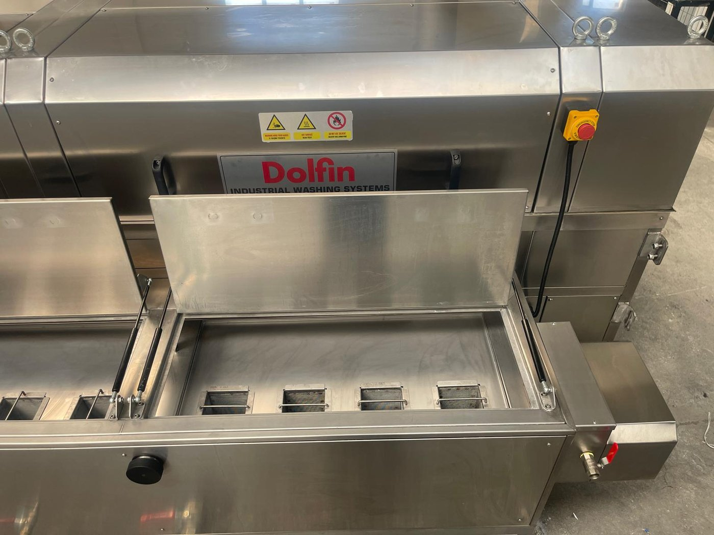
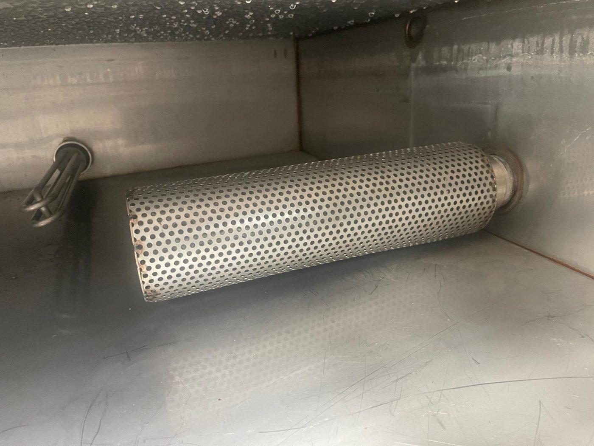
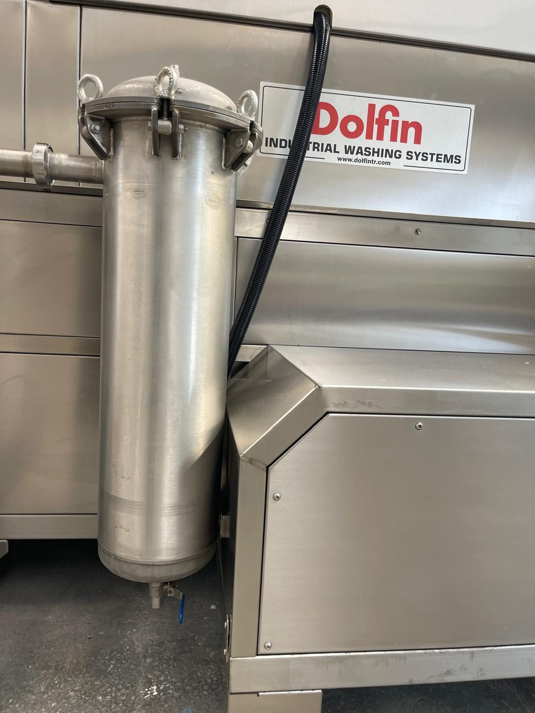
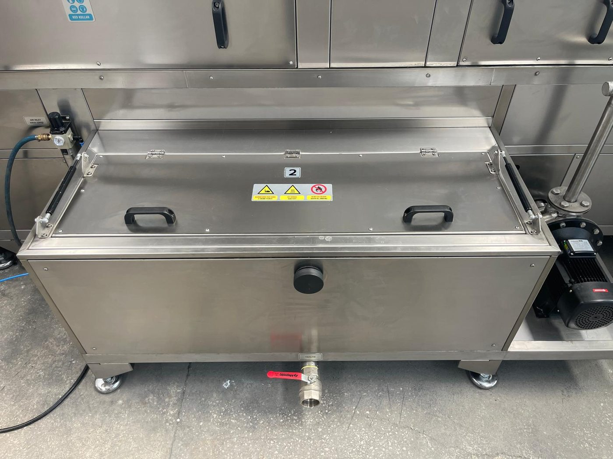
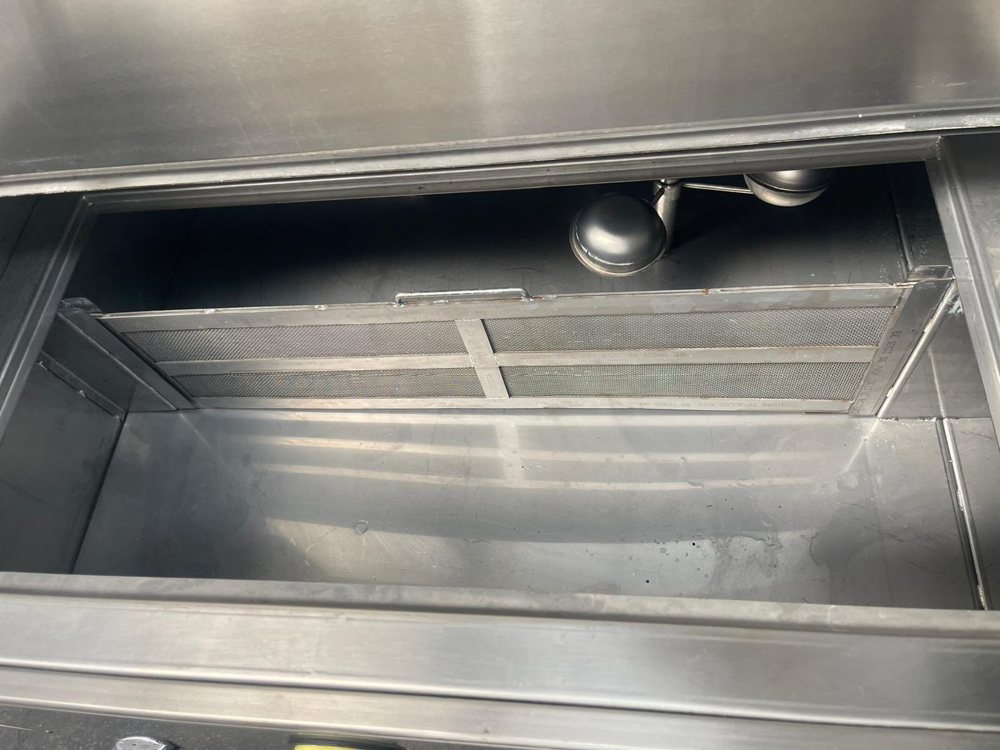

# 10.1 Temizlik ve dezenfeksiyon

Makine proses tankları **sıcak su** (+70 °C'ye kadar) ile çalışır; temizlik sırasında sıcak yüzey ve buhar riski vardır. Temizlik maddesi olarak **Bölüm 10.1.7**'de tanımlanan kriterlere uygun maddeler kullanılmalıdır; yasak maddeler tank, conta ve paslanmaz yüzeylere kalıcı hasar verir.

Filtre yedek parça sipariş kodları **Bölüm 9.1.6** ve **13.3.1** tablolarında verilmiştir.

---

## 10.1.1 Temizlik tipi

| Parametre | Değer |
| :--- | :--- |
| Temizlik tipi | **Kuru / ıslak** |
| CIP / COP | Bulunmamaktadır |

Temizlik **manuel** uygulanır. Makine dış yüzeyleri kuru bez ile silinir; tank içi ıslak temizlik (su, sabunlu su) gerektirir. Elektrik panosu, operatör paneli, konveyör inverteri, kapak switch'leri ve motor klemens kutularına **doğrudan su püskürtmeyin**.

---

## 10.1.2 Temizlik öncesi güvenlik

Tank ve filtre erişimi kapak açmayı gerektirir. Hücre bakım kapakları manyetik switch ile izlenir ve açıldığında makineyi durdurur; tank üst kapaklarında switch yoktur. Bu nedenle her temizlik işinden önce LOTO zorunludur.

**UYARI — Sıcak yüzey ve buhar:** Sıcak tank suyu, buhar ve rezistanslar ciltte yanığa yol açar. Tank kapağını tank suyu ve rezistanslar soğuduktan sonra açın; ısıya dayanıklı eldiven ve koruyucu gözlük kullanın (**Bkz. Bölüm 2.6**).

**UYARI — Kimyasal madde:** Temizlik kimyasalı cilde ve göze temas ettiğinde tahrişe yol açabilir. Yalnızca **Bölüm 10.1.7**'deki onaylı temizlik maddelerini ürün talimatına göre kullanın; koruyucu eldiven ve gözlük kullanın. Asit bazlı ve paslanmaz çeliğe zararlı maddeler **yasaktır**.

Her temizlik işinden önce aşağıdaki adımları uygulayın:

1. Makineyi durdurun (**Bkz. Bölüm 7.3.1**).
2. LOTO prosedürünü uygulayın (**Bkz. Bölüm 2.4**).
3. Tank suyunun ve rezistansların soğumasını bekleyin.
4. Uzun süreli temizlik veya dezenfeksiyon öncesi tankları **TAHLİYE** vanasından boşaltın (**Bkz. Bölüm 10.1.5**).
5. Kapak switch'lerini ve seviye sensörünü **bypass etmeyin**.

---

## 10.1.3 Günlük temizlik — ön filtreler

| Parametre | Değer |
| :--- | :--- |
| Periyot | **Günlük** (**Bkz. Bölüm 9.1.3**) |
| Kapsam | Yıkama tankı **ön filtreleri** (ön filtre sepetleri — 6 adet montaj) |
| Diğer | Günlük başka temizlik gerekmez |

Ön filtre sepetleri, hücre tabanından tanka dönen suyun geçtiği delikli plaka altındaki bölmelerde durur; talaş ve kaba kiri tutar. Tıkanan ön filtre tank dönüşünü yavaşlatır, hücre tabanında su birikmesine ve kirin tanka geçmesine yol açar.

Yedek parça: **07 10214** — ÖN FİLTRE NS KOMPLESİ (önerilen stok 2 — **Bkz. Bölüm 9.1.6**).

**Günlük temizlik prosedürü**

1. Makineyi durdurun ve LOTO uygulayın (**Bkz. Bölüm 10.1.2**).
2. Yıkama tankı (TANK 1) üst kapağını açın; gaz amortisörler kapağı açık tutar.
3. Ön filtre yuvasının üzerindeki **delikli plakayı** kaldırın.
4. Ön filtre sepetlerini kulplarından tutarak yukarı çekip çıkarın; suyun tanka süzülmesini bekleyin.
5. Sepetlerdeki talaş ve kiri atık kabına boşaltın (**Bkz. Bölüm 10.1.8**).
6. Sepetleri **şebeke suyu** ile yıkayın; inatçı kirde fırça ve onaylı temizlik maddesi kullanın (**Bkz. Bölüm 10.1.7**).
7. Deforme, delik veya eleği yırtık sepeti yedek parça ile değiştirin.
8. Sepetleri yuvalarına tam oturacak şekilde yerleştirin; delikli plakayı kapatın.
9. Tank kapağını kapatın.
10. LOTO'yu kaldırın (**Bkz. Bölüm 2.4**).
11. Devreye almadan önce sızıntı olmadığını kontrol edin.

**Beklenen sonuç:** Ön filtreler temiz, doğru monte; hücre tabanında su birikmesi yok; pompa emişinde anormal gürültü yok.

**Anormal durum:** Sık tıkanma varsa proses suyu kalitesini ve yağ yükünü değerlendirin; yağ sıyırıcı ve yağ ayırıcı kullanımını artırın (**Bkz. Bölüm 3.1.5**).

---

## 10.1.4 Haftalık derin temizlik — tank iç filtreleri ve torba filtreler

| Parametre | Değer |
| :--- | :--- |
| Periyot | **Haftalık** (**Bkz. Bölüm 9.1.3**) |
| Kapsam | Tank **iç filtreleri** (emiş filtreleri) + pompa çıkışı **hassas (torba) filtreler** |

Emiş filtresi, tank içinde pompa emiş hattının ucundaki delikli silindirdir; pompaya kaba parçacık girişini önler. Hassas filtre, pompa çıkışındaki paslanmaz gövde içindeki torba filtredir; nozulları tıkayacak ince partikülleri tutar. Tıkanan torba filtre püskürtme basıncını düşürür ve pompayı zorlar.

Yedek parça: **07 17682** — HASSAS FİLTRE KOMPLESİ (stok 1); **07 00670 / 07 08732** — EMİŞ FİLTRESİ KOMPLESİ (stok 1) — **Bkz. Bölüm 9.1.6**.

**Haftalık temizlik prosedürü**

1. Makineyi durdurun ve LOTO uygulayın (**Bkz. Bölüm 10.1.2**).
2. TANK 1 ve TANK 2 üst kapaklarını açın.
3. Emiş filtrelerini yuvalarından çıkarın.
4. Emiş filtrelerini şebeke suyu ve fırça ile temizleyin; delikleri tıkalı veya gövdesi deforme olanları değiştirin.
5. Pompa emiş/çıkış vanalarını kapatın.
6. Hassas filtre gövdesinin kapağını açın; içindeki suyu tavaya alın.
7. **Torba filtreyi** çıkarın.
8. Torba filtreyi ters çevirerek kiri boşaltın; şebeke suyu ile yıkayın. Temizlenemeyen veya eleği yırtık torba filtreyi **değiştirin**.
9. Torba filtreyi gövdeye yerleştirin; conta ve kapağı sızdırmaz şekilde kapatın.
10. Emiş filtrelerini yerine takın.
11. **Günlük** ön filtre temizliğini aynı bakım turunda uygulayın (**Bkz. Bölüm 10.1.3**, adım 3–8).
12. Yağ sıyırıcı diskini ve tank yüzeyini kontrol edin; yüzeydeki aşırı yağ tabakasını alın.
13. Tank kapaklarını kapatın.
14. Pompa vanalarını açın.
15. LOTO'yu kaldırın (**Bkz. Bölüm 2.4**) ve RESET'e basın.
16. Pompaları çalıştırın; filtre gövdesi ve bağlantılarda sızıntı olmadığını kontrol edin.
17. Yağ tabakası yeniden oluşuyorsa TANK 1 OIL SKIMMER anahtarını ON konumuna alarak yağ sıyırıcıyı çalıştırın.

**Beklenen sonuç:** Filtreler temiz veya yeni; püskürtme basıncı normal; sızıntı yok.

---

## 10.1.5 Tank boşaltma ve dezenfeksiyon prosedürü

| Parametre | Değer |
| :--- | :--- |
| Uygulama | Uzun süreli duruş (hafta sonu), 1000 saatlik su kalitesi değerlendirmesi, koku/kirlilik birikimi |
| Yöntem | Tank boşaltma (TAHLİYE vanası) + **sabunlu su** ile iç yıkama |

**DİKKAT — Yasak kimyasal:** Asit bazlı ve paslanmaz çeliğe zararlı temizlik/dezenfeksiyon maddeleri tank, conta ve rezistanslarda kalıcı korozyon hasarına yol açar. Bu maddeleri kullanmayın (**Bkz. Bölüm 10.1.7**); tank içi dezenfeksiyonda **sabunlu su** kullanın.

**DİKKAT — Rezistans hasarı:** Boş tankta enerjilenen rezistans aşırı ısınarak hasar görür. Tank dolmadan TANK 1 / TANK 2 HEATER anahtarlarını ON konumuna almayın; seviye sensörünü bypass etmeyin.

**Tank boşaltma ve dezenfeksiyon prosedürü**

1. Makineyi durdurun.
2. LOTO uygulayın (**Bkz. Bölüm 2.4**).
3. Tank suyunun soğumasını bekleyin.
4. Tank altındaki **TAHLİYE** vanasının atık su hattına bağlı olduğunu doğrulayın (**Bkz. Bölüm 10.1.8**).
5. TAHLİYE vanasını açın; tankın tamamen boşalmasını bekleyin.
6. Tank üst kapağını açın; ön filtre sepetlerini, delikli plakayı ve emiş filtresini çıkarın (**Bkz. Bölüm 10.1.3**, **10.1.4**).
7. Tank tabanındaki çamur ve tortuyu kürek/spatula ile alın; atık kabına boşaltın.
8. Tank iç yüzeylerini, rezistansları ve seviye sensörünü **sabunlu su** ile yıkayın; paslanmaz yüzeylere uygun yumuşak fırça veya bez kullanın; rezistans borularını ve termokuplu zorlamayın.
9. Sabunlu suyu TAHLİYE vanasından boşaltın.
10. Tank içini **temiz su** ile durulayın; durulama suyunu boşaltın.
11. TAHLİYE vanasını kapatın.
12. Filtreleri ve delikli plakayı yerine takın; tank kapağını kapatın.
13. Adım 4–12'yi diğer tank için tekrarlayın.
14. Makine dış yüzeyini silin (**Bkz. Bölüm 10.1.6**).
15. Atık suyu bertaraf edin (**Bkz. Bölüm 10.1.8**).
16. Yeniden devreye almadan önce tankları doldurun (**Bkz. Bölüm 7.2.1**).

**Beklenen sonuç:** Tank içi temiz, tortu ve koku yok; proses suyu yeniden doldurulmaya hazır.

---

## 10.1.6 Temizlik sonrası kurutma

| Parametre | Değer |
| :--- | :--- |
| Makine dışı | **Kuru bez** ile silinmelidir |
| Tank içi | Boşaltma sonrası doğal kuruma veya bez ile kurutma |
| Elektrik panosu / operatör paneli / inverter | **Su ile yıkanmaz** — yalnızca kuru veya hafif nemli bez |
| Kapak switch'leri ve mıknatıslar | Kuru bez; su ve kimyasal uygulanmaz |

Makine dış yüzeyinde su birikintisi bırakmayın; elektrik panosu yakınında ıslak temizlik yapmayın. Kurutma tamamlandıktan sonra LOTO'yu kaldırın (**Bkz. Bölüm 2.4**) ve makineyi **Bölüm 7.2**'ye göre devreye alın.

---

## 10.1.7 Temizlik maddeleri

Makine temizliğinde **şebeke suyu** kullanılabilir. Temizlik kimyasalı olarak **paslanmaz çelik uyumlu nötr veya hafif alkali** deterjanlar kullanılmalıdır. Aşağıdaki tablo üretici önerisini verir; müşteri, asit bazlı olmayan ve makineye (paslanmaz çelik, tank, conta) zarar vermeyen eşdeğer ürünler de kullanabilir.

| Parametre | Değer |
| :--- | :--- |
| Temizlik suyu | **Şebeke suyu** |
| Genel kriter | Paslanmaz çelik uyumlu **nötr** veya **hafif alkali** deterjanlar |
| Dezenfeksiyon (tank içi) | **Sabunlu su** |
| Müşteri eşdeğer ürün | Asit bazlı olmayan, paslanmaz çelik, tank ve contaya zarar vermeyen ürünler kullanılabilir |

**Üretici önerilen temizlik maddeleri**

| Ürün | Kullanım |
| :--- | :--- |
| **VEIDEC 89 SUPER FOAM 750** | Genel temizlik |
| **VEIDEC BIO CLEANING 3** | Çıkmayan inatçı lekeler — az miktarda ıslatılmış **sünger** ile ovun |
| **VEIDEC 34 INOX** | Parlatma |

Ürün talimatlarına (dozaj, bekleme süresi, durulama) uygun hareket edin. Kimyasalı doğrudan elektrik panosu, operatör paneli, inverter ve kapak switch bölgelerine uygulamayın.

**Yasak temizlik maddeleri**

| Yasak | Gerekçe |
| :--- | :--- |
| **Asit bazlı** temizlik maddeleri | Tank, rezistans, conta ve paslanmaz yüzey korozyonu |
| **Paslanmaz çeliğe zarar verecek** maddeler | Makine gövdesi ve tank malzemesi hasarı |
| **Solvent / yanıcı sıvılar** | Yangın riski; makine üzerindeki yasak etiketi |

Proses suyu kaynağı (üretim): şebeke veya arıtılmış su (**Bkz. Bölüm 3.3.5**). Makine **temizliğinde** şebeke suyu kullanılır.

---

## 10.1.8 Atık su ve kimyasal bertaraf

| Parametre | Gereksinim |
| :--- | :--- |
| Atık su / kimyasal bertaraf | Makinenin kullanıldığı ülkenin mevcut atık su / kimyasal bertaraf gereksinimleri |

Tank boşaltma suyu **yağlı proses suyudur**; evsel kanalizasyona dökmeyin. Tank boşaltma suyu, sabunlu yıkama suyu, yağ ayırıcı ünitesinde toplanan yağ, filtre temizlik atıkları ve ön filtre sepetlerindeki talaş yerel **atık su ve kimyasal bertaraf** kurallarına uygun şekilde toplanmalı, sınıflandırılmalı ve arıtılmalı veya lisanslı tesise verilmelidir. Bertaraf prosedürü tesis çevre izinleri kapsamında tanımlanmalıdır.

Drain / atık su hattı bağlantı çapı ve bağlantı verileri: **Bkz. Bölüm 3.3.5**.

---

## 10.1.9 Temizlik kayıt formu

| # | İşlem | Periyot | Tarih | Yapan | OK/NOK |
| :---: | :--- | :--- | :--- | :--- | :---: |
| 1 | Yıkama tankı ön filtre temizliği | Günlük | | | ☐ |
| 2 | Tank iç (emiş) filtre temizliği | Haftalık | | | ☐ |
| 3 | Pompa çıkışı torba filtre temizliği/değişimi | Haftalık | | | ☐ |
| 4 | Yağ sıyırıcı / tank yüzeyi kontrolü | Haftalık | | | ☐ |
| 5 | Tank boşaltma + dezenfeksiyon (sabunlu su) | Gerektiğinde / uzun duruş | | | ☐ |
| 6 | Dış yüzey kurutma | Her temizlik sonrası | | | ☐ |

**Onaylayan:** _______________ **Tarih:** _______________

---

Demontaj öncesi tanklar **Bölüm 10.1.5** prosedürüyle boşaltılır; demontaj için **Bkz. Bölüm 12.1**.
