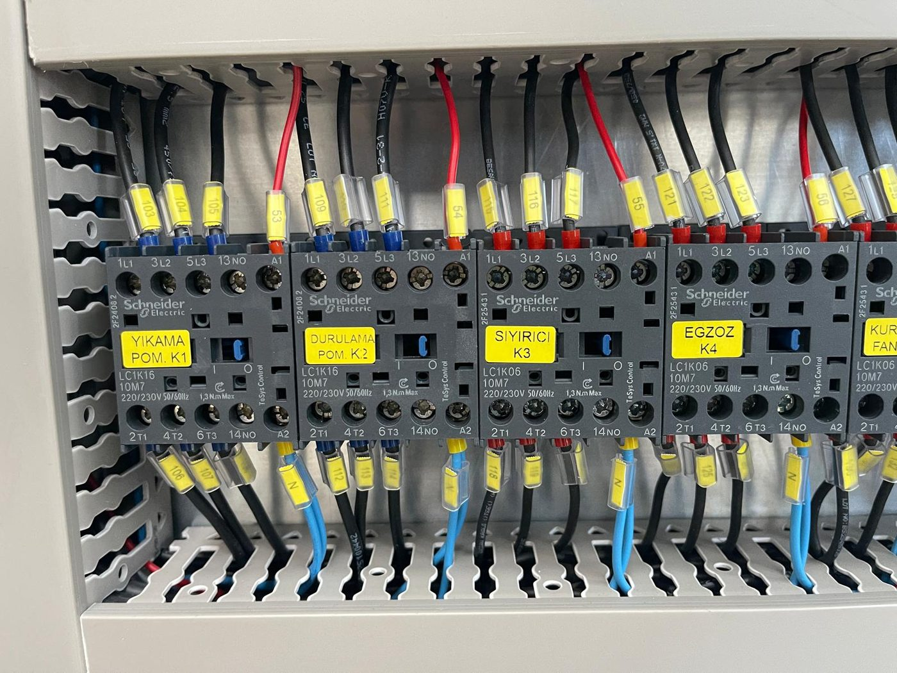
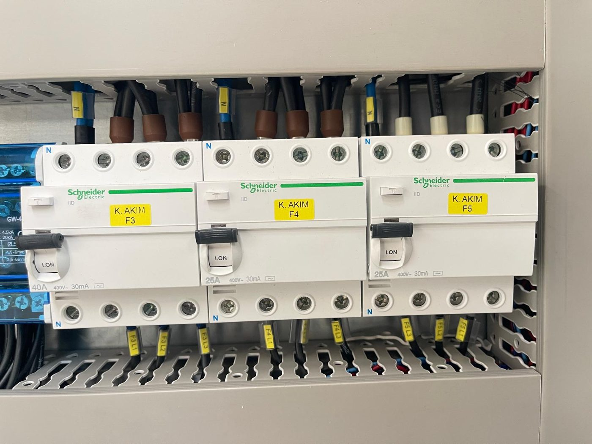
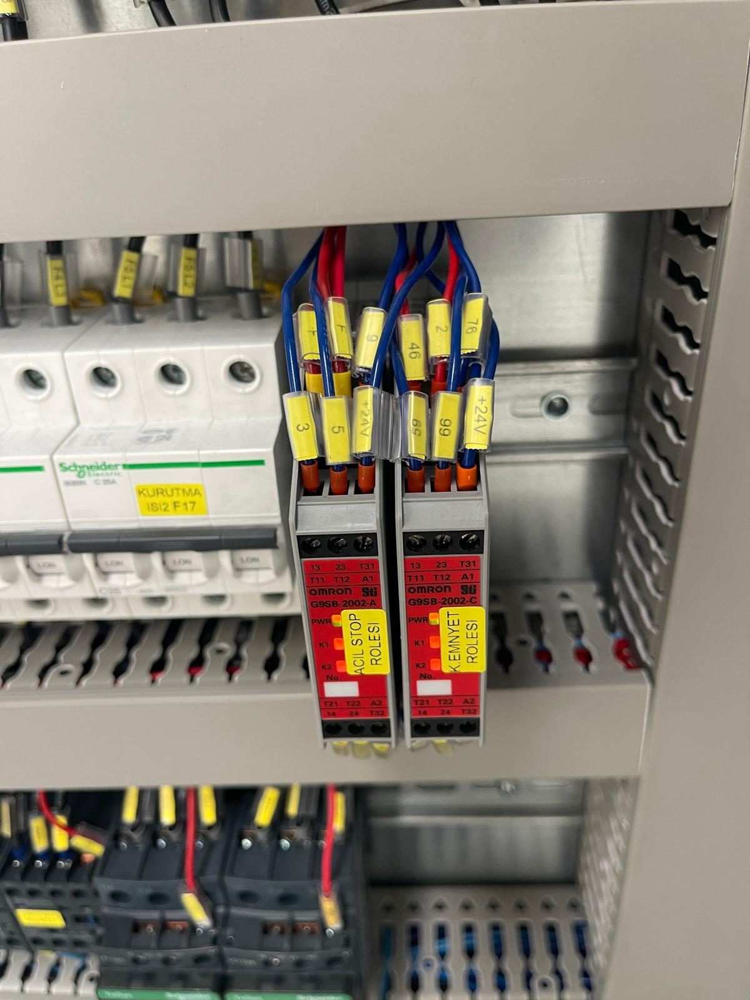
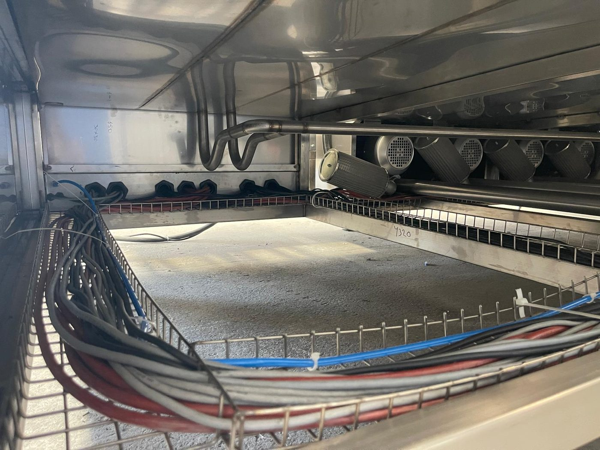

# 11.3 Elektrik arızaları

Elektrik arızalarında pano içi müdahale öncesi LOTO uygulayın (**Bkz. Bölüm 2.4**). Besleme değerleri **Bölüm 3.3.3**, motor/ısıtıcı ve koruma elemanı listesi **Bölüm 3.3.4** tablosunda verilmiştir. Bu bölümdeki tüm işlemler yetkili elektrik personeli içindir.

**TEHLİKE — Elektrik çarpması:** Pano içinde 380 V bulunur. Ana şalter kapalıyken de ana şalter giriş klemensleri enerjilidir; inverter ara devresi enerji kesildikten sonra bir süre tehlikeli gerilim taşır. Temas ölüme veya ağır yaralanmaya yol açar. Pano içinde çalışmadan önce LOTO uygulayın; ana şalter giriş klemenslerine dokunmayın; invertere müdahaleden önce inverter kılavuzundaki bekleme süresine uyun ve gerilimsizliği ölçün.

---

## 11.3.1 Faz kaybı ve faz sırası

| Parametre | Değer |
| :--- | :--- |
| Faz kaybı / ters faz davranışı | Faz sıra rölesi **MKR-01** çıkış vermez; pano fonksiyonları devreye girmez (RESET lambası yanmayabilir) |
| Motor dönüş yönü | Pompa, fan ve blower motorlarına doğrudan yol verilir — dönüş yönü faz sırasına bağlıdır; konveyör inverter ile sürülür — yön parametre ile sabittir |

**Faz hatası teşhis prosedürü**

1. Tüm fonksiyon anahtarlarını OFF konumuna alın.
2. Tesis besleme şalterinde üç fazın mevcut olduğunu ve gerilim dengesini ölçün.
3. MKR-01 röle göstergesini okuyun (faz sırası / faz kaybı LED'i — röle etiketine göre). Gösterge enerji altında okunur; yalnız yetkili elektrikçi.
4. Faz sırası ters ise LOTO uygulayın ve tesis beslemesini kapatıp kilitleyin (**Bkz. Bölüm 2.4**).
5. Besleme hattında **iki fazı** yer değiştirin (**Bkz. Bölüm 5.3.6**). Enerji açıkken faz değiştirmeyin.
6. Pano kapağını kapatın; LOTO'yu kaldırın.
7. Ana şalteri ON konumuna alın; MKR-01'in çıkış verdiğini doğrulayın.
8. RESET'e basın; RESET lambasının yandığını doğrulayın.
9. Bir pompa veya fanı kısa süre çalıştırarak dönüş yönünü motor üzerindeki ok ile karşılaştırın.

**Tekrarlayan faz hatası:** Tesis besleme kalitesi (gevşek bağlantı, faz dengesizliği) veya röle arızası — servis kriteri (**Bkz. Bölüm 11.2.2**).

---

## 11.3.2 Motor arızaları — MKŞ ve inverter

| Motor | Koruma | Trip belirtisi |
| :--- | :--- | :--- |
| Yıkama pompası PE02 (5,5 kW) | Q1 GV2ME16 | TANK 1 PUMP run lambası sönük |
| Durulama pompası PE04 (3 kW) | Q2 GV2ME14 | TANK 2 PUMP run lambası sönük |
| Yağ sıyırıcı GE06 (0,09 kW) | Q3 GV2ME04 | OIL SKIMMER run lambası sönük |
| Egzoz fanı FE01 (1,1 kW) | Q4 GV2ME07 | Buhar tahliyesi yok |
| Kurutma fanları FE02, FE03 (1,1 kW) | Q5, Q6 GV2ME07 | DRYING FAN run lambası sönük |
| Blowerlar FE04–FE07 (4 kW) | Q7–Q10 GV2ME14 | Blower havası azaldı |
| Konveyör GE01 (0,25 kW) | İnverter Delta VFD004EL21W-1; sigorta A9F74106 | CONVEYOR run lambası sönük; inverter ekranında kod |

**Motor arıza teşhis prosedürü (MKŞ trip)**

1. İlgili fonksiyon anahtarını **OFF** alın.
2. Pompa motorunda emiş/çıkış vanalarının açık olduğunu kontrol edin (**Bkz. Bölüm 7.2.5**); pompayı kapalı vanayla çalıştırmayın.
3. LOTO uygulayın (**Bkz. Bölüm 2.4**).
4. Pano kapağını açın; trip olan MKŞ'yi bulun (kol "0" konumunda — **Bkz. Bölüm 11.1.3**).
5. Motor ve kablo bağlantılarını gözle kontrol edin.
6. Motor sargı direncini ve izolasyonunu ölçün.
7. Mekanik sıkışma şüphesinde mil/kaplin serbestliğini elle kontrol edin (fan kanadı, pompa çarkı, sıyırıcı diski).
8. Nedeni giderin; MKŞ kolunu ON konumuna alın.
9. Pano kapağını kapatın; LOTO'yu kaldırın.
10. RESET'e basın; fonksiyon anahtarını ON alın ve birimi kısa süre çalıştırın.
11. Motor akımını pens ampermetre ile ölçün; akım motorun nominal akımını aşmamalıdır (**Bkz. Bölüm 3.3.4**). Ölçüm enerji altında yapılır; yalnız yetkili elektrikçi.

**Konveyör inverter alarmı**

| Parametre | Değer |
| :--- | :--- |
| İnverter | Delta **VFD004EL21W-1** (0,4 kW) — pano içi |
| Alarm kodları | Sürücü ekranındaki koda göre **Delta VFD-EL kullanım kılavuzu** (**Bkz. Bölüm 13.1.3**) |
| Reset | CONVEYOR anahtarı OFF → ON veya inverter STOP/RESET tuşu |

**DİKKAT — Parametre değişikliği:** Yanlış inverter parametresi konveyörün ters yönde veya izin verilen hız aralığı dışında çalışmasına ve tahrik grubunun hasar görmesine yol açabilir. İnverter parametrelerini değiştirmeyin; yön, min/maks frekans ve rampa fabrika ayarıdır. Parametre gerektiren arızalarda üretici servisini çağırın (**Bkz. Bölüm 11.2.2**).

1. CONVEYOR anahtarını OFF alın; inverter ekranındaki alarm kodunu kaydedin.
2. Hat üzerinde sıkışma veya parça yığılması varsa LOTO altında giderin (**Bkz. Bölüm 2.4**).
3. Potansiyometrenin 20 Hz altında olmadığını kontrol edin (aşırı yük alarmı).
4. Alarm kodunun anlamını Delta kılavuzundan okuyun; aşırı akım/aşırı yük ise mekanik yükü, besleme hatası ise sigorta A9F74106 ve bağlantıları kontrol edin.
5. İnverteri resetleyin.
6. CONVEYOR anahtarını ON alın; tel bandın ilerlediğini doğrulayın.

**Beklenen sonuç:** MKŞ normal; motor çalışıyor; run lambası yanık; motor akımı nominal akımı aşmıyor.

---

## 11.3.3 Isıtıcı arızaları — kaçak akım, sigorta, termostat, kontaktör

| Isıtıcı grubu | Koruma | Kontrol |
| :--- | :--- | :--- |
| TANK 1 rezistansları R01–R05 (5 × 8 kW) | RCCB A9N19643; sigorta A9F74316 (16 A) ×5; kontaktör LC1K1610M7 ×5 | TANK 1 HEATER termostatı + anahtarı |
| TANK 2 rezistansları R06–R07 (2 × 8 kW) | RCCB A9N19643; sigorta A9F74316 ×2; kontaktör LC1K1610M7 ×2 | TANK 2 HEATER termostatı + anahtarı |
| Kurutma ısıtıcıları R21, R22 (2 × 12 kW) | RCCB A9N19642; sigorta A9F74325 (25 A) ×2; kontaktör LC1D25M7 ×2 | DRYING 1/2 HEATER termostatı + anahtarı |

Pano içindeki kaçak akım röleleri **K.AKIM F1…F5** etiketleriyle, ısıtıcı sigortaları **YIKAMA ISI 1…5**, **DURULAMA ISI 1–2**, **KURUTMA ISI 1–2** etiketleriyle işaretlidir.

**UYARI — Elektrik çarpması:** Köprülenmiş veya devre dışı bırakılmış kaçak akım rölesi, rezistans izolasyon hatasında ölümcül elektrik çarpmasına yol açar. Kaçak akım rölesini köprülemeyin ve devre dışı bırakmayın; rezistans ve kaçak akım koruma devresine yalnızca yetkili elektrik personeli müdahale eder.

**Sıcaklık yükselmiyor (ısıtıcı anahtarı ON)**

1. İlgili **WASHING LEVEL** lambasının sönük olduğunu doğrulayın; kırmızı yanıyorsa seviye interlock'u ısıtıcıyı kilitler — tankı doldurun (**Bkz. Bölüm 7.2.1**).
2. Termostat set değerinin anlık sıcaklığın üzerinde olduğunu kontrol edin (**Bkz. Bölüm 6.3.3**).
3. Termostat ekranındaki sıcaklık okumasını kontrol edin; okuma anlamsızsa termokupl arızası — **Bkz. Bölüm 11.7.3**.
4. LOTO uygulayın (**Bkz. Bölüm 2.4**).
5. İlgili RCCB (K.AKIM) kolunun ve ısıtıcı sigortalarının konumunu kontrol edin; trip varsa aşağıdaki kaçak akım prosedürüne geçin.
6. Termokupl (ETB30F06) bağlantısını kontrol edin.
7. RCCB ve sigortalar normalse LOTO'yu kaldırın; yetkili elektrikçi, enerji altında termostat çıkışını ve ısıtıcı kontaktörünün bobin gerilimini (220 V AC) ölçsün ve kontaktörün çekip çekmediğini kontrol etsin.

**Kaçak akım trip (RCCB)**

1. Isıtıcı anahtarını OFF alın.
2. LOTO uygulayın (**Bkz. Bölüm 2.4**).
3. Trip olan RCCB'nin beslediği grubu şemadan belirleyin (tank 1, tank 2 veya kurutma).
4. Grubun her rezistansını sırayla ayırın; rezistans gövde–uç izolasyon direncini megger ile ölçün; düşük izolasyonlu (patlak/ıslak) rezistansı belirleyin.
5. Tank rezistansı değişecekse tankı boşaltın (**Bkz. Bölüm 10.1.5**).
6. Arızalı rezistansı **REZİSTANS KOMPLESİ 8000 W 50 cm** (07 15142) veya kurutma ısıtıcısı ile değiştirin (**Bkz. Bölüm 13.3**).
7. Tank altı rezistans bağlantı kutularında nem ve sızıntı izi kontrolü yapın; nem kaynağını giderin.
8. RCCB'yi kurun; LOTO'yu kaldırın.
9. Tank boşaltıldıysa tankı doldurun (**Bkz. Bölüm 7.2.1**); ardından ısıtıcıyı çalıştırarak test edin.
10. Trip tekrarlıyorsa **servis** çağırın (**Bkz. Bölüm 11.2.2**).

**Termostat set değere ulaştı, ısınma devam ediyor (Arıza 5)**

1. Isıtıcı anahtarını OFF alın. Sıcaklık yükselmeye devam ediyorsa kontaktör yapışıktır: ana şalteri hemen **OFF** alın.
2. LOTO uygulayın (**Bkz. Bölüm 2.4**); yapışık kontaktörü (LC1K1610M7 veya LC1D25M7) değiştirin.
3. Anahtar OFF iken ısınma duruyor, ON iken set değeri aşıyorsa termostat çıkışı veya termokupl arızalıdır; LOTO altında termostatı (GEMO DTH2) veya termokuplu değiştirin.

---

## 11.3.4 Pano içi genel kontroller

| Kontrol | Periyot / durum | Bölüm |
| :--- | :--- | :--- |
| Bağlantı sıkılığı (TMŞ, kontaktör, klemens) | Yıllık — LOTO | 9.1.3 |
| Pano ventilasyon ve toz | Aylık | 9.1.3 |
| 24 V DC güç kaynağı LRS-350-24 çıkışı | Arıza 6 teşhisi | 11.1.2 |
| Kontrol sigortaları A9F74160 / A9F74110 | Arıza 6 teşhisi | 11.1.2 |
| Emniyet röleleri G9SB — LED durumu | RESET alınamıyorsa | 11.7.1 |

Kablo renk kodu, klemens numaraları ve devre detayları **elektrik şemasında** verilmiştir (**Bkz. Bölüm 13.1**).
