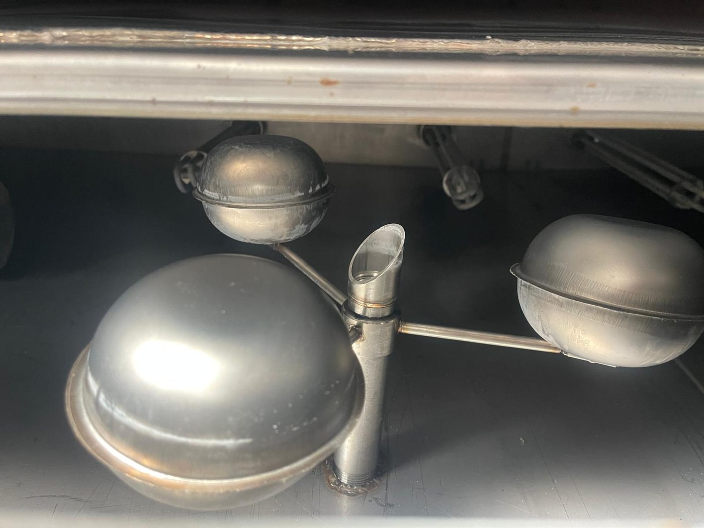

# 11.7 Sensör arızaları

Makinede güvenlik (bakım kapağı manyetik switch'leri) ve proses (tank seviye sensörleri, seviye bekçisi, termokupllar) sensörleri bulunur. HMI olmadığından sensör durumu doğrudan izlenmez; sensör arızası, ilgili fonksiyonun davranışından (RESET alınamıyor, seviye lambası yanlış, sıcaklık okuması anlamsız) anlaşılır.

---

## 11.7.1 Bakım kapağı manyetik switch'leri — RESET alınamıyor

| Parametre | Değer |
| :--- | :--- |
| Switch | Omron **F3STGRNLPU21M1J8** manyetik kapı switch'i — 7 bakım kapağı, seri zincir |
| Emniyet rölesi | Omron **G9SB2002AACDC241** (kapak zinciri) |
| Belirti | Tüm kapaklar kapalı görünmesine rağmen RESET lambası yanmıyor; makine çalışmıyor |

Switch, kapaktaki mıknatıs ile sensör arasındaki hizaya duyarlıdır. Kapak tam oturmamış, mıknatıs kaymış veya switch yüzeyinde kir/metal talaş varsa zincir açık kalır. Switch'ler seri bağlı olduğundan tek bir kapak tüm makineyi kilitler.

**UYARI — Devre dışı güvenlik fonksiyonu:** Köprülenmiş veya mıknatısla kandırılmış kapak switch'i, kapak açıkken makinenin çalışmasına izin verir; hareketli konveyöre kapılma ve sıcak su püskürmesi nedeniyle yaralanma oluşabilir. Switch'leri köprülemeyin ve mıknatısla kandırmayın (**Bkz. Bölüm 6.2.1**).

**Teşhis prosedürü**

1. 7 acil stop butonunun tamamının serbest olduğunu doğrulayın (**Bkz. Bölüm 2.5**).
2. 7 bakım kapağının her birini açıp hizalı şekilde yeniden kapatın; her kapatmadan sonra RESET deneyin.
3. Kapak switch'i ve mıknatıs yüzeylerini kuru bezle temizleyin; mekanik hasar veya gevşek montaj kontrolü yapın.
4. RESET hâlâ alınamıyorsa yetkili elektrikçi G9SB emniyet rölesinin giriş LED'lerini okusun (röle etiketine göre) ve hangi girişin açık olduğunu belirlesin. LED'ler enerji altında okunur.
5. LOTO uygulayın (**Bkz. Bölüm 2.4**); pano kapağını açın.
6. Switch zincirinin kablo bağlantılarını ve klemenslerini kontrol edin; arızalı switch'i orijinal tip ile değiştirin (10 07147 — **Bkz. Bölüm 13.3**).
7. Pano kapağını kapatın ve LOTO'yu kaldırın.
8. Kapak testini uygulayın (**Bkz. Bölüm 5.4.2**).

---

## 11.7.2 Tank seviye sensörleri ve seviye bekçisi

| Parametre | Değer |
| :--- | :--- |
| Seviye sensörü | **VEGASWING 51** çatal tip (2 adet — Tank 1, Tank 2) |
| Seviye bekçisi | Paslanmaz şamandıralı seviye bekçisi (10 00296) |
| Belirti | WASHING LEVEL lambası tank doluyken yanıyor; veya tank boşken yanmıyor |

**UYARI — Aşırı ısınma ve yanık:** Tank boşken WASHING LEVEL lambası yanmıyorsa seviye interlock'u çalışmıyordur; boş tankta çalışan rezistans aşırı ısınır, yangın ve yanık tehlikesi oluşur. Bu durumda ilgili tankın HEATER anahtarını hemen OFF konumuna alın; arıza giderilene kadar ısıtıcıyı çalıştırmayın.

**Teşhis prosedürü**

1. İlgili tankın HEATER ve PUMP anahtarlarını OFF konumuna alın.
2. LOTO uygulayın (**Bkz. Bölüm 2.4**).
3. Tank kapağını açın; gerçek su seviyesini gözle kontrol edin.
4. **Tank dolu, lamba yanıyor:** Çatal sensör yüzeyinde yağ/kir tabakası veya yabancı cisim olabilir; sensör çatalını temizleyin (aylık bakım maddesi — **Bkz. Bölüm 9.1.3**). Şamandıranın serbest hareket ettiğini kontrol edin.
5. **Tank boş, lamba yanmıyor:** Sensör veya devre arızası; sensör çıkışını ve kabloyu kontrol edin; arızalı sensörü değiştirin (07 16791).
6. Sensör kablo bağlantısını ve pano klemensini kontrol edin (elektrik şeması — **Bkz. Bölüm 13.1**).
7. Tank kapağını kapatın ve LOTO'yu kaldırın.
8. Seviye interlock testini uygulayın (**Bkz. Bölüm 5.4.4**).

---

## 11.7.3 Termokupllar ve termostatlar

| Parametre | Değer |
| :--- | :--- |
| Termokupl | ETB30F06-5Ç / ETB30F06-4Ç (2 + 2) |
| Termostat | GEMO DTH2 (4 adet) |
| Belirti | Termostat ekranında anlamsız/sabit okuma, sensör hatası göstergesi, sıcaklık kontrolü bozuk |

1. Termostat ekranındaki okumayı, harici termometre ile ölçtüğünüz tank suyu sıcaklığı ile karşılaştırın.
2. Okuma yoksa veya hata kodu varsa LOTO uygulayın (**Bkz. Bölüm 2.4**) ve termokupl bağlantısını (polarite, kopukluk) kontrol edin.
3. Arızalı termokuplu değiştirin (10 02976 / 10 02634); montajda termostat adaptörü komplesi (07 00669) gerekebilir.
4. Termostat arızası şüphesinde (çıkış vermiyor / kesmiyor) Arıza 5 prosedürünü uygulayın (**Bkz. Bölüm 11.3.3**).

---

## 11.7.4 Kritik sensör listesi

| Fonksiyon | Tip / model | Konum | Belirti |
| :--- | :--- | :--- | :--- |
| Kapak güvenlik | Omron F3STGRNLPU21M1J8 (7 ad) | Bakım kapakları | RESET alınamıyor |
| Tank seviye | VEGASWING 51 çatal tip (2 ad) + paslanmaz seviye bekçisi | Tank 1, Tank 2 | WASHING LEVEL lambası |
| Sıcaklık | Termokupl ETB30F06-5Ç / -4Ç (2+2) | Tank 1, Tank 2, kurutma 1, kurutma 2 | Termostat okuması |

Sensör LED / durum göstergesi: HMI yok; seviye durumu TANK 1/2 WASHING LEVEL kırmızı lambaları, emniyet zinciri durumu RESET lambası ile izlenir. Yedek parça sipariş kodları: **Bkz. Bölüm 13.3**. Kablo renk kodu ve bağlantı detayları **elektrik şemasındadır** (**Bkz. Bölüm 13.1**).
