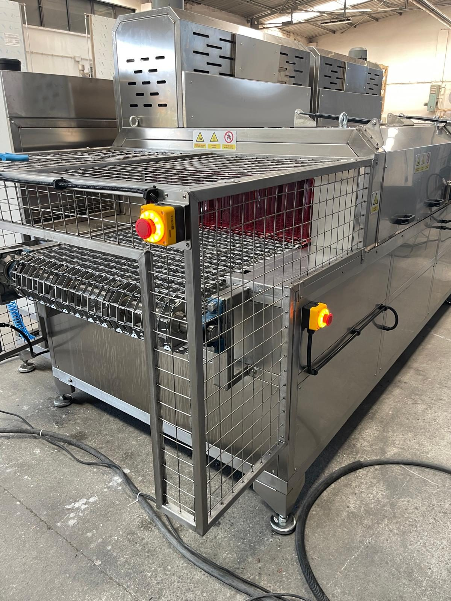
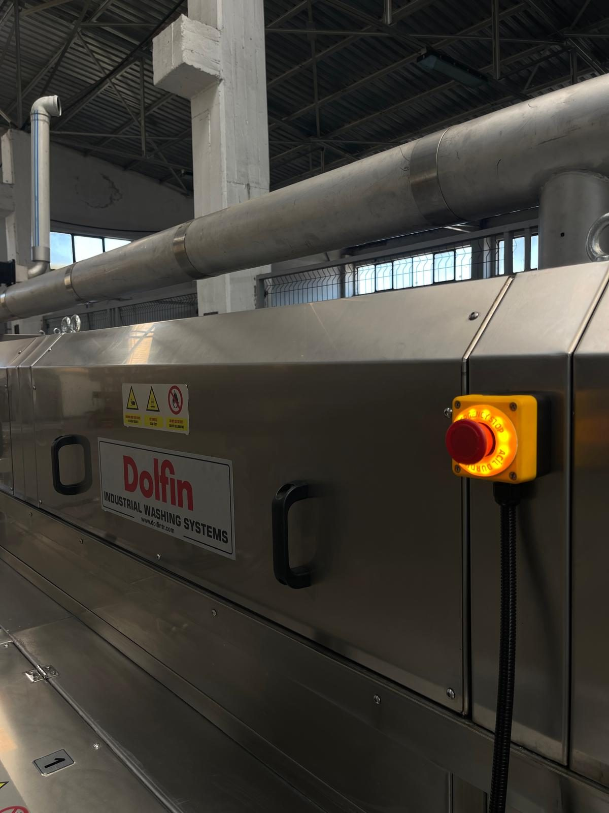

# 2.3 Allgemeine betriebliche Sicherheitsregeln

Die folgenden Regeln gelten in allen Nutzungsphasen der Maschine. Bei einem Verstoß die Maschine anhalten; nicht wieder in Betrieb nehmen, bevor die Sicherheitsbedingungen erfüllt sind.

1. Die Anleitung lesen und die Maschine nicht ohne Schulung betreiben (**Siehe Kapitel 1.1.3**).
2. Sicherheitseinrichtungen (magnetische Klappenschalter, Not-Halt, Sicherheitsrelais, Füllstandverriegelung) nicht außer Kraft setzen oder umgehen.
3. Wartungsklappen bei laufender Maschine nicht öffnen; vor dem Öffnen einer Klappe LOTO anwenden (**Siehe Kapitel 2.4**). Die Klappenschalter besitzen keine mechanische Zuhaltung; beim Öffnen stoppen sie die Maschine, beseitigen jedoch nicht die Gefahr durch heiße Flüssigkeit und Restbewegung.
4. Bei erloschener **RESET**-Leuchte (offener Sicherheitskreis) keinen Funktionsschalter einschalten; zuerst die Ursache beseitigen (**Siehe Kapitel 2.5, 11.1.2**).
5. Heizungs- und Pumpenschalter nicht einschalten, solange die rote **WASHING-LEVEL**-Leuchte leuchtet; zuerst den betreffenden Tank befüllen (**Siehe Kapitel 7.2.1**).
6. Vor dem Einschalten des Förderers prüfen, dass auf der Fördererstrecke keine Gegenstände verblieben sind, die sich verklemmen könnten.
7. Vor dem Einschalten der Pumpen prüfen, dass die Saug-/Druckventile der Pumpen geöffnet sind (**Siehe Kapitel 7.2.5**).
8. Werkstücke ausschließlich am linken Einlauf auf den Förderer auflegen und am rechten Auslauf abnehmen; nicht in die Kammer greifen, nicht in das Schutzgitter eintreten.
9. Die Schaltschranktür während des Betriebs geschlossen und verriegelt halten; in den Schaltschrank greift ausschließlich eine Elektrofachkraft unter LOTO ein.
10. Kein Wasser in das Maschinenumfeld spritzen; Schaltschrank, Frequenzumrichter und die Bereiche der Klappenschalter nicht direkt mit Wasser beaufschlagen.
11. Im Notfall den nächstgelegenen Not-Halt-Taster betätigen (**Siehe Kapitel 2.5**).

---

# 2.4 Kontrolle gefährlicher Energien — LOTO (Verriegeln und Kennzeichnen)

**WARNUNG — Energiebedingte Verletzung:** Bei Wartung oder Reinigung ohne LOTO kann die Maschine unbeabsichtigt anlaufen; es können Quetschungen, Stromschlag sowie Verletzungen durch heiße Flüssigkeit und Druckluft entstehen. Alle Energiequellen trennen, verriegeln und kennzeichnen.

Dieses Verfahren wird vor allen Arbeiten an der Maschine angewendet: mechanische Wartung, Elektroarbeiten, Filter-/Tankreinigung, Abnehmen von Klappen, Prüfung von Düsen und Heizstäben und vergleichbare Tätigkeiten. In den übrigen Kapiteln wird nur der Verweis **Siehe Kapitel 2.4** gegeben; die Schritte werden nicht wiederholt.

Da diese Maschine kein HMI besitzt, erfolgt der Nachweis der Energiefreiheit **physisch**: vollständiges Erlöschen der Leuchten am Bedienfeld, kein Aufleuchten der RESET-Leuchte beim Drücken des RESET-Tasters, kein Anlaufen eines Motors beim Einschalten eines Funktionsschalters und Anzeige von **0 bar** am Manometer des Luftreglers.

Das Ausschalten der Funktionsschalter, das Drücken des Not-Halts oder der Stillstand der PLC ist **keine Energietrennung**: PLC und Steuerstromkreis bleiben unter Spannung, und ein Fehler oder eine falsche Schalterstellung kann die Einheiten wieder in Gang setzen. Eine Energietrennung wird ausschließlich durch Verriegeln des Hauptschalters (TMŞ) in Stellung OFF und Absperren der Luftleitung erreicht.

## 2.4.1 Umfang und Energiequellen

| Energieart | Quelle | Trennstelle |
| :--- | :--- | :--- |
| Elektrisch | 380 V, 3-phasig, 110 kW / 220 A | Hauptschalter — **Leistungsschalter (TMŞ) Schneider CVS250F (LV521091)**, Drehhebel auf der Schaltschranktür; Stellung **OFF (O)** abschließbar |
| Pneumatisch | Druckluft 6 bar | **Abschließbarer Kugelhahn mit Entlüftung** in der Anlagenleitung — GESCHLOSSEN + Schloss + Anhängeschild; Restdruck über die Entlüftungsöffnung des Kugelhahns ablassen; Nachweis: **0 bar** am Manometer des Reglers **AIR INLET / HAVA GİRİŞİ** |
| Wasser / Prozessflüssigkeit | Netzwassereingang 1 bar; Flüssigkeit in den Tanks bis +70 °C | **Wasserventil der Anlage**, das die Tankfüllleitung speist — GESCHLOSSEN + Anhängeschild; Ablassventile **TAHLİYE** für die Tankflüssigkeit (**Siehe Kapitel 10.1.5**) |
| Thermisch | Tank-Heizstäbe (7 × 8 kW), Trocknungsheizungen (2 × 12 kW) | Abkühlzeit nach der elektrischen Trennung — Tankflüssigkeit und Oberflächen der Trocknungskammer |
| Mechanisch | Förderer, Blower, Ventilator, Pumpe, Ölskimmer | Elektrische Trennung; nach dem Abschalten drehen Ventilator- und Blowerflügel durch ihre Trägheit weiter — vollständigen Stillstand abwarten |
| Elektrisch gespeichert | Zwischenkreiskondensator des Förderer-Frequenzumrichters | Nach Hauptschalter OFF warten, bis die Anzeige des Frequenzumrichters vollständig erloschen und die in der Delta-Betriebsanleitung angegebene Entladezeit abgelaufen ist |

**HINWEIS:** An der Maschine ist kein Druckluft-Absperrventil vorhanden; die Druckluft wird über einen Schlauch an den Regler **AIR INLET / HAVA GİRİŞİ** am Maschinenkörper angeschlossen. Der Betreiber muss in der Anlagenleitung vor dem Luftschlauch einen **abschließbaren Kugelhahn mit Entlüftung** installieren; dieser Kugelhahn ist die pneumatische LOTO-Trennstelle (**Siehe Kapitel 5.3.1**). Die Tanks werden manuell befüllt; die Trennstelle für Wasser ist das Wasserventil der Anlage, das die Füllleitung speist.

An der Maschine ist kein Hydraulik- oder Vakuumsystem vorhanden.

## 2.4.2 LOTO-Durchführungsverfahren

**Vorbereitung**

1. Umfang und Dauer der Wartung oder des Eingriffs festlegen.
2. Dem betroffenen Personal mitteilen, dass an der Maschine gearbeitet wird.

**Maschine anhalten**

3. Alle Funktionsschalter am Bedienfeld in Stellung **OFF** bringen; zuerst CONVEYOR, dann Pumpen, Blower/Ventilatoren und Heizungen (**Siehe Kapitel 7.3.1**).
4. Kommt eine Bewegung bei Schalterstellung OFF nicht zum Stillstand, den nächstgelegenen **Not-Halt**-Taster betätigen (**Siehe Kapitel 2.5**).

**Elektrische Trennung**

5. Den **Hauptschalterhebel** auf der Schaltschranktür in Stellung OFF (O) drehen.
6. Das persönliche **Vorhängeschloss** am Schalterhebel anbringen.
7. Das **LOTO-Anhängeschild** am Schloss befestigen; das Schild muss Name, Datum und den Hinweis „Nicht einschalten — Wartung" tragen.

**Trennung der Druckluft**

8. Den abschließbaren **Kugelhahn** in der Druckluftleitung der Anlage schließen.
9. Das persönliche Vorhängeschloss und das LOTO-Anhängeschild am Kugelhahn anbringen.
10. Den Restdruck in der Leitung über die Entlüftungsöffnung des Kugelhahns ablassen.

**Trennung des Wassers**

11. Das **Wasserventil der Anlage**, das die Tankfüllleitung speist, schließen.
12. Ein LOTO-Anhängeschild am Wasserventil anbringen.

**WARNUNG — Heiße Flüssigkeit:** Die Tankflüssigkeit kann bis +70 °C heiß sein; beim Ablassen herausspritzende Flüssigkeit verursacht Verbrühungen. Die Flüssigkeit nicht vor dem Abkühlen ablassen; hitzebeständige Handschuhe und Schutzbrille tragen.

13. Ist ein Eingriff im Tank erforderlich, die Prozessflüssigkeit über die Ablassventile **TAHLİYE** ablassen (**Siehe Kapitel 10.1.5**).

**Nachweis**

14. Prüfen, dass das Manometer des Luftreglers **0 bar** anzeigt.
15. Prüfen, dass die Leuchten am Bedienfeld (Betriebsleuchten, WASHING LEVEL, RESET) vollständig **erloschen** sind.
16. Gedrückte Not-Halt-Taster entriegeln.

**HINWEIS:** Bei gedrücktem Not-Halt schalten RESET-Leuchte und Motoren auch bei nicht getrennter Versorgung nicht ein; der Test in den Schritten 17–19 ist daher nur bei entriegelten Not-Halt-Tastern aussagekräftig.

**WARNUNG — Unerwartete Bewegung:** Ist die Versorgung nicht getrennt, bewegt sich der Förderer während des Tests; Quetschverletzungen können entstehen. Vor dem Test prüfen, dass sich niemand im Bereich des Förderers aufhält.

17. Den **RESET**-Taster drücken; prüfen, dass die RESET-Leuchte nicht aufleuchtet.
18. Den Schalter **CONVEYOR** in Stellung ON bringen; prüfen, dass sich der Förderer nicht bewegt und die Betriebsleuchte nicht aufleuchtet.
19. Den Schalter CONVEYOR in Stellung OFF zurückstellen.
20. Hat in Schritt 17 oder 18 eine Leuchte aufgeleuchtet oder ein Motor angelaufen, ist die Versorgung nicht getrennt: nicht in den Schaltschrank greifen; eine Elektrofachkraft rufen.

**GEFAHR — Stromschlag:** Die Eingangsklemmen des Hauptschalters und das Versorgungskabel der Anlage stehen auch in Stellung OFF des Hauptschalters unter Spannung; eine Berührung kann tödlich sein. Vor Arbeiten auf der Eingangsseite den Versorgungsschalter in der Unterverteilung der Anlage ausschalten und abschließen.

21. Bei Arbeiten im Schaltschrank an den Ausgangsklemmen des Hauptschalters die Spannungsfreiheit mit einem Multimeter messen (nur Elektrofachkraft).
22. In den Bereichen Förderer, Ventilatoren, Blower und Pumpen durch Sehen und Hören prüfen, dass keine Bewegung vorhanden ist.
23. Vor Abschluss des Nachweises keine Klappe oder Abdeckung abnehmen und keinen Eingriff beginnen.

**Nach dem Eingriff**

24. Alle Schutzeinrichtungen, Klappen und Anschlüsse wieder anbringen.
25. Werkzeuge und Materialien aus dem Bereich entfernen.
26. Prüfen, dass die Wartungsklappen mit den magnetischen Schaltern ausgerichtet geschlossen sind.
27. Das eigene LOTO-Schloss und -Anhängeschild entfernen; kein fremdes Schloss entfernen.
28. Das Wasserventil der Anlage öffnen.
29. Den Kugelhahn der Druckluftleitung öffnen.
30. Prüfen, dass am Manometer des Luftreglers der Versorgungsdruck angezeigt wird (**Siehe Kapitel 3.3.5**).
31. Den Hauptschalter in Stellung ON bringen.
32. Den **RESET**-Taster drücken, bis die blaue Leuchte aufleuchtet (**Siehe Kapitel 2.5**).
33. Die Maschine gemäß dem Startverfahren in Betrieb nehmen (**Siehe Kapitel 7.2**).

**GEFAHR — Mehrere Personen:** Schaltet eine Person die Energie wieder zu, bevor eine andere ihre Arbeit beendet hat, können Quetschungen oder Stromschlag zum Tod oder zu schweren Verletzungen führen. Jede Person bringt an jeder Trennstelle ihr eigenes persönliches Schloss an; die Energie wird erst zugeschaltet, wenn die letzte Person ihr Schloss entfernt hat.

Die magnetischen Schalter der Wartungsklappen nicht überbrücken, nicht mit einem Magneten manipulieren und nicht außer Kraft setzen. Eine Wartungsklappe erst nach abgeschlossenem LOTO öffnen.

---

# 2.5 Not-Halt (E-Stop) und Reset

An der Maschine befinden sich insgesamt **7** Not-Halt-Taster:

| Nr. | Position |
| :---: | :--- |
| 1 | Bedienfeld — **EMERGENCY STOP** |
| 2 | Förderereingang (linkes Ende) — Vorderseite |
| 3 | Förderereingang (linkes Ende) — Rückseite |
| 4 | Fördererausgang (rechtes Ende) — Vorderseite |
| 5 | Fördererausgang (rechtes Ende) — Rückseite |
| 6 | Mittlerer Maschinenbereich — Vorderseite |
| 7 | Mittlerer Maschinenbereich — Rückseite |

Beim Betätigen eines Not-Halt werden **alle Bewegungs- und Prozessausgänge** der Maschine (Förderer, Pumpen, Heizungen, Blower, Trocknungs- und Abluftventilatoren, Ölskimmer) sicher gestoppt; die blaue **RESET**-Leuchte erlischt; ohne Reset-Bestätigung kann keine Funktion wieder gestartet werden.

Der Not-Halt entspricht **Stoppkategorie 0** (EN 60204-1): Die Ausgänge des Sicherheitsrelais Omron G9SB-2002-A, das den Not-Halt-Kreis überwacht, sind unverzögert; beim Betätigen des Not-Halt werden die Schütze der Motoren und Heizungen sofort spannungsfrei geschaltet. Ventilator- und Blowerflügel laufen durch ihre Trägheit aus.

Den Not-Halt nicht zum normalen Anhalten verwenden; nur bei akuter Gefahr betätigen. Häufige Not-Halt-Betätigung belastet die Schütze und den Steuerkreis der Heizstäbe. Zum normalen Anhalten **Siehe Kapitel 7.3.1**.

**Situationen, in denen der Not-Halt zu verwenden ist**

- Lebensbedrohliche Gefahr durch Einklemmen, Sturz oder Anstoßen
- Plötzliches mechanisches Störgeräusch, starke Vibration durch Pumpe oder Ventilator, große Leckage am Tank oder an der Rohrleitung
- Lichtbogen, Rauch, Brandgeruch oder anormale Erwärmung durch die Heizstäbe
- Verklemmen eines Werkstücks auf dem Förderer oder Beschädigung des Drahtgurts

Beim Öffnen einer Wartungsklappe stoppt der Sicherheitskreis die Maschine bereits; dies ist kein Grund für einen Not-Halt. Hat das Öffnen einer Klappe die Maschine gestoppt und sind unter der Klappe Arbeiten erforderlich, zuerst LOTO anwenden (**Siehe Kapitel 2.4**). Nach Abschluss der Arbeiten die Klappe mit dem Schalter ausgerichtet schließen, LOTO aufheben und das folgende Reset-Verfahren durchführen.

**Reset-Verfahren**

1. Die physische Gefahr beseitigen; ist ein Eingriff an der Ursache des Einklemmens, der Leckage oder der Störung erforderlich, zuerst LOTO anwenden (**Siehe Kapitel 2.4**).
2. Alle 7 Not-Halt-Taster prüfen; es können mehrere Taster gedrückt sein.
3. Den gedrückten Not-Halt-Pilztaster **entriegeln** (durch Ziehen oder Drehen in Pfeilrichtung die Verriegelung lösen).
4. Prüfen, dass alle Wartungsklappen geschlossen und mit dem Schalter ausgerichtet sind.
5. Den blauen **RESET**-Taster am Bedienfeld drücken, **bis die Leuchte aufleuchtet**.

**HINWEIS:** Das Entriegeln des Not-Halt allein versetzt die Maschine nicht in den Bereitschaftszustand; der Bediener bestätigt mit RESET, dass die Maschine in den sicheren Zustand versetzt wurde.

6. Leuchtet die RESET-Leuchte nicht, die Diagnoseschritte zu Störung 4 anwenden (**Siehe Kapitel 11.1.2**); keinen Funktionsschalter einschalten, bevor die Leuchte leuchtet.
7. Die Funktionen in der Einschaltreihenfolge wieder einschalten (**Siehe Kapitel 7.2.2**).

RESET aktiviert den Sicherheitskreis erneut; werden Funktionen ohne Beseitigung der Störung wieder eingeschaltet, kann dies zu erneutem Stillstand oder Schaden führen. Den Funktionstest des Not-Halt **monatlich** durchführen (**Siehe Kapitel 6.2.3, 5.4.1**).

---

# 2.6 Persönliche Schutzausrüstung (PSA)

Der Betreiber ist verpflichtet, aufgabenbezogene PSA bereitzustellen und deren Verwendung zu überwachen. Die folgende Matrix definiert die Mindestanforderungen; sind die örtlichen Vorschriften strenger, gelten diese. Das Etikett „KKD KULLAN" (PSA tragen) an der Maschine verweist auf diese Matrix.

| Tätigkeit | Arbeitskleidung | Sicherheitsschuhe mit Stahlkappe | Handschuhe | Schutzbrille | Atemschutz |
| :--- | :---: | :---: | :---: | :---: | :---: |
| Bedienung des Bedienfelds (Schalter / Reset) | ✓ | ✓ | — | — | — |
| Beladen / Entnehmen der Werkstücke (Förderer-Ein-/Auslauf) | ✓ | ✓ | ✓ (hitzebeständig — austretende Werkstücke sind heiß) | ✓ (Spritzgefahr) | — |
| Manuelles Befüllen der Tanks, Füllstandkontrolle | ✓ | ✓ (rutschfest) | ✓ | ✓ | — |
| Reinigung von Vorfilter, Tankinnenfilter und Beutelfilter | ✓ | ✓ (rutschfest) | ✓ (flüssigkeitsdicht, chemikalienbeständig) | ✓ | Filtermaske bei Chemikaliendämpfen |
| Tankentleerung, Desinfektion, Reinigungschemikalien | ✓ (flüssigkeitsdichte Schürze) | ✓ (rutschfest) | ✓ (chemikalienbeständig, mit langer Stulpe) | ✓ (vollständig geschlossen) | Filtermaske bei Chemikaliendämpfen |
| Mechanische Wartung (Förderer, Pumpe, Ventilator, Düsen) | ✓ | ✓ | ✓ (schnittfest) | ✓ | — |
| Eingriff im Schaltschrank (mit LOTO) | ✓ (Baumwolle, schwer entflammbar) | ✓ (isolierende Sohle) | Isolierend (während der Messung) | ✓ | — |
| Arbeiten in der Nähe von heißem Tank / Heizstäben / Trocknungskammer | ✓ | ✓ | ✓ (hitzebeständig) | ✓ | — |

**VORSICHT — Rutschiger Boden:** Austretendes oder überlaufendes Wasser im Tankumfeld kann zu Ausrutschen und Sturz führen. Schuhe mit rutschfester Sohle tragen; Leckagen und übergelaufenes Wasser sofort beseitigen (**Siehe Kapitel 10**).

**VORSICHT — Heiße Werkstücke:** Die aus der Trocknungskammer austretenden Werkstücke wurden mit Heißluft getrocknet; Kontakt mit bloßen Händen kann Verbrennungen verursachen. Werkstücke mit hitzebeständigen Handschuhen entnehmen.

Der Betreiber weist kurzzeitige Besucher vor dem Betreten des aktiven Prozessbereichs ein und stattet sie mit der Mindest-PSA (Sicherheitsschuhe, Schutzbrille) aus.
