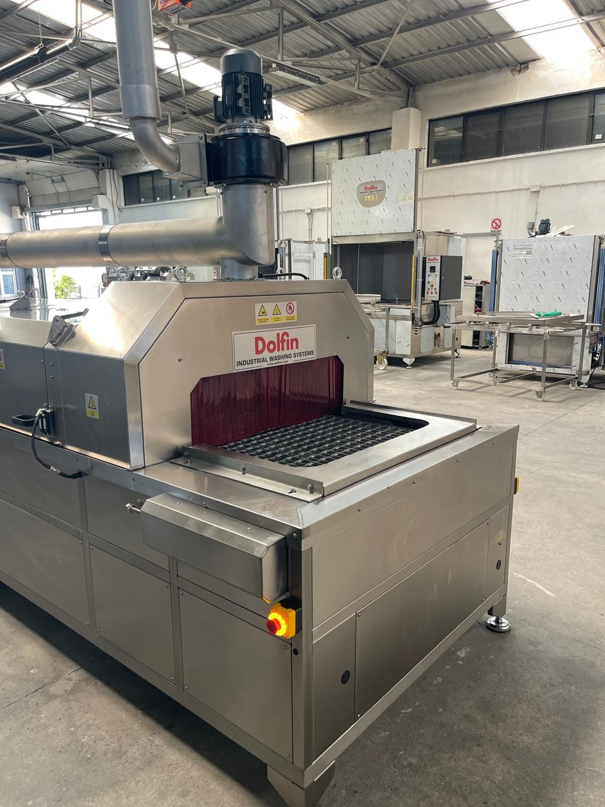

# 3. ALLGEMEINE ÜBERSICHT

**KNV 90 7500 2B** (Modellcode **KNV-90**, Seriennummer **[EKSİK]**, Kunde **ÇELİK**) ist eine Teilewaschanlage mit Förderer und **zwei Bädern** (Waschen + Spülen), die zur Entfernung von Öl, Prozessschmutz und Rückständen entwickelt wurde, die sich auf den Oberflächen industrieller Werkstücke ansammeln. Dieses Kapitel ist so aufgebaut, dass Bediener, Wartungs- und Installationspersonal die Maschine als Ganzes kennenlernen und die Prozessgrenzen sowie den technischen Rahmen erfassen können; die detaillierten technischen Werte sind in den jeweiligen Unterkapiteln angegeben und werden in anderen Kapiteln nicht wiederholt.

Die Maschine führt die Werkstücke auf einem getriebemotorgetriebenen **Kettenförderer** nacheinander durch die Prozesse **Waschen → Spülen → Wasserabblasen mit Blower → Trocknen mit Heißluft**. Bei Blick von vorn (von der vorderen Längsseite) erfolgt die Beschickung **links** und die Entnahme **rechts**; Schaltschrank und Bedienfeld befinden sich an der vorderen Längsseite **rechts**, nahe dem Ausgangsende (**Siehe Kapitel 3.5.1**). In diesem Projekt werden die Werkstücke **vom Bediener von Hand** aufgelegt und entnommen; eine Roboterintegration ist nicht vorhanden. Die Steuerung erfolgt über eine **PLC**; ein HMI ist nicht vorhanden, jede Funktion wird über einen eigenen EIN/AUS-Schalter geführt, und die Temperaturen der Tanks und der Trocknungsluft werden mit GEMO-DTH2-Thermostaten eingestellt.

Die Hauptmodule der Maschine sind: Kettenförderer mit Getriebemotorantrieb; Waschtank (TANK 1) mit Pumpe, Kammer und Düsen; Spültank (TANK 2) mit Pumpe, Kammer und Düsen; Ölskimmer und Ölabscheidereinheit; Trocknungseinheit aus vier Blowern, zwei Trocknungsventilatoren und zwei Trocknungsheizungen; Abluftventilator; Schaltschrank und Sicherheitseinrichtungen. Die Funktionen der Module sind in **Kapitel 3.1**, die Grenzen der bestimmungsgemäßen Verwendung in **Kapitel 3.2**, die Elektrik-, Motor- und Installationsdaten in **Kapitel 3.3**, das Bedienfeld und der Schaltschrankaufbau in **Kapitel 3.4** sowie die Aufstellung und der Platzbedarf in **Kapitel 3.5** beschrieben.

---

## Kapitelinhalt

| Kapitel | Titel | Thema |
| :--- | :--- | :--- |
| **3.1** | Maschinenbeschreibung | Prozessablauf, Förderer, Tanks, Pumpen, Ölskimmer/-abscheider, Trocknung, Abluft, Schaltschrank |
| **3.2** | Bestimmungsgemäße Verwendung | Bearbeitbare Werkstücktypen, verbotene Verwendungen, Prozesswasser, Umgebungs- und Personalanforderungen |
| **3.3** | Technische Daten | Abmessungen/Gewicht, Kapazität, Elektrik, Motor- und Heizungsliste, Luft/Wasser, Umgebung |
| **3.4** | Maschinensteuerung | Schaltschrank, Bedienfeldschalter, Thermostate, Leuchten, Interlock, Fördergeschwindigkeit |
| **3.5** | Aufstellungsplan der Maschine | Richtungsdefinitionen, Freiräume, Wartungszugang, Transporteinschränkungen, Sicherheitselemente |

---

## Maschinenübersicht

| Parameter | Wert |
| :--- | :--- |
| Bestell-/Seriennummer | [EKSİK] |
| Modell | KNV-90 — KNV 90 7500 2B |
| Maschinentyp | Mit Förderer — industrielle Teilewaschanlage mit zwei Bädern (2 Bäder + Trocknung) |
| Prozessablauf | Waschen → Spülen → Wasserabblasen (Blower) → Trocknen (Heißluft) |
| Steuerung | PLC + Schalter des Bedienfelds; kein HMI |
| Beschickung / Entnahme | Links / Rechts — Beladen und Entnehmen von Hand |
| Bedienerseite | Vordere Längsseite — Schaltschrank und Bedienfeld rechts, nahe dem Ausgangsende (**Siehe Kapitel 3.5.1**) |
| Gesamte installierte Leistung | 110 kW — 380 V / 50 Hz / 3 Phasen (**Siehe Kapitel 3.3.3**) |
| Schutzart (Maschine) | IP55 (**Siehe Kapitel 3.3.6**) |

