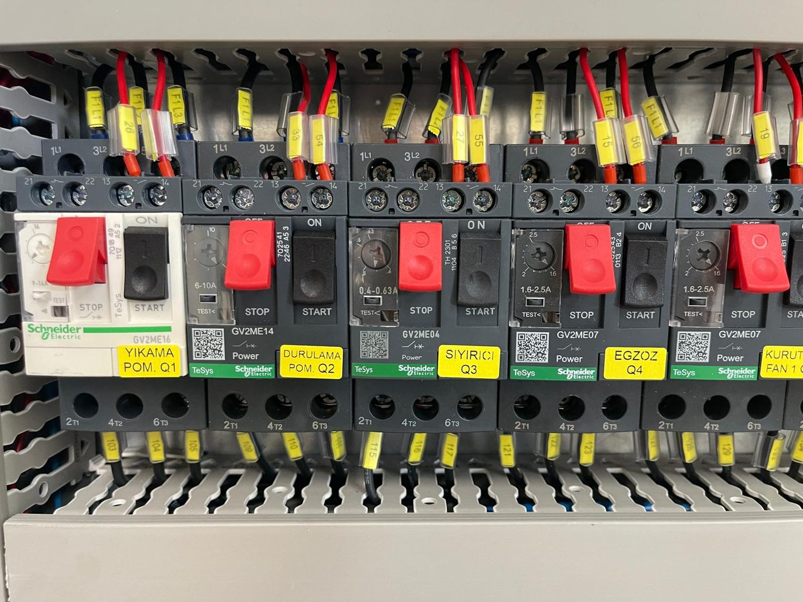

# 11.1 Fehlersuche

Bei der Störungsdiagnose wird zuerst der **Leuchtenstatus** am Bedienfeld abgelesen; anschließend werden die Prüf- und Abhilfeschritte gemäß der nachstehenden Störungstabelle durchgeführt. Bei Störungen, für die die Tabelle keine Abhilfe enthält, oder bei wiederkehrenden Störungen das zugehörige Unterkapitel (**Siehe Kapitel 11.3**–**11.7**) und die Servicekriterien (**Siehe Kapitel 11.2.2**) heranziehen.

---

## 11.1.1 Allgemeine Diagnoseschritte

1. **RESET-Leuchte** prüfen. Ist sie aus, ist der Sicherheitskreis offen: Not-Halt betätigt, Wartungsklappe offen/nicht ausgerichtet oder Reset ausstehend — **Störung 4**.
2. **WASHING-LEVEL-Leuchten** prüfen. Leuchtet eine rot, ist der Wasserstand im betreffenden Tank zu niedrig; Heizung und Pumpe dieses Tanks sind durch die Verriegelung gesperrt — **Störung 3**.
3. **Betriebsleuchte** der nicht arbeitenden Funktion prüfen. Ist die Leuchte bei Schalterstellung ON aus, ist der Ausgang unterbrochen: Verriegelung, MKŞ-Auslösung, Fehlerstrom-Auslösung oder Schützstörung — **Störung 1, 2, 3**.
4. Arbeitet keine Funktion und leuchtet auch die RESET-Leuchte nicht, liegt ein Problem der Schaltschrankversorgung oder des Phasenschutzes vor — **Störung 6**.
5. Läuft der Förderer nicht, den Code auf dem Display des Frequenzumrichters ablesen — **Siehe Kapitel 11.3.2**.
6. Ist eine Prüfung im Schaltschrank erforderlich, die Maschine stillsetzen und LOTO anwenden (**Siehe Kapitel 2.4**); die Elektrofachkraft ermittelt das ausgelöste Element anhand der MKŞ-Zuordnungstabelle (**Siehe Kapitel 11.1.3**).
7. Die Abhilfeschritte durchführen; MKŞ oder Fehlerstrom-Schutzschalter nicht wiederholt zurücksetzen, ohne die Ursache beseitigt zu haben.

**Fehlerverhalten:** Beim Öffnen des Sicherheitskreises (Klappe, Not-Halt) werden **alle** Ausgänge abgeschaltet. Füllstand-, MKŞ- und Fehlerstrom-Auslösungen schalten nur die **betroffene** Funktion ab; die übrigen Funktionen laufen weiter. Bei Phasenfehler gibt der Schaltschrank überhaupt keinen Ausgang frei.

**Erwartetes Ergebnis:** Die Ursache ist beseitigt; die RESET-Leuchte leuchtet; beim Stellen des Funktionsschalters auf ON leuchtet die Betriebsleuchte und die Einheit läuft.

---

## 11.1.2 Störungstabelle — Symptom, Ursache, Prüfung, Abhilfe

Die nachstehende Tabelle enthält die für diese Maschine definierten Störungsszenarien. Arbeiten im Schaltschrank werden ausschließlich von einer Elektrofachkraft unter LOTO durchgeführt.

| # | Symptom | Mögliche Ursache | Prüfung | Abhilfe | Qualifikation |
| :---: | :--- | :--- | :--- | :--- | :---: |
| 1 | Motor / Pumpe / Ventilator / Blower läuft nicht; Schalter ON, Betriebsleuchte aus; zugehöriger **MKŞ ausgelöst** (GV2ME-Hebel unten / "0") | Überstrom, mechanisches Blockieren, Phasenausfall, Kurzschluss; Pumpenventil geschlossen | Schalter auf OFF; LOTO; ausgelösten MKŞ ermitteln (**Siehe Kapitel 11.1.3** — Q1 Waschen, Q2 Spülen, Q3 Skimmer, Q4 Abluft, Q5–Q6 Trocknungsventilator, Q7–Q10 Blower); Freigängigkeit von Welle/Kupplung, Ventilstellung, Kabel | Mechanische Ursache beseitigen; MKŞ-Hebel zurücksetzen; LOTO aufheben; Kurztest. Wiederholte Auslösung → Service | Elektrik |
| 2 | **Fehlerstrom-Schutzschalter (RCCB)** ausgelöst — Gruppe A9N19642 / A9N19643; zugehörige Heizungen oder Motorgruppe laufen nicht | Isolationsfehler am Heizstab (geplatzter/nasser Heizstab), Feuchtigkeit, Kabelschaden | LOTO; ausgelösten RCCB und die versorgte Gruppe ermitteln (Etiketten K.AKIM F1…F5); Isolation von Heizstab und Anschlüssen messen | Defekten Heizstab abklemmen und ersetzen (**Siehe Kapitel 13.3** — 07 15142); Feuchtigkeitsquelle beseitigen; RCCB zurücksetzen. Wiederholte Auslösung → Service | Elektrik |
| 3 | Schalter von Pumpe oder Tankheizung auf ON, aber kein Betrieb | Bei der Heizung Solltemperatur erreicht (Thermostat hat abgeschaltet — normal); kein Wasser im Tank oder Füllstand niedrig (Füllstandverriegelung); MKŞ ausgelöst; Schütz zieht nicht an | Bei der Heizung Ist- und Solltemperatur am Thermostatdisplay vergleichen; Tankfüllstand per Sichtprüfung kontrollieren; Leuchte **TANK 1/2 WASHING LEVEL** prüfen | Leuchtet die Leuchte rot, Tank von Hand befüllen (**Siehe Kapitel 7.2.1**); nach Erlöschen der Leuchte den Schalter erneut einschalten. Tank voll, aber Leuchte an → Füllstandsensor — **Siehe Kapitel 11.7.2**. Leuchte aus, aber Einheit läuft nicht → MKŞ/Schütz — Störung 1 | Bediener / Elektrik |
| 4 | Bei gefülltem Tank leuchtet die blaue Leuchte nach **RESET** nicht; Maschine wird nicht betriebsbereit | Wartungsklappe offen oder Klappenschalter nicht ausgerichtet; mindestens ein Not-Halt betätigt; Sicherheitsrelais G9SB wartet auf Reset | Alle 7 Not-Halt-Taster prüfen; prüfen, dass alle 7 Wartungsklappen geschlossen und Schalter–Magnet ausgerichtet sind | Alle Not-Halt-Taster entriegeln; Klappen ausgerichtet schließen; RESET drücken, bis die Leuchte leuchtet. Bei Fortbestehen Klappenschalterkette und Eingänge des Sicherheitsrelais prüfen (**Siehe Kapitel 11.7.1**) | Bediener / Elektrik |
| 5 | GEMO DTH2 zeigt Solltemperatur erreicht, Wasser (oder Trocknungsluft) **heizt jedoch weiter** | Ausgangsstörung des Thermostats (Kontakt öffnet nicht); Heizungsschütz verschweißt (LC1K / LC1D dauerhaft angezogen) | Heizungsschalter auf OFF; steigt die Temperatur weiter, ist das Schütz verschweißt. LOTO; Geräusch/Erwärmung am Schütz; Thermostatausgang und Schützkontakte prüfen | Heizt es bei Heizungsschalter OFF weiter, Hauptschalter sofort auf OFF. Defekten Thermostat (10 11089) oder Schütz ersetzen (**Siehe Kapitel 13.3**). Bei Wiederholung Service | Elektrik |
| 6 | **Keine Energie im Schaltschrank** — keine Funktion arbeitet, RESET-Leuchte aus; Netzkabel angeschlossen | Hauptschalter (TMŞ) OFF oder ausgelöst; Steuersicherung ausgelöst; **Phasenfolgerelais MKR-01** gibt wegen vertauschter/fehlender Phasen keinen Ausgang frei; Störung des 24-V-DC-Netzteils | Hebelstellung des Hauptschalters; Anlagenversorgung; unter LOTO Steuersicherungen (A9F74160 / A9F74110); MKR-01-Anzeige und Ausgang LRS-350-24 (Elektrofachkraft) | TMŞ auf ON; ausgelöste Sicherung nach Ermittlung der Ursache ersetzen; Phasenfolge durch Elektrofachkraft prüfen und bei Bedarf zwei Phasen tauschen lassen (**Siehe Kapitel 5.3.6**); MKR-01 zurücksetzen; Schaltplan: **Siehe Kapitel 13.1** | Elektrik |
| 7 | **Förderer** läuft nicht; Schalter CONVEYOR ON; Alarmcode auf dem Display des Frequenzumrichters | Alarm des Frequenzumrichters (Überstrom, Überlast, Versorgung); mechanisches Blockieren; Drahtgurt verklemmt; Potentiometer unter 20 Hz | Blockierung auf der Linie; Displaycode des Frequenzumrichters; Potentiometerstellung | Blockierung unter LOTO beseitigen; Potentiometer auf über 20 Hz stellen; Code des Frequenzumrichters im Delta-Handbuch nachschlagen (**Siehe Kapitel 11.3.2**); Frequenzumrichter mit OFF/ON zurücksetzen. Bei Wiederholung Service | Bediener / Elektrik |
| 8 | Förderer dreht, aber **Drahtgurt bewegt sich nicht vorwärts** | Drehmomentbegrenzer rutscht (Überlast, Blockierung, Werkstückstau) | Werkstückansammlung am Auslauf; Blockierung auf der Linie | Förderer auf OFF; LOTO; Blockierung beseitigen; Last verringern. Rutscht der Drehmomentbegrenzer dauerhaft, Service | Bediener / Wartung |
| 9 | **Sprühstrahl schwach**, Pumpe läuft | Beutelfilter / Saugfilter verstopft; Vorfilter verstopft; Pumpenventil gedrosselt; Düsen verstopft; Wasserstand niedrig | Filterzustand; Ventilstellung; Füllstand | Filter reinigen (**Siehe Kapitel 10.1.3**, **10.1.4**); Ventile öffnen; Düsenprüfung (**Siehe Kapitel 9.1.3**) | Wartung |
| 10 | **Werkstück kommt nass heraus** | Blower oder Trocknung ausgeschaltet; Sollwert der Trocknungsheizung niedrig; Fördergeschwindigkeit hoch; Ventilator-/Blowerflügel verstaubt | Schalterstellungen; Thermostat; Geschwindigkeit; Ventilatorreinigung | BLOWER 1/2 und DRYING FAN/HEATER einschalten; Sollwert erhöhen, ohne die Temperaturbeständigkeit des Werkstückmaterials zu überschreiten (**Siehe Kapitel 6.3.3**); Geschwindigkeit verringern; Staubreinigung Ventilator/Blower (**Siehe Kapitel 9.1.3**) | Bediener / Wartung |
| 11 | **Dampf** tritt aus Kammerklappen und Vorhängen in den Betrieb aus | Abluftventilator läuft nicht (Q4 ausgelöst); Abluftkamin verstopft oder nicht angeschlossen | Geräusch des Abluftventilators; MKŞ Q4; Abluftkamin | Verfahren Störung 1 (Q4); Abluftkanal öffnen/anschließen (**Siehe Kapitel 5.3.4**) | Wartung / Elektrik |
| 12 | Pumpe des **Ölabscheiders** läuft nicht; Schalter ON | Keine Luft / Druck niedrig; Magnetventil defekt; Membranpumpe verstopft | Manometer; Klickgeräusch des Magnetventils; Schläuche | Anlagen-Luftventil öffnen; Reglerdruck einstellen (**Siehe Kapitel 6.5.1**); Magnetventil und Pumpe — **Siehe Kapitel 11.5.2** | Wartung |
| 13 | **Wasseransammlung** / Leckage unter der Maschine | Tankdichtung, Ablassventil (TAHLİYE) undicht, Filtergehäusedeckel, Schlauchanschluss, Tanküberlauf | Quelle verfolgen | Ventil/Dichtung/Deckel nachziehen oder ersetzen; Tank ohne Überlauf befüllen (**Siehe Kapitel 7.2.1**) | Wartung |
| 14 | Not-Halt-Taster entriegelt, Klappen geschlossen, RESET ausgeführt; bei Schaltern auf ON **arbeitet keine Einheit**, alle Betriebsleuchten aus | PLC im Zustand STOP oder Fehler; keine PLC-Versorgung | Elektrofachkraft: Status- und Fehler-LEDs der PLC-CPU; PLC-Versorgungsspannung (**Siehe Kapitel 11.3.5**) | Verfahren PLC-Zustandsprüfung in **Kapitel 11.3.5** anwenden. Geht die PLC nicht in RUN → Service — nicht in das PLC-Programm eingreifen | Elektrik |

**HINWEIS:** Diese Tabelle beruht auf dem Schaltschrankaufbau und der Komponentenliste der Maschine. Die Abhilfeschritte sind eine allgemeine Diagnoseanleitung; vor jedem Eingriff in den Schaltschrank ist LOTO zwingend (**Siehe Kapitel 2.4**).

---

## 11.1.3 MKŞ-Zuordnungstabelle — Motorschutzschalter im Schaltschrank

Im Schaltschrank befindet sich für jede Motorleitung ein separater Motorschutzschalter (MKŞ) Schneider GV2ME; bei Auslösung fällt der Hebel nach unten ("0") und der Hilfskontakt GVAE11 schaltet die zugehörige Betriebsleuchte aus. Die Etiketten sind im Schaltschrank auf gelben Schildern angebracht.

| Schaltschrank-Etikett | MKŞ-Typ | Motor | Auslösesymptom |
| :--- | :--- | :--- | :--- |
| **Q1 YIKAMA POM.** (Waschpumpe) | GV2ME16 (9–14 A) | Waschpumpe PE02 | Kein Wasch-Sprühstrahl; Betriebsleuchte TANK 1 PUMP aus |
| **Q2 DURULAMA POM.** (Spülpumpe) | GV2ME14 (6–10 A) | Spülpumpe PE04 | Kein Spül-Sprühstrahl; Betriebsleuchte TANK 2 PUMP aus |
| **Q3 SIYIRICI** (Skimmer) | GV2ME04 (0,4–0,63 A) | Ölskimmer GE06 | Scheibe dreht nicht; Betriebsleuchte TANK 1 OIL SKIMMER aus |
| **Q4 EGZOZ** (Abluft) | GV2ME07 (1,6–2,5 A) | Abluftventilator FE01 | Keine Ableitung über den Abluftkamin; Dampf tritt aus |
| **Q5 KURUTMA FAN 1** (Trocknungsventilator 1) | GV2ME07 | Trocknungsventilator FE02 | Betriebsleuchte DRYING 1 FAN aus |
| **Q6 KURUTMA FAN 2** (Trocknungsventilator 2) | GV2ME07 | Trocknungsventilator FE03 | Betriebsleuchte DRYING 2 FAN aus |
| **Q7 BLOWER 1** | GV2ME14 | Blower FE04 | Luftmenge in der Blowergruppe verringert |
| **Q8 BLOWER 2** | GV2ME14 | Blower FE05 | Luftmenge in der Blowergruppe verringert |
| **Q9 BLOWER 3** | GV2ME14 | Blower FE06 | Luftmenge in der Blowergruppe verringert |
| **Q10 BLOWER 4** | GV2ME14 | Blower FE07 | Luftmenge in der Blowergruppe verringert |
| Förderer | Kein MKŞ — Schutz durch Frequenzumrichter (VFD004EL21W-1); Sicherung A9F74106 | Förderer GE01 | Alarm auf dem Display des Frequenzumrichters; Betriebsleuchte CONVEYOR aus |
| Heizungen | Kein MKŞ — Fehlerstrom-Schutzschalter RCCB + Sicherung A9F74316 / A9F74325 | R01–R07, R21–R22 | Temperatur steigt nicht; **Siehe Kapitel 11.3.3** |

**Verfahren MKŞ-Reset**

1. Die Auslöseursache beseitigen (Störung 1).
2. Unter LOTO die Schaltschranktür öffnen; den Auslösehebel nach oben in Stellung ON bringen.
3. Die Schaltschranktür schließen.
4. LOTO aufheben (**Siehe Kapitel 2.4**).
5. RESET drücken; leuchtet die RESET-Leuchte nicht, Störung 4 abarbeiten.
6. Den betreffenden Funktionsschalter auf ON stellen; prüfen, dass die Betriebsleuchte leuchtet und die Einheit läuft.

**HINWEIS:** Der MKŞ-Reset wirkt nicht auf den Sicherheitskreis; der Sicherheitskreis wird ausschließlich mit der RESET-Taste quittiert.

---

Elektrische Störungen: **Siehe Kapitel 11.3**. Pneumatische Störungen: **Siehe Kapitel 11.5**. Sensorstörungen: **Siehe Kapitel 11.7**.
