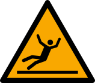
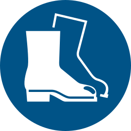

# 1.2 Semboller ve gösterim kuralları

## 1.2.1 Uyarı seviyeleri

Kılavuzdaki güvenlik uyarıları, tehlikenin ciddiyetine göre dört seviyede gösterilir. Uyarı kutusu, tehlikenin türünü, olası sonucunu ve tehlikeden korunmak için yapılması gerekeni belirtir. Uyarılar yalnızca ilgili oldukları adımdan önce verilir.

Tablo: Uyarı seviyeleri

| Sinyal kelimesi | Anlamı |
|---|---|
| **TEHLİKE** | Önlenmezse ölüme veya ağır yaralanmaya **kesinlikle** yol açacak tehlikeli durum. |
| **UYARI** | Önlenmezse ölüme veya ağır yaralanmaya yol açabilecek tehlikeli durum. |
| **DİKKAT** | Önlenmezse hafif veya orta derecede yaralanmaya yol açabilecek tehlikeli durum. |
| **NOT** | Kişisel yaralanma tehlikesi içermeyen; makine hasarını önlemeye veya doğru kullanıma yönelik bilgi. |

Uyarı kutusu örneği:

**UYARI — Sıcak yıkama sıvısı:** Kapak çevrim sırasında açılırsa sıcak sıvı sıçraması ve buhar yanıklara yol açabilir. Kapağı çevrim tamamlanıp pompa ve döndürme durmadan açmayın.

---

## 1.2.2 Güvenlik işaretleri

Makine üzerinde ve bu kılavuzda kullanılan güvenlik işaretleri EN ISO 7010 standardına uygundur. Makineyi çalıştırmadan, bakım veya temizlik yapmadan önce işaretlerin anlamını öğrenin.

Tablo: Güvenlik işaretleri

| İşaret | Tür | Anlamı | Yapılması gereken |
|:---:|:---:|---|---|
|  | Uyarı | Genel tehlike | İşaretin bulunduğu bölgede dikkatli çalışın; ilgili bölümdeki güvenlik talimatlarına uyun. |
| :W012: | Uyarı | Elektrik tehlikesi | Elektrik panosunu ve bağlantı kutularını yalnızca yetkili elektrik personeli, enerji kesilip kilitlendikten sonra açabilir. |
|  | Uyarı | Sıcak yüzey | Makinenin dış yüzeyleri çalışma sırasında {{GENEL_TEKNIK:Dış yüzey sıcaklığı — çalışma sırasında maks. (°C)}} °C'ye kadar ısınır; kabin, tank, ısıtıcı ve buhar tahliye kanalı daha sıcak olabilir. Bu yüzeylere ısıya dayanıklı eldiven olmadan dokunmayın. |
|  | Uyarı | Aşındırıcı (korozif) madde | Kimyasalla çalışırken göz ve el koruyucu kullanın; cilde ve göze temas ettirmeyin. |
|  | Uyarı | El ezilmesi / sıkışma | Kapak, sepet ve taşıma arabası hareket ederken elinizi hareket alanına sokmayın; sepeti çekip iterken elinizi sepet tekerlekleri ile tekerleklerin kaydığı profil arasına koymayın. |
|  | Uyarı | Kaygan zemin | Makine çevresindeki sıvıyı hemen temizleyin; kaymaz tabanlı iş ayakkabısı giyin. |
|  | Yasak | Açık alev ve yanıcı madde yasaktır | Makinede ve çevresinde yanıcı solvent, açık alev ve kıvılcım kaynağı kullanmayın. |
|  | Zorunluluk | Kullanım kılavuzunu okuyun | Makineyi çalıştırmadan ve bakım yapmadan önce kılavuzu okuyun. |
|  | Zorunluluk | Koruyucu iş elbisesi giyin | Kolları kapalı iş elbisesi veya sıvı geçirmez önlük kullanın. |
|  | Zorunluluk | İş ayakkabısı giyin | Çelik burunlu ve kaymaz tabanlı iş ayakkabısı giyin. |
|  | Zorunluluk | Koruyucu eldiven giyin | Yapılan işe göre ısıya, kesilmeye veya kimyasala dayanıklı eldiven kullanın. |
|  | Zorunluluk | Göz koruyucu kullanın | Sıçrama ve kimyasal riskine karşı kapalı tip gözlük veya yüz siperi kullanın. |
|  | Zorunluluk | Solunum koruyucu kullanın | Kimyasal buhar veya sis oluşan işlerde kimyasal güvenlik bilgi formunda belirtilen filtreli maskeyi kullanın. |
|  | Zorunluluk | Baret takın | E modellerde (elle açılan kapak) kapağı açarken ve kapatırken baret takın. |

Makine üzerindeki etiketlerin konumları **Bölüm 2.2.4**'te verilmiştir.

**NOT:** Yıpranan, okunmaz hale gelen veya sökülen etiketleri hemen yenisiyle değiştirin. Yeni etiketleri üreticiden temin edin (**Bkz. Bölüm 1.3**).

---

## 1.2.3 Gösterim kuralları

Kılavuzda aşağıdaki gösterim kuralları kullanılır:

- **İşlem adımları:** Sırayla uygulanması gereken işlemler numaralı adımlarla verilir. Her adımda tek bir işlem yapılır. Bir adımın alt işlemleri harfle (a, b, c) gösterilir.
- **Çapraz referanslar:** Başka bir bölüme yapılan atıflar "**Bkz. Bölüm X.Y**" biçiminde verilir.
- **Varyant bilgisi:** Yalnızca belirli bir varyantta geçerli bilgiler model kodundaki kısaltmayla başlar (ör. "MULTI modellerde", "P modellerde", "DS modellerde"). Kısaltmaların anlamı için **Bkz. Bölüm 3.1.2**.
- **Şekil konum numaraları:** Şekiller üzerindeki numaralar, şekli izleyen tablodaki parça veya eleman numaralarıdır.
- **Birimler:** Tüm değerler SI birim sisteminde verilir. Ondalık ayırıcı olarak virgül kullanılır (ör. 2,2 kW).
- **Kumanda elemanları:** Kumanda panelindeki buton, şalter ve göstergelerin adları metinde kalın yazılır (ör. **Ana şalter**).
