# 3.1 Makine tanımı

## 3.1.1 Genel tanım

KBN 1B, önden yüklemeli kabin tipi bir parça yıkama makinesidir. Makine; yıkama kabini, kabinin önündeki kapak, kabin içindeki yıkama sepeti ve püskürtme boruları, kabinin altındaki yıkama tankı, sağ yandaki elektrik panosu ve tavandaki buhar tahliye fanından oluşur.

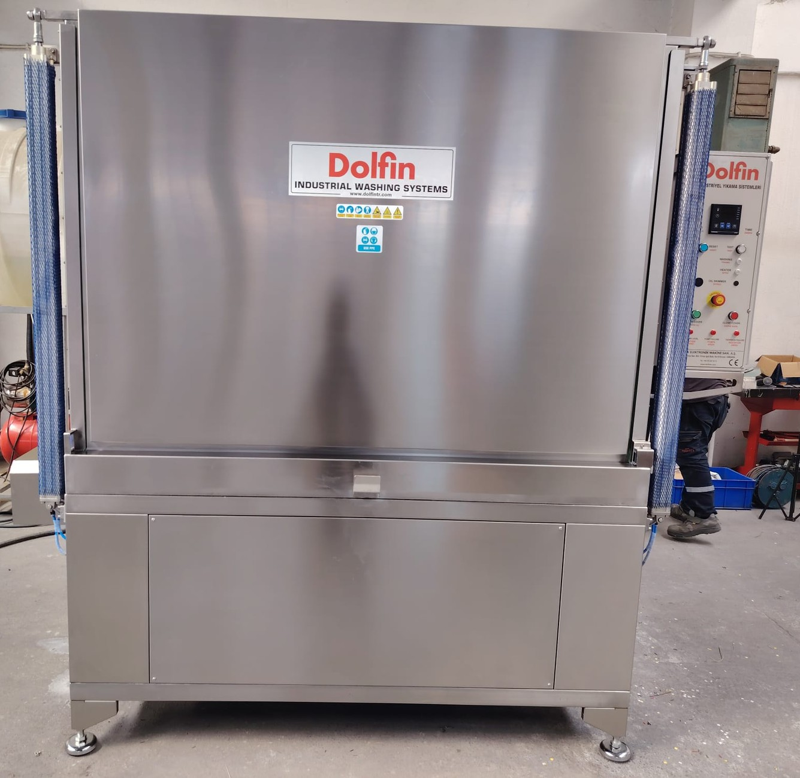

- **Yükleme:** Kapak açıldığında kabinin ön yüzü tamamen açılır. Sepet, P modellerde taşıma arabasına, E modellerde indirilen kapağın üzerindeki yükleme yoluna çekilir; parçalar sepete makinenin dışında yüklenir ve yüklü sepet kabine itilir (**Bkz. Bölüm 7.4.2**).
- **Kapak:** P modellerde kapak, iki yanındaki pnömatik silindirlerle yukarı kaldırılarak açılır ve aşağı indirilerek kapatılır. E modellerde kapak elle aşağı indirilerek açılır ve kaldırılarak kapatılır; indirilen kapağın üzerindeki yükleme yolu, sepetin dışarı çekildiği yükleme bölümünü oluşturur. E kapağının hareketi gazlı amortisörlerle dengelenir; amortisörler 3 ayda bir kontrol edilir, 2 yılda bir değiştirilir (**Bkz. Bölüm 9.1.7**) ve kapak açılırken ve kapatılırken baret takmak zorunludur (**Bkz. Bölüm 2.2.6**).
- **Yıkama:** Yıkama pompası tanktaki sıvıyı emerek püskürtme borularına basar. DS modellerde sepet, kabin yan duvarından giren pinyon ile sepetin dişli çemberinden döndürülür. DN modellerde sepet sabittir, nozul kolları döner. P DN modellerde kabinin tavanındaki üst nozul kolu ve tabanındaki alt nozul kolu, ayrı birer redüktörlü motor tarafından zincir aktarmayla döndürülür. E DN modellerde {{GENEL_TEKNIK:Nozul kollarının dönüşü — E DN modeller}}.
- **Isıtma:** Yıkama sıvısı tanktaki elektrikli ısıtıcılarla ısıtılır; sıcaklık kumanda panelinden ayarlanır. Sıvının sıcaklığı standart olarak en fazla {{GENEL_TEKNIK:Yıkama sıvısı sıcaklığı — maks. (°C)}} °C'dir (**Bkz. Bölüm 3.3.1**).
- **Manuel yıkama (MULTI modeller):** MULTI modellerde otomatik yıkamaya ek olarak, yüksek basınçlı manuel yıkama pompası ve manuel yıkama tabancasıyla parçaların belirli bölgeleri elle yıkanabilir.

---

## 3.1.2 Model kodu ve varyantlar

Makinenin model kodu, makinenin donanımını tanımlar. Kod; makinenin serisini, tank sayısını, fonksiyon tipini, kapak tipini, püskürtme tipini ve gövde büyüklüğünü gösterir. Makinenizin model kodu tip etiketinde yazılıdır (**Bkz. Bölüm 3.1.5**). Makinenizin donanımını belirlemek için tip etiketindeki kodun her alanını aşağıdaki şekil ve tabloyla karşılaştırın. Bu kılavuzdaki model bazlı talimatlar ("P modeller", "MULTI modeller", "DS modeller" gibi) bu alanlara göre verilmiştir.

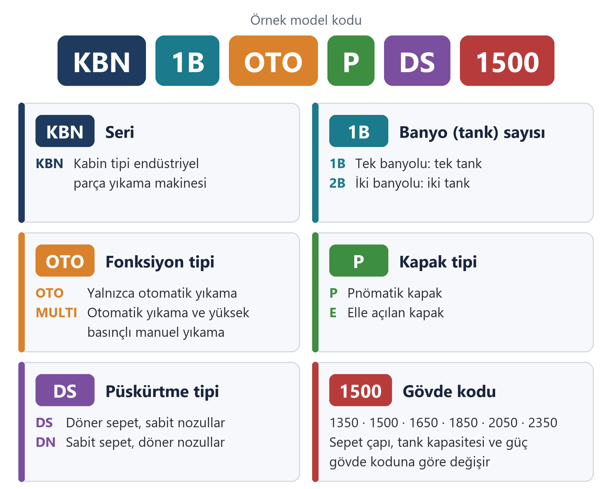

Örnek: **KBN 1B OTO P DS 1500** kodlu makine; kabin tipi (KBN), tek banyolu (1B), yalnızca otomatik yıkama yapan (OTO), pnömatik kapaklı (P), döner sepetli (DS) ve 1500 gövde kodlu bir parça yıkama makinesidir.

**NOT:** Tip etiketinde kod alanları farklı bir sırayla yazılmış olabilir (ör. KBN 1B P DS OTO 1350). Alanların anlamı yazılış sırasından bağımsızdır.

Tablo: Model kodunun yapısı

| Kod alanı | Değer | Anlamı |
|---|---|---|
| Seri | KBN | Kabin tipi yıkama makinesi |
| Banyo (tank) sayısı | 1B | Tek banyolu: tek tank, tek yıkama sıvısı |
| Fonksiyon tipi | OTO | Yalnızca otomatik yıkama |
| | MULTI | Otomatik yıkama ve yüksek basınçlı manuel yıkama |
| Kapak tipi | P | Pnömatik kapak |
| | E | Manuel (elle açılan) kapak |
| Püskürtme tipi | DS | Döner sepet: sepet döner, nozullar sabittir |
| | DN | Döner nozul: sepet sabittir, nozul sistemi döner |
| Gövde kodu | 1350 – 2350 | Makinenin gövde büyüklüğü; sepet çapı, tank kapasitesi ve güç değerleri gövde koduna göre değişir |

Üretilen model kombinasyonları aşağıdaki tabloda verilmiştir (✓ üretilir, – üretilmez).

{{TABLO:MODEL_VARYANTLARI}}

---

## 3.1.3 Ana bileşenler

Aşağıdaki şekillerde KBN 1B OTO P DS 1500 modeli kapak açık konumda gösterilmiştir. Diğer modellerde ölçüler ve bazı bileşenlerin konumu farklı olabilir.

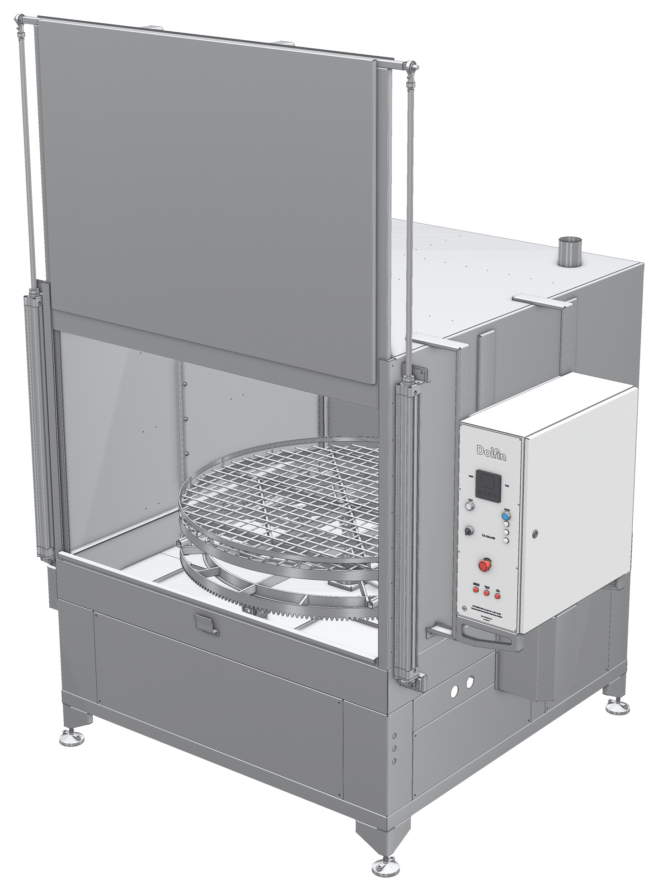

Makinenin sol ve arka tarafındaki bileşenler aşağıdaki şekilde gösterilmiştir.

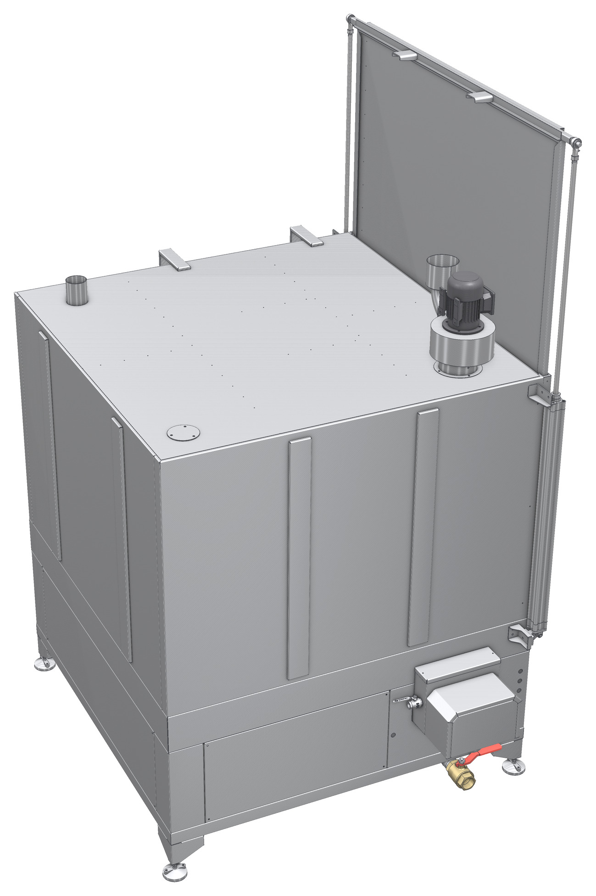

Kabin ve tankın iç yapısı, makine ortasından kesilmiş olarak aşağıdaki şekilde gösterilmiştir.

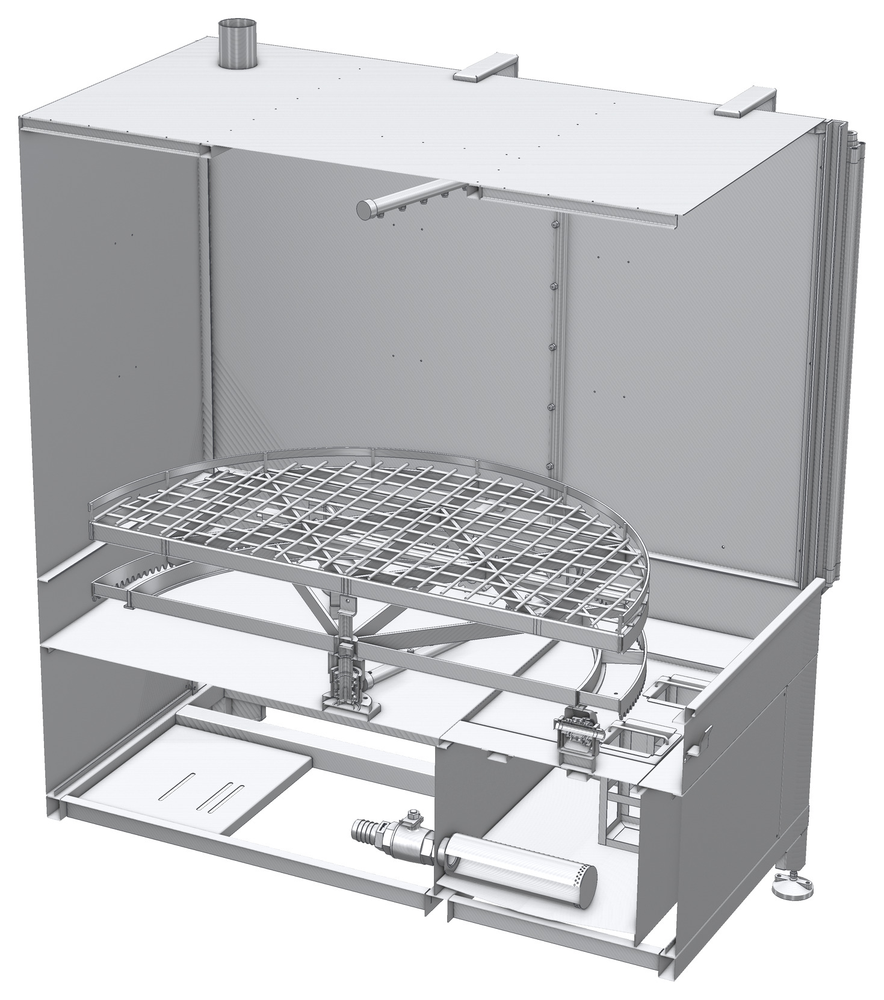

Tablo: Ana bileşenler

| No | Bileşen | İşlev |
|:---:|---|---|
| 1 | Ön kapak | Kabinin ön yüzünü kapatır; yukarı doğru açılarak yükleme açıklığını oluşturur. |
| 2 | Pnömatik kapak silindiri (P modeller) | Kapağı yukarı kaldırarak açar ve aşağı indirerek kapatır. Kapı açıklığının her iki yanında birer silindir bulunur; silindirler pnömatik bir valfle kumanda edilir. |
| 3 | Yıkama kabini | Yıkamanın yapıldığı kapalı hacim; sıçramayı ve buharı içeride tutar. |
| 4 | Yıkama sepeti | Parçaların yerleştirildiği ızgaralı tabla. DS modellerde döner, DN modellerde sabittir. P DS modellerde üst sepet ve alt sepetten oluşur; ayrıntılar bu bölümün sonundaki kilitleme düzeni tablosundadır. |
| 5 | Kumanda paneli | Sıcaklık ve süre ayarı, kapak açma / kapama butonları (P modeller), ikaz lambaları ve acil durdurma butonu (**Bkz. Bölüm 3.4**). |
| 6 | Elektrik panosu | Güç ve kumanda devrelerini içerir. Yalnızca yetkili elektrik personeli açar. |
| 7 | Döndürme tahriki | Redüktörlü motor ve muhafazası; pinyon ile sepeti döndürür. |
| 8 | Tank bölümü | Kabinin ön alt kısmındaki tankı kapatan ön panel. |
| 9 | Ayarlanabilir ayak | Makinenin zemine terazili oturmasını sağlar. |
| 10 | Buhar tahliye fanı | Kabindeki buharı emer. |
| 11 | Buhar tahliye çıkışı | Buhar tahliye kanalının bağlandığı çıkış ağzı. |
| 12 | Yağ sıyırıcı (bulunan makinelerde) | Tanktaki sıvının yüzeyinde toplanan yağı ayırır. |
| 13 | Tank tahliye vanası | Tankı boşaltmak için kullanılır. |
| 14 | Üst püskürtme kolu | Parçaları üstten yıkayan nozulları taşır. |
| 15 | Yan püskürtme borusu | Parçaları yandan yıkayan nozulları taşır; kabinin her iki yan duvarında bulunur. |
| 16 | Sepet dişli çemberi | Döndürme tahrikinin pinyonuyla kavrayarak sepeti döndürür (DS modeller). |
| 17 | Sepet merkez yatağı | Sepetin dönme eksenini oluşturur. |
| 18 | Süzgeç sepetleri | Kabinden tanka dönen sıvıdaki talaş ve kaba kirleri tutar. |
| 19 | Pompa emiş süzgeci | Pompanın tanktan emdiği sıvıyı süzer. |
| 20 | Tank | Yıkama sıvısını depolar; ısıtıcılar ve seviye şalteri tanktadır. |

Şekillerde gösterilmeyen diğer bileşenler:

- **Alt püskürtme kolları:** Sepetin altında, parçaları alttan yıkayan nozulları taşır.
- **Isıtıcılar:** Tankın içindeki elektrikli ısıtıcılar.
- **Seviye şalteri ve sıcaklık sensörü:** Tanktaki sıvı seviyesini (şamandıralı seviye şalteri) ve sıvının sıcaklığını algılar.
- **Taşıma arabası (P modeller):** Sepetin ve parçaların makineye yüklenmesi ve makineden alınması için kullanılan tekerlekli araba. Kullanım sırasında kilitleme koluyla makineye kilitlenir. Makineye demonte olarak gönderilir (**Bkz. Bölüm 5.1.4**).
- **Yükleme yolu (E modeller):** İndirilen kapağın üzerindeki yol; sepet bu yol üzerinde dışarı çekilir ve parçalar sepete burada yüklenir (**Bkz. Bölüm 7.4.2**).
- **Kapak güvenlik pimi (E modeller):** Kapak indirildiğinde yuvasına oturarak kapağı açık konumda kilitleyen, siyah başlı yaylı pim. Pim yuvasına oturmadan sepet çekilmez; kapak, pim çekilerek kapatılır (**Bkz. Bölüm 3.4.4** ve **7.4.2**).
- **Manuel yıkama pompası ve tabancası (MULTI modeller):** Yüksek basınçlı manuel yıkama donanımı (**Bkz. Bölüm 3.4.5**).

**Sepet ve taşıma arabası kilitleme düzeni (P DS modeller)**

P DS modellerde yıkama sepeti iki parçadan oluşur: parçaların yerleştirildiği üst sepet ve kabin içinde kalan, dişli çemberli alt sepet. Üst sepet, ön kenarındaki sepet pimiyle kabin içinde alt sepete kilitlenir ve alt sepetle birlikte döner. Yükleme ve boşaltma için üst sepet taşıma arabasına çekilir ve aynı pimle arabaya kilitlenir. Taşıma arabası da kilitleme koluyla makineye kilitlenir. Sepet pimi yaylıdır: halkasından yukarı çekildiğinde yuvasından çıkar; halka bırakıldığında pim, yuvasının üzerine geldiği anda yay etkisiyle kendiliğinden yuvasına oturur. Çevrim bittiğinde alt sepet, üst sepetin arabaya çekilebileceği konumda kendiliğinden durur; operatörün sepeti hizalaması gerekmez. Kullanım adımları için **Bkz. Bölüm 7.4.2**.

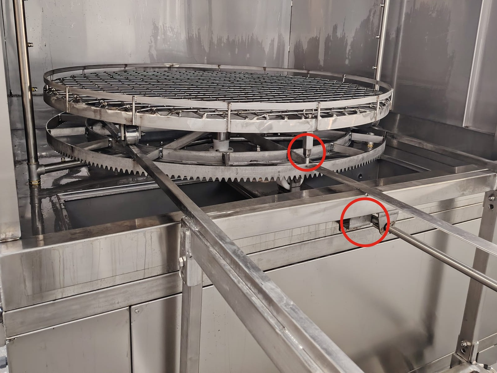

Tablo: Sepet ve taşıma arabası kilitleme elemanları (P DS modeller)

| İşaret | Eleman | İşlev |
|:---:|---|---|
| A | Üst sepet | Parçaların yerleştirildiği ızgaralı sepet. Yükleme ve boşaltma için taşıma arabasına çekilir. |
| B | Alt sepet | Kabin içinde kalan, dişli çemberli taşıyıcı. DS modellerde döndürme tahrikiyle döner. |
| C | Pim halkası | Yaylı sepet pimini çalıştırır: yukarı çekilince pim yuvasından çıkar; bırakıldığında pim, yuvasının üzerine geldiğinde kendiliğinden oturur (**Bkz. Bölüm 7.4.2**). |
| D | Sepet pimi ve pim yuvası | Üst sepeti kabin içinde alt sepetteki yuvaya, kabin dışında taşıma arabasındaki yuvaya kilitler. |
| E | Taşıma arabası rayları | Araba makineye yanaştırıldığında kabin içine, alt sepetin üzerine uzanır; üst sepet bu raylar üzerinde arabaya çekilir ve kabine itilir. |
| F | Kilitleme kancası ve kilit braketi | Arabanın makineye bakan ucundaki kanca, kilitleme kolu çevrildiğinde makinenin ön yüzündeki kilit braketine geçerek arabayı makineye kilitler. |
| G | Kilitleme kolu | Arabanın makineden uzak ucundaki siyah topuzlu kol; kilitleme kancasını çalıştırır (**Bkz. Bölüm 7.4.2**). |

**Sepet kilitleme düzeni, sepet yerinde sensörü ve nozul tahriki (P DN modeller)**

P DN modellerde yıkama sepeti, tekerlekleriyle kabin içindeki profiller üzerinde hareket eden tek parçalı ızgaralı sepettir; yıkama sırasında sepet sabit kalır, nozul kolları döner. Sepetin ön kenarının altına uzanan sepet pimi, kabin içinde kabin ön rayındaki delikli plakaya, kabin dışında taşıma arabasındaki pim yuvasına girerek sepeti kilitler. Pim, sepetin üst kenarındaki başından yukarı çekilerek yuvasından çıkarılır. Taşıma arabası, P DS modellerdeki gibi kilitleme koluyla makineye kilitlenir. Kullanım adımları için **Bkz. Bölüm 7.4.2**.

**Sepet yerinde sensörü:** Kabinin sağ yan duvarındaki sepet yerinde sensörü, sepetin kabin içinde yuvasına tam oturduğunu algılar. Sensör sepeti algılamazsa kapak açılmaz ve kapanmaz (**Bkz. Bölüm 3.4.4**).

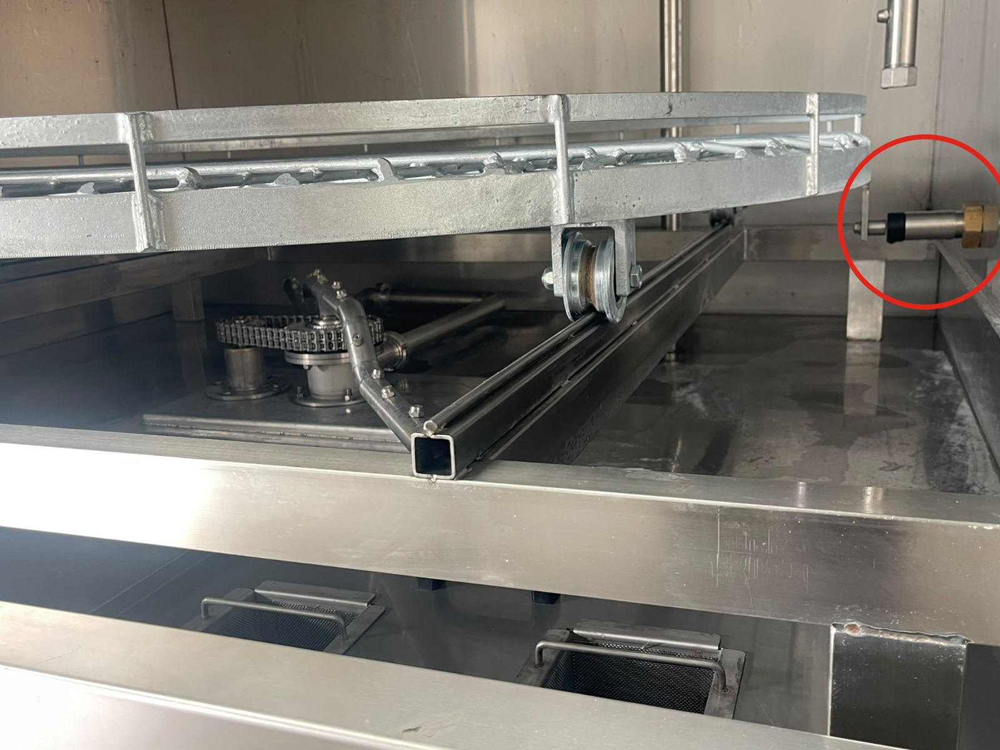

**Nozul tahriki:** Üst nozul kolu, makinenin tavanındaki redüktörlü motorla; alt nozul kolu, kabin tabanının altındaki redüktörlü motorla döndürülür. Hareket, her iki kolda da zincir ve zincir dişlileriyle aktarılır. Redüktörlü motorlar: {{GENEL_TEKNIK:Nozul döndürme redüktörlü motorları — P DN modeller}}. Bakımı için **Bkz. Bölüm 9.1.6**.

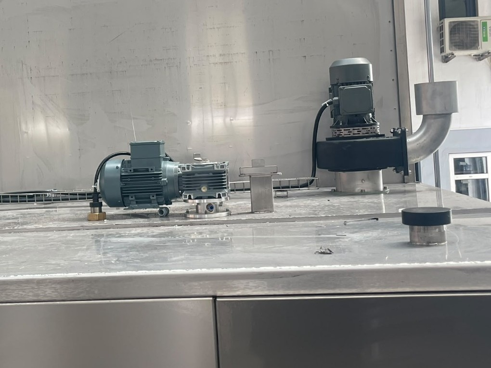

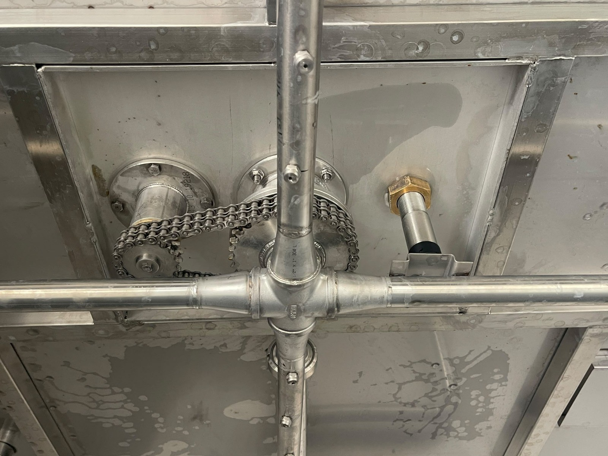

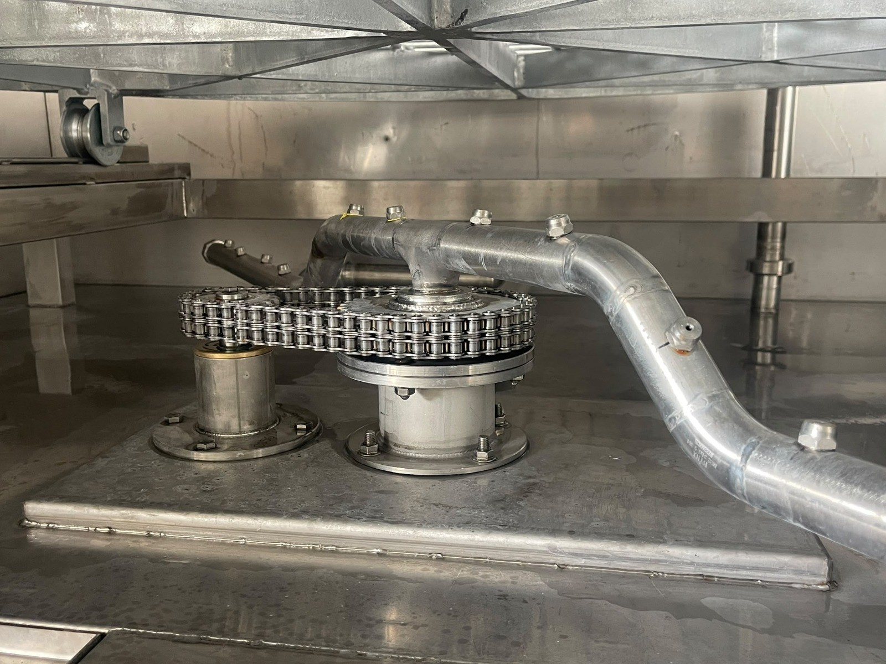

**Nozul kolları (E DN modeller)**

E DN modellerde {{GENEL_TEKNIK:Nozul kollarının dönüşü — E DN modeller}}. Nozul kolları yalnızca yıkama pompası çalışırken döner; kapak açıldığında pompa durur ve nozul kolları da durur. Nozullar tıkanırsa veya nozul kolunun döner bağlantısı kirlenirse nozul kolları yavaşlar veya durur (**Bkz. Bölüm 9.1.6**).

---

## 3.1.4 Çalışma prensibi ve yıkama çevrimi

Bir yıkama çevrimi aşağıdaki aşamalardan oluşur:

1. **Isıtma:** Tanktaki yıkama sıvısı ısıtıcılarla, kumanda panelinde ayarlanan sıcaklığa ısıtılır. Sıvı seviyesi seviye şalterinin altındaysa **SU SEVİYESİ YETERSİZ** ikaz lambası yanar ve makinenin hiçbir işlevi çalışmaz.
2. **Yükleme:** Kapak açılır ve parçalar yıkama sepetine yerleştirilir (**Bkz. Bölüm 7.4**). P modellerde parçaların dönerken bir yere çarpıp çarpmadığı, kapak açıkken **TEST** butonu basılı tutularak kontrol edilir.
3. **Başlatma:** Kapak kapatılır ve yıkama süresi ayarlanarak çevrim başlatılır. Kapak emniyet şalteri, kapak kapanmadan çevrimin başlamasını engeller.
4. **Yıkama:** Yıkama pompası sıvıyı pompa emiş süzgecinden emer ve {{GENEL_TEKNIK:Otomatik yıkama püskürtme basıncı (bar)}} bar basınçla üst, yan ve alt püskürtme borularındaki nozullardan parçalara püskürtür. DS modellerde sepet, DN modellerde nozul sistemi döner.
5. **Sıvının geri dönüşü:** Parçalardan akan sıvı kabin tabanından süzgeç sepetlerinden geçerek tanka döner. Talaş ve kaba kirler süzgeç sepetlerinde tutulur.
6. **Buhar tahliyesi:** Buhar tahliye fanı, kabinde oluşan buharı tavandaki buhar tahliye çıkışından binanın egzoz hattına atar.
7. **Çevrimin bitişi:** Ayarlanan süre dolduğunda yıkama pompası ve döndürme durur. Buhar tahliye fanı, çevrim bittikten sonra {{KONTROLLER:Buhar tahliye fanı çalışma süresi — fabrika ayarı (s)}} saniye (fabrika ayarı) daha çalışarak kabindeki buharı tahliye eder.
8. **Boşaltma:** Buhar tahliye fanı durduktan sonra kapak açılır ve parçalar boşaltılır (**Bkz. Bölüm 7.4.4**).

Yağ sıyırıcısı bulunan makinelerde yağ sıyırıcı, sıvının yüzeyinde toplanan yağı çevrimden bağımsız olarak ayırır; böylece yıkama sıvısının ömrü uzar.

MULTI modellerde otomatik yıkamadan önce veya sonra, parçaların zor ulaşılan bölgeleri manuel yıkama tabancasıyla yıkanabilir (**Bkz. Bölüm 7.4.5**).

---

## 3.1.5 Tip etiketi

Tip etiketi makinenin kimlik bilgilerini taşır. Etiketi sökmeyin ve üzerini kapatmayın. Tip etiketinin konumu: {{PROJE:Tip etiketi konumu}}.

Tip etiketinde aşağıdaki bilgiler bulunur:

- Üretici adı ve adresi
- Makine adı ve model kodu
- Seri numarası
- Üretim yılı
- Besleme gerilimi, frekansı ve toplam güç
- CE işareti

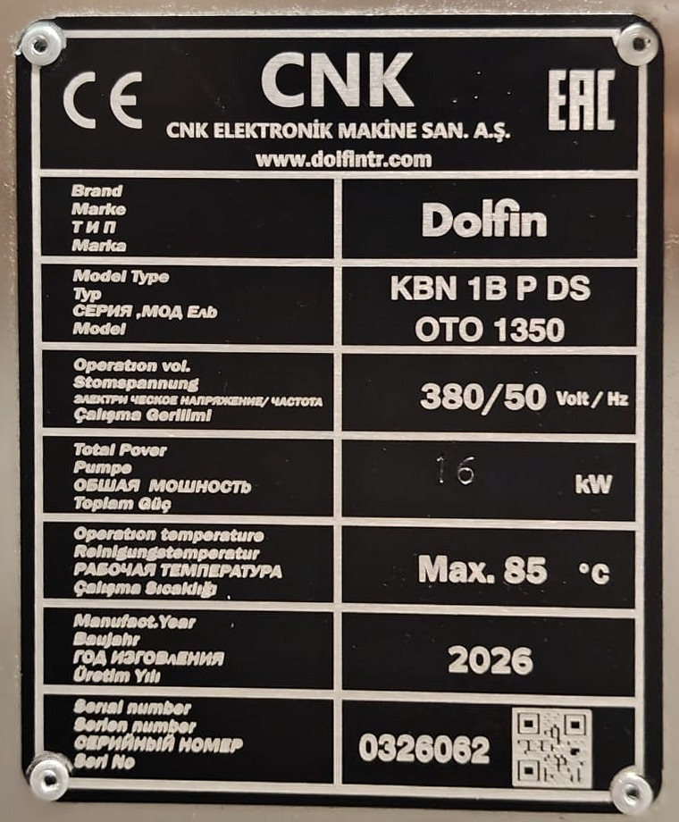

---

## 3.1.6 Opsiyonel donanımlar

Makine, siparişe göre aşağıdaki opsiyonel donanımlarla donatılabilir. Makinenizde bulunan opsiyonlar sipariş belgelerinde ve elektrik devre şemasında belirtilmiştir (**Bkz. Bölüm 13.1**). Opsiyonlara ait talimatlar ilgili bölümlerde opsiyon adıyla işaretlenmiştir; makinenizde bulunmayan bir opsiyona ait talimatları dikkate almayın.

Tablo: Opsiyonel donanımlar

| Opsiyon | İşlevi | Model | Ayrıntı |
|---|---|---|---|
| Hassas filtre (filtre torbalı) | Pompa çıkışında, süzgeç sepetlerinden geçen ince kirleri filtre torbasında tutar. | Tümü | **Bkz. Bölüm 9.1.13** |
| Yağ sıyırıcı | Sıvı yüzeyinde toplanan yağı ayırır ve yağ toplama kabına aktarır. | Tümü | **Bkz. Bölüm 7.6.2** |
| Zamanlayıcılı yağ sıyırıcı | Yağ sıyırıcıyı zamanlayıcıda programlanan saatlerde çalıştırır. | Yağ sıyırıcılı makineler | **Bkz. Bölüm 6.6.4** |
| Otomatik dolum | Makineye enerji verildiğinde tankı üst seviyeye kadar kendiliğinden doldurur. | Tümü | **Bkz. Bölüm 7.6.5** |
| Otomatik drenaj | Tankı, drenaj butonuyla çalıştırılan drenaj pompasıyla boşaltır. | Tümü | **Bkz. Bölüm 7.6.5** |
| Zamanlayıcılı ısıtıcı | Isıtmayı zamanlayıcıda programlanan gün ve saatlerde başlatır ve durdurur. | Tümü | **Bkz. Bölüm 6.6.4** |
| Işık perdesi | Kapı açıklığında kişi veya cisim algıladığında kapağın kapanmasını engeller. | P | **Bkz. Bölüm 5.4.6** |

**Hassas filtre (filtre torbalı):** Süzgeç sepetleri ve pompa emiş süzgeci talaşı ve kaba kirleri tutar; bunlardan geçen ince kir parçacıkları ise yıkama sıvısıyla birlikte dolaşmaya devam eder, nozulları tıkar ve parçalarda kir bırakır. Hassas filtre, pompanın bastığı yıkama sıvısını {{OPSIYONLAR:Hassas filtre — filtre torbası gözenek boyutu (µm)}} µm gözenekli bir filtre torbasından geçirerek bu ince kirleri tutar ve yıkama sıvısının ömrünü uzatır. Filtre torbası kirlendikçe sıvının geçişi zorlaşır ve püskürtme zayıflar; bu nedenle torba düzenli olarak temizlenir ve gerektiğinde değiştirilir (**Bkz. Bölüm 9.1.13**). Filtre gövdesinin konumu: {{OPSIYONLAR:Hassas filtre — filtre gövdesi konumu}}.

**Yağ sıyırıcı:** Parçalardan ayrılan yağ, sıvının yüzeyinde toplanır; yüzeydeki yağ alınmazsa parçalara yeniden bulaşır ve sıvının ömrünü kısaltır. Yağ sıyırıcı makinenin sol tarafındadır; yüzeydeki yağı alarak yağ toplama kabına aktarır ve kumanda panelindeki yağ sıyırıcı butonuyla (E modellerde anahtarıyla) çalıştırılır; sağındaki lamba yağ sıyırıcının çalıştığını gösterir (**Bkz. Bölüm 3.4.1**). Yağ sıyırıcının tipi: {{OPSIYONLAR:Yağ sıyırıcı — tipi}}.

**Zamanlayıcılı yağ sıyırıcı:** Yağ sıyırıcıyı zamanlayıcıda programlanan saatlerde kendiliğinden çalıştırır ve durdurur. Yağ, sıvı sakinken yüzeyde daha iyi toplanır; bu nedenle sıyırma, yıkama pompasının çalışmadığı zamanlarda daha etkilidir.

**Otomatik dolum:** Otomatik dolum opsiyonunda tanka bir üst seviye algılayıcısı eklenir. Makineye enerji verildiğinde tank, dolum vanası açılarak üst seviyeye kadar şebeke suyuyla doldurulur; üst seviyeye ulaşıldığında dolum kesilir. Dolum vanası: {{OPSIYONLAR:Otomatik dolum — dolum vanası}}. Otomatik dolum tanka yalnızca su ekler; eksilen kimyasalı operatör tamamlar (**Bkz. Bölüm 7.6.5**). Seviye algılama: {{OPSIYONLAR:Otomatik dolum — seviye algılama}}.

**Otomatik drenaj:** Drenaj butonuna basıldığında drenaj pompası çalışır ve tanktaki sıvıyı tahliye hattına basar. Tank alt seviyeye kadar boşaldığında pompa, kalan sıvıyı da boşaltmak için elektrik panosundaki zaman rölesinde ayarlanan süre kadar daha çalışır ve durur. Sıvı değişiminde tahliye vanasının elle açılması gerekmez. Tahliye düzeni: {{OPSIYONLAR:Otomatik drenaj — tahliye düzeni}}. Zaman rölesinin ayarını yalnızca yetkili elektrik personeli değiştirir.

**Zamanlayıcılı ısıtıcı:** Isıtmayı zamanlayıcıda programlanan gün ve saatlerde kendiliğinden başlatır ve durdurur. Zamanlayıcı: {{OPSIYONLAR:Zamanlayıcı — marka / model}}. Isıtma vardiyadan önce başlatıldığında sıvı, vardiya başında ayar sıcaklığına ulaşmış olur ve ısınma için beklenmez. Sıvının sıcaklığı yine kumanda panelinde ayarlanan sıcaklığa göre kontrol edilir (**Bkz. Bölüm 6.6.1**). Zamanlayıcının çalışabilmesi için ana şalter "I" konumunda kalmalıdır (**Bkz. Bölüm 7.3.1**).

**Işık perdesi (P modeller):** P modellerde kapak pnömatik silindirlerle kapanır; kapı açıklığındaki el, kol veya baş kapak ile gövde arasında sıkışabilir. Işık perdesi, kapı açıklığının iki yanındaki verici ve alıcıdan oluşur ve açıklığı görünmez ışınlarla izler. Işınlardan biri kesildiğinde kapağın kapanmasını engelleyerek sıkışmayı önler. Kapak kapanırken perde kesildiğinde kapağın davranışı: {{OPSIYONLAR:Işık perdesi — perde kesildiğinde kapağın davranışı}}. Işık perdesi: {{OPSIYONLAR:Işık perdesi — marka / model}}. Işık perdesi, {{OPSIYONLAR:Işık perdesi — güvenlik kontrolörü}} ile birlikte çalışır. Işık perdesi bir güvenlik donanımıdır; devre dışı bırakılması yasaktır (**Bkz. Bölüm 2.3.7**). Işık perdesi opsiyonu bulunmayan P modellerde kapı açıklığında standart olarak bir el koruma sensörü bulunur (**Bkz. Bölüm 2.2.3**).

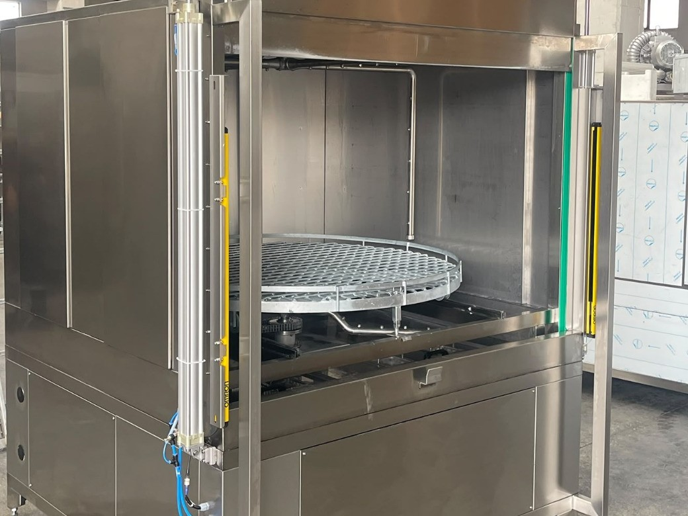
