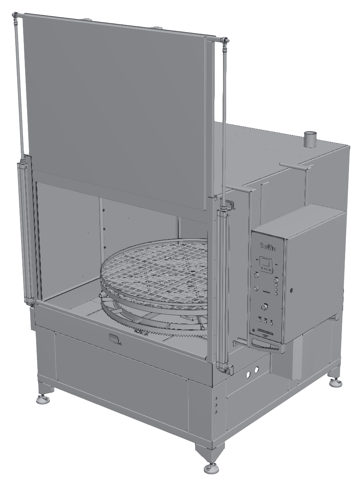
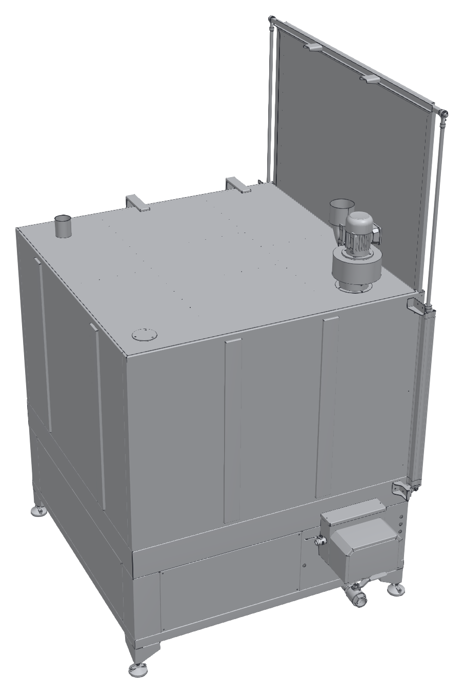
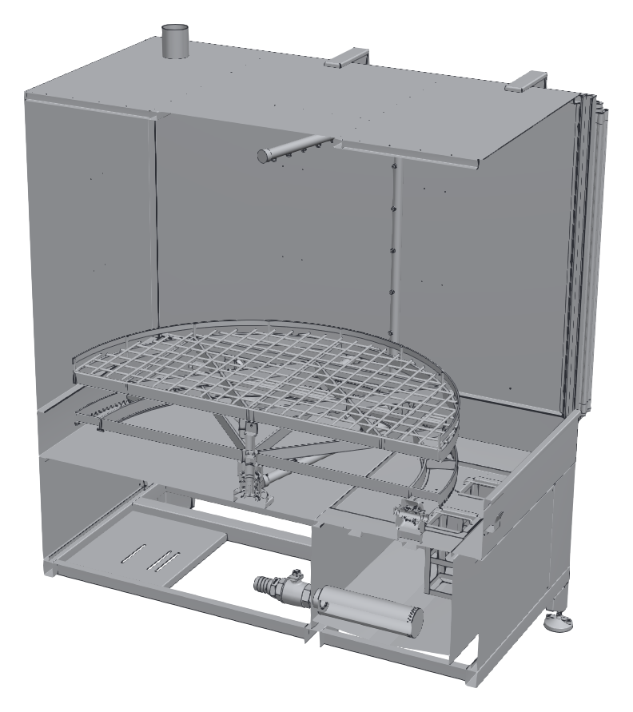

# 3.1 Makine tanımı

## 3.1.1 Genel tanım

KBN 1B, önden yüklemeli kabin tipi bir parça yıkama makinesidir. Makine; yıkama kabini, kabinin önündeki dikey açılan kapak, kabin içindeki yıkama sepeti ve püskürtme boruları, kabinin altındaki yıkama tankı, sağ yandaki elektrik panosu ve tavandaki buhar tahliye fanından oluşur.

- **Yükleme:** Kapak yukarı açıldığında kabinin ön yüzü tamamen açılır. Parçalar yıkama sepetine bu açıklıktan yüklenir. Ağır parçalar ve yüklü sepet, standart donanım olan taşıma arabası ile makineye getirilir ve makineden alınır.
- **Kapak:** P modellerde kapak, kapı açıklığının iki yanındaki pnömatik silindirlerle açılıp kapatılır. E modellerde kapak elle açılıp kapatılır.
- **Yıkama:** Yıkama pompası tanktaki sıvıyı emerek püskürtme borularına basar. DS modellerde sepet, kabin yan duvarından giren pinyon ile sepetin dişli çemberinden döndürülür. DN modellerde sepet sabittir, nozul sistemi döner.
- **Isıtma:** Yıkama sıvısı tanktaki elektrikli ısıtıcılarla ısıtılır; sıcaklık kumanda panelindeki dijital kontrol cihazından ayarlanır.
- **Manuel yıkama (MULTI modeller):** MULTI modellerde otomatik yıkamaya ek olarak, yüksek basınçlı manuel yıkama pompası ve manuel yıkama tabancasıyla parçaların belirli bölgeleri elle yıkanabilir.

---

## 3.1.2 Model kodu ve varyantlar

Makinenin model kodu, makinenin donanımını tanımlar. Model kodu tip etiketinde yazılıdır (**Bkz. Bölüm 3.1.5**).

Örnek model kodu: **KBN 1B OTO P DS 1500**

Tablo: Model kodunun yapısı

| Kod alanı | Değer | Anlamı |
|---|---|---|
| Seri | KBN | Kabin tipi yıkama makinesi |
| Banyo (tank) sayısı | 1B | Tek banyolu: tek tank, tek yıkama sıvısı |
| Fonksiyon tipi | OTO | Yalnızca otomatik yıkama |
| | MULTI | Otomatik yıkama ve yüksek basınçlı manuel yıkama |
| Kapak tipi | P | Pnömatik kapak |
| | E | Manuel (elle açılan) kapak |
| Püskürtme tipi | DS | Döner sepet: sepet döner, nozullar sabittir |
| | DN | Döner nozul: sepet sabittir, nozul sistemi döner |
| Gövde kodu | 1350 – 2350 | Makinenin gövde büyüklüğü; sepet çapı, tank kapasitesi ve güç değerleri gövde koduna göre değişir |

Üretilen model kombinasyonları aşağıdaki tabloda verilmiştir (✓ üretilir, – üretilmez).

{{TABLO:MODEL_VARYANTLARI}}

---

## 3.1.3 Ana bileşenler

Aşağıdaki şekillerde KBN 1B OTO P DS 1500 modeli kapak açık konumda gösterilmiştir. Diğer modellerde ölçüler ve bazı bileşenlerin konumu farklı olabilir.

Tablo: Ana bileşenler

| No | Bileşen | İşlev |
|:---:|---|---|
| 1 | Ön kapak | Kabinin ön yüzünü kapatır; yukarı doğru açılarak yükleme açıklığını oluşturur. |
| 2 | Pnömatik kapak silindiri (P modeller) | Kapağı açar ve kapatır. Kapı açıklığının her iki yanında birer silindir bulunur. |
| 3 | Yıkama kabini | Yıkamanın yapıldığı kapalı hacim; sıçramayı ve buharı içeride tutar. |
| 4 | Yıkama sepeti | Parçaların yerleştirildiği ızgaralı tabla. DS modellerde döner, DN modellerde sabittir. |
| 5 | Kumanda paneli | Sıcaklık ve süre ayarı, ikaz lambaları ve acil durdurma butonu (**Bkz. Bölüm 3.4**). |
| 6 | Elektrik panosu | Güç ve kumanda devrelerini içerir. Yalnızca yetkili elektrik personeli açar. |
| 7 | Döndürme tahriki | Redüktörlü motor ve muhafazası; pinyon ile sepeti döndürür. |
| 8 | Tank bölümü | Kabinin ön alt kısmındaki tankı kapatan ön panel. |
| 9 | Ayarlanabilir ayak | Makinenin zemine terazili oturmasını sağlar. |
| 10 | Buhar tahliye fanı | Kabindeki buharı emer. |
| 11 | Buhar tahliye çıkışı | Buhar tahliye kanalının bağlandığı çıkış ağzı. |
| 12 | Yağ sıyırıcı (bulunan makinelerde) | Tanktaki sıvının yüzeyinde toplanan yağı ayırır. |
| 13 | Tank tahliye vanası | Tankı boşaltmak için kullanılır. |
| 14 | Üst püskürtme kolu | Parçaları üstten yıkayan nozulları taşır. |
| 15 | Yan püskürtme borusu | Parçaları yandan yıkayan nozulları taşır; kabinin her iki yan duvarında bulunur. |
| 16 | Sepet dişli çemberi | Döndürme tahrikinin pinyonuyla kavrayarak sepeti döndürür (DS modeller). |
| 17 | Sepet merkez yatağı | Sepetin dönme eksenini oluşturur. |
| 18 | Süzgeç sepetleri | Kabinden tanka dönen sıvıdaki talaş ve kaba kirleri tutar. |
| 19 | Pompa emiş süzgeci | Pompanın tanktan emdiği sıvıyı süzer. |
| 20 | Tank | Yıkama sıvısını depolar; ısıtıcılar ve seviye şalteri tanktadır. |

Şekillerde gösterilmeyen diğer bileşenler:

- **Alt püskürtme kolları:** Sepetin altında, parçaları alttan yıkayan nozulları taşır.
- **Isıtıcılar:** Tankın içindeki elektrikli ısıtıcılar.
- **Seviye şalteri ve sıcaklık sensörü:** Tanktaki sıvı seviyesini ve sıcaklığını algılar.
- **Taşıma arabası:** Sepetin ve parçaların makineye yüklenmesi ve makineden alınması için kullanılan tekerlekli araba.
- **Manuel yıkama pompası ve tabancası (MULTI modeller):** Yüksek basınçlı manuel yıkama donanımı (**Bkz. Bölüm 3.4.5**).

---

## 3.1.4 Çalışma prensibi ve yıkama çevrimi

Bir yıkama çevrimi aşağıdaki aşamalardan oluşur:

1. **Isıtma:** Tanktaki yıkama sıvısı ısıtıcılarla, dijital kontrol cihazında ayarlanan sıcaklığa ısıtılır. Sıvı seviyesi seviye şalterinin altındaysa ısıtıcı çalışmaz ve **INADEQUATE WATER LEVEL** ikaz lambası yanar.
2. **Yükleme:** Kapak açılır ve parçalar yıkama sepetine yerleştirilir (**Bkz. Bölüm 7.4**).
3. **Başlatma:** Kapak kapatılır ve yıkama süresi ayarlanarak çevrim başlatılır. Kapak emniyet şalteri, kapak kapanmadan çevrimin başlamasını engeller.
4. **Yıkama:** Yıkama pompası sıvıyı pompa emiş süzgecinden emer ve {{GENEL_TEKNIK:Otomatik yıkama püskürtme basıncı (bar)}} bar basınçla üst, yan ve alt püskürtme borularındaki nozullardan parçalara püskürtür. DS modellerde sepet, DN modellerde nozul sistemi döner.
5. **Sıvının geri dönüşü:** Parçalardan akan sıvı kabin tabanından süzgeç sepetlerinden geçerek tanka döner. Talaş ve kaba kirler süzgeç sepetlerinde tutulur.
6. **Buhar tahliyesi:** Buhar tahliye fanı, kabinde oluşan buharı tavandaki buhar tahliye çıkışından binanın egzoz hattına atar.
7. **Çevrimin bitişi:** Ayarlanan süre dolduğunda yıkama pompası ve döndürme durur.
8. **Boşaltma:** Kabindeki buharın tahliyesi beklendikten sonra kapak açılır ve parçalar boşaltılır.

Yağ sıyırıcısı bulunan makinelerde yağ sıyırıcı, sıvının yüzeyinde toplanan yağı çevrimden bağımsız olarak ayırır; böylece yıkama sıvısının ömrü uzar.

MULTI modellerde otomatik yıkamadan önce veya sonra, parçaların zor ulaşılan bölgeleri manuel yıkama tabancasıyla yıkanabilir (**Bkz. Bölüm 7.4.5**).

---

## 3.1.5 Tip etiketi

Tip etiketi makinenin kimlik bilgilerini taşır. Etiketi sökmeyin ve üzerini kapatmayın. Tip etiketinin konumu: {{PROJE:Tip etiketi konumu}}.

Tip etiketinde aşağıdaki bilgiler bulunur:

- Üretici adı ve adresi
- Makine adı ve model kodu
- Seri numarası
- Üretim yılı
- Besleme gerilimi, frekansı ve toplam güç
- CE işareti

