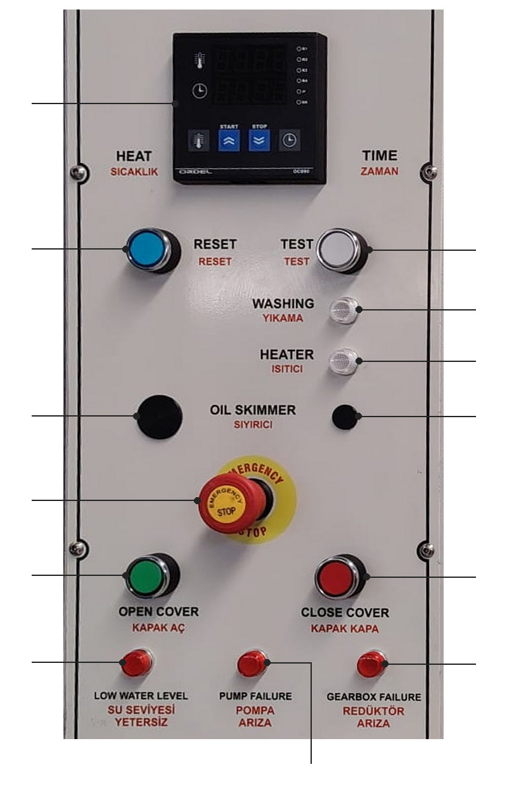
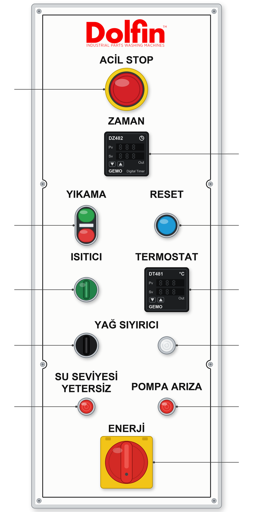
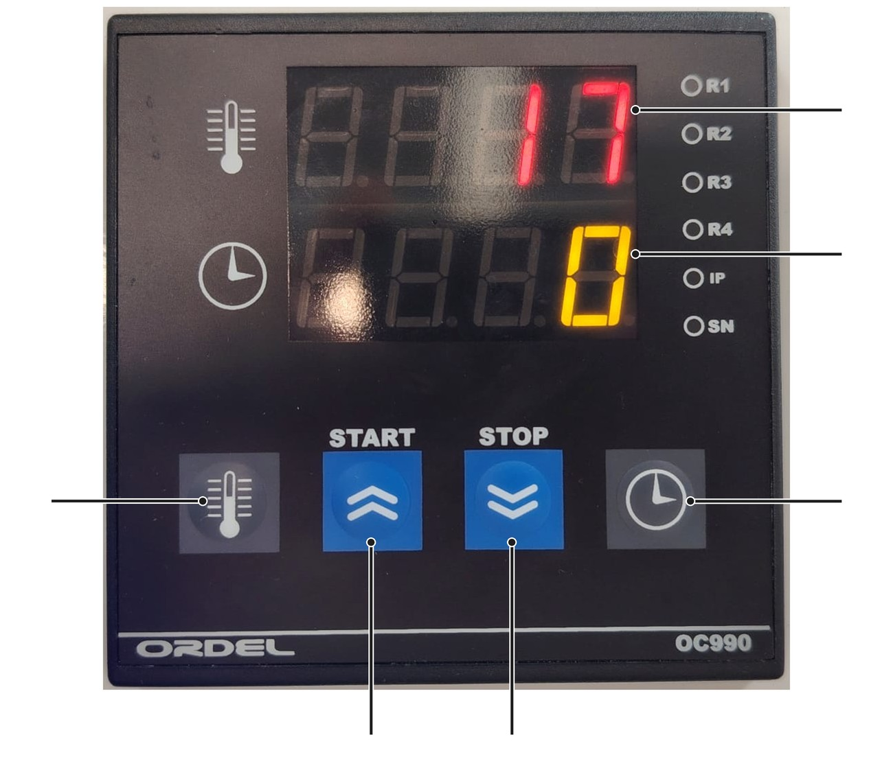

# 3.4 Kumanda elemanları

## 3.4.1 Kumanda paneli

Makine analog kumandalıdır. Sıcaklık ve yıkama süresi P modellerde tek bir dijital kontrol cihazında, E modellerde ayrı bir dijital termostatta ve dijital zaman rölesinde gösterilir ve ayarlanır. Kumanda paneli {{KONTROLLER:Kumanda paneli konumu}} üzerindedir. Metinde panel etiketlerinin Türkçe yazımı kullanılır.

**P modeller: standart KBN kumanda paneli**

Aşağıdaki şekil ve tablo, P modellerdeki dijital kontrol cihazlı standart KBN kumanda panelini gösterir. Panel etiketleri İngilizce ve Türkçedir; tabloda her iki yazım da verilmiştir.

Tablo: Kumanda paneli elemanları — P modeller

| No | Panel etiketi | Eleman | İşlev |
|:---:|---|---|---|
| 1 | HEAT / SICAKLIK — TIME / ZAMAN | Dijital kontrol cihazı | Tanktaki sıvının sıcaklığını ve yıkama süresini gösterir; sıcaklık ve yıkama süresi bu cihazdan ayarlanır. Yıkama çevrimi cihazın START ve STOP tuşlarıyla başlatılır ve durdurulur (**Bkz. Bölüm 3.4.2**). |
| 2 | RESET | Reset butonu (mavi) | Makineye enerji verildikten, acil durdurma butonu serbest bırakıldıktan veya seviye şalteri kumanda devresini kestikten sonra kumanda devresini yeniden devreye alır; arıza giderildikten sonra arıza ikazını sıfırlar (**Bkz. Bölüm 3.4.3**). |
| 3 | TEST | Buton (beyaz) | {{KONTROLLER:TEST butonu işlevi}} |
| 4 | WASHING / YIKAMA | Sinyal lambası | Yıkama çevrimi sırasında yanar. |
| 5 | HEATER / ISITICI | Sinyal lambası | Isıtıcılar çalışırken yanar. |
| 6 | OIL SKIMMER / SIYIRICI | Yağ sıyırıcı butonu (solda) ve yağ sıyırıcı lambası (sağda) | Buton yağ sıyırıcıyı çalıştırır ve durdurur; lamba yağ sıyırıcının çalıştığını gösterir. Yağ sıyırıcısı bulunmayan makinelerde bu iki yuva kapalıdır. |
| 7 | EMERGENCY STOP | Acil durdurma butonu | Makinenin hareketli ve ısıtıcı devrelerinin enerjisini keser (**Bkz. Bölüm 2.3.2**). |
| 8 | OPEN COVER / KAPAK AÇ | Kapak açma butonu (yeşil) | Pnömatik valf kapak silindirlerini açar; kapak yukarı kalkar (**Bkz. Bölüm 3.4.4**). |
| 9 | CLOSE COVER / KAPAK KAPA | Kapak kapama butonu (kırmızı) | Valfin diğer tarafı çalışır ve kapak silindirleri kapanır; kapak aşağı iner (**Bkz. Bölüm 3.4.4**). |
| 10 | LOW WATER LEVEL / SU SEVİYESİ YETERSİZ | İkaz lambası — yetersiz su seviyesi | Tanktaki sıvı seviyesi seviye şalterinin altına indiğinde yanar; makinenin hiçbir işlevi çalışmaz (**Bkz. Bölüm 3.4.3**). |
| 11 | PUMP FAILURE / POMPA ARIZA | İkaz lambası — pompa arızası | Yıkama pompası motorunun koruma şalteri attığında yanar. |
| 12 | GEARBOX FAILURE / REDÜKTÖR ARIZA | İkaz lambası — redüktör arızası | Döndürme redüktörlü motorunun (DN modellerde nozul döndürme redüktörlü motorlarından birinin) koruma şalteri attığında yanar. |

**E modeller: kumanda paneli**

E modellerin kumanda panelinde sıcaklık dijital termostattan, yıkama süresi dijital zaman rölesinden ayarlanır; yıkama çevrimi **YIKAMA** butonuyla başlatılır ve durdurulur. Ana şalter (**ENERJİ**) panelin alt kısmındadır. E modellerde **TEST** butonu, kapak butonları ve **REDÜKTÖR ARIZA** lambası yoktur.

Tablo: Kumanda paneli elemanları — E modeller

| No | Panel etiketi | Eleman | İşlev |
|:---:|---|---|---|
| 1 | ACİL STOP | Acil durdurma butonu | Makinenin hareketli ve ısıtıcı devrelerinin enerjisini keser (**Bkz. Bölüm 2.3.2**). |
| 2 | ZAMAN | Dijital zaman rölesi ({{KONTROLLER:Dijital zaman rölesi (ZAMAN) marka / model — E modeller}}) | Yıkama süresini gösterir; yıkama süresi bu cihazdan ok tuşlarıyla, dakika cinsinden ve ondalıklı olarak ayarlanır (0,1 dakika = 6 saniye). Süre dolduğunda yıkama çevrimi durur (**Bkz. Bölüm 6.6.2**). |
| 3 | YIKAMA | Çift buton: yeşil (üstte), kırmızı (altta) ve ortada lamba | Yeşil buton yıkama çevrimini başlatır; kırmızı buton çevrimi süre dolmadan durdurur. Ortadaki lamba yıkama çalışırken yanar (**Bkz. Bölüm 7.4**). |
| 4 | RESET | Reset butonu (mavi) | Makineye enerji verildikten, acil durdurma butonu serbest bırakıldıktan veya seviye şalteri kumanda devresini kestikten sonra kumanda devresini yeniden devreye alır; arıza giderildikten sonra arıza ikazını sıfırlar (**Bkz. Bölüm 3.4.3**). |
| 5 | ISITICI | Isıtma anahtarı (yeşil, ışıklı) | Isıtmayı devreye alır ve devreden çıkarır. Anahtar açıkken ısıtıcılar, sıvı termostatta ayarlanan sıcaklığa ulaşana kadar çalışır; ısıtıcılar çalışırken anahtarın ışığı yanar. |
| 6 | TERMOSTAT | Dijital termostat ({{KONTROLLER:Dijital termostat (TERMOSTAT) marka / model — E modeller}}) | Tanktaki sıvının sıcaklığını gösterir; ayar sıcaklığı bu cihazdan ok tuşlarıyla ayarlanır (**Bkz. Bölüm 6.6.1**). |
| 7 | YAĞ SIYIRICI | Yağ sıyırıcı anahtarı (solda) ve yağ sıyırıcı lambası (sağda) | Anahtar yağ sıyırıcıyı çalıştırır ve durdurur; lamba yağ sıyırıcının çalıştığını gösterir. Yağ sıyırıcısı bulunmayan makinelerde bu elemanlar yoktur. |
| 8 | SU SEVİYESİ YETERSİZ | İkaz lambası — yetersiz su seviyesi | Tanktaki sıvı seviyesi seviye şalterinin altına indiğinde yanar; makinenin hiçbir işlevi çalışmaz (**Bkz. Bölüm 3.4.3**). |
| 9 | POMPA ARIZA | İkaz lambası — pompa arızası | Yıkama pompası motorunun koruma şalteri attığında yanar. |
| 10 | ENERJİ | Ana şalter | Makinenin tüm elektrik beslemesini açar ve keser; "0" konumunda kilitlenir (**Bkz. Bölüm 2.3.3**). |

Diğer kumanda elemanları:

Tablo: Diğer kumanda elemanları

| Eleman | Konum | İşlev |
|---|---|---|
| **Ana şalter** | {{KONTROLLER:Ana şalter konumu}} | Makinenin tüm elektrik beslemesini açar ve keser; "0" konumunda kilitlenir (**Bkz. Bölüm 2.3.3**). |
| Çevrim başlatma | {{KONTROLLER:Yıkama çevrimini başlatma kumandası}} | Yıkama çevrimini başlatır (**Bkz. Bölüm 7.4**). |
| Çevrim durdurma | {{KONTROLLER:Yıkama çevrimini durdurma kumandası}} | Yıkama çevrimini süre dolmadan durdurur (**Bkz. Bölüm 7.3.2**). |
| Manuel yıkama kumandası (MULTI modeller) | {{KONTROLLER:Manuel yıkama kumandası — MULTI modeller}} | Manuel yıkama pompasını çalıştırır ve durdurur (**Bkz. Bölüm 3.4.5**). |

---

## 3.4.2 Dijital kontrol cihazı (P modeller)

P modellerdeki standart KBN kumanda panelinde {{KONTROLLER:Dijital kontrol cihazı (HEAT / TIME) marka / model}} dijital kontrol cihazı bulunur. Cihaz, yıkama sıvısının sıcaklığını ve yıkama süresini kontrol eder; yıkama çevrimi de bu cihazın START ve STOP tuşlarıyla başlatılır ve durdurulur.

Tablo: Dijital kontrol cihazının elemanları

| No | Eleman | İşlev |
|:---:|---|---|
| 1 | Üst gösterge (kırmızı, termometre simgeli) | Tanktaki sıvının ölçülen sıcaklığını (°C) gösterir. |
| 2 | Alt gösterge (sarı, saat simgeli) | Yıkama süresini (dakika) gösterir. |
| 3 | Sıcaklık tuşu (termometre simgeli) | Sıcaklık ayar ekranını açar (**Bkz. Bölüm 6.6.1**). |
| 4 | START tuşu (yukarı ok) | Ana ekranda yıkama çevrimini başlatır; ayar ekranlarında değeri artırır. |
| 5 | STOP tuşu (aşağı ok) | Ana ekranda yıkama çevrimini durdurur; ayar ekranlarında değeri azaltır. |
| 6 | Zaman tuşu (saat simgeli) | Yıkama süresi ayar ekranını açar (**Bkz. Bölüm 6.6.2**). |

- **Sıcaklık:** Ayar sıcaklığı {{KONTROLLER:Sıcaklık ayar aralığı — ORDEL OC990 (°C)}} °C aralığında ayarlanır. Müşterinin özel isteğiyle üst sınırı yükseltilmiş makinelerde üst sınır en fazla {{GENEL_TEKNIK:Yıkama sıvısı sıcaklığı — özel istekle maks. (°C)}} °C'dir (**Bkz. Bölüm 3.3.1**). Ayar sıcaklığı tanktaki sıvının sıcaklığından yüksekse ısıtıcılar çalışır; düşükse ısıtıcılar çalışmaz.
- **Süre:** Yıkama süresi dakika cinsinden, {{GENEL_TEKNIK:Yıkama süresi ayar aralığı (dk)}} dakika aralığında ayarlanır. Süre dolduğunda yıkama pompası ve döndürme durur.
- **Başlatma ve durdurma:** Sıvı ayar sıcaklığına ulaştığında yıkama çevrimi START tuşuyla başlatılır. Çevrimi süre dolmadan durdurmak için STOP tuşuna basılır.
- **Ana ekrana dönüş:** {{KONTROLLER:Dijital kontrol cihazı — ayar ekranından ana ekrana dönüş}}. START ve STOP tuşları yalnızca ana ekranda çevrimi başlatır ve durdurur; ayar ekranı açıkken ayar değerini değiştirir.

Cihaz ayrıca buhar tahliye fanının çalışma süresini belirleyen parametreyi içerir (**Bkz. Bölüm 6.6.5**). Cihazın diğer parametreleri fabrikada ayarlanmıştır; bunları değiştirmeyin. Ayar adımları için **Bkz. Bölüm 6.6**. Cihazın tüm tuş işlevleri ve menü yapısı, cihazın kendi kullanım kılavuzunda verilmiştir (**Bkz. Bölüm 13.1**).

---

## 3.4.3 İkaz lambaları ve arıza sıfırlama

Kumanda panelinin alt kısmındaki ikaz lambaları (P modellerde üç, E modellerde iki) makineyi durduran arızaları gösterir:

- **SU SEVİYESİ YETERSİZ:** Tanktaki sıvı seviyesi, tankın içindeki şamandıralı seviye şalterinin altına inmiştir. Seviye şalteri kumanda devresini keser; ısıtıcı ve yıkama pompası dahil makinenin hiçbir işlevi çalışmaz. Tankı doldurun (**Bkz. Bölüm 7.2.2**) ve **RESET** butonuna basın.
- **POMPA ARIZA:** Yıkama pompası motorunun koruma şalteri atmıştır (**Bkz. Bölüm 11.3**).
- **REDÜKTÖR ARIZA (P modeller):** Döndürme redüktörlü motorunun koruma şalteri atmıştır; DN modellerde bu ikaz üst veya alt nozul kolunu döndüren redüktörlü motorlardan birine aittir. Sepetin veya nozul kollarının dönüşünü engelleyen bir sıkışma olup olmadığını kontrol edin (**Bkz. Bölüm 11.4**).

Makineye enerji verildikten (ana şalter "I" konumuna getirildikten) ve acil durdurma butonu serbest bırakıldıktan sonra da kumanda devresi kapalıdır; makine **RESET** butonuna basılana kadar çalışmaz.

Arızanın nedeni giderildikten sonra arıza ikazını **RESET** butonuyla sıfırlayın. Motor koruma şalterleri elektrik panosunun içindedir; atan bir koruma şalterini yalnızca elektrik personeli kurar.

**NOT:** Arıza nedenini gidermeden ikazı sürekli sıfırlayarak makineyi çalıştırmayın. Tekrarlanan motor koruma atmaları motorun veya tahrikin hasar gördüğünü gösterir.

---

## 3.4.4 Kapak kumandası

**P modeller:** Kapağın iki yanında birer pnömatik silindir bulunur; silindirler pnömatik bir valfle kumanda edilir. Kumanda panelindeki **KAPAK AÇ** butonuna basıldığında valf silindirleri açar ve kapak yukarı kalkarak açılır. **KAPAK KAPA** butonuna basıldığında valfin diğer tarafı çalışır, silindirler kapanır ve kapak aşağı inerek kapanır. Kapağın çalışması için basınçlı hava bağlantısının yapılmış ve hava basıncının **Bölüm 6.5**'teki değerde olması gerekir. Kapağın kapanma hızı, silindirlerin yanındaki kısma valfleriyle fabrikada ayarlanmıştır; bu ayarı değiştirmeyin (**Bkz. Bölüm 6.5.2**).

**P DN modellerde sepet yerinde sensörü:** Kabinin sağ yan duvarındaki sepet yerinde sensörü, sepetin kabin içinde yuvasına tam oturduğunu algılar. Sensör sepeti algılamazsa kapak açılmaz ve kapanmaz; **KAPAK AÇ** ve **KAPAK KAPA** butonları çalışmaz. Sepet yerinde değilken kapağı açmaya veya kapatmaya çalışmayın; sepeti kabine sonuna kadar itin ve sepet piminin yuvasına oturduğunu kontrol edin (**Bkz. Bölüm 7.4.2**).

**E modeller:** Kapak elle aşağı indirilerek açılır ve yukarı kaldırılarak kapatılır; kapağın hareketi gazlı amortisörlerle dengelenir. İndirilen kapağın üzerindeki yükleme yolu, sepetin dışarı çekildiği yükleme bölümünü oluşturur. Kapağı açmadan önce baret takın; kapağı tutamağından tutarak yavaşça indirin. İndirilen kapak, yanındaki kapak güvenlik pimiyle bu konumda kilitlenir. Kapağı indirdiğinizde kapak güvenlik piminin yuvasına oturduğunu kontrol edin; pim yuvasına oturmadan sepeti çekmeyin (**Bkz. Bölüm 7.4.2**). Kapağı kapatmak için sepeti kabine ittikten sonra kapak güvenlik pimini siyah başından çekin ve kapağı tutamağından tutup ileri iterek kaldırın. Kapak hareket ederken kapağı serbest bırakmayın. Baret zorunluluğu için **Bkz. Bölüm 2.2.6**, amortisörlerin kontrol ve değişim periyotları için **Bkz. Bölüm 9.1.7**.

**UYARI — Kapanan kapak:** Kapak kapanırken el, kol veya baş kapak ile gövde arasında sıkışabilir. P modellerde basınçlı hava kesildiğinde açık kapak kendi ağırlığıyla aşağı inebilir. Kapak kapanırken kapağın altına uzanmayın, kapağın altına girmeyin ve kapak hareket ederken elinizi kapak kenarına koymayın.

Her iki kapak tipinde de kapak emniyet şalteri, kapak tam kapanmadan otomatik yıkamanın başlamasını engeller. Çevrim sırasında kapak açılırsa E modellerde yıkama pompası (E DS modellerde ayrıca sepet döndürme motoru), P modellerde yıkama pompası ve redüktörlü motorlar (sepetin veya nozul kollarının döndürülmesi) durur. E DN modellerde nozul kolları pompanın basıncıyla döndüğünden pompa durunca nozul kolları da durur. P modellerde kapak açıkken redüktörlü motorlar yalnızca **TEST** butonu basılı tutulduğu sürece çalışır (**Bkz. Bölüm 7.4.3**).

---

## 3.4.5 Manuel yıkama donanımı (MULTI modeller)

MULTI modellerde otomatik yıkama donanımına ek olarak aşağıdaki donanım bulunur:

- **Manuel yıkama pompası:** Tanktaki yıkama sıvısını en fazla {{TEKNIK_MULTI_P_DS:Manuel yıkama basıncı — maks. (bar)#1}} bar basınçla manuel yıkama tabancasına basar. Motor gücü model bazlı tablolarda verilmiştir (**Bkz. Bölüm 3.3.2**).
- **Yüksek basınç hortumu ve manuel yıkama tabancası:** Sıvı jetinin elle yönlendirilmesini sağlar. Tabancada, kullanılmadığında tetiği kilitleyen tetik emniyet kilidi bulunur.
- **Manuel yıkama kumandası:** Manuel yıkama pompasını çalıştırır ve durdurur.

Manuel yıkama yalnızca **Bölüm 2.3.6**'daki güvenlik kurallarına uyularak yapılır. Kullanım adımları için **Bkz. Bölüm 7.4.5**.

---

## 3.4.6 Opsiyonel donanımların kumandaları

Makinede bulunan opsiyonlara göre aşağıdaki kumanda elemanları bulunur (**Bkz. Bölüm 3.1.6**).

Tablo: Opsiyonel donanımların kumanda elemanları

| Opsiyon | Kumanda elemanı | İşlev |
|---|---|---|
| Yağ sıyırıcı | Kumanda panelindeki yağ sıyırıcı butonu (E modellerde anahtarı) ve lambası | Yağ sıyırıcıyı çalıştırır ve durdurur (**Bkz. Bölüm 7.6.2**). |
| Zamanlayıcılı ısıtıcı, zamanlayıcılı yağ sıyırıcı | Zamanlayıcı; konum: {{OPSIYONLAR:Zamanlayıcı — konum}} | Isıtmayı ve yağ sıyırıcıyı programlanan gün ve saatlerde çalıştırır (**Bkz. Bölüm 6.6.4**). |
| Otomatik dolum | — (otomatik çalışır) | {{OPSIYONLAR:Otomatik dolum — kumanda}} (**Bkz. Bölüm 7.6.5**). |
| Otomatik drenaj | {{OPSIYONLAR:Otomatik drenaj — tahliye kumandası}} | Drenaj pompasını çalıştırarak tankı boşaltır; pompa, tank alt seviyeye kadar boşaldıktan sonra zaman rölesinde ayarlanan süre kadar daha çalışıp durur (**Bkz. Bölüm 7.6.5**). |
| Işık perdesi (P modeller) | {{OPSIYONLAR:Işık perdesi — yeniden başlatma (reset)}} | Perde kesildikten sonra ışık perdesini yeniden devreye alır (**Bkz. Bölüm 7.6.5**). |
