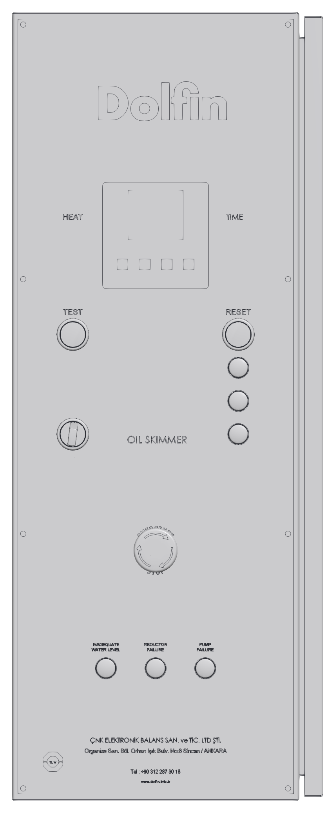

# 3.4 Kumanda elemanları

## 3.4.1 Kumanda paneli

Makine analog kumandalıdır; sıcaklık ve süre dijital bir kontrol cihazında gösterilir ve ayarlanır. Kumanda paneli {{KONTROLLER:Kumanda paneli konumu}} üzerindedir. Panel etiketleri İngilizcedir; bu kılavuzda etiketler panelde yazıldığı şekliyle ve Türkçe karşılıklarıyla verilmiştir.

Tablo: Kumanda paneli elemanları

| No | Panel etiketi | Eleman | İşlev |
|:---:|---|---|---|
| 1 | HEAT / TIME | Dijital kontrol cihazı | Tanktaki sıvının sıcaklığını gösterir; sıcaklık ve yıkama süresi bu cihazdan ayarlanır (**Bkz. Bölüm 3.4.2**). |
| 2 | TEST | Buton | {{KONTROLLER:TEST butonu işlevi}} |
| 3 | RESET | Arıza sıfırlama butonu | Arıza giderildikten sonra arıza ikazını sıfırlar (**Bkz. Bölüm 3.4.3**). |
| 4 | — | Sinyal lambaları (3 adet) | {{KONTROLLER:Kumanda paneli sinyal lambaları (3 adet) işlevleri}} |
| 5 | OIL SKIMMER | Yağ sıyırıcı seçici şalteri | Yağ sıyırıcıyı çalıştırır ve durdurur (yağ sıyırıcısı bulunan makinelerde). |
| 6 | EMERGENCY STOP | Acil durdurma butonu | Makinenin hareketli ve ısıtıcı devrelerinin enerjisini keser (**Bkz. Bölüm 2.3.2**). |
| 7 | INADEQUATE WATER LEVEL | İkaz lambası — yetersiz su seviyesi | Tanktaki sıvı seviyesi seviye şalterinin altına indiğinde yanar. |
| 8 | REDUCTOR FAILURE | İkaz lambası — redüktör arızası | Döndürme redüktörlü motorunun koruma şalteri attığında yanar. |
| 9 | PUMP FAILURE | İkaz lambası — pompa arızası | Yıkama pompası motorunun koruma şalteri attığında yanar. |

Panelde gösterilmeyen kumanda elemanları:

Tablo: Diğer kumanda elemanları

| Eleman | Konum | İşlev |
|---|---|---|
| **Ana şalter** | {{KONTROLLER:Ana şalter konumu}} | Makinenin tüm elektrik beslemesini açar ve keser; "0" konumunda kilitlenir (**Bkz. Bölüm 2.3.3**). |
| Kapak kumandası (P modeller) | {{KONTROLLER:Kapak açma / kapama kumandası — P modeller}} | Pnömatik kapağı açar ve kapatır (**Bkz. Bölüm 3.4.4**). |
| Çevrim başlatma | {{KONTROLLER:Yıkama çevrimini başlatma kumandası}} | Yıkama çevrimini başlatır (**Bkz. Bölüm 7.4**). |
| Manuel yıkama kumandası (MULTI modeller) | {{KONTROLLER:Manuel yıkama kumandası — MULTI modeller}} | Manuel yıkama pompasını çalıştırır ve durdurur (**Bkz. Bölüm 3.4.5**). |

---

## 3.4.2 Dijital kontrol cihazı (HEAT / TIME)

Dijital kontrol cihazı, ekranı ve altındaki dört tuşuyla yıkama sıvısının sıcaklığını ve yıkama süresini kontrol eder.

- **HEAT (sıcaklık):** Cihaz, tanktaki sıcaklık sensöründen ölçtüğü sıcaklığı gösterir ve sıvı ayar sıcaklığına ulaşana kadar ısıtıcıları çalıştırır. Ayar sıcaklığı en fazla {{GENEL_TEKNIK:Yıkama sıvısı sıcaklığı — maks. (°C)}} °C olabilir.
- **TIME (süre):** Yıkama süresi {{GENEL_TEKNIK:Yıkama süresi ayar aralığı (dk)}} dakika aralığında ayarlanır. Süre dolduğunda yıkama pompası ve döndürme durur.

Cihazın tuş işlevleri ve menü yapısı, cihazın kendi kullanım kılavuzunda verilmiştir (**Bkz. Bölüm 13.1**). Ayar adımları için **Bkz. Bölüm 6.6**. Cihaz: {{KONTROLLER:Dijital kontrol cihazı (HEAT / TIME) marka / model}}.

---

## 3.4.3 İkaz lambaları ve arıza sıfırlama

Kumanda panelinin alt kısmındaki üç ikaz lambası, makineyi durduran arızaları gösterir:

- **INADEQUATE WATER LEVEL:** Tanktaki sıvı seviyesi düşüktür. Seviye şalteri ısıtıcının çalışmasını engeller. Tankı doldurun (**Bkz. Bölüm 7.2**).
- **REDUCTOR FAILURE:** Döndürme redüktörlü motorunun koruma şalteri atmıştır. Sepetin veya nozul sisteminin dönüşünü engelleyen bir sıkışma olup olmadığını kontrol edin (**Bkz. Bölüm 11.4**).
- **PUMP FAILURE:** Yıkama pompası motorunun koruma şalteri atmıştır (**Bkz. Bölüm 11.3**).

Arızanın nedeni giderildikten sonra arıza ikazını **RESET** butonuyla sıfırlayın. Motor koruma şalterleri elektrik panosunun içindedir; atan bir koruma şalterini yalnızca elektrik personeli kurar.

**NOT:** Arıza nedenini gidermeden ikazı sürekli sıfırlayarak makineyi çalıştırmayın. Tekrarlanan motor koruma atmaları motorun veya tahrikin hasar gördüğünü gösterir.

---

## 3.4.4 Kapak kumandası

**P modeller:** Kapak, kapı açıklığının iki yanındaki iki pnömatik silindirle yukarı doğru açılır ve aşağı doğru kapanır. Kapağın çalışması için basınçlı hava bağlantısının yapılmış ve hava basıncının **Bölüm 6.5**'teki değerde olması gerekir.

**E modeller:** Kapak elle yukarı kaldırılarak açılır ve aşağı indirilerek kapatılır.

**UYARI — Kapanan kapak:** Kapak kapanırken el, kol veya baş kapak ile gövde arasında sıkışabilir. P modellerde basınçlı hava kesildiğinde açık kapak kendi ağırlığıyla aşağı inebilir. Kapağın altına girmeyin ve kapak hareket ederken elinizi kapak kenarına koymayın.

Her iki kapak tipinde de kapak emniyet şalteri, kapak tam kapanmadan otomatik yıkamanın başlamasını engeller; çevrim sırasında kapak açılırsa yıkama pompası ve döndürme durur.

---

## 3.4.5 Manuel yıkama donanımı (MULTI modeller)

MULTI modellerde otomatik yıkama donanımına ek olarak aşağıdaki donanım bulunur:

- **Manuel yıkama pompası:** Tanktaki yıkama sıvısını en fazla {{TEKNIK_MULTI_P_DS:Manuel yıkama basıncı — maks. (bar)#1}} bar basınçla manuel yıkama tabancasına basar. Motor gücü model bazlı tablolarda verilmiştir (**Bkz. Bölüm 3.3.2**).
- **Yüksek basınç hortumu ve manuel yıkama tabancası:** Sıvı jetinin elle yönlendirilmesini sağlar. Tabancada, kullanılmadığında tetiği kilitleyen tetik emniyet kilidi bulunur.
- **Manuel yıkama kumandası:** Manuel yıkama pompasını çalıştırır ve durdurur.

Manuel yıkama yalnızca **Bölüm 2.3.6**'daki güvenlik kurallarına uyularak yapılır. Kullanım adımları için **Bkz. Bölüm 7.4.5**.
