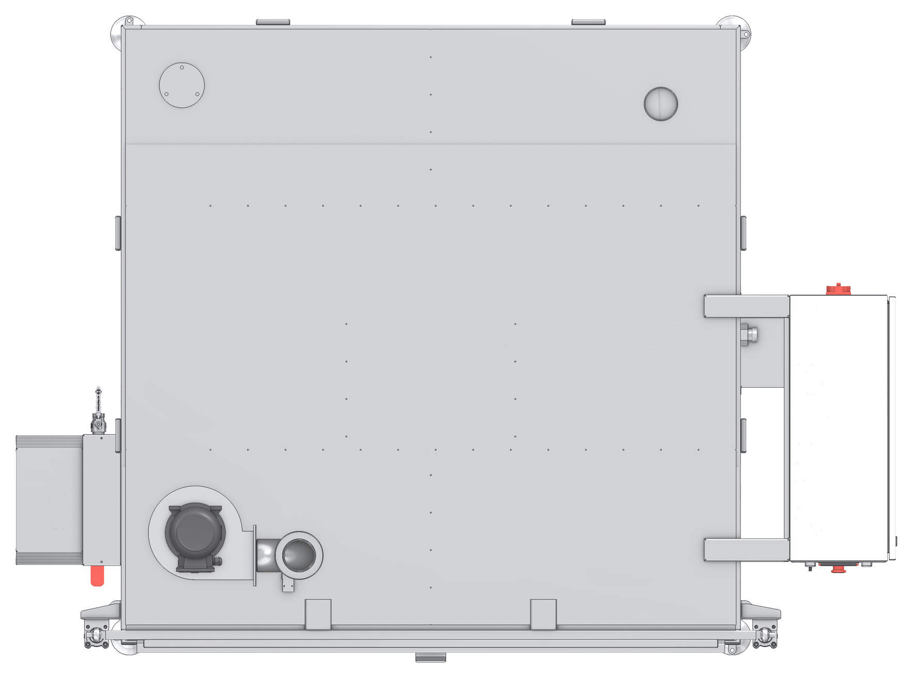

# 3.5 Makine yerleşimi

## 3.5.1 Makinenin tarafları ve çalışma alanları

Bu kılavuzda makinenin tarafları, kapağın bulunduğu ön yüze bakan operatöre göre tanımlanır.

Tablo: Makinenin tarafları

| No | Taraf / eleman | Açıklama |
|:---:|---|---|
| 1 | Ön taraf (kapak) | Yükleme ve boşaltma tarafı. Operatör bu tarafta çalışır. P modellerde taşıma arabası bu tarafa yanaştırılır; E modellerde kapak bu tarafa indirilir. |
| 2 | Kumanda paneli | Sağ yandaki elektrik panosunun ön yüzündedir; operatör kapağın önünden paneli görür ve kullanır. |
| 3 | Elektrik panosu (sağ taraf) | Elektrik bakımı bu taraftan yapılır. Pano kapağının önü boş bırakılmalıdır. |
| 4 | Buhar tahliye fanı ve çıkışı (tavan) | Buhar tahliye kanalı bu çıkışa bağlanır. |
| 5 | Yağ sıyırıcı ve tank tahliye vanası (sol taraf) | Tankın boşaltılması ve yağ sıyırıcının bakımı bu taraftan yapılır. |

Döndürme tahriki, sağ taraftaki elektrik panosunun altındadır.

---

## 3.5.2 Minimum boşluklar ve tavan yüksekliği

- Makinenin tüm taraflarında en az {{KURULUM:Makine çevresinde minimum boşluk (mm)}} mm boşluk bırakın. Bu boşluk bakım, temizlik ve acil durumda tahliye için bırakılır.
- Ön tarafta, P modellerde taşıma arabasının yanaşması ve sepetin arabaya alınması için arabanın boyu kadar; E modellerde indirilen kapak ve dışarı çekilen sepet için kapağın boyu kadar ek alan bırakın.
- Sağ tarafta elektrik panosu kapağının tam açılabileceği boşluk bırakın.
- P modellerde kapak, açılırken gövdenin üzerine yükselir. Kurulum yerinin tavan yüksekliği, kapak açıkken makinenin toplam yüksekliğinden ve buhar tahliye kanalının bağlantı yüksekliğinden büyük olmalıdır. KBN 1B 1500 gövdesi için kapak açıkken toplam yükseklik {{AGIRLIK:Kapak açıkken toplam yükseklik — P modeller (mm)#2}} mm'dir; diğer gövde kodları için **Bkz. Bölüm 3.3.3**.
- Minimum tavan yüksekliği: {{KURULUM:Minimum tavan yüksekliği (mm)}} mm.

---

## 3.5.3 Bağlantı noktaları

Tablo: Bağlantı noktaları

| Bağlantı | Konum | Ayrıntı |
|---|---|---|
| Elektrik beslemesi | Sağ taraf, elektrik panosu | **Bkz. Bölüm 5.3.1** |
| Buhar tahliye (egzoz) | Tavan, buhar tahliye fanının çıkışı | **Bkz. Bölüm 5.3.4** |
| Tank tahliyesi | Sol taraf, alt kısım, **DRENAJ** etiketli tank tahliye vanası. Bağlantı ölçüsü: {{TESISAT:Tank tahliye bağlantısı}} | **Bkz. Bölüm 5.3.2** |
| Su dolumu | Bağlantı ölçüsü: {{TESISAT:Su dolum bağlantısı}} | **Bkz. Bölüm 5.3.2** |
| Basınçlı hava (P modeller) | Sağ taraf, alt kısım, **AIR INLET / HAVA GİRİŞİ** etiketli şartlandırıcı. Bağlantı ölçüsü: {{TESISAT:Basınçlı hava bağlantısı — P modeller}} | **Bkz. Bölüm 5.3.3** |

Makinenin ön, yan ve üst görünüşleri için **Bkz. Bölüm 13.2**.
