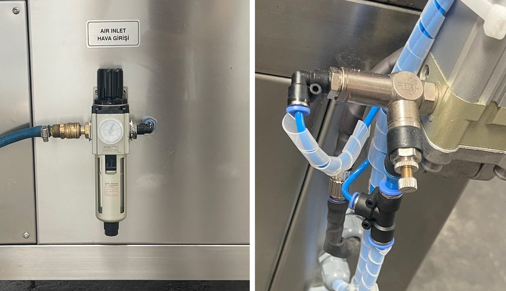

# 6.5 Pnömatik ayarlar (P modeller)

Bu alt bölüm yalnızca pnömatik kapaklı (P) modeller için geçerlidir. Çalışma basıncını bakım personeli ayarlar; kapak kısma valflerinin ayarı değiştirilmez (**Bkz. Bölüm 6.5.2**).

---

## 6.5.1 Çalışma basıncı

Kapak silindirlerini besleyen basınçlı hava, makinenin sağ yanındaki **AIR INLET / HAVA GİRİŞİ** etiketli hava girişinde bulunan şartlandırıcıdan (filtre ve regülatör) geçer. Çalışma basıncı, makineyle birlikte verilen pnömatik şemada belirtilmiştir (**Bkz. Bölüm 13.1**).

1. Basınçlı hava giriş vanasının açık olduğunu kontrol edin.
2. Regülatörün ayar düğmesini yukarı çekerek kilidini açın.
3. Düğmeyi saat yönünde çevirerek basıncı artırın, saat yönünün tersine çevirerek azaltın. Basıncı manometrede okuyarak çalışma basıncına ayarlayın.
4. Düğmeyi aşağı bastırarak kilitleyin.
5. Kapağı birkaç kez açıp kapatarak hareketin düzgün olduğunu kontrol edin.

**NOT:** Düşük basınçta kapak tam açılmaz veya kapanmaz; yüksek basınçta kapak sert hareket eder; kapak, kılavuzlar ve silindir bağlantıları zarar görür. Basıncı çalışma basıncının dışına ayarlamayın.

---

## 6.5.2 Kapak hareket hızı

Kapağın kapanma hızı, kapak silindirlerinin yanındaki kısma (hız ayar) valfleriyle belirlenir. Valfler fabrikada ayarlanmış ve ayar vidaları kilit somunlarıyla sıkıca sabitlenerek gönderilmiştir. Bu ayar, kapağın güvenli hızda kapanmasını ve iki silindirin kapağı eşit hızda hareket ettirmesini sağlar.

**UYARI — Kapağın hareketi:** Kısma valflerinin ayarı değiştirilirse kapak hızlı ve sert kapanarak el, kol veya başı sıkıştırabilir ya da kapak kılavuzlarında yamuk hareket ederek sıkışabilir. Kısma valflerinin ayar vidalarını ve kilit somunlarını **kesinlikle çevirmeyin**.

- Kısma valflerinin ayarını kullanıcı, operatör ve bakım personeli değiştirmez.
- Kapak sert çarparak kapanıyor, çok yavaş hareket ediyor veya yamuk hareket ediyorsa makineyi kullanmayın ve üretici servisine başvurun.
- Kısma valfi veya silindir değiştirildiğinde ayarı yalnızca üretici servisi yapar.

