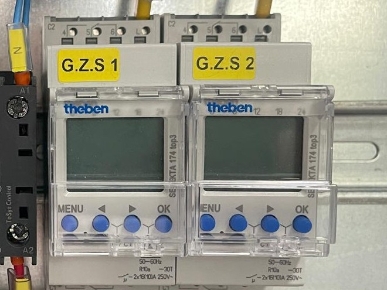
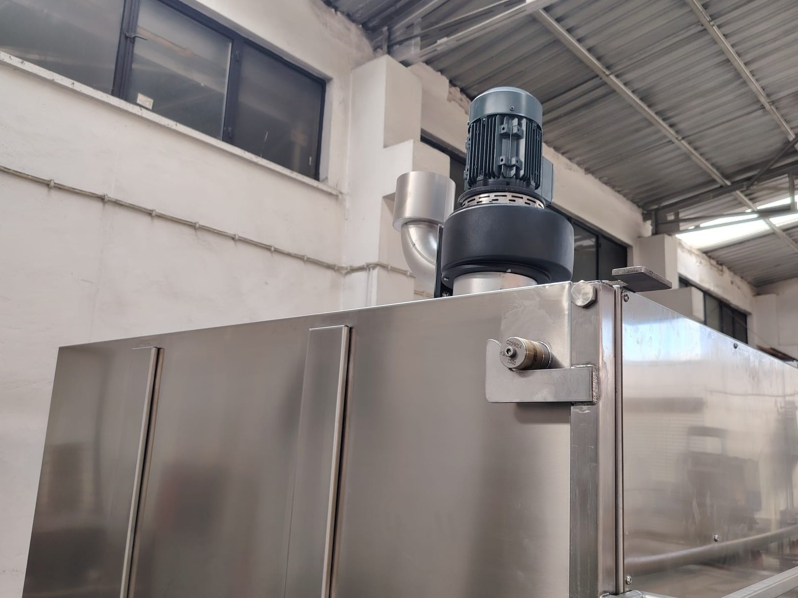
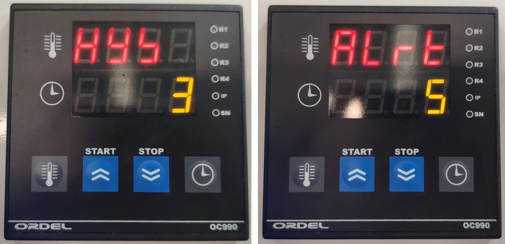
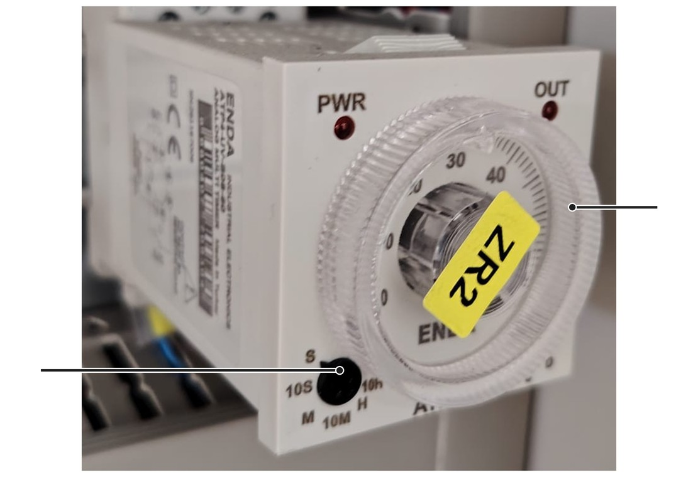

# 6.6 Proses ayarları

Operatör, parça türüne göre yıkama sıvısının sıcaklığını ve yıkama süresini kumanda panelinden ayarlar: P modellerde dijital kontrol cihazından (**Bkz. Bölüm 3.4.2**), E modellerde dijital termostattan ve dijital zaman rölesinden (**Bkz. Bölüm 3.4.1**). Parça türüne göre ayar değerlerinin belirlenmesi için **Bkz. Bölüm 8.2**.

**Bölüm 6.6.1** ve **6.6.2**'deki tuş adımları, P modellerdeki standart KBN kumanda panelindeki {{KONTROLLER:Dijital kontrol cihazı (HEAT / TIME) marka / model}} dijital kontrol cihazı içindir. E modellerde sıcaklık **TERMOSTAT** etiketli {{KONTROLLER:Dijital termostat (TERMOSTAT) marka / model — E modeller}} dijital termostattan, yıkama süresi **ZAMAN** etiketli {{KONTROLLER:Dijital zaman rölesi (ZAMAN) marka / model — E modeller}} dijital zaman rölesinden ayarlanır; ısıtmanın çalışması için **ISITICI** anahtarı açık olmalıdır. Cihazların tüm tuş işlevleri ve menü yapısı, cihazların kendi kılavuzlarında verilmiştir (**Bkz. Bölüm 13.1**).

---

## 6.6.1 Yıkama sıvısı sıcaklığı

Ayar sıcaklığı tanktaki sıvının sıcaklığından yüksekse ısıtıcılar çalışır ve sıvı ayar sıcaklığına ulaşınca durur. Ayar sıcaklığı tanktaki sıvının sıcaklığından düşükse ısıtıcılar çalışmaz. Standart makinelerde ayar sıcaklığı en fazla {{GENEL_TEKNIK:Yıkama sıvısı sıcaklığı — maks. (°C)}} °C'dir. Müşterinin özel isteğiyle üst sınırı yükseltilmiş makinelerde üst sınır en fazla {{GENEL_TEKNIK:Yıkama sıvısı sıcaklığı — özel istekle maks. (°C)}} °C'dir; üst sınırı yalnızca üretici değiştirir (**Bkz. Bölüm 3.3.1**).

**P modellerde: dijital kontrol cihazından ayar**

Cihaz, tanktaki sıvının ölçülen sıcaklığını üst göstergede gösterir. Ayar sıcaklığı {{KONTROLLER:Sıcaklık ayar aralığı — ORDEL OC990 (°C)}} °C aralığında ayarlanabilir.

1. Kontrol cihazının ana ekranda olduğunu kontrol edin: üst göstergede sıvının sıcaklığı, alt göstergede yıkama süresi görünür.
2. Sıcaklık tuşuna (termometre simgeli, en soldaki tuş) basın. Sıcaklık ayar ekranı açılır.
3. Yukarı ok (START) ve aşağı ok (STOP) tuşlarıyla ayar sıcaklığını kimyasal tedarikçisinin önerdiği değere getirin.
4. Tuşlara basmayı bırakın. {{KONTROLLER:Dijital kontrol cihazı — ayar ekranından ana ekrana dönüş}}.
5. Ayarı kontrol etmek için sıcaklık tuşuna yeniden basın ve ayar ekranında yeni değerin göründüğünü kontrol edin.

**E modellerde: dijital termostattan ayar**

**TERMOSTAT** etiketli dijital termostatın üst satırında (Pv) tanktaki sıvının ölçülen sıcaklığı, alt satırında (Sv) ayar sıcaklığı görünür.

6. Ok tuşlarıyla ayar sıcaklığını (Sv) kimyasal tedarikçisinin önerdiği değere getirin.
7. **ISITICI** anahtarını açın. Isıtıcılar çalışırken anahtarın ışığı yanar.
8. Sıvının ayar sıcaklığına ulaştığını üst satırda (Pv) kontrol edin. Sıvı ayar sıcaklığına ulaştığında ısıtıcılar durur ve anahtarın ışığı söner.

**NOT:** Kimyasal tedarikçisinin önerdiğinden yüksek sıcaklık enerji tüketimini ve buhar oluşumunu artırır, bazı kimyasallarda köpürmeye ve parçalarda lekeye yol açar.

---

## 6.6.2 Yıkama süresi

Yıkama süresi dakika cinsinden, {{GENEL_TEKNIK:Yıkama süresi ayar aralığı (dk)}} dakika aralığında ayarlanır. Ayarlanan süre dolduğunda yıkama pompası ve döndürme durur. Süreyi çevrimi başlatmadan önce ayarlayın.

**P modellerde: dijital kontrol cihazından ayar**

1. Zaman tuşuna (saat simgeli, en sağdaki tuş) basın. Süre ayar ekranı açılır.
2. Yukarı ok (START) ve aşağı ok (STOP) tuşlarıyla yıkama süresini parça türü için belirlenen değere (dakika) getirin.
3. Tuşlara basmayı bırakın. {{KONTROLLER:Dijital kontrol cihazı — ayar ekranından ana ekrana dönüş}}.

**NOT:** Yukarı ve aşağı ok tuşlarının iki işlevi vardır: ayar ekranlarında ayar değerini değiştirir, ana ekranda çevrimi başlatır (START) ve durdurur (STOP). Ayardan sonra cihazın ana ekrana dönmesini bekleyin; ardından çevrimi START tuşuyla başlatın.

**E modellerde: dijital zaman rölesinden ayar**

E modellerde yıkama süresi **ZAMAN** etiketli dijital zaman rölesinden ayarlanır. Süre birimi: {{KONTROLLER:Dijital zaman rölesi — süre birimi (E modeller)}}. Örneğin 1.00 değeri 1 dakika, 1.10 değeri 1 dakika 6 saniye, 1.50 değeri 1 dakika 30 saniyedir.

4. Ok tuşlarıyla ayar değerini (Sv) parça türü için belirlenen yıkama süresine getirin.
5. Ayar değerini alt satırda (Sv) kontrol edin.

**NOT:** Saniyeyi noktadan sonra doğrudan yazmayın: 1.30 değeri 1 dakika 30 saniye değil, 1 dakika 18 saniyedir. 1 dakika 30 saniye için 1.50 girin.

---

## 6.6.3 Kimyasal konsantrasyonu

Kimyasal konsantrasyonu, tanka eklenen kimyasal miktarıyla belirlenir. Tank kapasitesi **Bölüm 3.3.2**'deki tablolarda verilmiştir.

Eklenecek kimyasal miktarını aşağıdaki gibi hesaplayın:

Kimyasal miktarı (L) = Tank kapasitesi (L) × Konsantrasyon (%) / 100

Örneğin 200 L tank ve %3 konsantrasyon için 6 L kimyasal eklenir. Konsantrasyon değerini kimyasal tedarikçisinin önerisine göre belirleyin. Çalışma sırasında buharlaşma ve parçalarla taşınan sıvı nedeniyle eksilen sıvıyı tamamlarken kimyasalı da aynı oranda ekleyin (**Bkz. Bölüm 7.6.1**).

---

## 6.6.4 Zamanlayıcının ayarı (zamanlayıcılı ısıtıcı ve yağ sıyırıcı opsiyonları)

Zamanlayıcılı ısıtıcı ve zamanlayıcılı yağ sıyırıcı opsiyonlarında ısıtma ve yağ sıyırıcı, zamanlayıcıda programlanan gün ve saatlerde çalışır. Zamanlayıcı: {{OPSIYONLAR:Zamanlayıcı — marka / model}}; konum: {{OPSIYONLAR:Zamanlayıcı — konum}}. Programlama tuşlarının işlevleri zamanlayıcının kendi kılavuzunda verilmiştir (**Bkz. Bölüm 13.1**).

**UYARI — Elektrik çarpması:** Zamanlayıcıya erişmek için elektrik panosunun açılması gerekiyorsa pano içindeki gerilimli parçalara dokunulabilir. Bu durumda programı yalnızca yetkili elektrik personeli girer.

**Isıtma programının belirlenmesi**

1. Bir vardiya başında ısıtmanın başladığı saati ve sıvının ayar sıcaklığına ulaştığı saati not ederek ısınma süresini ölçün.
2. Isıtmanın başlama saatini, vardiya başlangıcından ısınma süresi kadar önceye programlayın.
3. Isıtmanın bitiş saatini vardiyanın bitişine programlayın.
4. Çalışılmayan günler için ısıtmayı kapalı programlayın.

**Yağ sıyırıcı programının belirlenmesi**

5. Yağ sıyırıcının çalışma saatlerini, yıkama pompasının çalışmadığı zamanlara (molalar ve vardiya sonrası) programlayın.
6. Yağ toplama kabının, programlanan çalışma süresi boyunca ayrılan yağı alabileceğini kontrol edin.

**Programın girilmesi ve kontrolü**

7. Zamanlayıcının gösterdiği saatin ve günün doğru olduğunu kontrol edin; yanlışsa düzeltin.
8. Programı zamanlayıcının kendi kılavuzuna göre girin.
9. Programın ilk çalışmasında ısıtmanın ve yağ sıyırıcının programlanan saatte başladığını ve durduğunu kontrol edin.

**NOT:** Zamanlayıcının ısıtmayı ve yağ sıyırıcıyı çalıştırabilmesi için ana şalter "I" konumunda, tank dolu olmalıdır. Sıvı seviyesi düşükse seviye şalteri kumanda devresini keser; tank doldurulup **RESET** butonuna basılana kadar zamanlayıcı da ısıtmayı ve yağ sıyırıcıyı çalıştıramaz (**Bkz. Bölüm 3.4.3**).

---

## 6.6.5 Buhar tahliye fanının çalışma süresi

Buhar tahliye fanı tüm KBN 1B modellerinde standart donanımdır. Fan makinenin tavanındadır ve kabinde oluşan buharı buhar tahliye çıkışından atar. Fan, çevrim bittikten sonra ayarlanan süre kadar çalışır; operatör kapağı fan durduktan sonra açar (**Bkz. Bölüm 7.4.4**). Fanın çalışma süresi saniye cinsinden ayarlanır; fabrika ayarı {{KONTROLLER:Buhar tahliye fanı çalışma süresi — fabrika ayarı (s)}} s'dir. Süre kısaltılırsa buhar tam tahliye edilemez ve kapak açıldığında kabinden sıcak buhar çıkabilir. Ayarın yapıldığı yer modele göre değişir:

- **P modeller:** Dijital kontrol cihazının ALrt parametresi. Ayarı bakım personeli kumanda panelinden yapar.
- **E modeller:** Elektrik panosunun içindeki zaman rölesi. Ayarı yalnızca yetkili elektrik personeli yapar.

**P modellerde: dijital kontrol cihazından ayar**

1. Ana şalterin "I" konumunda olduğunu ve kontrol cihazının göstergelerinin yandığını kontrol edin.
2. Sıcaklık tuşuna (en soldaki) ve zaman tuşuna (en sağdaki) aynı anda basın. Üst göstergede HYS yazısı görünür.
3. HYS ekranında yukarı ve aşağı ok tuşlarına basmadan zaman tuşuna bir kez basın. Üst göstergede ALrt yazısı, alt göstergede fanın çalışma süresi (saniye) görünür.
4. Yukarı ok (START) ve aşağı ok (STOP) tuşlarıyla fanın çalışma süresini saniye cinsinden ayarlayın.
5. Sıcaklık tuşuna bir kez basarak ana ekrana dönün.

**NOT:** HYS ekranındaki değeri değiştirmeyin. HYS, ısıtma kontrolüne ait bir fabrika ayarıdır; değiştirilirse ısıtıcıların devreye girme ve devreden çıkma sıcaklıkları değişir.

**E modellerde: zaman rölesinden ayar**

Fanın çalışma süresi, elektrik panosunun içindeki {{KONTROLLER:Buhar tahliye fanı zaman rölesi — E modeller}} ile ayarlanır. Rölenin pano içindeki yeri elektrik devre şemasında gösterilmiştir (**Bkz. Bölüm 13.1**).

**UYARI — Elektrik çarpması:** Elektrik panosunun içinde {{ELEKTRIK:Besleme gerilimi (V)}} V gerilimli parçalar bulunur; bu parçalara dokunmak ölüme veya ağır yaralanmaya yol açar. Panoyu yalnızca yetkili elektrik personeli, makineyi **Bölüm 2.3.3**'e göre kilitledikten sonra açar.

**DİKKAT — Zaman rölesinin çalışma modu:** Zaman rölesinin çalışma modu A (standart mod) konumundadır. Çalışma modu değiştirilirse fan doğru çalışmaz; kapak açıldığında kabinden çıkan sıcak buhar yüzde ve ellerde yanığa yol açabilir. Çalışma modunu kesinlikle değiştirmeyin.

6. Makineyi **Bölüm 2.3.3**'e göre kilitleyin ve elektrik panosunu açın.
7. Buhar tahliye fanının zaman rölesini bulun.
8. Zaman aralığı seçicisinin (2) S (saniye) konumunda olduğunu kontrol edin. Bu konumda ayar değeri saniye cinsindendir; seçiciyi başka bir konuma getirmeyin.
9. Rölenin şeffaf ayar düğmesini (1) çevirerek fanın çalışma süresini saniye cinsinden ayarlayın.
10. Çalışma modunun A konumunda olduğunu kontrol edin.
11. Elektrik panosunu kapatın ve LOTO'yu kaldırın.
12. Bir yıkama çevrimi çalıştırın ve fanın ayarlanan süre boyunca çalıştığını kontrol edin.

