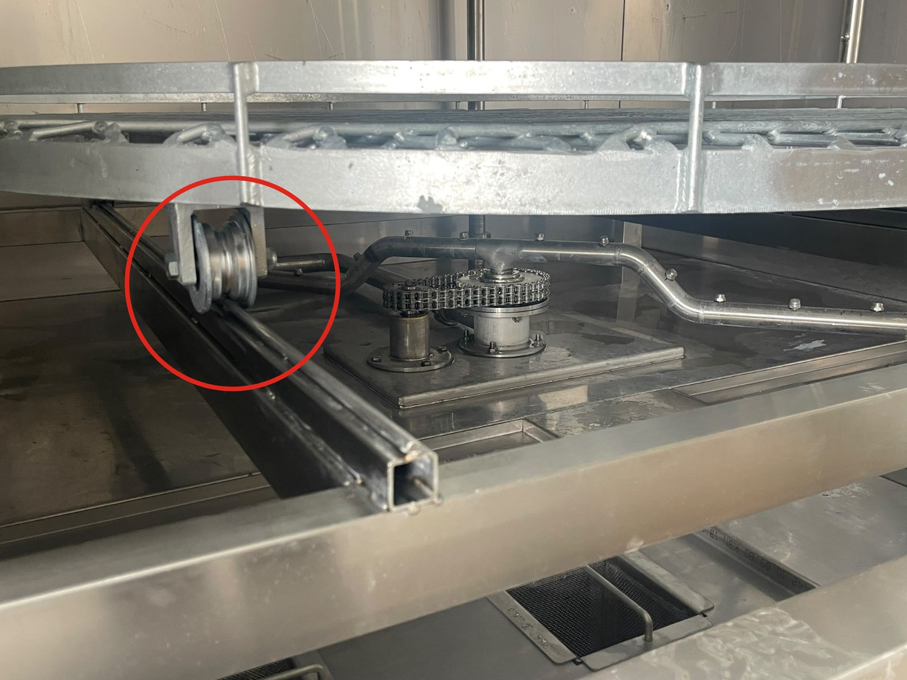
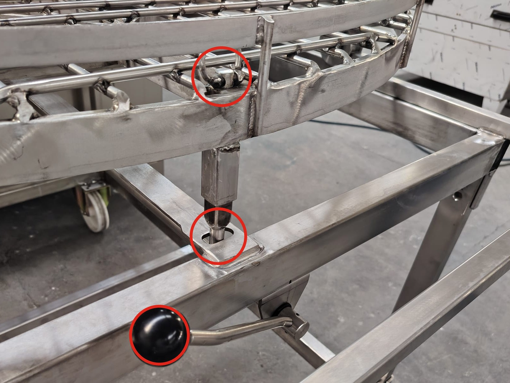
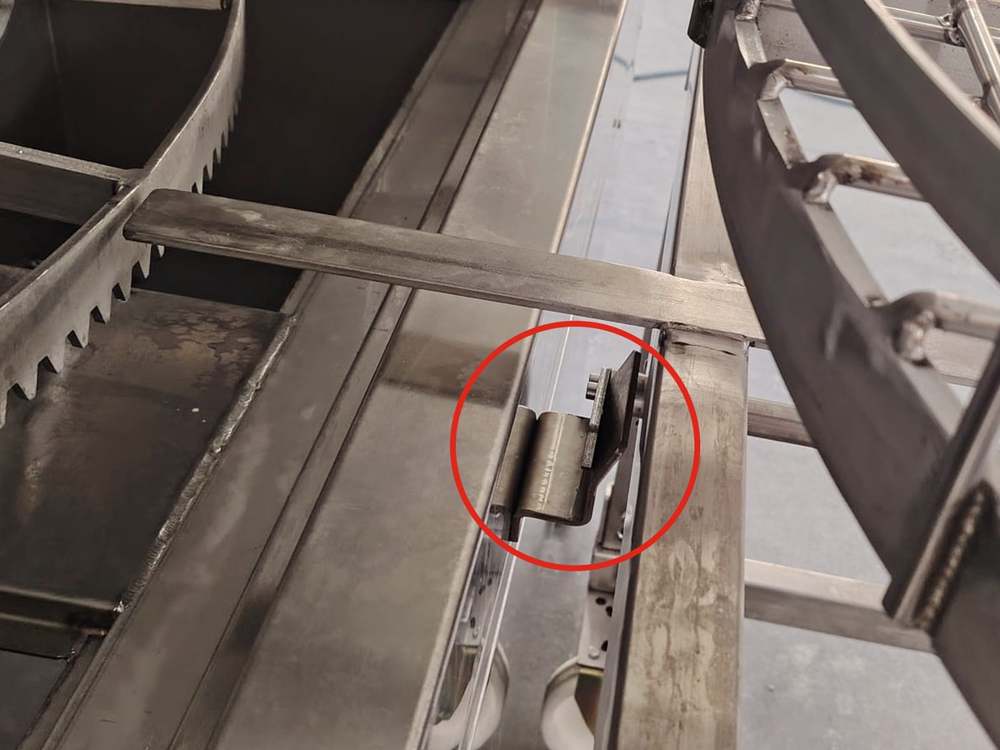
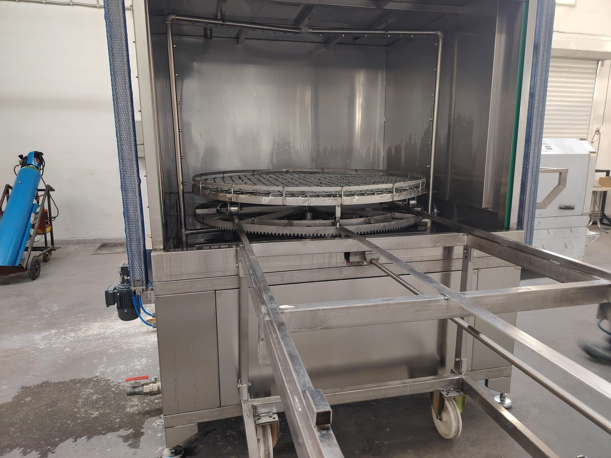
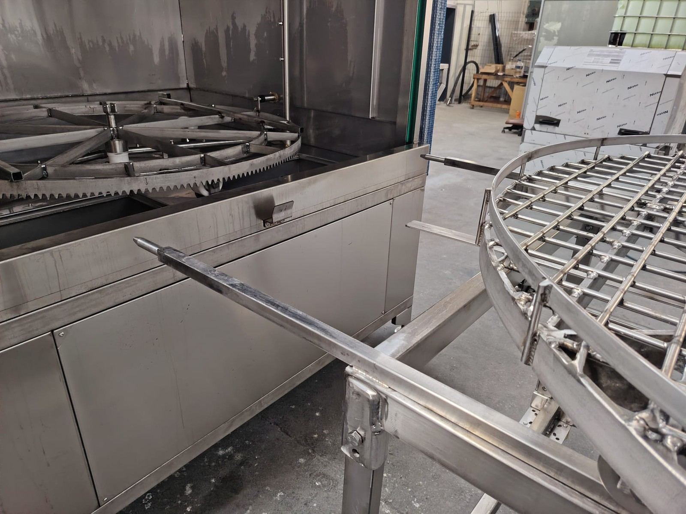
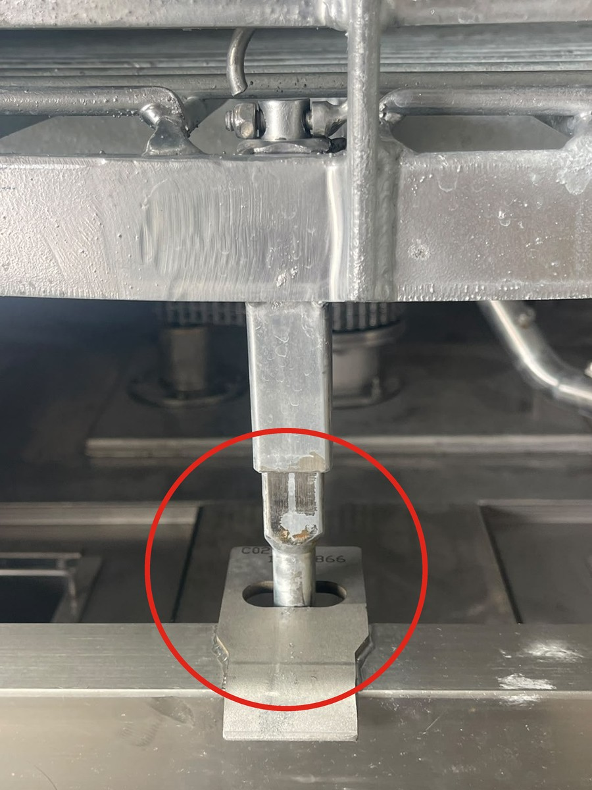
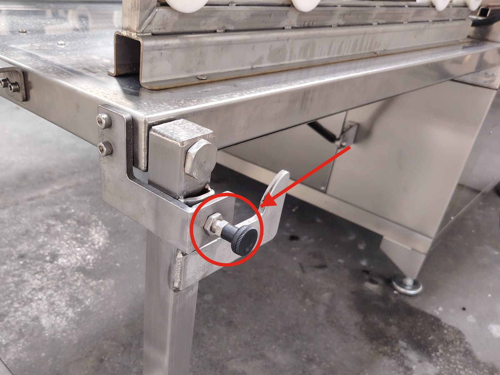
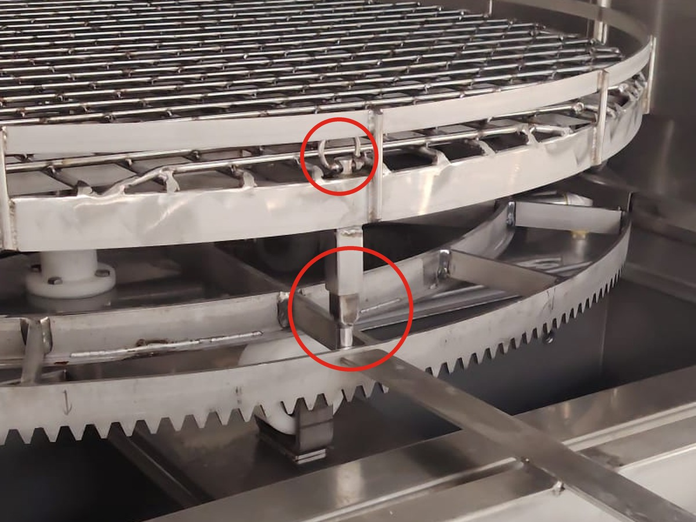

# 7.4 Yıkama çevrimi

## 7.4.1 Parçaların hazırlanması

1. Parçaların ağırlığını, yüksekliğini ve çapını **Bölüm 3.3.2**'deki sınırlarla karşılaştırın.
2. Parçalar üzerindeki büyük talaş yığınlarını, bezleri, etiketleri ve gevşek ambalaj malzemelerini temizleyin. Bu malzemeler süzgeç sepetlerini ve nozulları tıkar.
3. Parçaların yanıcı sıvıya (solvent, benzin, tiner) bulanmış olmadığını kontrol edin.
4. Küçük parçaları delikli kutu veya kapaklı tel sepet içine koyun.

---

## 7.4.2 Sepetin yüklenmesi

Parçaları sepete her zaman makinenin dışında yükleyin. Sepet, P modellerde taşıma arabasına, E modellerde indirilen kapağın üzerindeki yükleme yoluna çekilir; parçalar sepete orada yerleştirilir ve yüklü sepet kabine itilir. Bu yöntemle kapağın hareket alanında yalnızca sepeti çekip itmek için gereken süre kadar kalınır; kapağın sıkıştırma ve düşme tehlikesinden uzak durulur. Parçaları kabin içindeki sepete yüklemeyin.

**UYARI — Kapanan kapak:** Kapak kapanırken kapağın altına uzanan el, kol veya baş, kapak ile gövde arasında sıkışır. Bu tehlike pnömatik kapaklı (P) modellerde de vardır. Kapak kapanırken kapağın altına uzanmayın; kapak açıkken kapağın altında yalnızca sepeti çekip itecek kadar kalın.

**UYARI — Devrilen veya düşen yük:** Ağır parçaların sepete yüklenmesi sırasında parça devrilerek veya kaldırma ekipmanından kayarak el ve ayakları ezebilir. Ağır parçaları kaldırma ekipmanıyla taşıyın, yükün altında durmayın ve çelik burunlu iş ayakkabısı giyin.

**DİKKAT — Sıcak yüzeyler:** Kabin iç yüzeyleri, sepet ve önceki partinin parçaları sıcak olabilir. Yükleme ve boşaltmada ısıya dayanıklı eldiven kullanın.

**UYARI — El sıkışması (sepet tekerlekleri):** Sepet çekilirken veya itilirken sepetin tekerlekleri ile tekerleklerin üzerinde kaydığı profil arasına el veya parmak sıkışabilir. Sepeti yalnızca çerçevesinden tutun; elinizi ve parmaklarınızı profilin üzerine ve tekerleklerin önüne koymayın.

**P DS modellerde: taşıma arabası ile yükleme**

Üst sepet, ön kenarındaki yaylı sepet pimiyle kabin içinde alt sepete, kabin dışında taşıma arabasına kilitlenir. Pim, halkasından yukarı çekildiğinde yuvasından çıkar; halka bırakıldığında pim, yuvasının üzerine geldiği anda yay etkisiyle kendiliğinden yuvasına oturur. Taşıma arabası da arabanın makineden uzak ucundaki kilitleme koluyla makineye kilitlenir (**Bkz. Bölüm 3.1.3**). Çevrim bittiğinde alt sepet, üst sepetin arabaya çekilebileceği konumda kendiliğinden durur; sepeti hizalamak için ek bir işlem gerekmez.

**UYARI — Ayrılan taşıma arabası:** Kilitlenmemiş taşıma arabası, sepet çekilirken veya itilirken makineden uzaklaşır; sepet raylardan çıkarak düşer ve el ile ayakları ezer. Sepeti çekmeden önce arabayı kilitleme koluyla makineye kilitleyin.

**UYARI — Arabaya kilitlenmemiş sepet:** Pimi arabadaki yuvasına oturmamış sepet, yükleme sırasında araba üzerinde kayabilir veya dönebilir; sepet ve parçalar düşerek el ve ayakları ezer. Parçaları yüklemeden önce sepet piminin arabadaki yuvasına oturduğunu kontrol edin.

1. Kapağı **KAPAK AÇ** butonuyla tam açın.
2. Taşıma arabasını makinenin önüne düz ve ortalı olarak yanaştırın. Arabanın rayları kabin içine, alt sepetin üzerine uzanır.
3. Arabayı kilitleme koluyla makineye kilitleyin; arabayı çekerek kilidin tuttuğunu kontrol edin.
4. Sepet pimini halkasından yukarı çekerek alt sepetteki yuvasından çıkarın.
5. Sepeti raylar üzerinde arabaya doğru yavaşça çekin ve arabanın üzerinde tam oturttuğunuzu kontrol edin. Sepeti yalnızca çerçevesinden tutun.
6. Pim halkasını bırakın ve sepet piminin arabadaki yuvasına oturduğunu kontrol edin. Pim oturmuyorsa sepeti raylar üzerinde hafifçe ileri geri hareket ettirin; pim, yuvasının üzerine geldiğinde kendiliğinden oturur.
7. Parçaları sepete arabanın üzerinde, **Bölüm 8.2**'deki kurallara göre yerleştirin; yükü sepet üzerinde dengeli dağıtın (**Bkz. Bölüm 8.1.2**).
8. Sepet pimini halkasından yukarı çekerek arabadaki yuvasından çıkarın.
9. Sepeti raylar üzerinde kabine doğru yavaşça itin ve kabin içinde sonuna kadar yerleştiğini kontrol edin.
10. Pim halkasını bırakın ve sepet piminin alt sepetteki yuvasına oturduğunu kontrol edin. Pim oturmuyorsa sepeti raylar üzerinde hafifçe ileri geri hareket ettirin. Pim yine oturmuyorsa çevrimi başlatmayın ve bakım personeline bildirin.
11. Kilitleme kolunu açarak kilitleme kancasını makinedeki kilit braketinden çıkarın.
12. Taşıma arabasını makineden ayırın ve kapağın hareket alanından uzaklaştırın.

**P DN modellerde: taşıma arabası ile yükleme**

Sepet, ön kenarının altındaki sepet pimiyle kabin içinde kabin ön rayındaki delikli plakaya, kabin dışında taşıma arabasındaki pim yuvasına kilitlenir. Pim, sepetin üst kenarındaki başından yukarı çekilerek yuvasından çıkarılır ve bırakıldığında yuvasına iner. Taşıma arabası, kilitleme koluyla makineye kilitlenir (**Bkz. Bölüm 3.1.3**).

**DİKKAT — Sepet yerinde sensörü:** Sepet yerinde sensörü sepeti algılamazsa kapak açılmaz ve kapanmaz. Sepet yerinde değilken kapağı açmaya veya kapatmaya çalışmayın. Kapak hareket etmiyorsa sepeti kabine sonuna kadar itin ve sepet piminin yuvasına oturduğunu kontrol edin; sensörü kurcalamayın ve köprülemeyin (**Bkz. Bölüm 3.4.4**).

13. Kapağı **KAPAK AÇ** butonuyla tam açın. Kapak açılmıyorsa sepetin kabin içinde yuvasında olduğunu kontrol edin (sepet yerinde sensörü).
14. Taşıma arabasını makinenin önüne düz ve ortalı olarak yanaştırın.
15. Arabayı kilitleme koluyla makineye kilitleyin; arabayı çekerek kilidin tuttuğunu kontrol edin.
16. Sepet pimini başından yukarı çekerek kabin ön rayındaki yuvasından çıkarın.
17. Sepeti profiller üzerinde arabaya doğru yavaşça çekin ve arabanın üzerinde tam oturttuğunuzu kontrol edin. Sepeti yalnızca çerçevesinden tutun.
18. Pimi bırakın ve sepet piminin arabadaki yuvasına indiğini kontrol edin. Pim inmiyorsa sepeti hafifçe ileri geri hareket ettirin.
19. Parçaları sepete arabanın üzerinde, **Bölüm 8.2**'deki kurallara göre yerleştirin; yükü sepet üzerinde dengeli dağıtın (**Bkz. Bölüm 8.1.2**).
20. Sepet pimini başından yukarı çekerek arabadaki yuvasından çıkarın.
21. Sepeti profiller üzerinde kabine doğru yavaşça itin ve kabin içinde sonuna kadar yerleştiğini kontrol edin.
22. Pimi bırakın ve sepet piminin kabin ön rayındaki yuvasına indiğini kontrol edin. Pim inmiyorsa sepeti hafifçe ileri geri hareket ettirin. Pim yine oturmuyorsa çevrimi başlatmayın ve bakım personeline bildirin.
23. Kilitleme kolunu açarak kilitleme kancasını makinedeki kilit braketinden çıkarın.
24. Taşıma arabasını makineden ayırın ve kapağın hareket alanından uzaklaştırın.

**E modellerde: kapak üzerindeki yükleme yolu ile yükleme**

E modellerde taşıma arabası yoktur. Kapak aşağı indirilerek açılır; indirilen kapağın üzerindeki yükleme yolu, sepetin dışarı çekildiği yükleme bölümünü oluşturur. İndirilen kapak, kapak güvenlik pimiyle bu konumda kilitlenir. Sepet kabine itildikten sonra kapak, kapak güvenlik pimi çekilerek kapatılır (**Bkz. Bölüm 7.4.3**).

**UYARI — Düşen kapak:** Elle açılan kapak, indirilirken veya kaldırılırken düşerek ya da çarparak ağır kafa yaralanmasına yol açabilir. Kapağı açmadan önce baret takın; kapak indirilirken kontrolsüz düşüyorsa makineyi kullanmayın (**Bkz. Bölüm 9.1.7**).

**DİKKAT — Kapak güvenlik pimi:** Kapak güvenlik pimi yuvasına oturmadan sepet çekilirse kapak ve yükleme yolu zarar görür, sepet güvenli şekilde çekilemez. Kapağı indirdiğinizde pimin yuvasına oturduğunu gözle kontrol edin; **pim yuvasına oturmadan sepeti çekmeyin.**

25. Baret takın.
26. Kapağı tutamağından tutarak yavaşça indirin ve tam açın. Kapak inerken kapağı serbest bırakmayın.
27. Kapak güvenlik piminin yuvasına oturduğunu kontrol edin. Pim yuvasına oturmamışsa pimin siyah başını çekip bırakarak pimi yuvasına oturtun. Pim yuvasına oturmuyorsa sepeti çekmeyin ve bakım personeline bildirin.
28. Sepeti kapağın üzerindeki yükleme yolunda yavaşça dışarı çekin. Sepeti yalnızca çerçevesinden tutun.
29. Parçaları sepete **Bölüm 8.2**'deki kurallara göre yerleştirin; yükü sepet üzerinde dengeli dağıtın (**Bkz. Bölüm 8.1.2**).
30. Sepeti yükleme yolunda kabine doğru yavaşça itin ve kabin içinde sonuna kadar yerleştiğini kontrol edin.

---

## 7.4.3 Çevrimin başlatılması

**DİKKAT — Makine hasarı (P modeller):** Sepet pimi yuvasına oturmadan çevrim başlatılırsa sepet kilitlenmemiş olur ve çevrim sırasında sepet ve makine hasar görebilir. Çevrimi başlatmadan önce sepet piminin yuvasına (DS modellerde alt sepetteki, DN modellerde kabin ön rayındaki yuvasına) oturduğunu mutlaka kontrol edin. Bu kontrol yapılmadan çalıştırılan makinede oluşan hasar **kullanıcının sorumluluğundadır** (**Bkz. Bölüm 1.1.5**).

**UYARI — Dönen sepet ve nozul kolları (P modeller):** **TEST** sırasında kapak açıktır ve sepet veya nozul kolları döner. Dönen parçaya uzanan el veya kol çarpabilir, sıkışabilir veya kapılabilir. **TEST** butonuna yalnızca kabinin dışında durarak basın, döndürme sırasında kabine uzanmayın ve butonu bırakmadan sepete veya parçalara dokunmayın.

1. Kabinde ve kapak hareket alanında kimsenin bulunmadığını kontrol edin.
2. P modellerde sepet piminin yuvasına (DS modellerde alt sepetteki, DN modellerde kabin ön rayındaki yuvasına) oturduğunu kontrol edin. Pim yuvasına oturmamışsa çevrimi başlatmayın; pimi **Bölüm 7.4.2**'ye göre yuvasına oturtun.
3. P modellerde parçaların dönerken bir yere çarpıp çarpmadığını **TEST** butonuyla kontrol edin:
   a. Kabinin dışında durun.
   b. Kapak açıkken **TEST** butonunu basılı tutun; DS modellerde sepet, DN modellerde nozul kolları döner.
   c. En az bir tam tur boyunca parçaların sepete, birbirine, nozul kollarına veya kabine çarpmadığını gözleyin.
   d. Butonu bırakın; döndürme durur. Bir parça çarparsa veya yerinden oynarsa butonu hemen bırakın, parçaları yeniden yerleştirin (**Bkz. Bölüm 7.4.2**) ve kontrolü tekrarlayın.
4. Kapağı tam kapatın. P modellerde kapağı **KAPAK KAPA** butonuyla kapatın; P DN modellerde kapak kapanmıyorsa sepet yerinde sensörü sepeti algılamıyordur, sepeti kabine sonuna kadar itin (**Bkz. Bölüm 3.4.4**). E modellerde baret takın, kapak güvenlik pimini siyah başından çekin ve kapağı tutamağından tutup ileri iterek kaldırarak kapatın. Kapak kapanırken kapağın altına uzanmayın.
5. Yıkama süresini parça türü için belirlenen değere ayarlayın: P modellerde dijital kontrol cihazında, E modellerde dijital zaman rölesinde (**Bkz. Bölüm 6.6.2**).
6. Sıvının ayar sıcaklığında olduğunu kontrol edin.
7. Çevrimi başlatın: {{KONTROLLER:Yıkama çevrimini başlatma kumandası}}.
8. **YIKAMA** lambasının yandığını kontrol edin. Yıkama pompasının çalıştığını ve DS modellerde sepetin, DN modellerde nozul sisteminin döndüğünü dinleyerek kontrol edin.

Çevrim süresince makinenin başında kalın. Olağandışı ses, titreşim veya sızıntı fark ederseniz çevrimi durdurun (**Bkz. Bölüm 7.3.2**).

---

## 7.4.4 Çevrimin bitişi ve boşaltma

Yıkama süresi dolduğunda yıkama pompası ve döndürme durur; buhar tahliye fanı ise çevrim bittikten sonra {{KONTROLLER:Buhar tahliye fanı çalışma süresi — fabrika ayarı (s)}} saniye (fabrika ayarı) daha çalışarak kabindeki sıcak buharı tahliye eder. Fanın çalışma süresi değiştirilmişse ayarlanan süre geçerlidir (**Bkz. Bölüm 6.6.5**).

**UYARI — Sıcak buhar:** Fan durmadan kapak açılırsa kabinden çıkan sıcak buhar yüzde, gözde ve ellerde yanığa yol açar. Çevrim bittikten sonra buhar tahliye fanının durmasını bekleyin; kapağı fan durduktan sonra açın ve kapağı açarken yüzünüzü kapak hizasından uzak tutun.

1. Süre dolduğunda yıkama pompasının ve döndürmenin durduğunu kontrol edin. P DS modellerde alt sepet, üst sepetin arabaya çekilebileceği konumda kendiliğinden durur.
2. Buhar tahliye fanının durmasını bekleyin (fabrika ayarında {{KONTROLLER:Buhar tahliye fanı çalışma süresi — fabrika ayarı (s)}} saniye). Fan çalışırken kapağı açmayın.
3. Kapağın önünde değil yanında durarak kapağı açın; yüzünüzü kapak hizasından uzak tutun. E modellerde kapağı açmadan önce baret takın.
4. Parçalardan sıvının süzülmesini kısa bir süre bekleyin.
5. Sepeti dışarı çekin: **Bölüm 7.4.2**'deki adımlara göre P DS modellerde 2.–6. adımlarla, P DN modellerde 14.–18. adımlarla taşıma arabasına; E modellerde 27. ve 28. adımlarla kapağın üzerindeki yükleme yoluna.
6. Parçaları kabin içinden almayın; sepeti dışarı çektikten sonra boşaltın.
7. Sıcak parçaları ısıya dayanıklı eldivenle tutun; ağır parçaları kaldırma ekipmanıyla alın.
8. Parçaları bir sonraki işleme veya kurumaya bırakın.

---

## 7.4.5 Manuel yıkama (MULTI modeller)

Manuel yıkama, otomatik yıkamanın ulaşamadığı derin cepler, kör delikler ve yoğun kirli bölgeler için kullanılır. Manuel yıkamaya başlamadan önce **Bölüm 2.3.6**'daki güvenlik kurallarını okuyun ve manuel yıkama için tanımlanan KKD'yi kullanın (**Bkz. Bölüm 2.2.6**).

**UYARI — Yüksek basınçlı jet:** Jet ciltte kesik ve deri altına sıvı enjeksiyonuna, gözde kalıcı hasara yol açabilir. Tabancayı hiçbir zaman kişilere, kendinize veya elektrik donanımına yöneltmeyin.

1. Çalışma alanında sizden başka kimse bulunmadığını kontrol edin.
2. Yüksek basınç hortumunu ve tabancayı hasara karşı kontrol edin.
3. Kapağı açın (E modellerde kapağı açmadan önce baret takın); yıkanacak parçanın sepette dengeli durduğunu kontrol edin.
4. Tabancayı iki elle tutun ve ucunu kabin içine, parçaya doğru yöneltin.
5. Manuel yıkama pompasını çalıştırın: {{KONTROLLER:Manuel yıkama kumandası — MULTI modeller}}.
6. Tetik emniyet kilidini açın ve tetiğe basarak parçayı yıkayın. Jeti yalnızca kabin içine yöneltin.
7. Yıkamayı bitirdiğinizde tetiği bırakın ve tetik emniyet kilidini kilitleyin.
8. Manuel yıkama pompasını durdurun.
9. Tabancayı kabin içine yöneltin ve tetiğe basarak hortumdaki basıncı boşaltın; ardından tetik kilidini yeniden kilitleyin.
10. Tabancayı yerine asın ve hortumu ezilmeyecek şekilde toplayın.
