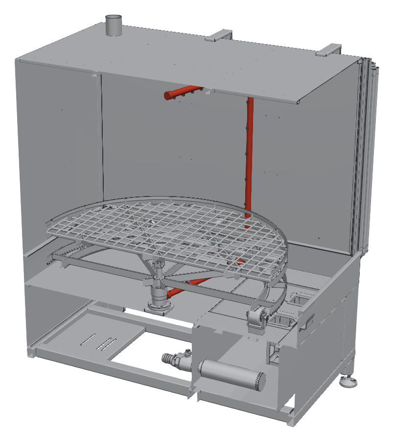

# 9.1 Bakım talimatları

## 9.1.1 Genel bakım kuralları

- Bakıma başlamadan önce makineyi durdurun ve **Bölüm 2.3.3**'teki LOTO prosedürünü uygulayın. Bakım sırasında **Ana şalteri** hiçbir koşulda kilitsiz bırakmayın.
- Tank, ısıtıcı, pompa ve borular üzerinde çalışmadan önce yıkama sıvısının 40 °C'nin altına soğumasını bekleyin.
- Bakımda **Bölüm 2.2.6**'daki KKD'yi kullanın.
- Değiştirilen parçalar için yalnızca orijinal yedek parça kullanın (**Bkz. Bölüm 13.3**).
- Bakım sırasında sökülen koruyucu panelleri ve kapakları, makineyi yeniden çalıştırmadan önce yerine takın.
- Bakımdan sonra güvenlik donanımlarını **Bölüm 5.4**'e göre test edin.

---

## 9.1.2 Bakım planı

Tablo: Periyodik bakım planı

| Periyot | Bakım işi | Model | Yapan | Talimat |
|---|---|---|---|---|
| Her vardiya başında | Acil durdurma butonunu ve kapak emniyet şalterini test edin | Tümü | Operatör | **Bkz. Bölüm 7.2** |
| Her vardiya başında | Tank sıvı seviyesini ve sıvının durumunu kontrol edin | Tümü | Operatör | **Bkz. Bölüm 7.2** |
| Günlük | Süzgeç sepetlerini temizleyin, sıvı yüzeyindeki yağı alın | Tümü | Operatör | **Bkz. Bölüm 10.1.3** |
| Günlük | Pompa, borular ve tahliye vanasında sızıntı olup olmadığını gözle kontrol edin | Tümü | Operatör | — |
| Günlük | Şartlandırıcı manometresinde hava basıncını kontrol edin | P | Operatör | **Bkz. Bölüm 6.5** |
| Her kullanımdan önce | Yüksek basınç hortumunu ve tabancayı kontrol edin | MULTI | Operatör | **Bkz. Bölüm 9.1.9** |
| Haftalık | Nozulları kontrol edin ve tıkalı olanları temizleyin | Tümü | Bakım personeli | **Bkz. Bölüm 9.1.3** |
| Haftalık | Sepetin (DS) veya nozul sisteminin (DN) serbest ve sessiz döndüğünü kontrol edin | Tümü | Bakım personeli | **Bkz. Bölüm 9.1.6** |
| Haftalık | Şartlandırıcı filtresindeki yoğuşma suyunu boşaltın | P | Bakım personeli | **Bkz. Bölüm 9.1.8** |
| Aylık | Yıkama sıvısını değiştirin ve tankı temizleyin; ısıtıcı yüzeyini kontrol edin | Tümü | Bakım personeli | **Bkz. Bölüm 10.1.4** ve **9.1.4** |
| Aylık | Seviye şalterinin çalışmasını kontrol edin | Tümü | Bakım personeli | **Bkz. Bölüm 9.1.4** |
| Aylık | Kapak kılavuzlarını ve kapak hareketini kontrol edin | Tümü | Bakım personeli | **Bkz. Bölüm 9.1.7** |
| Aylık | Pompa mekanik salmastrasında sızıntı ve pompada anormal ses olup olmadığını kontrol edin | Tümü | Bakım personeli | **Bkz. Bölüm 9.1.5** |
| Aylık | Döndürme redüktörlü motorunu, pinyonu ve sepet dişli çemberini kontrol edin | Döndürme motorlu modeller | Bakım personeli | **Bkz. Bölüm 9.1.6** |
| Aylık | Buhar tahliye fanını ve kanalını kontrol edin | Tümü | Bakım personeli | **Bkz. Bölüm 9.1.10** |
| Aylık | Pnömatik silindirlerde ve hortumlarda sızıntı olup olmadığını kontrol edin | P | Bakım personeli | **Bkz. Bölüm 9.1.8** |
| Aylık | Taşıma arabasını, sepet raylarını ve makaralarını kontrol edin | Tümü | Bakım personeli | **Bkz. Bölüm 9.1.11** |
| Aylık | Uyarı etiketlerinin yerinde ve okunur olduğunu kontrol edin | Tümü | Bakım personeli | **Bkz. Bölüm 2.2.4** |
| 6 ayda bir | Emniyet termostatının çalışmasını test edin | Tümü | Elektrik personeli | **Bkz. Bölüm 9.1.4** |
| 6 ayda bir | Elektrik panosundaki, motor ve ısıtıcı bağlantı kutularındaki klemenslerin sıkılığını kontrol edin | Tümü | Elektrik personeli | **Bkz. Bölüm 9.1.12** |
| Yıllık | Elektriksel güvenlik testlerini yapın | Tümü | Elektrik personeli | **Bkz. Bölüm 9.1.12** |
| Yıllık | Aşınmış nozulları değiştirin | Tümü | Bakım personeli | **Bkz. Bölüm 9.1.3** |
| {{BAKIM:Redüktör yağ değişim periyodu}} | Redüktör yağını değiştirin | Döndürme motorlu modeller | Bakım personeli | **Bkz. Bölüm 9.1.6** |

---

## 9.1.3 Nozulların kontrolü ve temizliği

Kabinin her iki yan duvarında; sepetin altındaki alt koldan, yan duvar boyunca yükselen dikey borudan ve kabin tavanının altındaki üst koldan oluşan birer püskürtme çerçevesi bulunur. Nozullar bu boruların üzerindedir. Tıkalı veya aşınmış nozullar, parçaların bazı bölgelerinin yıkanmamasına ve pompa basıncının değişmesine yol açar.

**Kontrol**

1. Makineyi boş sepetle ve kapak kapalıyken kısa bir süre çalıştırın; püskürtme sesinde düzensizlik olup olmadığını dinleyin.
2. Makineyi durdurun ve **Bölüm 2.3.3**'e göre kilitleyin.
3. Kapağı açın ve nozulları gözle kontrol edin. Ağzı kir veya kireçle kapanmış, ağız çevresi aşınmış veya hasarlı nozulları belirleyin.

**Temizlik**

4. Tıkalı nozulu püskürtme borusundan sökün.
5. Nozulu sıcak su ve yıkama kimyasalı ile temizleyin; ağzındaki kiri plastik bir çubukla veya basınçlı hava ile çıkarın.
6. Nozulu yerine takın ve püskürtme yönünün söktüğünüz konumla aynı olduğunu kontrol edin.

**NOT:** Nozul ağzını tel, iğne veya matkap ucuyla temizlemeyin. Ağız genişlerse püskürtme açısı ve debisi değişir, pompa basıncı düşer ve yıkama kalitesi bozulur. Ağzı genişlemiş veya aşınmış nozulu değiştirin.

---

## 9.1.4 Isıtıcı, seviye şalteri ve emniyet termostatı

**Isıtıcı yüzeyi:** Tank her boşaltıldığında ısıtıcıların yüzeyini gözle kontrol edin. Isıtıcı üzerinde kireç veya kir tabakası varsa yumuşak bir fırçayla temizleyin. Kalın kireç tabakası ısıtıcının aşırı ısınmasına ve erken arızalanmasına yol açar; suyunuz sertse kireç oluşumunu önlemek için kimyasal tedarikçinize danışın.

**Seviye şalteri:**

1. Tank doluyken makineyi çalıştırın ve ısıtıcıyı devreye alın.
2. Tank tahliye vanasını açarak sıvı seviyesini yavaşça düşürün.
3. Sıvı seviyesi seviye şalterinin altına indiğinde ısıtıcının devreden çıktığını kontrol edin.
4. Tahliye vanasını kapatın ve tankı yeniden doldurun.
5. Isıtıcı devreden çıkmıyorsa makineyi kullanmayın; seviye şalterini elektrik personeline kontrol ettirin.

**Emniyet termostatı:** Emniyet termostatının fonksiyon testini yalnızca elektrik personeli, elektrik devre şemasına göre yapar. Termostat, sıvı sıcaklığı {{GUVENLIK_DONANIMLARI:Emniyet termostatı ayar değeri (°C)}} °C'ye ulaştığında ısıtıcı devresini açmalıdır. Termostatın ayar değerini değiştirmeyin.

---

## 9.1.5 Yıkama pompası

1. Makine çalışırken pompadan gelen sesi dinleyin. Hırıltı, vınlama veya titreşim; süzgeç sepetlerinin veya pompa emiş süzgecinin tıkandığını, sıvı seviyesinin düştüğünü veya rulman hasarını gösterebilir.
2. Makineyi durdurun ve kilitleyin.
3. Pompa gövdesinin altında ve mekanik salmastra bölgesinde damlama olup olmadığını kontrol edin. Mekanik salmastradan sürekli damlama varsa salmastrayı değiştirin.
4. Pompa ve motor bağlantı cıvatalarının sıkılığını kontrol edin.

**NOT:** Pompayı hiçbir zaman kuru (tank boşken) çalıştırmayın. Kuru çalışma mekanik salmastrayı birkaç saniye içinde tahrip eder.

---

## 9.1.6 Döndürme tahriki

Döndürme redüktörlü motoru DS modellerde yıkama sepetini, döndürme motoru bulunan DN modellerde nozul sistemini döndürür. Döndürme motorunun bulunduğu modeller ve motor güçleri **Bölüm 3.3.2**'deki tablolarda verilmiştir.

1. Makine çalışırken sepetin (DS) veya nozul sisteminin (DN) sarsıntısız ve sabit hızda döndüğünü kontrol edin.
2. Redüktörlü motordan gelen sesi dinleyin; düzensiz ses rulman veya dişli hasarını gösterebilir.
3. Makineyi durdurun ve kilitleyin.
4. Redüktör gövdesinde ve mil çıkışında yağ sızıntısı olup olmadığını kontrol edin.
5. Sepetin veya nozul sisteminin dönüşünü engelleyen talaş, parça veya kir olup olmadığını kontrol edin ve temizleyin.
6. DS modellerde pinyonun ve sepet dişli çemberinin dişlerinde kırık, aşırı aşınma ve dişler arasına sıkışmış talaş olup olmadığını kontrol edin.
7. Sepet merkez yatağının boşluk yapmadığını ve sepetin dönerken salgı yapmadığını kontrol edin.
8. Redüktör yağını {{BAKIM:Redüktör yağ değişim periyodu}} periyotta, {{BAKIM:Redüktör yağı tipi ve miktarı}} ile değiştirin.

---

## 9.1.7 Kapak ve kapak kılavuzları

Kapak, kabinin ön yüzündeki dikey kılavuzlar içinde aşağı yukarı hareket eder.

1. Kapak kılavuzlarında talaş, kir ve kireç birikimi olup olmadığını kontrol edin; birikintileri temizleyin.
2. Kapağı açıp kapatarak hareketin kılavuzlarda takılmadan ve sarsıntısız olduğunu kontrol edin.
3. Kapağın kapalı konumda gövdeye tam oturduğunu ve çevrim sırasında kapak kenarlarından sıvı veya buhar sızmadığını kontrol edin.
4. Kapakta eğilme, ezilme ve kaynak çatlağı olup olmadığını kontrol edin.
5. Kapak kapalıyken kapak emniyet şalterinin kapağı algıladığını kontrol edin (**Bkz. Bölüm 5.4.2**).

---

## 9.1.8 Pnömatik sistem (P modeller)

1. Şartlandırıcının filtre haznesindeki yoğuşma suyunu tahliye vanasından boşaltın.
2. Filtre elemanının kirlenmiş olup olmadığını kontrol edin; kirli elemanı değiştirin.
3. Regülatör manometresinde basıncın **Bölüm 6.5**'teki değerde olduğunu kontrol edin.
4. Pnömatik hortumlarda ve rakorlarda hava kaçağı olup olmadığını dinleyerek kontrol edin.
5. Kapak silindirlerinin mil yüzeyinde çizik ve sızıntı olup olmadığını kontrol edin.

---

## 9.1.9 Manuel yıkama donanımı (MULTI modeller)

**UYARI — Yüksek basınç:** Basınç altındaki hortum veya rakor sökülürse sıvı jeti ağır yaralanmaya yol açabilir. Hortum, tabanca veya rakorlara müdahale etmeden önce manuel yıkama pompasını durdurun ve tabancanın tetiğine basarak basıncı boşaltın.

1. Yüksek basınç hortumunu tüm boyunca çatlak, kabarma, ezilme ve aşınmaya karşı kontrol edin.
2. Hortum rakorlarında ve tabanca bağlantısında sızıntı olup olmadığını kontrol edin.
3. Tetik emniyet kilidinin tetiği kilitlediğini kontrol edin.
4. Tabanca ucundaki nozulun tıkalı olmadığını kontrol edin.
5. Hasarlı hortum, tabanca veya rakorları orijinal parçalarla değiştirin; hortumu ek yaparak onarmayın.

---

## 9.1.10 Buhar tahliye fanı ve kanalı

1. Fanın çalışırken anormal ses ve titreşim yapmadığını kontrol edin.
2. Buhar tahliye kanalında yoğuşma suyu birikimi ve sızıntı olup olmadığını kontrol edin.
3. Kanal bağlantılarının sıkı olduğunu kontrol edin.

---

## 9.1.11 Taşıma arabası, sepet rayları ve makaralar

1. Taşıma arabasının tekerleklerinin serbest döndüğünü ve hasarsız olduğunu kontrol edin; tekerlek yataklarındaki talaş ve kiri temizleyin.
2. Arabanın raylarında ve kabin içindeki sepet raylarında eğilme, çentik ve talaş birikimi olup olmadığını kontrol edin. Raylardaki talaş, sepetin çekilip itilmesini zorlaştırır.
3. Sepetin üzerinde hareket ettiği makaraların serbest döndüğünü kontrol edin.
4. Arabanın şasesinde deformasyon ve kaynak çatlağı olup olmadığını kontrol edin.

---

## 9.1.12 Elektrik bakımı ve yıllık elektriksel güvenlik testleri

Elektrik bakımını ve testleri yalnızca yetkili elektrik personeli yapar.

**6 ayda bir:**

1. Elektrik panosundaki güç ve kumanda klemenslerinin sıkılığını kontrol edin.
2. Isıtıcı ve motor bağlantı kutularındaki klemenslerde gevşeklik, oksitlenme ve ısınma izi olup olmadığını kontrol edin.
3. Pano içinde nem, toz ve yabancı madde olup olmadığını kontrol edin.

**Yıllık elektriksel güvenlik testleri (EN 60204-1):**

4. Koruma iletkeni (PE) sürekliliğini ölçün. Ölçülen direnç 0,1 Ω'u aşmamalıdır.
5. Güç devrelerinin yalıtım direncini 500 V DC ile ölçün. Yalıtım direnci 1 MΩ'dan küçük olmamalıdır.
6. Tesis tarafındaki kaçak akım rölesini test butonuyla ve ölçüm cihazıyla test edin.
7. Acil durdurma butonunun tüm motorları ve ısıtıcıları durdurduğunu kontrol edin.
8. Kapak emniyet şalterinin, kapak açıldığında otomatik yıkama pompasını ve döndürme motorunu durdurduğunu kontrol edin.
9. Test sonuçlarını **Bölüm 14.1.4**'teki forma kaydedin.

Testlerden herhangi biri olumsuz sonuçlanırsa makineyi arıza giderilene kadar kullanmayın.
