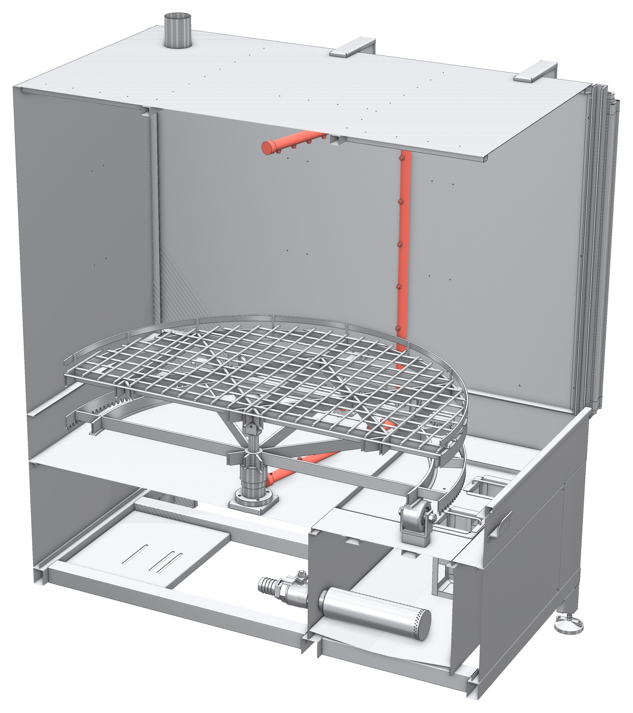

# 9.1 Bakım talimatları

## 9.1.1 Genel bakım kuralları

- Bakıma başlamadan önce makineyi durdurun ve **Bölüm 2.3.3**'teki LOTO prosedürünü uygulayın. Bakım sırasında **Ana şalteri** hiçbir koşulda kilitsiz bırakmayın.
- Tank, ısıtıcı, pompa ve borular üzerinde çalışmadan önce yıkama sıvısının 40 °C'nin altına soğumasını bekleyin.
- Bakımda **Bölüm 2.2.6**'daki KKD'yi kullanın.
- Değiştirilen parçalar için yalnızca orijinal yedek parça kullanın (**Bkz. Bölüm 13.3**).
- Bakım sırasında sökülen koruyucu panelleri ve kapakları, makineyi yeniden çalıştırmadan önce yerine takın.
- Bakımdan sonra güvenlik donanımlarını **Bölüm 5.4**'e göre test edin.

---

## 9.1.2 Bakım planı

Tablo: Periyodik bakım planı

| Periyot | Bakım işi | Model | Yapan | Talimat |
|---|---|---|---|---|
| Her vardiya başında | Acil durdurma butonunu ve kapak emniyet şalterini test edin | Tümü | Operatör | **Bkz. Bölüm 7.2** |
| Her vardiya başında | TEST butonunu bıraktığınızda döndürmenin hemen durduğunu kontrol edin | P | Operatör | **Bkz. Bölüm 5.4.8** |
| Her vardiya başında | Tank sıvı seviyesini ve sıvının durumunu kontrol edin | Tümü | Operatör | **Bkz. Bölüm 7.2** |
| Her vardiya başında | Işık perdesini test edin | Işık perdesi (opsiyon) | Operatör | **Bkz. Bölüm 5.4.6** |
| Her vardiya başında | El koruma sensörünü test edin | P (ışık perdesi opsiyonu yoksa) | Operatör | **Bkz. Bölüm 5.4.6** |
| Günlük | Süzgeç sepetlerini temizleyin, sıvı yüzeyindeki yağı alın | Tümü | Operatör | **Bkz. Bölüm 10.1.3** |
| Günlük | Pompa, borular ve tahliye vanasında sızıntı olup olmadığını gözle kontrol edin | Tümü | Operatör | — |
| Günlük | Şartlandırıcı manometresinde hava basıncını kontrol edin | P | Operatör | **Bkz. Bölüm 6.5** |
| Her kullanımdan önce | Yüksek basınç hortumunu ve tabancayı kontrol edin | MULTI | Operatör | **Bkz. Bölüm 9.1.9** |
| Haftalık | Nozulları kontrol edin ve tıkalı olanları temizleyin | Tümü | Bakım personeli | **Bkz. Bölüm 9.1.3** |
| Haftalık | Sepetin (DS) veya nozul sisteminin (DN) serbest ve sessiz döndüğünü kontrol edin | Tümü | Bakım personeli | **Bkz. Bölüm 9.1.6** |
| Haftalık | Şartlandırıcı filtresindeki yoğuşma suyunu boşaltın | P | Bakım personeli | **Bkz. Bölüm 9.1.8** |
| Haftalık | Işık perdesinin ön camlarını temizleyin | Işık perdesi (opsiyon) | Operatör | **Bkz. Bölüm 9.1.13** |
| Aylık | Yıkama sıvısını değiştirin ve tankı temizleyin; ısıtıcı yüzeyini kontrol edin | Tümü | Bakım personeli | **Bkz. Bölüm 10.1.4** ve **9.1.4** |
| Aylık | Seviye şalterinin çalışmasını kontrol edin | Tümü | Bakım personeli | **Bkz. Bölüm 9.1.4** |
| Aylık | Kapak kılavuzlarını ve kapak hareketini kontrol edin | Tümü | Bakım personeli | **Bkz. Bölüm 9.1.7** |
| Aylık | Pompa mekanik salmastrasında sızıntı ve pompada anormal ses olup olmadığını kontrol edin | Tümü | Bakım personeli | **Bkz. Bölüm 9.1.5** |
| Aylık | Nozul kollarının redüktörlü motorlarını, zincirlerini ve zincir dişlilerini kontrol edin | P DN | Bakım personeli | **Bkz. Bölüm 9.1.6** |
| Aylık | Sepet yerinde sensörünün temiz ve sıkı olduğunu, sepet yerindeyken kapağın açılıp kapandığını kontrol edin | P DN | Bakım personeli | **Bkz. Bölüm 9.1.11** |
| Aylık | Döndürme redüktörlü motorunu, pinyonu ve sepet dişli çemberini kontrol edin | DS | Bakım personeli | **Bkz. Bölüm 9.1.6** |
| Aylık | Buhar tahliye fanını ve kanalını kontrol edin | Tümü | Bakım personeli | **Bkz. Bölüm 9.1.10** |
| Aylık | Pnömatik silindirlerde ve hortumlarda sızıntı olup olmadığını kontrol edin | P | Bakım personeli | **Bkz. Bölüm 9.1.8** |
| Aylık | Taşıma arabasını (OTO), sepet tekerleklerinin kaydığı profilleri ve tekerlekleri kontrol edin | Tümü | Bakım personeli | **Bkz. Bölüm 9.1.11** |
| Aylık | Sepet pimini, pim yuvalarını, kilitleme kolunu ve kilitleme kancasını kontrol edin | P | Bakım personeli | **Bkz. Bölüm 9.1.11** |
| Aylık | Yağ sıyırıcıyı temizleyin ve çalışmasını kontrol edin | Yağ sıyırıcı (opsiyon) | Bakım personeli | **Bkz. Bölüm 9.1.13** |
| Aylık | Otomatik dolum vanasını ve üst seviye algılayıcısını kontrol edin | Otomatik dolum (opsiyon) | Bakım personeli | **Bkz. Bölüm 9.1.13** |
| Aylık | Drenaj pompasını ve tahliye hattını sızıntıya karşı kontrol edin | Otomatik drenaj (opsiyon) | Bakım personeli | **Bkz. Bölüm 9.1.13** |
| Aylık | Uyarı etiketlerinin yerinde ve okunur olduğunu kontrol edin | Tümü | Bakım personeli | **Bkz. Bölüm 2.2.4** |
| **3 ayda bir** | **Kapak amortisörlerini kontrol edin** | E | Bakım personeli | **Bkz. Bölüm 9.1.7** |
| 6 ayda bir | Elektrik panosundaki, motor ve ısıtıcı bağlantı kutularındaki klemenslerin sıkılığını kontrol edin | Tümü | Elektrik personeli | **Bkz. Bölüm 9.1.12** |
| 6 ayda bir | Zamanlayıcının saatini ve programını kontrol edin | Zamanlayıcı opsiyonları | Bakım personeli | **Bkz. Bölüm 6.6.4** |
| Yıllık | Elektriksel güvenlik testlerini yapın | Tümü | Elektrik personeli | **Bkz. Bölüm 9.1.12** |
| Yıllık | Aşınmış nozulları değiştirin | Tümü | Bakım personeli | **Bkz. Bölüm 9.1.3** |
| **2 yılda bir** | **Kapak amortisörlerini değiştirin** (kontrol sonucu iyi olsa bile) | E | Bakım personeli | **Bkz. Bölüm 9.1.7** |
| {{BAKIM:Redüktör yağ değişim periyodu}} | Redüktör yağını değiştirin | Döndürme motorlu modeller | Bakım personeli | **Bkz. Bölüm 9.1.6** |
| {{OPSIYONLAR:Hassas filtre — filtre torbası basit temizlik periyodu}} | Filtre torbasını temizleyin (basit temizlik) | Hassas filtre (opsiyon) | Bakım personeli | **Bkz. Bölüm 9.1.13** |
| {{OPSIYONLAR:Hassas filtre — filtre torbası detaylı temizlik periyodu}} | Filtre torbasını ve filtre gövdesini detaylı temizleyin | Hassas filtre (opsiyon) | Bakım personeli | **Bkz. Bölüm 9.1.13** |
| {{OPSIYONLAR:Hassas filtre — filtre torbası değişim ölçütü}} | Filtre torbasını değiştirin | Hassas filtre (opsiyon) | Bakım personeli | **Bkz. Bölüm 9.1.13** |

---

## 9.1.3 Nozulların kontrolü ve temizliği

Kabinin her iki yan duvarında; sepetin altındaki alt koldan, yan duvar boyunca yükselen dikey borudan ve kabin tavanının altındaki üst koldan oluşan birer püskürtme çerçevesi bulunur. Nozullar bu boruların üzerindedir. Tıkalı veya aşınmış nozullar, parçaların bazı bölgelerinin yıkanmamasına ve pompa basıncının değişmesine yol açar.

**Kontrol**

1. Makineyi boş sepetle ve kapak kapalıyken kısa bir süre çalıştırın; püskürtme sesinde düzensizlik olup olmadığını dinleyin.
2. Makineyi durdurun ve **Bölüm 2.3.3**'e göre kilitleyin.
3. Kapağı açın ve nozulları gözle kontrol edin. Ağzı kir veya kireçle kapanmış, ağız çevresi aşınmış veya hasarlı nozulları belirleyin.

**Temizlik**

4. Tıkalı nozulu püskürtme borusundan sökün.
5. Nozulu sıcak su ve yıkama kimyasalı ile temizleyin; ağzındaki kiri plastik bir çubukla veya basınçlı hava ile çıkarın.
6. Nozulu yerine takın ve püskürtme yönünün söktüğünüz konumla aynı olduğunu kontrol edin.

**NOT:** Nozul ağzını tel, iğne veya matkap ucuyla temizlemeyin. Ağız genişlerse püskürtme açısı ve debisi değişir, pompa basıncı düşer ve yıkama kalitesi bozulur. Ağzı genişlemiş veya aşınmış nozulu değiştirin.

---

## 9.1.4 Isıtıcı ve seviye şalteri

**Isıtıcı yüzeyi:** Tank her boşaltıldığında ısıtıcıların yüzeyini gözle kontrol edin. Isıtıcı üzerinde kireç veya kir tabakası varsa yumuşak bir fırçayla temizleyin. Kalın kireç tabakası ısıtıcının aşırı ısınmasına ve erken arızalanmasına yol açar; suyunuz sertse kireç oluşumunu önlemek için kimyasal tedarikçinize danışın.

**Seviye şalteri:**

1. Tank doluyken makineyi çalıştırın ve ısıtmayı devreye alın.
2. Tank tahliye vanasını açarak sıvı seviyesini yavaşça düşürün.
3. Sıvı seviyesi seviye şalterinin altına indiğinde **SU SEVİYESİ YETERSİZ** ikaz lambasının yandığını ve ısıtıcının devreden çıktığını kontrol edin.
4. Tahliye vanasını kapatın, tankı yeniden doldurun ve **RESET** butonuna basın.
5. Lamba yanmıyorsa veya ısıtıcı devreden çıkmıyorsa makineyi kullanmayın; seviye şalterini elektrik personeline kontrol ettirin.

---

## 9.1.5 Yıkama pompası

1. Makine çalışırken pompadan gelen sesi dinleyin. Hırıltı, vınlama veya titreşim; süzgeç sepetlerinin veya pompa emiş süzgecinin tıkandığını, sıvı seviyesinin düştüğünü veya rulman hasarını gösterebilir.
2. Makineyi durdurun ve kilitleyin.
3. Pompa gövdesinin altında ve mekanik salmastra bölgesinde damlama olup olmadığını kontrol edin. Mekanik salmastradan sürekli damlama varsa salmastrayı değiştirin.
4. Pompa ve motor bağlantı cıvatalarının sıkılığını kontrol edin.

**NOT:** Pompayı hiçbir zaman kuru (tank boşken) çalıştırmayın. Kuru çalışma mekanik salmastrayı birkaç saniye içinde tahrip eder.

---

## 9.1.6 Döndürme tahriki

Döndürme redüktörlü motoru DS modellerde yıkama sepetini döndürür. P DN modellerde nozul kollarını döndüren redüktörlü motorlar: {{GENEL_TEKNIK:Nozul döndürme redüktörlü motorları — P DN modeller}}. Motorlar hareketi zincir ve zincir dişlileriyle nozul kollarına aktarır. Üst nozul kolunun redüktörlü motoru makinenin tavanında, alt nozul kolununki kabin tabanının altındadır (**Bkz. Bölüm 3.1.3**). E DN modellerde {{GENEL_TEKNIK:Nozul kollarının dönüşü — E DN modeller}}.

**UYARI — Dönen parçalar:** Nozul kolları, zincirler ve zincir dişlileri çalışırken el veya giysi kaptırabilir. Tahrik üzerindeki her işten önce makineyi **Bölüm 2.3.3**'e göre kilitleyin. Tavandaki redüktörlü motora erişmek için makinenin tavanına çıkmayın; merdiven veya çalışma platformu kullanın.

**DS modeller: sepet döndürme tahriki**

1. Makine çalışırken sepetin sarsıntısız ve sabit hızda döndüğünü kontrol edin.
2. Redüktörlü motordan gelen sesi dinleyin; düzensiz ses rulman veya dişli hasarını gösterebilir.
3. Makineyi durdurun ve kilitleyin.
4. Redüktör gövdesinde ve mil çıkışında yağ sızıntısı olup olmadığını kontrol edin.
5. Sepetin dönüşünü engelleyen talaş, parça veya kir olup olmadığını kontrol edin ve temizleyin.
6. Pinyonun ve sepet dişli çemberinin dişlerinde kırık, aşırı aşınma ve dişler arasına sıkışmış talaş olup olmadığını kontrol edin.
7. Sepet merkez yatağının boşluk yapmadığını ve sepetin dönerken salgı yapmadığını kontrol edin.

**P DN modeller: nozul kollarının tahriki**

8. Makine çalışırken üst ve alt nozul kollarının sarsıntısız ve sabit hızda döndüğünü kapak kapalıyken sesinden kontrol edin; düzensiz ses rulman, zincir veya dişli hasarını gösterebilir.
9. Makineyi durdurun ve kilitleyin.
10. Üst ve alt redüktörlü motorların gövdesinde ve mil çıkışında yağ sızıntısı olup olmadığını kontrol edin.
11. Kabin tavanındaki ve kabin tabanındaki zincirlerde gevşeklik, uzama, kırık bakla ve korozyon olup olmadığını kontrol edin.
12. Zincir dişlilerinin dişlerinde aşınma ve kırık olup olmadığını, dişlilerin mil üzerinde boşluk yapmadığını kontrol edin.
13. Zincirlerin ve zincir dişlilerinin arasına sıkışmış talaş ve kiri temizleyin.
14. Nozul kollarını elle çevirerek takılmadan döndüklerini ve nozul kolu bağlantılarında boşluk olmadığını kontrol edin.
15. Gevşek veya aşınmış zinciri ve zincir dişlisini yalnızca orijinal parçayla değiştirin (**Bkz. Bölüm 13.3**).

**E DN modeller: nozul kolları**

16. Makine çalışırken nozul kollarının sarsıntısız ve sabit hızda döndüğünü kapak kapalıyken sesinden kontrol edin. Nozul kolları yavaş dönüyorsa veya duruyorsa nozullar tıkalı ya da döner bağlantılar kirli olabilir.
17. Makineyi durdurun ve kilitleyin.
18. Nozul kollarını elle çevirerek takılmadan döndüklerini kontrol edin; döner bağlantılarda biriken kiri ve talaşı temizleyin.
19. Nozulları **Bölüm 9.1.3**'e göre kontrol edin ve temizleyin.

**Döndürme motorlu modeller (DS ve P DN)**

20. Redüktör yağını {{BAKIM:Redüktör yağ değişim periyodu}} periyotta, {{BAKIM:Redüktör yağı tipi ve miktarı}} ile değiştirin.

---

## 9.1.7 Kapak, kapak kılavuzları ve amortisörler

P modellerde kapak, kabinin önündeki kapak çerçevesinin kılavuzlarında hareket eder. E modellerdeki elle açılan kapağın amortisörleri bu bölümün sonunda ayrıca ele alınmıştır.

1. Kapak kılavuzlarında talaş, kir ve kireç birikimi olup olmadığını kontrol edin; birikintileri temizleyin.
2. Kapağı açıp kapatarak hareketin kılavuzlarda takılmadan ve sarsıntısız olduğunu kontrol edin.
3. Kapağın kapalı konumda gövdeye tam oturduğunu ve çevrim sırasında kapak kenarlarından sıvı veya buhar sızmadığını kontrol edin.
4. Kapakta eğilme, ezilme ve kaynak çatlağı olup olmadığını kontrol edin.
5. Kapak kapalıyken kapak emniyet şalterinin kapağı algıladığını kontrol edin (**Bkz. Bölüm 5.4.2**).

**Kapak amortisörleri (E modeller) — 3 ayda bir kontrol, 2 yılda bir değişim**

E modellerdeki kapak elle aşağı indirilerek açılır ve kaldırılarak kapatılır; kapağın hareketi gazlı amortisörlerle dengelenir. Amortisörler, kapağın indirilirken ve kaldırılırken kontrolsüz düşmesini önleyen kritik parçalardır; zamanla gaz kaybederek güçlerini yitirir ve bu kayıp dışarıdan her zaman fark edilmez. Bu nedenle:

- Amortisörleri **3 ayda bir** kontrol edin.
- Amortisörleri, kontrol sonucu iyi olsa bile **2 yılda bir** değiştirin.
- Kontrolde kusur bulunan amortisörleri 2 yıllık süreyi beklemeden hemen değiştirin.

Kontrol ve değişim tarihlerini bakım kayıt formuna yazın (**Bkz. Bölüm 14.1.3**).

**UYARI — Düşen kapak:** Gücünü kaybetmiş, hasarlı veya sökülmüş amortisör kapağı tutamaz; kapak düşerek başta ve ellerde ağır yaralanmaya yol açar. Amortisörleri kontrol ederken ve değiştirirken baret takın; amortisörleri sökmeden önce kapağı mekanik bir destekle düşmeye karşı sabitleyin.

**Kontrol (3 ayda bir)**

6. Baret takın.
7. Kapağı tutamağından tutarak yavaşça indirin; amortisörlerin kapağın inişini frenlediğini ve kapağın kontrolsüz düşmediğini kontrol edin.
8. Kapağı kaldırarak kapatın; kapatmak için gereken kuvvetin önceki kontrole göre artıp artmadığını kontrol edin. Kuvvetin artması, amortisörlerin güç kaybettiğini gösterir.
9. Amortisörlerin gövdesinde yağ sızıntısı, milinde çizik, pas veya ezik, bağlantı uçlarında boşluk ve hasar olup olmadığını kontrol edin.
10. Amortisör bağlantı cıvatalarının sıkı olduğunu kontrol edin.
11. Kapak indirilirken kontrolsüz düşüyorsa veya 8.–10. adımlarda bir kusur bulunduysa makineyi kullanmayın ve amortisörleri hemen değiştirin.

**Değişim (2 yılda bir)**

12. Baret takın, kapağı tam açık konuma indirin ve amortisörler sökülürken kapağın hareket etmemesi için kapağı mekanik bir destekle sabitleyin.
13. Amortisörleri bağlantı uçlarından sökün. Sökülen amortisörleri delmeyin ve ateşe atmayın; içlerinde basınçlı gaz bulunur.
14. Yalnızca orijinal, aynı kuvvet ve boydaki amortisörleri takın (**Bkz. Bölüm 13.3**). Amortisörlerin tümünü aynı anda değiştirin.
15. Mekanik desteği kaldırın.
16. Kapağı birkaç kez açıp kapatın; amortisörlerin kapağın inişini frenlediğini ve kapağın kontrolsüz düşmediğini kontrol edin.
17. Değişim tarihini bakım kayıt formuna yazın.

---

## 9.1.8 Pnömatik sistem (P modeller)

1. Şartlandırıcının filtre haznesindeki yoğuşma suyunu tahliye vanasından boşaltın.
2. Filtre elemanının kirlenmiş olup olmadığını kontrol edin; kirli elemanı değiştirin.
3. Regülatör manometresinde basıncın **Bölüm 6.5**'teki değerde olduğunu kontrol edin.
4. Pnömatik hortumlarda ve rakorlarda hava kaçağı olup olmadığını dinleyerek kontrol edin.
5. Kapak silindirlerinin mil yüzeyinde çizik ve sızıntı olup olmadığını kontrol edin.
6. Silindirlerin yanındaki kısma valflerinin kilit somunlarının sıkı olduğunu gözle kontrol edin. Kısma valflerinin ayar vidalarını ve kilit somunlarını çevirmeyin; ayar bozulmuşsa üretici servisine başvurun (**Bkz. Bölüm 6.5.2**).

---

## 9.1.9 Manuel yıkama donanımı (MULTI modeller)

**UYARI — Yüksek basınç:** Basınç altındaki hortum veya rakor sökülürse sıvı jeti ağır yaralanmaya yol açabilir. Hortum, tabanca veya rakorlara müdahale etmeden önce manuel yıkama pompasını durdurun ve tabancanın tetiğine basarak basıncı boşaltın.

1. Yüksek basınç hortumunu tüm boyunca çatlak, kabarma, ezilme ve aşınmaya karşı kontrol edin.
2. Hortum rakorlarında ve tabanca bağlantısında sızıntı olup olmadığını kontrol edin.
3. Tetik emniyet kilidinin tetiği kilitlediğini kontrol edin.
4. Tabanca ucundaki nozulun tıkalı olmadığını kontrol edin.
5. Hasarlı hortum, tabanca veya rakorları orijinal parçalarla değiştirin; hortumu ek yaparak onarmayın.

---

## 9.1.10 Buhar tahliye fanı ve kanalı

1. Fanın çalışırken anormal ses ve titreşim yapmadığını kontrol edin.
2. Buhar tahliye kanalında yoğuşma suyu birikimi ve sızıntı olup olmadığını kontrol edin.
3. Kanal bağlantılarının sıkı olduğunu kontrol edin.
4. Fanın, ayarlanan çalışma süresi boyunca çalıştığını kontrol edin (**Bkz. Bölüm 6.6.5**).

---

## 9.1.11 Taşıma arabası, sepet tekerlekleri, pimler ve sepet yerinde sensörü

Taşıma arabası yalnızca P modellerde bulunur. Kabin içindeki işlerden önce makineyi **Bölüm 2.3.3**'e göre kilitleyin.

**Sepet tekerlekleri ve profiller (tüm modeller)**

1. Sepet tekerleklerinin kaydığı profillerde eğilme, çentik ve talaş birikimi olup olmadığını kontrol edin; profilleri temizleyin. Profillerdeki talaş, sepetin çekilip itilmesini zorlaştırır.
2. Sepet tekerleklerinin serbest döndüğünü ve tekerlek bağlantılarında boşluk olmadığını kontrol edin.

**Taşıma arabası (P modeller)**

3. Taşıma arabasının tekerleklerinin serbest döndüğünü ve hasarsız olduğunu kontrol edin; tekerlek yataklarındaki talaş ve kiri temizleyin.
4. Arabanın şasesinde deformasyon ve kaynak çatlağı olup olmadığını kontrol edin.
5. Arabanın tüm cıvatalarının ve somunlarının sıkı olduğunu kontrol edin; gevşek bağlantıları sıkın.
6. Kilitleme kolunun arabayı makineye sağlam şekilde kilitlediğini ve kilidin kendiliğinden açılmadığını kontrol edin. Kilitleme kancasında ve makinenin ön yüzündeki kilit braketinde eğilme ve aşınma olup olmadığını kontrol edin. Kilitlemeyen kol onarılana kadar arabayı kullanmayın.

**Pimler**

7. P modellerde sepet piminin çekildiğinde serbestçe yukarı kalktığını ve bırakıldığında yuvasına indiğini kontrol edin. Arabadaki ve kabin içindeki pim yuvalarında talaş, kir ve eğilme olup olmadığını kontrol edin; yuvaları temizleyin. Pimi yuvasına girmeyen sepeti onarılana kadar kullanmayın.
8. E modellerde kapak güvenlik piminin serbestçe hareket ettiğini ve bırakıldığında yuvasına girdiğini kontrol edin; yuvadaki talaşı ve kiri temizleyin. Yuvasına girmeyen pim onarılana kadar sepeti çekmeyin.

**Sepet yerinde sensörü (P DN modeller)**

9. Sepet yerinde sensörünün ön yüzündeki kiri ve talaşı yumuşak bir bezle temizleyin; sensörün sabitleme somununun sıkı olduğunu kontrol edin. Sensörün konumunu değiştirmeyin.
10. LOTO'yu kaldırın. Sepet kabine sonuna kadar itilmiş ve pimi yuvasına oturmuşken kapağın **KAPAK AÇ** ve **KAPAK KAPA** butonlarıyla açılıp kapandığını kontrol edin. Kapak hareket etmiyorsa **Bölüm 11.6**'ya bakın; sensörü köprülemeyin.

---

## 9.1.12 Elektrik bakımı ve yıllık elektriksel güvenlik testleri

Elektrik bakımını ve testleri yalnızca yetkili elektrik personeli yapar.

**6 ayda bir:**

1. Elektrik panosundaki güç ve kumanda klemenslerinin sıkılığını kontrol edin.
2. Isıtıcı ve motor bağlantı kutularındaki klemenslerde gevşeklik, oksitlenme ve ısınma izi olup olmadığını kontrol edin.
3. Pano içinde nem, toz ve yabancı madde olup olmadığını kontrol edin.

**Yıllık elektriksel güvenlik testleri (EN 60204-1):**

4. Koruma iletkeni (PE) sürekliliğini ölçün. Ölçülen direnç 0,1 Ω'u aşmamalıdır.
5. Güç devrelerinin yalıtım direncini 500 V DC ile ölçün. Yalıtım direnci 1 MΩ'dan küçük olmamalıdır.
6. Tesis tarafındaki kaçak akım rölesini test butonuyla ve ölçüm cihazıyla test edin.
7. Acil durdurma butonunun tüm motorları ve ısıtıcıları durdurduğunu kontrol edin.
8. Kapak emniyet şalterinin, kapak açıldığında yıkama pompasını, E DS modellerde ayrıca sepet döndürme motorunu, P modellerde ayrıca redüktörlü motorları durdurduğunu kontrol edin.
9. Test sonuçlarını **Bölüm 14.1.4**'teki forma kaydedin.

Testlerden herhangi biri olumsuz sonuçlanırsa makineyi arıza giderilene kadar kullanmayın.

---

## 9.1.13 Opsiyonel donanımların bakımı

Bu bölümdeki bakım işleri yalnızca ilgili opsiyonu bulunan makineler için geçerlidir (**Bkz. Bölüm 3.1.6**). Temizlik ve parça değişimi gerektiren adımlardan önce makineyi kilitleyin; kontrolleri ve testleri adımlarda belirtildiği gibi makine enerjiliyken yapın.

**Hassas filtre: filtre torbasının temizliği ve değiştirilmesi**

Basit temizlik: {{OPSIYONLAR:Hassas filtre — filtre torbası basit temizlik periyodu}}. Detaylı temizlik: {{OPSIYONLAR:Hassas filtre — filtre torbası detaylı temizlik periyodu}}. Filtre torbası değişim ölçütü: {{OPSIYONLAR:Hassas filtre — filtre torbası değişim ölçütü}}. Tıkanmış filtre torbası sıvının geçişini kısıtlar; püskürtme zayıflar ve pompa zorlanır. İki pompalı gövdelerde her pompanın filtresinde aynı işlemleri yapın.

1. Yıkama pompasını durdurun, makineyi **Bölüm 2.3.3**'e göre kilitleyin ve sıvının 40 °C'nin altına soğumasını bekleyin.
2. Filtre gövdesinin altına bir toplama kabı koyun.
3. Filtre gövdesinin kapağını açın.
4. Filtre torbasını halkasından tutarak gövdeden çıkarın ve içindeki sıvının gövdeye süzülmesini bekleyin.
5. Basit temizlikte torbanın içindeki kiri boşaltın ve torbayı temiz suyla durulayın.
6. Detaylı temizlikte torbayı ılık suyla yıkayın ve yumuşak bir fırçayla temizleyin; filtre gövdesinin içini ve torba destek sepetini de temizleyin.
7. Torbada yırtık, delik ve dikiş açılması olup olmadığını kontrol edin. Hasarlı veya temizlikten sonra da tıkalı kalan torbayı yeni torbayla değiştirin.
8. Torbayı, halkası gövdedeki yuvasına tam oturacak şekilde takın. Halkası yuvasına oturmayan torbanın kenarından kirli sıvı geçer.
9. Kapak contasını kontrol edin; hasarlıysa değiştirin.
10. Filtre gövdesinin kapağını kapatın ve sıkın.
11. LOTO'yu kaldırın, yıkama pompasını çalıştırın ve filtre gövdesinde sızıntı olmadığını kontrol edin.
12. Değiştirilen filtre torbasını yağlı atık olarak bertaraf edin.

**Yağ sıyırıcı**

13. Makineyi **Bölüm 2.3.3**'e göre kilitleyin.
14. Yağ sıyırıcının diskini ve sıyırma lastiklerini sıcak suyla temizleyin; aşınmış sıyırma lastiğini değiştirin.
15. Yağ toplama kabını ve yağın aktığı oluğu temizleyin.
16. Yağ sıyırıcının redüktörlü motorunda yağ sızıntısı olup olmadığını kontrol edin.
17. LOTO'yu kaldırın, yağ sıyırıcıyı çalıştırın ve diskin takılmadan döndüğünü kontrol edin.

**Otomatik dolum**

18. Makineyi **Bölüm 2.3.3**'e göre kilitleyin ve su dolum hattının kesme vanasını kapatın.
19. Dolum vanasının girişinde süzgeç bulunuyorsa süzgeci temizleyin.
20. Üst seviye algılayıcısını temizleyin.
21. LOTO'yu kaldırın, kesme vanasını açın ve makineye enerji verin. Sıvı seviyesi üst seviyenin altındayken dolum vanasının açıldığını, üst seviyeye ulaşıldığında kapandığını kontrol edin.

**Otomatik drenaj**

22. Drenaj pompasında, bağlantılarında ve tahliye hattında sızıntı olup olmadığını kontrol edin.
23. Tank boşaltılırken drenaj pompasının çalıştığını, tank alt seviyeye kadar boşaldıktan sonra zaman rölesinde ayarlanan süre kadar çalışıp durduğunu kontrol edin (**Bkz. Bölüm 7.6.5**). Zaman rölesinin ayarını yalnızca yetkili elektrik personeli değiştirir.

**Işık perdesi ve el koruma sensörü (P modeller)**

24. Kapağı tam kapatın ve makineyi **Bölüm 2.3.3**'e göre kilitleyin.
25. Işık perdesinin verici ve alıcısının ön camlarını veya el koruma sensörünün ön yüzünü yumuşak, nemli bir bezle temizleyin; aşındırıcı temizlik maddesi ve çözücü kullanmayın.
26. Bağlantı cıvatalarının sıkı olduğunu ve darbe almadığını kontrol edin. Hizası bozulan ışık perdesini veya el koruma sensörünü yalnızca yetkili elektrik personeli ayarlar.
27. LOTO'yu kaldırın ve **Bölüm 5.4.6**'ya göre test edin.

**Zamanlayıcı**

28. Zamanlayıcının gösterdiği saatin ve günün doğru olduğunu kontrol edin; yaz ve kış saati geçişlerinden sonra saati yeniden kontrol edin.
29. Programın **Bölüm 6.6.4**'e göre belirlenen programla aynı olduğunu kontrol edin.
