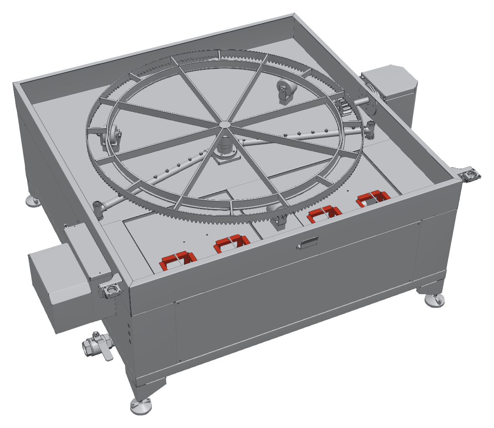

# 10.1 Temizlik talimatları

## 10.1.1 Genel temizlik kuralları

- Temizliğe başlamadan önce makineyi durdurun, **Ana şalteri** "0" konumuna getirin ve kilitleyin (**Bkz. Bölüm 2.3.3**).
- Tankta veya kabinde çalışmadan önce yıkama sıvısının 40 °C'nin altına soğumasını bekleyin.
- Elektrik panosuna, kumanda paneline, motorlara ve P modellerde valf bobinlerine su püskürtmeyin.
- Makinenin dış yüzeyini ve kabin içini basınçlı su veya buharlı temizleme cihazıyla yıkamayın. MULTI modellerde manuel yıkama tabancasını makineyi temizlemek için kullanmayın.
- Paslanmaz ve boyalı yüzeylerde tel fırça, çelik yünü, aşındırıcı toz ve klor içeren temizlik maddesi kullanmayın; bu malzemeler yüzeyi çizer ve korozyonu başlatır.
- Temizlikte çıkan yağlı çamuru ve süzgeç atıklarını ayrı kaplarda toplayın; kanalizasyona dökmeyin.

---

## 10.1.2 Temizlik planı

Tablo: Temizlik planı

| Periyot | Temizlik işi | Yapan | Talimat |
|---|---|---|---|
| Her çevrimden sonra | Sepette ve kabin tabanında kalan parça, talaş ve büyük kirleri alın | Operatör | **Bkz. Bölüm 10.1.3** |
| Günlük (vardiya sonu) | Süzgeç sepetlerini boşaltın ve temizleyin | Operatör | **Bkz. Bölüm 10.1.3** |
| Günlük (vardiya sonu) | Yıkama sıvısının yüzeyindeki yağı alın | Operatör | **Bkz. Bölüm 10.1.3** |
| Günlük (vardiya sonu) | Kapak alt kenarını ve kapak kılavuzlarını temizleyin | Operatör | **Bkz. Bölüm 10.1.3** |
| Haftalık | Nozulları tıkanmaya karşı kontrol edin ve temizleyin | Bakım personeli | **Bkz. Bölüm 9.1.3** |
| Haftalık | Makinenin dış yüzeyini temizleyin | Operatör | **Bkz. Bölüm 10.1.5** |
| Kirlilik durumuna göre (en geç {{BAKIM:Yıkama sıvısı değişim periyodu — en geç}}) | Yıkama sıvısını değiştirin, tankı ve pompa emiş süzgecini temizleyin | Bakım personeli | **Bkz. Bölüm 10.1.4** |

---

## 10.1.3 Günlük temizlik

**Sepet ve kabin**

1. Son çevrimden sonra sepeti boşaltın.
2. Makineyi durdurun ve **Ana şalteri** kilitleyin.
3. Sepette ve kabin tabanında kalan parça, talaş ve kirleri eldivenle veya bir kepçeyle alın.

**Süzgeç sepetleri**

Kabin tabanının ön kısmında, kabinden tanka dönen sıvının geçtiği dört süzgeç sepeti bulunur. Süzgeç sepetleri talaşı ve kaba kirleri tutarak tankı ve pompayı korur.

4. Kapağı açın ve süzgeç sepetlerine erişin.
5. Her süzgeç sepetini sapından tutarak yuvasından yukarı çekin.
6. Sepetin içindeki talaş ve kiri bir atık kabına boşaltın.
7. Süzgeç sepetini fırçayla ve suyla temizleyin; gözlerinin açık olduğunu kontrol edin.
8. Süzgeç teli yırtık veya deforme olmuşsa sepeti değiştirin.
9. Süzgeç sepetini yuvasına tam oturacak şekilde geri takın.

**NOT:** Makineyi süzgeç sepetleri takılı olmadan çalıştırmayın. Süzgeçsiz çalışmada talaş ve kir tanka ve pompaya ulaşarak pompa çarkını aşındırır ve nozulları tıkar.

**Yağ alma**

10. Yağ sıyırıcısı bulunmayan makinelerde yıkama sıvısının yüzeyinde toplanan yağı bir kepçeyle veya yağ emici bezle alın. Yağ sıyırıcısı bulunan makinelerde yağ toplama kabını boşaltın (**Bkz. Bölüm 7.6.2**).
11. Aldığınız yağı yağlı atık kabına koyun.

**Kapak**

12. Kapağın alt kenarını ve kapak kılavuzlarını nemli bir bezle silin; kılavuzlarda talaş ve kir bırakmayın.

---

## 10.1.4 Yıkama sıvısının değiştirilmesi ve tank temizliği

Yıkama sıvısı; yağ ve kir yükü arttıkça temizleme etkisini kaybeder, köpürür ve kötü koku oluşturur. Sıvıyı kirlilik durumuna göre değiştirin; değiştirme aralığı {{BAKIM:Yıkama sıvısı değişim periyodu — en geç}} süresini aşmamalıdır. Parçalarda yağ lekesi kalıyorsa veya sıvı belirgin şekilde bulanıklaştıysa sıvıyı daha erken değiştirin.

**UYARI — Sıcak sıvı:** Tahliye edilen sıvı yanığa yol açabilir. Tankı yalnızca sıvı 40 °C'nin altına soğuduktan sonra boşaltın.

1. **Ana şalteri** "0" konumuna getirin ve sıvının 40 °C'nin altına soğumasını bekleyin.
2. Makineyi **Bölüm 2.3.3**'e göre kilitleyin.
3. Makinenin sol tarafındaki tank tahliye vanasının çıkışını atık sıvı toplama kabına veya atık su hattına yönlendirin (tahliye vanasının konumu için **Bkz. Bölüm 3.1.3**, konum 13).
4. Tank tahliye vanasını açın ve tankı tamamen boşaltın.
5. Süzgeç sepetlerini çıkarın ve temizleyin.
6. Tankın içindeki pompa emiş süzgecini (delikli silindir) kontrol edin; üzerindeki kiri fırçayla ve suyla temizleyin.
7. Tank dibindeki çamuru ve talaşı bir kepçeyle alın.
8. Tankın iç yüzeylerini ve ısıtıcıların üzerini yumuşak bir fırçayla ve temiz suyla temizleyin. Isıtıcı yüzeyindeki kireç ve kir tabakası ısı geçişini azaltır.
9. Tankı temiz suyla durulayın ve durulama suyunu tahliye edin.
10. Tank tahliye vanasını kapatın.
11. Süzgeç sepetlerini yerine takın.
12. Tankı **Bölüm 7.2.2**'ye göre suyla doldurun ve kimyasalı ekleyin.

---

## 10.1.5 Dış yüzey temizliği

1. Makinenin dış yüzeyini nemli bir bez ve nötr bir temizlik maddesiyle silin.
2. Kumanda panelini yalnızca hafif nemli bir bezle silin; panele sıvı püskürtmeyin.
3. Makine çevresindeki zemini temizleyin ve kurulayın.
4. Uyarı etiketlerinin temiz ve okunur olduğunu kontrol edin.
