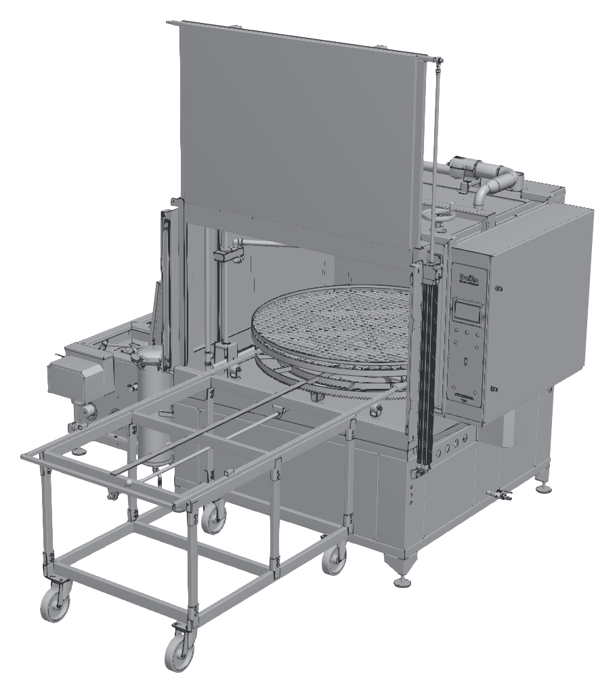
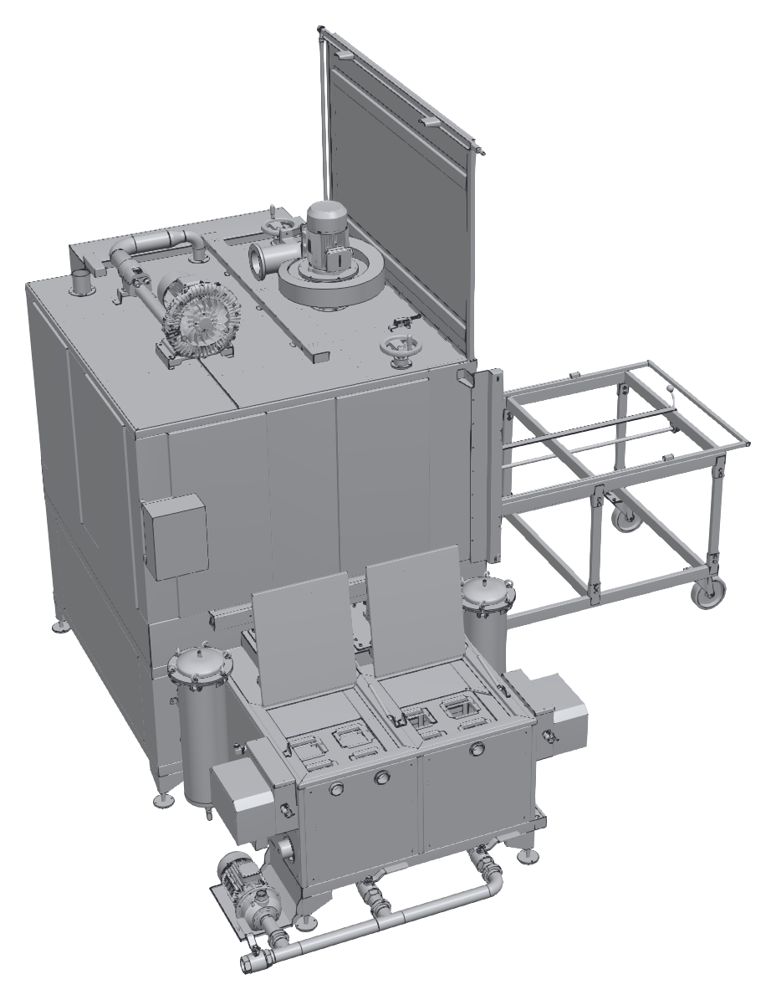
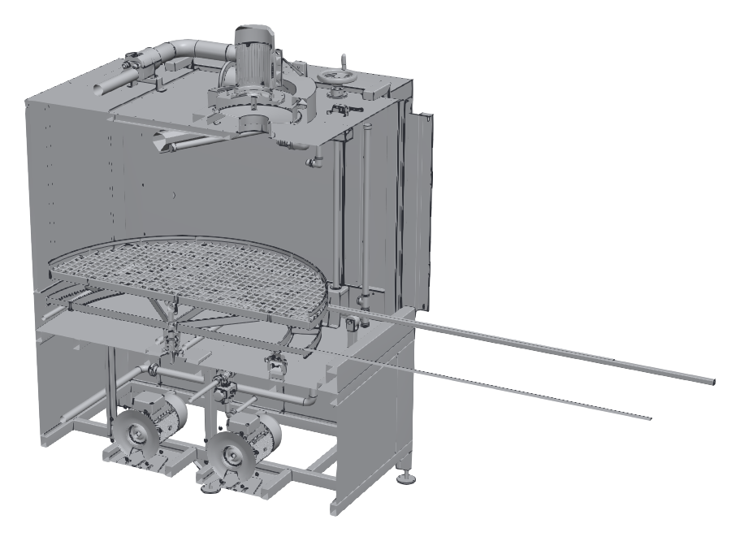
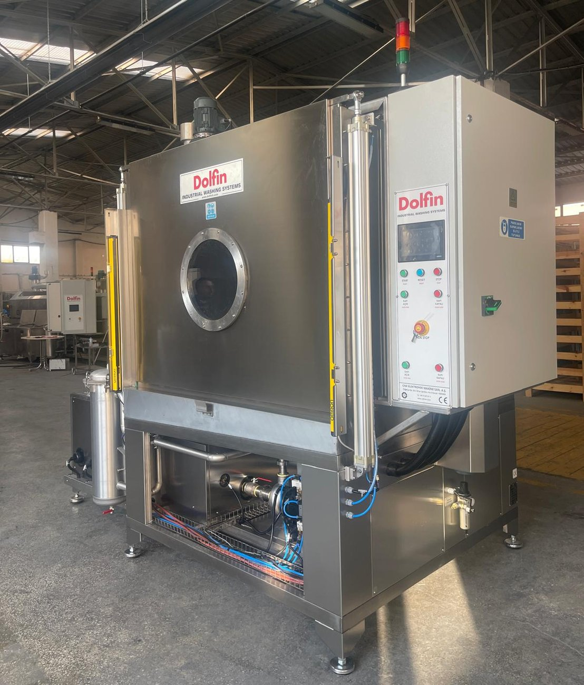
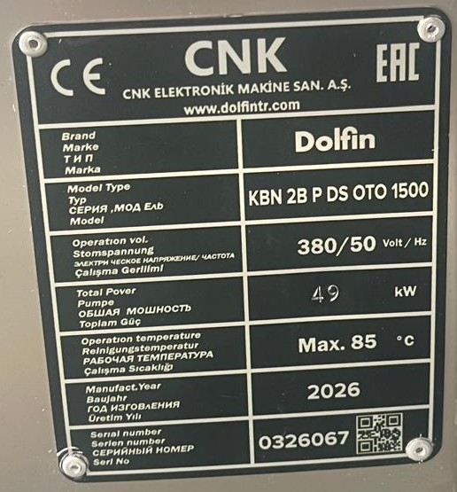

# 3.1 Makine tanımı

## 3.1.1 Genel tanım

KBN 2B, önden yüklemeli kabin tipi bir parça yıkama, durulama ve kurutma makinesidir. Makine; yıkama kabini, kabinin önündeki gözetleme camlı ve dikey açılan pnömatik kapak, kapı açıklığının iki yanındaki ışık perdesi, kabin içindeki döner sepet ve püskürtme boruları, makinenin sol yanındaki iki tanklı tank ünitesi, yıkama ve durulama pompaları, tavandaki buhar tahliye fanı ve kurutma ünitesi, sağ yandaki elektrik panosu, panonun ön yüzündeki HMI'lı kumanda paneli ve panonun üstündeki sinyal kulesinden oluşur.

- **Yükleme:** Kapak yukarı açıldığında kabinin ön yüzü tamamen açılır. Standart donanım olan taşıma arabası kapağın önüne yanaştırılır; sepet raylar üzerinde arabaya çekilir ve parçalar makinenin dışında yüklenir.
- **Kapak:** Kapak, kapı açıklığının iki yanındaki pnömatik silindirlerle açılıp kapatılır ve kumanda panelindeki KAPI AÇIK ve KAPI KAPALI butonlarıyla kumanda edilir. Kapı açıklığını ışık perdesi izler. Kapaktaki gözetleme camı ve kabin içindeki aydınlatma sayesinde program sırasında kabinin içi kapak açılmadan izlenebilir.
- **Yıkama:** Yıkama pompası 1. tanktaki yıkama sıvısını püskürtme borularına basar. Sepet, döndürme redüktörlü motorunun pinyonu ile sepetin dişli çemberinden döndürülür.
- **Durulama:** Durulama pompası 2. tanktaki durulama sıvısını aynı nozullardan püskürterek parçalardaki yıkama kimyasalı kalıntısını uzaklaştırır.
- **Kurutma:** Kurutma fanı, hava ısıtıcısından geçirdiği sıcak havayı kabine basar; parçalardaki su buharlaşır ve buhar tahliye fanıyla dışarı atılır.
- **Isıtma ve filtreleme:** Her iki tanktaki sıvı elektrikli ısıtıcılarla ısıtılır. Kabinden dönen sıvı tank üzerindeki süzgeç sepetlerinden geçer; pompa çıkışındaki sıvı filtre gövdelerinde filtrelenir.
- **Kumanda:** Makine PLC ile kumanda edilir. Program seçimi, parametre ayarları, durum ve alarm göstergeleri HMI dokunmatik ekranındadır.

---

## 3.1.2 Model kodu

Makinenin model kodu tip etiketinde yazılıdır (**Bkz. Bölüm 3.1.5**).

Örnek model kodu: **KBN 2B OTO P DS 1650**

Tablo: Model kodunun yapısı

| Kod alanı | Değer | Anlamı |
|---|---|---|
| Seri | KBN | Kabin tipi yıkama makinesi |
| Banyo (tank) sayısı | 2B | Çift banyolu: yıkama tankı ve durulama tankı |
| Fonksiyon tipi | OTO | Otomatik program: yıkama, durulama ve kurutma |
| Kapak tipi | P | Pnömatik kapak |
| Püskürtme tipi | DS | Döner sepet: sepet döner, nozullar sabittir |
| Gövde kodu | 1350 – 2350 | Makinenin gövde büyüklüğü; sepet çapı, tank kapasiteleri ve güç değerleri gövde koduna göre değişir |

Üretilen gövde kodları aşağıdaki tabloda verilmiştir (✓ üretilir).

{{TABLO:MODEL_VARYANTLARI}}

---

## 3.1.3 Ana bileşenler

Aşağıdaki şekillerde KBN 2B OTO P DS 1650 modeli kapak açık konumda, taşıma arabası kapağın önüne yanaştırılmış olarak gösterilmiştir. Diğer gövde kodlarında ölçüler ve bazı bileşenlerin konumu farklı olabilir.

Aşağıdaki fotoğrafta KBN 2B P DS OTO 1500 makinesi kapak kapalı konumda gösterilmiştir.

Tablo: Ana bileşenler

| No | Bileşen | İşlev |
|:---:|---|---|
| 1 | Ön kapak | Kabinin ön yüzünü kapatır; yukarı doğru açılarak yükleme açıklığını oluşturur. |
| 2 | Pnömatik kapak silindiri | Kapağı açar ve kapatır. Kapı açıklığının her iki yanında birer silindir bulunur. |
| 3 | Yıkama kabini | Yıkama, durulama ve kurutmanın yapıldığı kapalı hacim. |
| 4 | Yıkama sepeti | Parçaların yerleştirildiği ızgaralı döner tabla. |
| 5 | Kumanda paneli (HMI) | Program seçimi, parametre ayarları, alarmlar ve acil durdurma butonu (**Bkz. Bölüm 3.4**). |
| 6 | Elektrik panosu | Güç ve kumanda devrelerini ve PLC'yi içerir. Yalnızca yetkili elektrik personeli açar. |
| 7 | Taşıma arabası | Kapağın önüne yanaştırılır; sepet arabaya çekilerek makinenin dışında yüklenir ve boşaltılır. |
| 8 | Buhar tahliye fanı | Kabindeki buharı emerek egzoz hattına atar. |
| 9 | Tank ünitesi | Yıkama tankı (1. tank) ve durulama tankını (2. tank) içerir. |
| 10 | Filtre gövdesi | Pompa çıkışındaki sıvıyı filtreler. Her tankın devresinde birer filtre gövdesi bulunur. |
| 11 | Yağ sıyırıcı | Tanktaki sıvının yüzeyinde toplanan yağı ayırır. |
| 12 | Tank ünitesi pompası | {{TANK_UNITESI:Tank ünitesi altındaki pompanın işlevi}} |
| 13 | Tahliye manifoldu ve vanaları | Tankların boşaltıldığı boru grubu ve tahliye vanaları. |
| 14 | Kurutma fanı | Kurutma havasını hava ısıtıcısından geçirerek kabine basar. |
| 15 | Kurutma hava ısıtıcısı | Kurutma havasını ısıtır. |
| 16 | Tank kapakları | Tankların üzerini kapatır; süzgeç sepetlerine erişim için açılır. |
| 17 | Yıkama ve durulama pompaları | 1. ve 2. tanktaki sıvıyı filtre gövdeleri üzerinden püskürtme borularına basar. Pompaların konumu gövde koduna göre değişir; KBN 2B P DS OTO 1500'de bir pompa kabinin altındaki ön bölmede, dikey çok kademeli pompa makinenin sol arka köşesindedir (**Bkz. Bölüm 3.3.8**). |
| 18 | Püskürtme boruları | Sıvıyı parçalara püskürten nozulları taşır. |
| 19 | Gözetleme camı | Kapaktaki yuvarlak cam; kabinin içi kapak açılmadan görülür. |
| 20 | Işık perdesi | Kapı açıklığının iki yanında bulunan verici ve alıcıdan oluşur; kapak hareket alanını izler (**Bkz. Bölüm 2.2.3**). |
| 21 | Sinyal kulesi | Elektrik panosunun üstünde; makinenin durumunu renkli ışıklarla gösterir (**Bkz. Bölüm 3.4.1**). |
| 22 | Basınçlı hava girişi | "AIR INLET / HAVA GİRİŞİ" etiketli hızlı bağlantı rakoru ve şartlandırıcı (filtre-regülatör) (**Bkz. Bölüm 6.5**). |
| 23 | Ana şalter | Elektrik panosunun kapağında; makinenin tüm elektrik beslemesini açar ve keser (**Bkz. Bölüm 3.4.1**). |

Şekillerde gösterilmeyen diğer bileşenler:

- **Süzgeç sepetleri:** Her tankın üstünde dört adet; kabinden dönen sıvıdaki talaşı ve kaba kirleri tutar (**Bkz. Bölüm 10.1.3**).
- **Sepet rayları ve makaraları:** Sepet, kabin içindeki raylar üzerinde arabaya çekilir ve kabine itilir.
- **Döndürme tahriki:** Redüktörlü motor ve pinyon; sepetin dişli çemberini çevirir. Redüktörlü motor makinenin sağ yanında, elektrik panosunun altındadır.
- **Isıtıcılar, seviye şalterleri ve sıcaklık sensörleri:** Her iki tankta bulunur.
- **Taşma hatları:** Tank ünitesinin dış yüzünde, her tank için "TAŞMA HATTI" etiketli taşma çıkışı bulunur (**Bkz. Bölüm 5.3.2**).
- **Tahliye vanaları:** Her tankın altında "DRENAJ" etiketli küresel vana bulunur; vanalar zemindeki ortak tahliye borusuna bağlıdır.
- **Tank ünitesinin üstündeki pnömatik silindirler:** Tank kapaklarının arkasındaki kutunun üzerinde, konum sensörlü iki dikey silindir bulunur. İşlevleri: {{TANK_UNITESI:Tank ünitesi üstündeki pnömatik silindirlerin işlevi}}.
- **Pnömatik valf kutusu:** Kabinin sol yan duvarında, tank ünitesinin üstünde bulunan "KİLİTLİ TUT" etiketli kutudur; pnömatik valfleri içerir. Kabinin altındaki bölmede de pnömatik valfler bulunur.
- **Kabin aydınlatması:** Kabinin tavanındaki ve yan duvarındaki LED lambalar kabinin içini aydınlatır; program sırasında kabinin içi gözetleme camından izlenebilir.
- **Elektrik panosu:** PLC, güvenlik kontrolörü, frekans invertörü, motor koruma şalterleri, kaçak akım röleleri, faz koruma rölesi ve kontaktörleri içerir (**Bkz. Bölüm 3.3.5**).

---

## 3.1.4 Çalışma prensibi ve program akışı

Bir program aşağıdaki adımlardan oluşur. Adımların süreleri ve sıcaklıkları HMI'dan seçilen programda tanımlıdır (**Bkz. Bölüm 6.6**).

1. **Isıtma:** 1. tanktaki yıkama sıvısı ve 2. tanktaki durulama sıvısı ısıtıcılarla ayar sıcaklıklarına ısıtılır. Bir tankın sıvı seviyesi seviye şalterinin altındaysa o tankın ısıtıcısı çalışmaz ve HMI'da seviye alarmı görüntülenir.
2. **Yükleme:** Kapak açılır, sepet taşıma arabasına çekilir, parçalar yüklenir ve sepet kabine itilir (**Bkz. Bölüm 7.4**).
3. **Başlatma:** Kapak kapatılır ve program HMI'dan başlatılır. Kapak emniyet şalteri, kapak kapanmadan programın başlamasını engeller.
4. **Yıkama:** Yıkama pompası 1. tanktaki sıvıyı nozullardan parçalara püskürtür; sepet döner. Sıvı kabin tabanından süzgeç sepetlerinden geçerek 1. tanka döner.
5. **Durulama:** Durulama pompası 2. tanktaki sıvıyı aynı nozullardan püskürtür; sepet dönmeye devam eder. Sıvı 2. tanka döner.
6. **Kurutma:** Kurutma fanı, hava ısıtıcısından geçen sıcak havayı kabine basar. Buhar tahliye fanı nemli havayı egzoz hattına atar.
7. **Programın bitişi:** Pompalar, döndürme ve kurutma durur; HMI programın bittiğini gösterir.
8. **Boşaltma:** Kabindeki buharın tahliyesi beklendikten sonra kapak açılır ve sepet taşıma arabasına çekilerek parçalar boşaltılır.

Yağ sıyırıcılar, tanklardaki sıvının yüzeyinde toplanan yağı ayırarak sıvıların ömrünü uzatır.

---

## 3.1.5 Tip etiketi

Tip etiketi makinenin kimlik bilgilerini taşır. Etiketi sökmeyin ve üzerini kapatmayın. Tip etiketinin konumu: {{PROJE:Tip etiketi konumu}}.

Tip etiketinde aşağıdaki bilgiler bulunur:

- Üretici adı ve web adresi
- Marka
- Model kodu (model tipi)
- Çalışma gerilimi ve frekansı
- Toplam güç
- En yüksek çalışma sıcaklığı
- Üretim yılı
- Seri numarası ve karekod
- CE ve EAC işaretleri

Tip etiketinin hemen üstünde ayrı bir CE etiketi bulunur.

