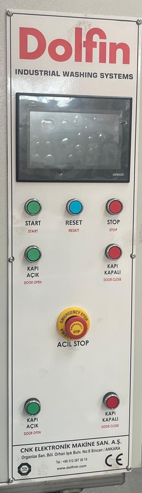

# 3.4 Kumanda elemanları

## 3.4.1 Kumanda paneli

Makine PLC ile kumanda edilir; operatör makineyi kumanda panelindeki dokunmatik ekranlı operatör paneli (HMI) ve butonlarla kullanır. Kumanda paneli {{KONTROLLER:Kumanda paneli konumu}} üzerindedir.

Kumanda panelinde yukarıdan aşağıya HMI, üç buton, iki kapak butonu, acil durdurma butonu ve en altta iki kapak elemanı daha bulunur. Her elemanın altında adı Türkçe, onun altında küçük kırmızı harflerle İngilizce yazılıdır.

Tablo: Kumanda paneli elemanları

| Konum | Eleman | İşlev |
|---|---|---|
| En üst | HMI dokunmatik ekran | Program seçimi, parametre ayarları, makine durumu, sıcaklıklar ve alarmlar (**Bkz. Bölüm 3.4.2**). |
| 1. sıra, sol | **START** butonu (yeşil) | {{KONTROLLER:START butonu (yeşil)}} (**Bkz. Bölüm 7.4.3**). |
| 1. sıra, orta | **RESET** butonu (mavi) | {{KONTROLLER:RESET butonu (mavi)}} (**Bkz. Bölüm 3.4.3**). |
| 1. sıra, sağ | **STOP** butonu (kırmızı) | {{KONTROLLER:STOP butonu (kırmızı)}} (**Bkz. Bölüm 7.3.2**). |
| 2. sıra, sol | **KAPI AÇIK / DOOR OPEN** butonu (yeşil) | {{KONTROLLER:KAPI AÇIK butonu (yeşil, 2. sıra)}} (**Bkz. Bölüm 3.4.4**). |
| 2. sıra, sağ | **KAPI KAPALI / DOOR CLOSE** butonu (kırmızı) | {{KONTROLLER:KAPI KAPALI butonu (kırmızı, 2. sıra)}} (**Bkz. Bölüm 3.4.4**). |
| Orta | **ACİL STOP / EMERGENCY STOP** — acil durdurma butonu | Makinenin hareketli ve ısıtıcı devrelerinin enerjisini keser (**Bkz. Bölüm 2.3.2**). |
| Alt sıra, sol | **KAPI AÇIK / DOOR OPEN** (yeşil) | {{KONTROLLER:KAPI AÇIK (yeşil, alt sıra)}} |
| Alt sıra, sağ | **KAPI KAPALI / DOOR CLOSE** (kırmızı) | {{KONTROLLER:KAPI KAPALI (kırmızı, alt sıra)}} |

Kumanda panelinde bulunmayan kumanda ve gösterge elemanları:

Tablo: Diğer kumanda ve gösterge elemanları

| Eleman | Konum | İşlev |
|---|---|---|
| **Ana şalter** | {{KONTROLLER:Ana şalter konumu}} | Makinenin tüm elektrik beslemesini açar ve keser. Döner kolun konumları: **I** (açık; kolda "I - On" yazar), **0** (kapalı) ve **Trip** (aşırı akım veya kısa devrede kendiliğinden atmış). Kol "0" konumunda asma kilitle kilitlenir (**Bkz. Bölüm 2.3.3**). |
| Basınçlı hava girişi | {{TESISAT:Basınçlı hava bağlantısı}} | Tesis hava hortumu bu girişteki hızlı bağlantı rakoruna takılır; hortum ayrıldığında makinenin basınçlı hava beslemesi kesilir (**Bkz. Bölüm 5.3.3**). |
| Sinyal kulesi | {{KONTROLLER:Sinyal kulesi konumu}} | Makinenin çalışma ve alarm durumunu uzaktan görülecek şekilde gösterir. Renkler (yukarıdan aşağıya): {{KONTROLLER:Sinyal kulesi renkleri (yukarıdan aşağıya)}}. Renklerin anlamı: {{KONTROLLER:Sinyal kulesi renklerinin anlamı}}. |

---

## 3.4.2 HMI (operatör paneli)

HMI, makinenin tüm işletim fonksiyonlarına erişim sağlar. HMI'da aşağıdaki işlemler yapılır:

- **Program seçimi:** Kayıtlı programlardan parça türü için tanımlanmış olan seçilir. Kayıtlı program sayısı: {{KONTROLLER:Kayıtlı program (reçete) sayısı}}.
- **Durum izleme:** 1. ve 2. tankın sıcaklıkları, programın çalışan adımı (yıkama, durulama, kurutma) ve kalan süre görüntülenir.
- **Parametre ayarları:** Yıkama, durulama ve kurutma süreleri ile tank ve kurutma sıcaklıkları ayarlanır (**Bkz. Bölüm 6.6**).
- **Alarmlar:** Arızalar alarm mesajıyla görüntülenir (**Bkz. Bölüm 3.4.3**).
- **Dil seçimi:** HMI dil seçenekleri: {{KONTROLLER:HMI dil seçenekleri}}.

Parametre ve program ayarlarına erişim şifreyle korunur. Şifre seviyeleri: {{KONTROLLER:Şifre seviyeleri}}. Operatör, kendisine verilen şifre seviyesinin dışındaki menülere girmez.

HMI: {{KONTROLLER:HMI marka / model}}, ekran boyutu {{KONTROLLER:HMI ekran boyutu (inç)}} inç. PLC: {{KONTROLLER:PLC marka / model}}. Güvenlik kontrolörü: {{GUVENLIK_DONANIMLARI:Güvenlik kontrolörü}}. Frekans invertörü: {{KONTROLLER:Frekans invertörü marka / model}}.

**NOT:** HMI ekranına sivri veya sert cisimlerle basmayın; ekranı yalnızca parmakla veya HMI için üretilmiş kalemle kullanın. Ekranı ıslak bezle silmeyin (**Bkz. Bölüm 10.1.5**).

---

## 3.4.3 Alarmlar ve alarm onaylama

PLC, makinenin çalışmasını engelleyen veya operatörün müdahalesini gerektiren durumları HMI'da alarm mesajı olarak gösterir. Tipik alarm nedenleri şunlardır:

- Tanklardan birinde sıvı seviyesinin düşük olması
- Pompa, döndürme veya fan motorunun koruma şalterinin atması
- Program sırasında kapağın açılması
- Acil durdurma butonuna basılması
- Sıcaklık sensörü arızası veya aşırı sıcaklık

Alarm görüntülendiğinde:

1. Alarm mesajını okuyun ve not edin.
2. Alarmın nedenini **Bölüm 11**'e göre belirleyin ve giderin. Operatör yetkisi dışındaki işleri bakım veya elektrik personeline bildirin.
3. Neden giderildikten sonra alarmı onaylayın: {{KONTROLLER:Alarm onaylama (reset) kumandası}}.

**NOT:** Nedenini gidermeden alarmı sürekli onaylayarak makineyi çalıştırmayın. Tekrarlanan motor koruma alarmları motorun veya tahrikin hasar gördüğünü gösterir.

---

## 3.4.4 Kapak kumandası

Kapak, kapı açıklığının iki yanındaki iki pnömatik silindirle yukarı doğru açılır ve aşağı doğru kapanır. Kapağı kumanda panelindeki **KAPI AÇIK** butonuyla açın, **KAPI KAPALI** butonuyla kapatın. Kapağın çalışması için basınçlı hava bağlantısının yapılmış ve hava basıncının **Bölüm 6.5**'teki değerde olması gerekir.

Kapı açıklığının iki yanındaki ışık perdesi kapak hareket alanını izler: {{GUVENLIK_DONANIMLARI:Işık perdesi işlevi}}. Işık perdesinin önüne malzeme koymayın; verici ve alıcının ön camlarını temiz tutun.

**UYARI — Kapanan kapak:** Kapak kapanırken el, kol veya baş kapak ile gövde arasında sıkışabilir. Basınçlı hava kesildiğinde açık kapak kendi ağırlığıyla aşağı inebilir. Kapağın altına girmeyin ve kapak hareket ederken elinizi kapak kenarına koymayın.

Kapak emniyet şalteri, kapak tam kapanmadan programın başlamasını engeller; program sırasında kapak açılırsa pompalar, döndürme ve kurutma durur.
