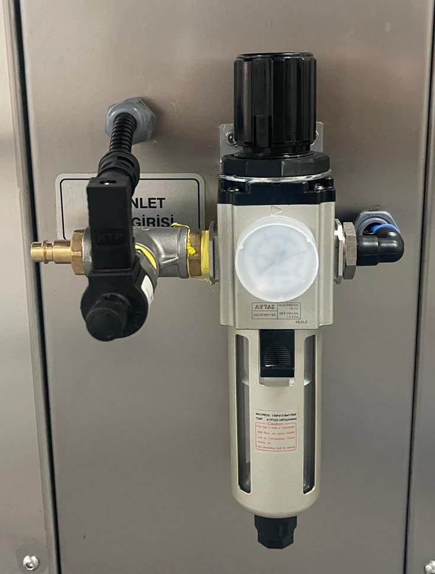

# 6.5 Pnömatik ayarlar

Pnömatik ayarları bakım personeli yapar.

---

## 6.5.1 Çalışma basıncı

Kapak silindirlerini ve tank ünitesinin üstündeki pnömatik silindirleri besleyen basınçlı hava, makinenin hava girişindeki şartlandırıcıdan geçer. Şartlandırıcı: {{TESISAT:Basınçlı hava şartlandırıcısı}}. Çalışma basıncı {{TESISAT:Basınçlı hava basıncı (bar)}} bar'dır.

1. Tesis hava hortumunun hava girişine takılı ve tesis hattında basınç olduğunu kontrol edin.
2. Regülatörün ayar düğmesini yukarı çekerek kilidini açın.
3. Düğmeyi saat yönünde çevirerek basıncı artırın, saat yönünün tersine çevirerek azaltın. Basıncı manometrede okuyarak çalışma basıncına ayarlayın.
4. Düğmeyi aşağı bastırarak kilitleyin.
5. Kapağı birkaç kez açıp kapatarak hareketin düzgün olduğunu kontrol edin.

**NOT:** Düşük basınçta kapak tam açılmaz veya kapanmaz; yüksek basınçta kapak sert hareket eder; kapak, kılavuzlar ve silindir bağlantıları zarar görür. Basıncı çalışma basıncının dışına ayarlamayın.

---

## 6.5.2 Kapak hareket hızı

Kapağın açılma ve kapanma hızları silindirlerin hava çıkışlarındaki hız ayar (kısma) valfleriyle ayarlanır. Hızlar fabrikada ayarlanmıştır; yalnızca kapak sert çarpıyor veya çok yavaş hareket ediyorsa ayarlayın.

**UYARI — Kapağın hareketi:** Ayar sırasında kapak hareket ederken el ve kol sıkışabilir. Ayarı kapak dururken yapın; kapağı hareket ettirmeden önce hareket alanında kimsenin bulunmadığını kontrol edin.

1. Kapağı tam kapalı konuma getirin.
2. Hız ayar valfinin kilit somununu gevşetin.
3. Hızı azaltmak için ayar vidasını saat yönünde, artırmak için saat yönünün tersine çeyrek tur çevirin.
4. Kapağı açıp kapatarak hareketi kontrol edin. Kapak, hareket sonunda çarpmadan yavaşça durmalıdır.
5. İstenen hıza ulaşana kadar 2. – 4. adımları tekrarlayın.
6. Kilit somununu sıkın.
7. İki silindirin hız ayar valflerini eşit ayarlayın; aksi halde kapak kılavuzlarında yamuk hareket eder ve sıkışır.
