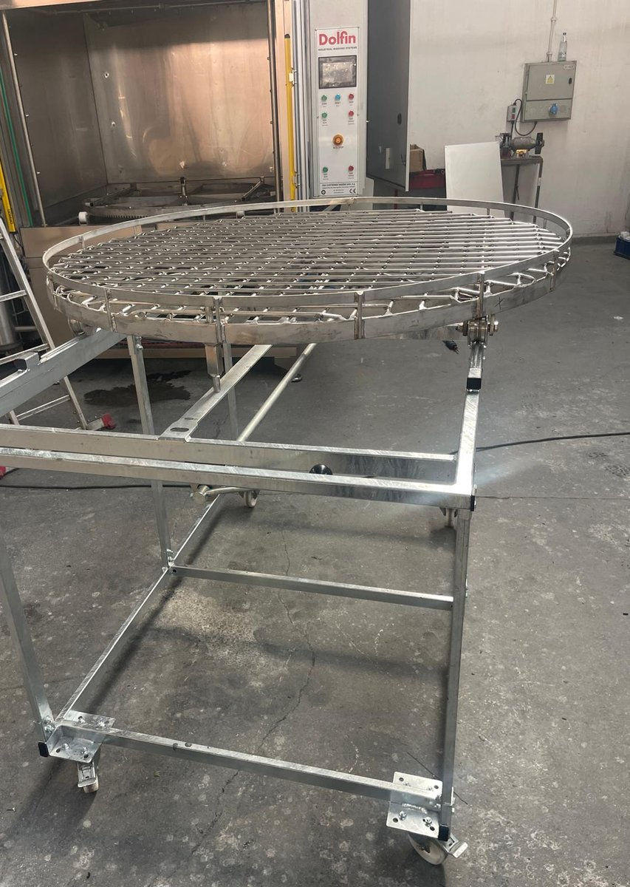

# 7.4 Program akışı

## 7.4.1 Parçaların hazırlanması

1. Parçaların ağırlığını, yüksekliğini ve çapını **Bölüm 3.3.2**'deki sınırlarla karşılaştırın.
2. Parçalar üzerindeki büyük talaş yığınlarını, bezleri, etiketleri ve gevşek ambalaj malzemelerini temizleyin. Bu malzemeler süzgeç sepetlerini, filtreleri ve nozulları tıkar.
3. Parçaların yanıcı sıvıya (solvent, benzin, tiner) bulanmış olmadığını kontrol edin.
4. Parçaların kurutma sıcaklığına dayanıklı olduğunu kontrol edin.
5. Küçük parçaları delikli kutu veya kapaklı tel sepet içine koyun.

---

## 7.4.2 Sepetin yüklenmesi

Parçalar sepete, sepet taşıma arabasına çekilerek makinenin dışında yüklenir. Hafif parçalar sepet kabin içindeyken de yüklenebilir.

**UYARI — Devrilen veya düşen yük:** Ağır parçaların sepete yüklenmesi sırasında parça devrilerek veya kaldırma ekipmanından kayarak el ve ayakları ezebilir. Ağır parçaları kaldırma ekipmanıyla taşıyın, yükün altında durmayın ve çelik burunlu iş ayakkabısı giyin.

**Taşıma arabası ile yükleme**

1. Kapağı kapak kumandasıyla tam açın.
2. Taşıma arabasını makinenin önüne, rayları kabin içindeki raylarla aynı hizada olacak şekilde yanaştırın.
3. Arabayı, sepet çekilirken hareket etmeyecek şekilde sabitleyin.
4. Sepeti raylar üzerinde arabaya doğru yavaşça çekin ve arabanın üzerinde tam oturttuğunuzu kontrol edin.
5. Parçaları sepete **Bölüm 8.2**'deki kurallara göre yerleştirin; yükü sepet üzerinde dengeli dağıtın (**Bkz. Bölüm 8.1.2**).
6. Sepeti raylar üzerinde kabine doğru yavaşça itin ve kabin içinde sonuna kadar yerleştiğini kontrol edin.
7. Taşıma arabasını makineden ayırın ve kapağın hareket alanından uzaklaştırın.

**Sepet kabin içindeyken yükleme**

8. Kapağı tam açın.
9. Hafif parçaları sepete elle yerleştirin. Kabin içine eğilirken başınızı kapak hareket alanına sokmayın.

**DİKKAT — Sıcak yüzeyler:** Kabin iç yüzeyleri, sepet ve önceki partinin parçaları sıcak olabilir. Yükleme ve boşaltmada ısıya dayanıklı eldiven kullanın.

---

## 7.4.3 Programın başlatılması

1. Kabinde ve kapak hareket alanında kimsenin bulunmadığını kontrol edin.
2. Kapağı kapak kumandasıyla tam kapatın.
3. HMI'da parça türü için tanımlanmış programı seçin (**Bkz. Bölüm 6.6**).
4. HMI'da her iki tankın sıcaklığının ayar değerinde olduğunu kontrol edin.
5. Programı başlatın: {{KONTROLLER:Programı başlatma kumandası}}.
6. HMI'da programın yıkama adımına geçtiğini, yıkama pompasının çalıştığını ve sepetin döndüğünü kontrol edin.

Program süresince makinenin başında kalın. HMI'da çalışan adımı ve kalan süreyi izleyin. Olağandışı ses, titreşim veya sızıntı fark ederseniz programı durdurun (**Bkz. Bölüm 7.3.2**).

---

## 7.4.4 Program adımları

Başlatılan program, PLC tarafından aşağıdaki sırayla uygulanır:

1. **Yıkama:** Yıkama pompası 1. tanktaki sıvıyı nozullardan parçalara püskürtür; sepet döner. Sıvı süzgeç sepetlerinden geçerek 1. tanka döner.
2. **Durulama:** Durulama pompası 2. tanktaki sıvıyı aynı nozullardan püskürtür; parçalardaki yıkama kimyasalı kalıntısı uzaklaştırılır. Sıvı 2. tanka döner.
3. **Kurutma:** Kurutma fanı, hava ısıtıcısından geçen sıcak havayı kabine basar; sepet dönmeye devam eder. Buhar tahliye fanı nemli havayı egzoz hattına atar.
4. **Bitiş:** Pompalar, döndürme ve kurutma durur; HMI programın bittiğini gösterir.

Adımların süreleri ve sıcaklıkları seçilen programda tanımlıdır.

---

## 7.4.5 Programın bitişi ve boşaltma

1. HMI'da programın bittiğini ve pompaların, döndürmenin ve kurutmanın durduğunu kontrol edin.
2. Kabindeki buharın ve sıcak havanın buhar tahliye fanıyla tahliye edilmesini bekleyin.
3. Kapağın önünde değil yanında durarak kapağı açın; yüzünüzü kapak hizasından uzak tutun.
4. Sepeti **Bölüm 7.4.2**'deki gibi taşıma arabasına çekin veya hafif parçaları kabin içinden alın.
5. Sıcak parçaları ısıya dayanıklı eldivenle tutun; ağır parçaları kaldırma ekipmanıyla alın.
6. Parçaların kuruduğunu kontrol edin. Parçalarda su kalıyorsa kurutma süresini veya kurutma sıcaklığını artırın ya da parçaların yerleşimini değiştirin (**Bkz. Bölüm 8.2**).

**UYARI — Sıcak buhar ve sıcak hava:** Kapak açıldığında kabinden çıkan sıcak buhar ve hava yüz ve ellerde yanığa yol açabilir. Kapağı tahliye tamamlanmadan açmayın ve kapağı açarken yüzünüzü kapak hizasından uzak tutun.
