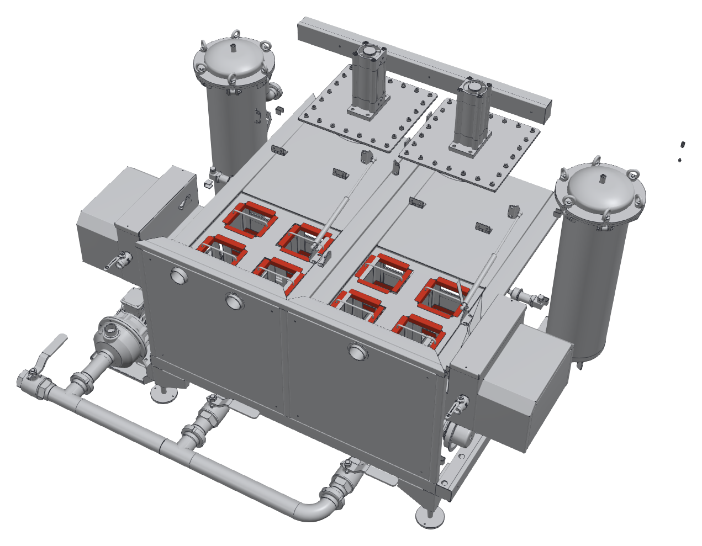

# 10.1 Temizlik talimatları

## 10.1.1 Genel temizlik kuralları

- Temizliğe başlamadan önce makineyi durdurun, **Ana şalteri** "0" konumuna getirin ve kilitleyin (**Bkz. Bölüm 2.3.3**).
- Tanklarda veya kabinde çalışmadan önce sıvıların 40 °C'nin altına soğumasını bekleyin.
- Elektrik panosuna, kumanda paneline (HMI), motorlara ve valf bobinlerine su püskürtmeyin.
- Makinenin dış yüzeyini ve kabin içini basınçlı su veya buharlı temizleme cihazıyla yıkamayın.
- Paslanmaz ve boyalı yüzeylerde tel fırça, çelik yünü, aşındırıcı toz ve klor içeren temizlik maddesi kullanmayın; bu malzemeler yüzeyi çizer ve korozyonu başlatır.
- Temizlikte çıkan yağlı çamuru, süzgeç ve filtre atıklarını ayrı kaplarda toplayın; kanalizasyona dökmeyin.

---

## 10.1.2 Temizlik planı

Tablo: Temizlik planı

| Periyot | Temizlik işi | Yapan | Talimat |
|---|---|---|---|
| Her programdan sonra | Sepette ve kabin tabanında kalan parça, talaş ve büyük kirleri alın | Operatör | **Bkz. Bölüm 10.1.3** |
| Günlük (vardiya sonu) | Her iki tanktaki süzgeç sepetlerini boşaltın ve temizleyin | Operatör | **Bkz. Bölüm 10.1.3** |
| Günlük (vardiya sonu) | Yağ sıyırıcıların toplama kaplarını boşaltın | Operatör | **Bkz. Bölüm 7.6.2** |
| Günlük (vardiya sonu) | Kapak alt kenarını ve kapak kılavuzlarını temizleyin | Operatör | **Bkz. Bölüm 10.1.3** |
| Haftalık | Nozulları ve filtre elemanlarını kontrol edin | Bakım personeli | **Bkz. Bölüm 9.1.3** ve **9.1.4** |
| Haftalık | Makinenin dış yüzeyini temizleyin | Operatör | **Bkz. Bölüm 10.1.5** |
| Kirlilik durumuna göre (en geç {{BAKIM:Yıkama sıvısı değişim periyodu — en geç}}) | Yıkama sıvısını değiştirin, yıkama tankını temizleyin | Bakım personeli | **Bkz. Bölüm 10.1.4** |
| Kirlilik durumuna göre (en geç {{BAKIM:Durulama sıvısı değişim periyodu — en geç}}) | Durulama sıvısını değiştirin, durulama tankını temizleyin | Bakım personeli | **Bkz. Bölüm 10.1.4** |

---

## 10.1.3 Günlük temizlik

**Sepet ve kabin**

1. Son programdan sonra sepeti boşaltın.
2. Makineyi durdurun ve **Ana şalteri** kilitleyin.
3. Sepette ve kabin tabanında kalan parça, talaş ve kirleri eldivenle veya bir kepçeyle alın.

**Süzgeç sepetleri**

Her tankın üst kısmında, kabinden dönen sıvının geçtiği dört süzgeç sepeti bulunur. Süzgeç sepetleri talaşı ve kaba kirleri tutarak tankları, pompaları ve filtreleri korur.

4. Tank kapağını açın; kapağın gazlı amortisörlerle açık durduğunu kontrol edin.
5. Her süzgeç sepetini sapından tutarak yuvasından yukarı çekin.
6. Sepetin içindeki talaş ve kiri bir atık kabına boşaltın.
7. Süzgeç sepetini fırçayla ve suyla temizleyin; gözlerinin açık olduğunu kontrol edin.
8. Süzgeç teli yırtık veya deforme olmuşsa sepeti değiştirin.
9. Süzgeç sepetini yuvasına tam oturacak şekilde geri takın.
10. 5. – 9. adımları tanktaki diğer süzgeç sepetleri için tekrarlayın ve tank kapağını kapatın.
11. Aynı işlemleri diğer tank için yapın.

**NOT:** Makineyi süzgeç sepetleri takılı olmadan çalıştırmayın. Süzgeçsiz çalışmada talaş ve kir tanka, pompalara ve filtrelere ulaşarak pompa çarklarını aşındırır, filtre elemanlarını ve nozulları tıkar.

**Kapak**

12. Kapağın alt kenarını ve kapak kılavuzlarını nemli bir bezle silin; kılavuzlarda talaş ve kir bırakmayın.

---

## 10.1.4 Sıvıların değiştirilmesi ve tank temizliği

Yıkama sıvısı; yağ ve kir yükü arttıkça temizleme etkisini kaybeder, köpürür ve kötü koku oluşturur. Durulama sıvısı ise parçalarla taşınan yıkama sıvısıyla kirlenir. Sıvıları kirlilik durumuna göre değiştirin; değiştirme aralıkları **Bölüm 10.1.2**'deki süreleri aşmamalıdır. Parçalarda yağ lekesi veya kimyasal kalıntısı kalıyorsa ilgili sıvıyı daha erken değiştirin.

**UYARI — Sıcak sıvı:** Tahliye edilen sıvı yanığa yol açabilir. Tankları yalnızca sıvı 40 °C'nin altına soğuduktan sonra boşaltın.

1. **Ana şalteri** "0" konumuna getirin ve sıvının 40 °C'nin altına soğumasını bekleyin.
2. Makineyi **Bölüm 2.3.3**'e göre kilitleyin.
3. Tahliye manifoldunun çıkışını atık sıvı toplama kabına veya atık su hattına yönlendirin (manifoldun konumu için **Bkz. Bölüm 3.1.3**, konum 13).
4. Boşaltılacak tankın tahliye vanasını açın ve tankı tamamen boşaltın. Diğer tankın vanasının kapalı olduğunu kontrol edin.
5. Tank kapağını açın ve süzgeç sepetlerini çıkarıp temizleyin.
6. Tank dibindeki çamuru ve talaşı bir kepçeyle alın.
7. Tankın iç yüzeylerini ve ısıtıcıların üzerini yumuşak bir fırçayla ve temiz suyla temizleyin. Isıtıcı yüzeyindeki kireç ve kir tabakası ısı geçişini azaltır.
8. Tankı temiz suyla durulayın ve durulama suyunu tahliye edin.
9. Tank tahliye vanasını kapatın.
10. İlgili filtre gövdesindeki filtre elemanını kontrol edin; kirlenmişse değiştirin (**Bkz. Bölüm 9.1.4**).
11. Süzgeç sepetlerini yerine takın.
12. Tankı **Bölüm 7.2.2**'ye göre doldurun; yıkama tankına kimyasalı ekleyin.

---

## 10.1.5 Dış yüzey temizliği

1. Makinenin dış yüzeyini nemli bir bez ve nötr bir temizlik maddesiyle silin.
2. HMI ekranını yalnızca hafif nemli, yumuşak bir bezle silin; ekrana sıvı püskürtmeyin.
3. Makine çevresindeki zemini temizleyin ve kurulayın.
4. Uyarı etiketlerinin temiz ve okunur olduğunu kontrol edin.
