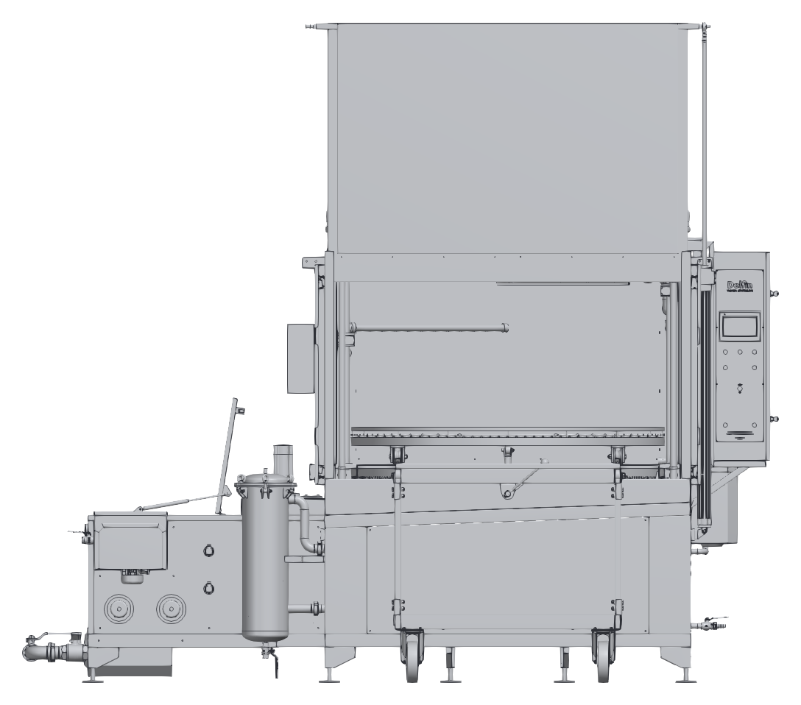
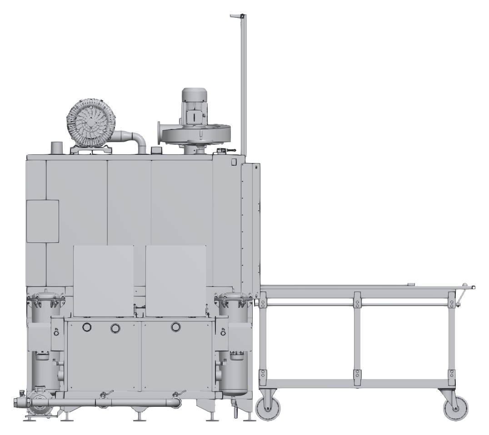
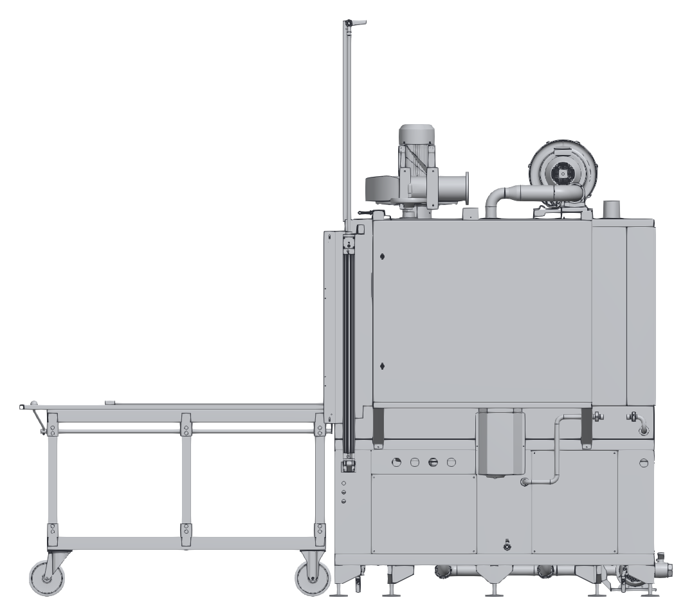
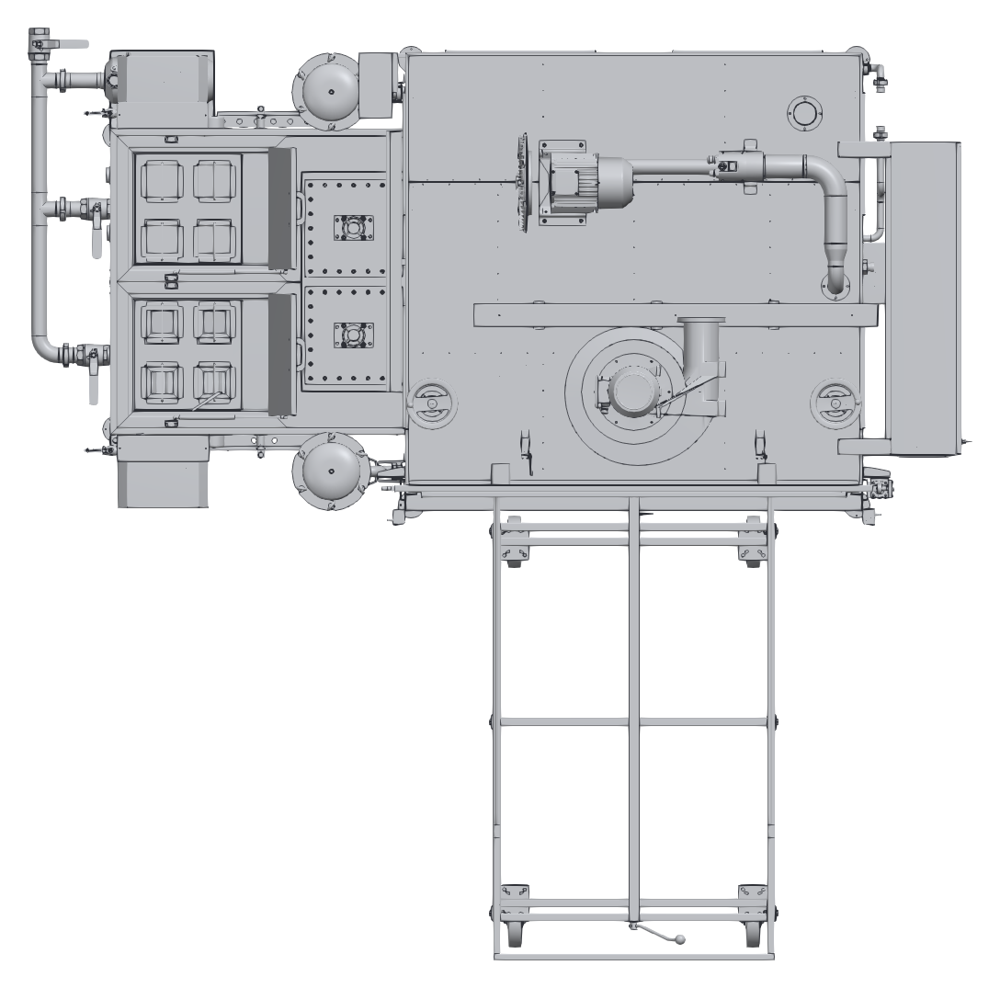

# 13.2 Teknik resimler ve şemalar

Bu alt bölümdeki görünüşler KBN 2B OTO P DS 1650 modeline aittir; kapak açık konumda ve taşıma arabası kapağın önüne yanaştırılmış olarak gösterilmiştir. Diğer modellerde ölçüler ve bazı bileşenlerin konumu farklı olabilir; makinenize ait ölçüler için **Bkz. Bölüm 3.3.2**.

---

## 13.2.1 Ön görünüş

---

## 13.2.2 Sol yan görünüş

---

## 13.2.3 Sağ yan görünüş

---

## 13.2.4 Üst görünüş

---

## 13.2.5 Elektrik devre şeması ve pnömatik şema

Elektrik devre şeması ve pnömatik şema makineyle birlikte ayrı dokümanlar olarak teslim edilir (**Bkz. Bölüm 13.1**).
